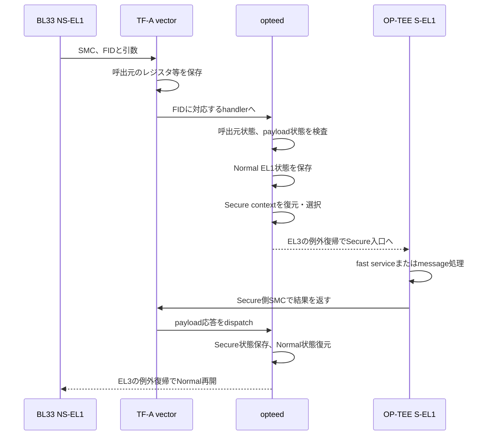

# TF-A 実行時ソフトウェア仕様・利用ガイド

対象版と全体構成は[00_README](00_README.md)を参照。コード例は説明用であり、そのまま製品用のmonitorとなるものではない。ビルド・ロード手順は対象外。

## 目次

- [1. TF-Aは何のためにあるか](#section-01)
- [2. EL、Security State、contextの違い](#section-02)
- [3. SMCを呼ぶとは何か](#section-03)
- [4. NS-EL1→EL3→S-EL1の詳細](#section-04)
- [5. アプリからTF-Aを使う方法](#section-05)
- [6. TF-A内部のruntime service framework](#section-06)
- [7. context management libraryをどこで使うか](#section-07)
- [8. PSCIとOP-TEE呼出しの違い](#section-08)
- [9. 割込み・同期例外・SError](#section-09)
- [10. 独自機能をどこへ置くか](#section-10)
- [11. 測定時に含まれる処理](#section-11)
- [12. 読解・障害解析の順番](#section-12)
- [13. レビューで答える質問](#section-13)
- [14. 根拠ソースと公式資料](#section-14)
- [コード索引](#section-15)

<a id="section-01"></a>

## 1. TF-Aは何のためにあるか

### 1.1 今回の役割

TF-AはArm向けの信頼するfirmware基盤である。今回実行するBL31はEL3に常駐し、SMCを受け、電源管理サービスやSecure payloadへの処理移譲を仲介する。

EL3は「重要な処理なら何でも実装する場所」ではない。EL3が破られると下位の分離全体へ影響するため、通常の業務処理・データ解析・ログ整形・TA認可は下位の適切な層へ置く。

|必要なこと|TF-A BL31が担うこと|BL31だけでは担わないこと|
|---|---|---|
|Normal→Secure|EL3受付、dispatcher、context切替|TAのcommandの意味の検査|
|CPU電源管理|PSCIとplatform連携|アプリの仕事の完了保証|
|例外処理|EL3に配送された例外の処理|任意の不正アクセスの安全な回復|
|Secure起動支援|Secure payload初期化への連携|今回のJTAG経路におけるimage認証の保証|
|メモリ保護|platform初期化との連携|XMPU・DMA・PL全経路の自動保護|

### 1.2 TF-Aの全ステージと今回使うもの

|名称|一般的な役割|今回|
|---|---|---|
|BL1|最初の信頼する起動処理|この評価の通常ロード経路にはない|
|BL2|次段imageのロード・認証等|この評価の通常ロード経路にはない|
|BL31|EL3 runtime firmware|TF-A|
|BL32|Secure payload|OP-TEE。TF-A自身と同一プログラムではない|
|BL33|Non-secure payload|Standalone試験プログラム|

ステージ番号は常駐タスクの番号ではなく起動構成の役割名。SoCではBootROM・FSBL・PMUFWなどが別途関係する。TF-Aを採用していることだけでBL1/BL2/TBBを使用したとはしない。

<a id="section-02"></a>

## 2. EL、Security State、contextの違い

|概念|意味|注意|
|---|---|---|
|EL1|OS／今回のBL33が使う例外レベル|EL1だけではSecureか分からない|
|S-EL1|Secure EL1|OP-TEE Core／PTA|
|NS-EL1|Non-secure EL1|今回のBL33試験実行|
|EL3|Secure Monitorの実行レベル|通常のTAはここでは動かない|
|context|再開に必要な状態の集合|汎用レジスタ、EL1設定、EL3の復帰情報等|

`CurrentEL`はレベルの確認であり、Security Stateを返すレジスタではない。`SCR_EL3.NS`は下位ELへ戻る際のSecurity State選択に関係し、EL3自身をNormalアプリのように分類する値ではない。

<a id="section-03"></a>

## 3. SMCを呼ぶとは何か

### 3.1 命令とインターフェース

`smc #0`はSecure Monitor Call例外を発生させる。通常、今回のNS-EL1からEL3へ入り、x0のFunction IDに応じたサービスを選ぶ。SMCを実行しただけではOP-TEEへ到達したことにもTA実行成功にもならない。EL2等の設定によるtrap条件も別途存在する。

SMCCCはFunction ID、引数・戻りレジスタ等の呼出し規約。OP-TEE message ABIは、その上でTA要求を表現する別の契約である。

|項目|意味|
|---|---|
|x0／w0|SMC Function ID|
|x1以降|サービスが定める引数|
|SMC直後のx0以降|サービスが定める応答|
|共有メモリ|レジスタへ収まらない要求やデータの受渡し|
|`#0`|SMC命令の即値。TA command IDではない|

### 3.2 Function IDの構成

|bit|意味|
|---|---|
|31|fast=1、yielding=0|
|30|SMC64=1、SMC32=0|
|29:24|Owning Entity Number（OEN）|
|23:16|予約領域や規約上のhint等。使用版の定義を確認し、独自の機能番号へ転用しない|
|15:0|機能番号|

SMC32は「AArch32のCPU命令しか使えない」という意味ではない。AArch64からも呼べる。引数の幅と解釈をサービス規約に合わせる。OP-TEEのCALL_WITH_ARGはSMC32形式でもPAを二つの32bit部分に分けて運べる。

### 3.3 今回の具体的な呼出し

|Function ID|意味|TA実行|
|---|---|---|
|`0xb2000009`|OP-TEE EXCHANGE_CAPABILITIES|なし|
|`0xb2000007`|OP-TEE GET_SHM_CONFIG|なし|
|`0x32000004`|OP-TEE CALL_WITH_ARG|messageの内容に応じてOpen/Invoke/Close|
|`0x32000003`|OP-TEE RETURN_FROM_RPC|中断中のCore処理を再開|
|`0x80000000`|SMCCC_VERSION|なし|
|`0x84000000`|PSCI_VERSION|なし|

x0に渡す値と、messageの`cmd`、TAのcommand IDは三つの異なる番号である。未知FIDを呼んだときの`SMC_UNK`と、TAの`TEE_ERROR_NOT_SUPPORTED`も違う。

<a id="section-04"></a>

## 4. NS-EL1→EL3→S-EL1の詳細



EL3のC関数が通常のC `return`だけで別WorldのC関数へ直接戻るわけではない。選択したcontextと復帰情報を、ASMの共通出口が用いて`eret`する。

### 4.1 何を保存するか

|状態|必要な理由|担当例|
|---|---|---|
|汎用レジスタ|引数・戻り値・再開状態|runtime exception framework|
|EL1 system register群|各WorldのMMU・例外・実行環境を分ける|context management|
|ELR_EL3|どのPCへ戻るか|EL3復帰context|
|SPSR_EL3|どのEL・状態・マスクで戻るか|EL3復帰context|
|SCR_EL3等|戻り先のSecurity State等を選ぶ|context/platform処理|
|追加機能の状態|構成で有効なCPU機能に対応|版・設定依存|

「すべてのレジスタを無条件に保存する」とは説明しない。SMCCCの契約、CPU機能、設定、呼出し種別に応じた保存対象がある。

### 4.2 opteedがしていること

opteedはOP-TEE用のSecure Payload Dispatcher。今回のBL31に組み込まれる。TAを実装するためのライブラリではない。

- Normalからの有効なOP-TEE callをSecure payloadへ渡す。
- Secure側の初期化完了やcall完了、割込み等の復帰経路を処理する。
- 各CPUのOP-TEE contextと実行状態を管理する。
- 必要なEL1 contextの保存・復元と、次に戻るcontextの選択を行う。

opteedを通過しただけではTAが呼ばれたとは限らない。GET_SHM_CONFIGはCoreのfast serviceで終わる。RPCでNormalへ戻る場合も、TA commandはまだ完了していない。

<a id="section-05"></a>

## 5. アプリからTF-Aを使う方法

### 5.1 直接使うものと間接利用するもの

|利用者|通常の使い方|
|---|---|
|今回のBL33|`smc_call()`から既定FIDを呼ぶ|
|Linuxアプリ|通常はOSのdriver/APIを通じ、任意SMCを直接実行しない|
|User TA|通常の暗号・保存・TA間通信はTEE APIを使い、独自SMCを直接発行しない|
|Core driver|必要なplatform serviceがあれば定義されたSMCを利用|
|TF-A拡張実装者|runtime serviceとplatform hookを実装|

### 5.2 今回のSMC wrapperの読み方

`runtime/arch.c:smc_call()`はAArch64レジスタへFIDと引数を配置しSMCを実行し、戻り値を`struct smc_result`へ格納する。構造体のx0〜x3はCoreのTA結果構造体ではなくSMC応答レジスタである。

呼出し側は次を決める。

1. このFIDが今回のfirmwareで提供されているか。
2. 引数が数値か、PAか、サイズか。
3. 戻り値が終了なのかRPC等の中間状態か。
4. 不明・失敗時に再試行可能か。
5. 同じ要求bufferを再利用してよいか。

メモリの順序保証とcache整合は別問題。`dsb`をSMCの前後に置けば全条件でデータを共有できる、とは扱わない。

<a id="section-06"></a>

## 6. TF-A内部のruntime service framework

### 6.1 サービス登録

`DECLARE_RT_SVC`はOEN範囲、call type、初期化関数、SMC handlerを記述する。宣言はEL3 runtime service frameworkに登録され、FIDからhandlerへdispatchされる。

|要素|意味|
|---|---|
|name|登録するサービスの内部名|
|start_oen／end_oen|受け付けるowner番号の範囲|
|call_type|fastかyieldingか|
|init|runtime service初期化callback|
|handle|SMC処理callback|

同じowner/call typeの登録範囲を勝手に重ねない。OP-TEE用owner領域へ独自FIDを追加しておけばよい、という設計にはしない。SMCCC上のowner割当とplatformの予約規則に従う。

### 6.2 SMC handlerの引数

説明用の型の形は次のとおり。

```c
uintptr_t service_handler(uint32_t smc_fid,
                          u_register_t x1, u_register_t x2,
                          u_register_t x3, u_register_t x4,
                          void *cookie, void *handle,
                          u_register_t flags);
```

|引数|意味・使い方|
|---|---|
|smc_fid|受付対象FIDを検査する|
|x1〜x4|サービスが定義した引数|
|cookie|framework予約用途。アプリの認証tokenとみなさない|
|handle|呼出元context。通常の任意buffer pointerではない|
|flags|frameworkが渡す呼出元状態の情報|

`flags`へ渡る呼出元Security Stateを調べるには、使用版の`is_caller_non_secure()`等を使う。これは「そのNormalプログラムが正規品か」を認証する仕組みではない。

### 6.3 戻り値の返し方

|API／macro|役割|
|---|---|
|`SMC_RET1(handle, v0)`|戻りレジスタ1個を設定してframeworkへ戻る|
|`SMC_RET2`〜`SMC_RET4`等|複数レジスタを返す|
|`SMC_GET_GP(handle, CTX_GPREG_Xn)`|保存contextから追加引数等を取得|
|`SMC_UNK`|未知・非対応FIDの応答|

C関数の`uintptr_t`戻り値を、サービス結果の数値そのものとして雑に返さない。frameworkのmacroを使い、保存contextと出口の契約を保つ。

### 6.4 独自serviceで検査するもの

- FID、呼出元World、引数幅、許可operation。
- pointer引数を受ける場合のPA範囲、長さ、overflow、共有可能性、alias。
- memory attributeとcache整合、実行中に入力が変わる可能性。
- 再入、複数CPU、割込み、途中状態での失敗。
- ログへ秘密を出していないか。

「EL3なら任意のPAを安全に読める」とは扱わない。未写像・存在しないデバイス・保護違反・SError等が発生し得る。

<a id="section-07"></a>

## 7. context management libraryをどこで使うか

|関数群|用途|使用する層|
|---|---|---|
|`cm_get_context()`|WorldごとのCPU context参照|dispatcher／EL3|
|`cm_set_context()`|contextの関連付け|dispatcher初期化等|
|`cm_el1_sysregs_context_save()`|下位ELのsystem registerを保存|World切替|
|`cm_el1_sysregs_context_restore()`|戻るWorldの状態を復元|World切替|
|`cm_set_next_eret_context()`|次に例外復帰するcontextを選ぶ|dispatcher|

これらをUser TAのコードへincludeして呼ぶことはできない。今回のTA変更に必要なのは主としてTEE APIであり、TF-A contextの変更ではない。

切替処理の順番は既存dispatcherを根拠に読む。保存前に別Worldの値をrestoreしたり、ELR/SPSRだけ書いてGPRやEL1状態を揃えなかったりすると、間違った状態で再開する。

<a id="section-08"></a>

## 8. PSCIとOP-TEE呼出しの違い

PSCIはCPU_ON、CPU_OFF、CPU_SUSPEND、SYSTEM_RESET等の電源・CPU制御を扱う標準interface。TA commandとは別のサービス群である。

|例|意味|注意|
|---|---|---|
|VERSION問い合わせ|実装versionを取得|電源遷移成功の証拠ではない|
|CPU_ON|対象CPUの起動を要求|入口PA、context引数、対象CPU状態等が必要|
|SYSTEM_RESET|システム再起動要求|証跡を失う副作用がある|

本書は電源操作をそのまま実行するサンプルを示さない。新しい機能を使うときは、platform supportと実行中資源への影響を確認する。

<a id="section-09"></a>

## 9. 割込み・同期例外・SError

### 9.1 全例外がTF-Aへ入るわけではない

|発生したもの|主な経路の例|
|---|---|
|NS-EL1での同期Data Abort|BL33のEL1同期例外handler|
|User TAのアクセスfault|OP-TEE Coreの下位EL例外handler|
|SMC|EL3へ。条件によってEL2 trap等も考慮|
|SError|routingとmaskに応じたELへ|

現在のEL、例外のsource、SCR/HCR、DAIF、GIC等によって処理先が変わる。FIQ=常にSecure、IRQ=常にNormalとはしない。

### 9.2 pending非同期エラー

同期Abortは問題の命令と結び付けて処理しやすい。SErrorは遅れて受理され、保存PCが原因命令を直接示すとは限らない。FARもSErrorの原因PAを特定するために無条件には使えない。

`DAIFSet`は指定した例外をmaskし、`DAIFClr`はmaskを解除する。A bitの解除直後にSErrorを受けた場合、それは保留エラーを受け付けた経路と整合するが、解除命令が元のメモリエラーを発生させた証拠ではない。

### 9.3 TF-Aのエラー反映

使用版の`runtime_exceptions.S`には保留async external abortを下位ELへ反映する処理がある。`reflect_pending_async_ea_to_lower_el`へ到達した記録だけで、EL3が最終停止したと断定しない。その後どのWorld/ELへ戻り、どのvectorを通り、最終的にどのpanic/fatalへ入ったかを区別する。

- TAの`TEE_Panic()`：TAの異常終了。
- OP-TEE Coreのpanic：Secure OS側の異常。
- TF-Aのplatform panic：EL3側の異常。
- BL33の`fatal_exception()`：Normalの試験側の異常。

同じ「止まった」でも保護能力と可用性の評価は異なる。

### 9.4 今回の報告済み観測の扱い

利用者の2026-11-12の観測では、read同期Abortからの復帰、Coreによる非改変確認、その後write試行、EL1 SError vector、BL33のFatal記録が得られた。古いTF-A停止観測と一つのrunへ混ぜない。本書は観測を再検証していない。

<a id="section-10"></a>

## 10. 独自機能をどこへ置くか

|追加したい処理|通常の候補|理由|
|---|---|---|
|鍵を使った署名・復号サービス|User TA|TEE APIで資源を管理できる|
|TAから使う専用ハードウェア機能|Core driver＋必要ならPTA|特権MMIOを扱うため|
|新しいEL3固有のsystem control|TF-A runtime service|EL3権限が必要な場合に限定|
|操作の画面表示・要求生成|Normal側アプリ|保護境界外の利用側|
|製品固有の認可|主にTA／Secure service|Normal側のチェックだけでは強制できない|
|大量のログ解析・整形|Normal側またはPC|EL3に複雑処理を持ち込まない|

独自SMCは公開インターフェースを増やし、引数検査・互換性・将来の更新責任が増える。既存TA APIで足りるなら、EL3を拡張しない設計から検討する。

<a id="section-11"></a>

## 11. 測定時に含まれる処理

|測定|含まれるもの|含まれないと決め付けないもの|
|---|---|---|
|GET_SHM_CONFIG往復|SMC入口出口、TF-A、Core fast service、wrapper|純粋なCPU切替命令だけではない|
|TA ECHO往復|message作成、World切替、Core検査、TA dispatch、比較|暗号単体性能ではない|
|最小baremetal Secure payload|自作monitorの保存復元とpayload|TrustZone全実装共通の固定時間ではない|

Normalで開始counterを読み、戻ってから終了counterを読むと往復測定。片道はSecure側にもtimestampが必要で、同一時刻基準・offsetを確認する。往復を単純に2で割って片道を断定しない。BP付きrunを正式な性能測定へ流用しない。

<a id="section-12"></a>

## 12. 読解・障害解析の順番

1. 呼んだFID、引数、共有PAを特定する。
2. SMCを実行したか、EL3入口へ届いたかを分ける。
3. handlerが未知FID／呼出元拒否／payload状態不正で返していないかを見る。
4. Secure入口まで届いたか、fast/service/TAのどこで止まったかを見る。
5. RPCで戻ったのか、完了で戻ったのかを見る。
6. Normal復帰先、result、後始末を確認する。
7. faultならEL/World/vector/ESR/ELRを先に決め、別runを混ぜない。

|症状|最初に見るもの|
|---|---|
|SMC_UNK|FID、OEN、fast/yielding、登録service|
|OP-TEEへ進まない|opteed初期化、payload entry、context|
|戻り先がおかしい|ELR/SPSR、保存context、ASM ABI|
|特定SMCだけ停止|pending error、対象serviceの入力、例外routing|
|PCがidle/wfe|正常終了、fatal、待機のどれか。関数名だけでは決めない|

<a id="section-13"></a>

## 13. レビューで答える質問

|質問|説明の要点|
|---|---|
|TF-AはOSか|通常アプリのOSではなく、今回のBL31はEL3 runtime firmware|
|SMCで直接TAへ飛ぶか|EL3→Core→TAの管理経路を通る|
|TF-AがTAの利用権限を決めるか|World等の検査はするが製品のTA command認可は主にTA側|
|TF-A導入でSecure Bootになるか|今回のJTAG構成は起動imageの信頼chainを実証していない|
|EL3へ処理を置けば最も安全か|権限が高く影響も大きい。必要最小限にする|
|なぜ状態保存が要るか|両Worldが同じCPUを別の実行環境として使うから|

<a id="section-14"></a>

## 14. 根拠ソースと公式資料

固定版ソースの読む場所は末尾の「コード索引」を参照。

- Arm [TrustZone for Armv8-A](https://developer.arm.com/-/media/Arm%20Developer%20Community/PDF/Learn%20the%20Architecture/TrustZone%20for%20Armv8-A.pdf)：EL3、Security State、SMCの基礎。
- TF-A [EL3 Runtime Service Writer’s Guide](https://trustedfirmware-a.readthedocs.io/en/latest/getting_started/rt-svc-writers-guide.html)：service宣言・handlerの契約。最新Web版のRealm等はA53へ適用しない。
- 固定版`docs/getting_started/rt-svc-writers-guide.rst`：本書のruntime service契約の主根拠。
- 固定版`docs/design/firmware-design.rst`：起動とruntimeの設計。

本書で示すTF-A内部APIは公開アプリAPIではなく、使用版の実装に依存する。独自変更の動作・securityはソース説明だけでは保証できない。

<a id="section-15"></a>

## コード索引

|参照先|確認する実装|
|---|---|
|[runtime/arch.c：struct smc_result smc_call](https://github.com/ririmon22/trustzone-validation/blob/7e51908c64e35808139845c8a07c05f0ca511dab/runtime/arch.c#L24)|`struct smc_result smc_call`の周辺を読む。本文の役割・API契約と照合する|
|[normal_world/client/client.c：static struct tee_reply transport_call](https://github.com/ririmon22/trustzone-validation/blob/7e51908c64e35808139845c8a07c05f0ca511dab/normal_world/client/client.c#L71)|`static struct tee_reply transport_call`の周辺を読む。本文の役割・API契約と照合する|
|[services/spd/opteed/opteed_main.c：static uintptr_t opteed_smc_handler](https://github.com/Xilinx/arm-trusted-firmware/blob/dd3512287a17eea866d5c82fa7b86ad58de59163/services/spd/opteed/opteed_main.c#L597)|`static uintptr_t opteed_smc_handler`の周辺を読む。本文の役割・API契約と照合する|
|[services/spd/opteed/opteed_main.c：DECLARE_RT_SVC(](https://github.com/Xilinx/arm-trusted-firmware/blob/dd3512287a17eea866d5c82fa7b86ad58de59163/services/spd/opteed/opteed_main.c#L839)|`DECLARE_RT_SVC(`の周辺を読む。本文の役割・API契約と照合する|
|[include/common/runtime_svc.h：rt_svc_handle_t](https://github.com/Xilinx/arm-trusted-firmware/blob/dd3512287a17eea866d5c82fa7b86ad58de59163/include/common/runtime_svc.h#L53)|`rt_svc_handle_t`の周辺を読む。本文の役割・API契約と照合する|
|[include/arch/aarch64/smccc_helpers.h：SMC_RET1](https://github.com/Xilinx/arm-trusted-firmware/blob/dd3512287a17eea866d5c82fa7b86ad58de59163/include/arch/aarch64/smccc_helpers.h#L36)|`SMC_RET1`の周辺を読む。本文の役割・API契約と照合する|
|[lib/el3_runtime/aarch64/context_mgmt.c：cm_el1_sysregs_context_save(](https://github.com/Xilinx/arm-trusted-firmware/blob/dd3512287a17eea866d5c82fa7b86ad58de59163/lib/el3_runtime/aarch64/context_mgmt.c#L1888)|`cm_el1_sysregs_context_save(`の周辺を読む。本文の役割・API契約と照合する|
|[lib/el3_runtime/aarch64/context_mgmt.c：void cm_set_next_eret_context](https://github.com/Xilinx/arm-trusted-firmware/blob/dd3512287a17eea866d5c82fa7b86ad58de59163/lib/el3_runtime/aarch64/context_mgmt.c#L2015)|`void cm_set_next_eret_context`の周辺を読む。本文の役割・API契約と照合する|
|[plat/xilinx/zynqmp/bl31_zynqmp_setup.c：bl31_early_platform_setup2](https://github.com/Xilinx/arm-trusted-firmware/blob/dd3512287a17eea866d5c82fa7b86ad58de59163/plat/xilinx/zynqmp/bl31_zynqmp_setup.c#L73)|`bl31_early_platform_setup2`の周辺を読む。本文の役割・API契約と照合する|
|[bl31/aarch64/runtime_exceptions.S：func reflect_pending_async_ea_to_lower_el](https://github.com/Xilinx/arm-trusted-firmware/blob/dd3512287a17eea866d5c82fa7b86ad58de59163/bl31/aarch64/runtime_exceptions.S#L649)|`func reflect_pending_async_ea_to_lower_el`の周辺を読む。本文の役割・API契約と照合する|
|[docs/getting_started/rt-svc-writers-guide.rst：DECLARE_RT_SVC](https://github.com/Xilinx/arm-trusted-firmware/blob/dd3512287a17eea866d5c82fa7b86ad58de59163/docs/getting_started/rt-svc-writers-guide.rst#L94)|`DECLARE_RT_SVC`の周辺を読む。本文の役割・API契約と照合する|
|[docs/design/firmware-design.rst：Lower EL Exceptions](https://github.com/Xilinx/arm-trusted-firmware/blob/dd3512287a17eea866d5c82fa7b86ad58de59163/docs/design/firmware-design.rst#L1193)|`Lower EL Exceptions`の周辺を読む。本文の役割・API契約と照合する|

## 作成時の確認範囲

固定版ソースとAPI宣言、本文のコードリンク・章リンク、Mermaidの構造を照合した。Linux clientの独立例はoptee_client 4.5.0の実headerを使ったC11構文検査を通過した。TA/PTA/TF-A例は利用箇所や前提を示す抜粋を含み、全体リンク・実機動作は未実施。図のMermaidレンダリングは未確認。手元のローカル修正・ロード済みimage・実機ログの一致確認は本資料の検証に含まれない。
