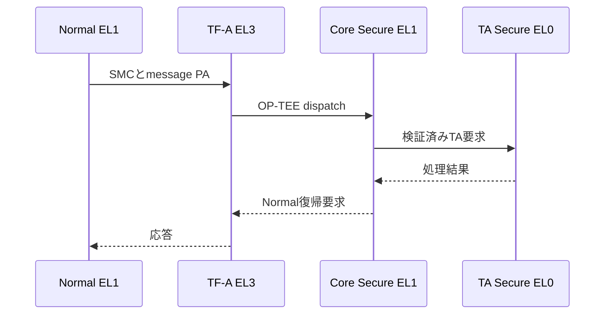

# 02：EL・Security State・例外・SMC

対象：ZCU106 B2 / TF-A + OP-TEE + Standalone BL33。作成日：2026-11-08。  
確認commit：`70bc1c288c962c3368ca53295a146db690213d8b`。基本原理と対象実装を区別し、実機結果は未再確認。  
[全体案内へ](00_README.md)

## 1. 権限とSecurity Stateは二つの軸

ELはCPUの例外レベル。Security StateはSecure/Non-secure等の区別。**EL1だからSecure、EL0だからNormalという対応はない。** 今回のCortex-A53構成について次を押さえる。新しいArmのRealm等は対象外。

| 実行主体 | EL | Security State | 役割 |
|---|---|---|---|
| TF-A BL31 | EL3 | EL3 monitor | 起動引渡しとWorld切替 |
| OP-TEE Core/PTA | EL1 | Secure | TA管理、MMU、Coreサービス |
| user TA-A/B・署名TA | EL0 | Secure | 検証サービス |
| Standalone BL33 | EL1 | Non-secure | 試験・client・ログ |
| BL33受取り時の候補 | EL2 | Non-secure | 起動ASMがEL1へ下ろす経路 |

SecureのEL0 TAはSecureであってもCoreへ自由にアクセスできるわけではない。Coreが設定する仮想空間と権限で分離される。Normal EL1も特権ではあるが、Secureメモリの保護を自由に越えられる意味ではない。

CurrentELだけからSecurity Stateを判定できない。EL、制御レジスタ、引渡し経路、対象Worldでの観測を結び付ける。

## 2. 命令が実行状態を変える境界

| 命令/処理 | 主な用途 | 単なるC呼出しとの違い |
|---|---|---|
| BL/BLR | 通常の関数呼出し | 通常はEL/Worldを変えない |
| RET | 通常の関数復帰 | LR等で戻る。SPSR復元ではない |
| SVC | syscall等の同期例外 | 例外入口へ制御を移す |
| SMC | monitorへの同期例外 | 今回はEL3を通じてSecureへ依頼 |
| ERET | 例外復帰 | ELR/SPSR等に基づいて状態と制御を戻す |

この表は今回の意図した構成。SMCが常に無条件で同じELへ届くとはせず、仮想化のtrap設定等は別途確認する。

OS学習で扱った「syscall終了時にもう一度例外を起こしてユーザーへ戻る」は正確には違い、典型的には例外復帰命令で状態を戻す。今回のEL2→EL1もERETの利用例。

## 3. 起動時EL2→EL1

bl33_start.SはCurrentELの符号化値8/4を比較する。通常のEL番号へ直すとEL2/EL1。EL2経路では次の準備をする。

1. HCR_EL2.RWでEL1をAArch64に設定する。
2. HCR/VTTBR/VTCR等をx19〜x22へ記録する。
3. counter/timerの利用条件を整える。
4. SCTLR_EL1をMMU/cache無効の初期値へ設定する。
5. SP_EL1へ__stack_topを設定する。
6. ELR_EL2へstart_el1、SPSR_EL2へDAIF全マスク・EL1hの状態を置く。
7. ISB後にERETする。

ERETは「例外で上がる前に戻る」場合だけでなく、起動側が適切な状態を用意して下位ELへ移るときにも使える。ここでWorldをSecureへ変える処理ではなく、Normal側内のEL移行。

EL1直接入口ではEL2経路を通らない。EL1h/SP選択、cache/MMU、上位EL状態などをCurrentEL確認だけで既知にしない。debug_handoff.el2_known=0なら物理試験は必要なEL2状態の証拠が足りないと扱う。

## 4. 例外は異常だけではない

例外は通常命令列から所定の処理へ制御を移す仕組み。SVC/SMCのような意図的要求も例外。メモリ異常、IRQ、FIQ、SErrorは原因と通知時点が異なる。

| 種類 | 例 | 今回の読み方 |
|---|---|---|
| 同期例外 | load/store異常、SVC、SMC | 原因となる命令との関係を追う |
| IRQ | timer/device割込み | 今回の通常試験ではマスク状態等を記録 |
| FIQ | 別系統の割込み | Secure/Normalへのrouting等に依存 |
| SError | システムの非同期エラー通知 | 通知PCをそのまま原因load/storeと断定しない |

同期例外でも、ELRがどの位置を表すかは例外種別による。Data Abortのfault命令と、SVC後の復帰位置を一律に扱わない。

## 5. 例外ベクタテーブル

AArch64ではVBAR_ELxがベクタテーブル先頭。入口は種類と発生元の状態で選ばれる。関数ポインタを並べるだけの表ではなく、今回のASMは各slotへbranch命令等を置く。

Cortex-A53で扱う基本形は4グループ×4種類、各slot 0x80=128バイト、表の配置整列は2KiB。

| グループ | Sync | IRQ | FIQ | SError |
|---|---|---|---|---|
| 現在EL、SP_EL0使用 | +0x000 | +0x080 | +0x100 | +0x180 |
| 現在EL、SP_ELx使用 | +0x200 | +0x280 | +0x300 | +0x380 |
| 下位EL、AArch64 | +0x400 | +0x480 | +0x500 | +0x580 |
| 下位EL、AArch32 | +0x600 | +0x680 | +0x700 | +0x780 |

今回のBL33はEL1hの同期例外用、slot4=+0x200をel1_syncへ向ける。他のslotはFATAL_VECTOR。したがって「全例外がhandle_el1_syncで回復する」とは違う。

linker_bl33.ldはvectorを4KiB境界の専用RX領域へ置く。2KiB表整列のアーキテクチャ要件と、4KiBページで権限分離する設計要件が重なる。

## 6. 例外時、CPUがすることとASMがすること

| 情報/処理 | 担当 |
|---|---|
| 復帰用PCをELR_ELxへ | CPUの例外機構 |
| 元のPSTATEをSPSR_ELxへ | CPUの例外機構 |
| syndrome等の更新 | 例外種別に応じCPU |
| x0〜x30をRAMへ退避 | 今回のASM |
| ESR/FAR/ELR等を固定レコードへコピー | 今回のcaptureマクロ |
| 回復可能性の判定 | el1_fault.c等 |
| 汎用レジスタの復元 | 今回のASM |
| ELR/SPSRに従う復帰 | ERET |

**AArch64の例外で、Cortex-Mのような汎用レジスタのstack自動保存を前提にしない。** CPUが必要情報をsystem registerへ持つことと、全コンテキストの保存は別。

## 7. 原因を読むレジスタ

| レジスタ | 意味 | 注意 |
|---|---|---|
| ESR_EL1 | 例外種別と詳細理由 | EC/ISSを例外種別に応じて解釈 |
| FAR_EL1 | 障害VA等 | 有効性と例外種別を確認 |
| ELR_EL1 | 保存された復帰位置 | 原因PCとの関係は種別依存 |
| SPSR_EL1 | 元の状態 | EL/SP選択、DAIF、flags等の解釈 |
| VBAR_EL1 | ベクタ先頭 | 適切なmapping/整列が必要 |
| SP/SP_EL0/SP_EL1 | stack位置 | 現在使っているSPとbankの差 |
| SCTLR_EL1 | MMU/cache等の状態 | fault時の前提照合 |

Data AbortではECの0x24は下位ELから、0x25は同じELからの例。今回Normal EL1のprobeは0x25を要求する。DFSCにはTranslation/Permission/External Abort等の違いがある。FARが0なら「0番地が原因」と即断せず有効性・種別を読む。

## 8. 実際のEL1同期例外経路

el1_vectors.Sは256バイトのframeを取り、x0〜x30を保存する。31×8=248バイトに整列分を加え、C呼出しに必要な16バイトSP整列を維持する。

CAPTURE_SYNCはCへ入る前の値をdebug_sync_exceptionへコピーし、handle_el1_sync(esr,pc)を呼ぶ。戻り値が0なら回復不可。非0なら検査済み復帰PCをELR_EL1へ置き、registerを復元してERETする。

想定probeだけ回復する条件は、期待種別、fault PC、FAR、読書き方向、ESR原因等。物理probeはb2_handle_phys_faultへ委譲する。

**単純なPC+4で全部を読み飛ばす設計ではない。** 本当に期待したアクセスで、次の命令へ進んで意味が保てる場合だけ復帰先ラベルを使う。

### 例外が起きたことと、試験PASSは別

ハンドラが回復した後でも、Translation Faultなら物理保護の証拠にできない。回復は「試験を続けて証拠を集められるか」、合否は「その証拠が要求を満たすか」。混ぜない。

## 9. 同期記録と最初の致命記録

debug_sync_exceptionは同期例外の記録で、次のprobeにより更新され得る。debug_exceptionは最初の致命記録を保持する設計。CAPTURE_FATALはSPやC呼出しを使わず記録し、待機する。

validは0/記録途中/完了を区別する。recordがあるだけで全fieldが完全とは限らない。cache cleanや回収タイミングも考慮する。

## 10. SMC：NormalからSecureへ

SMC自体がTAのC関数を直接呼ぶわけではない。FIDでmonitor側のサービスを選び、Coreがsession/parameterを確認し、user TAへ渡す。通常のC ABI、SMCCC、OP-TEE message ABIは層が違う。

今回のarch.cはx0へFID、x1〜x3へ引数を置く。CALL_WITH_ARGではmessageのPAを上位32bitと下位32bitへ分ける。Normal VA=PAという今回の限定前提を、一般的なポインタ転送の規則へ拡張しない。

## 11. TAのfaultとBL33のfault

TAが不正アクセスしても、Normalのel1_vectors.Sが直接そのSecure faultを捕まえるわけではない。OP-TEE側の例外機構が処理し、clientはTARGET_DEAD/origin等として観測する。

BL33のprobeならNormal EL1のベクタへ来る。TF-A EL3やCore Secure EL1のpanicならそれぞれの記録・traceが必要。すべてのPCをBL33 ELFでaddr2lineしない。

## 12. SErrorを扱うときの限界

このcommitは期待した同期Data Abortを限定回復する経路。全SErrorを復帰可能にする実装ではない。非同期通知は原因命令との対応が曖昧になり得て、状態破壊や未完了書込みの扱いも必要になる。

手元でTF-A側のSError処理を変更した場合は、その差分と実レジスタ記録を別に確認する。「同期probeが復帰できたからSErrorもPCを進めればよい」とは説明しない。

## 13. 想定問答と理解確認

| 質問 | 回答の核心 |
|---|---|
| EL1はSecure？ | ELとSecurity Stateは独立。Normal EL1もSecure EL1もある |
| CPUは全部のレジスタをstackへ保存？ | 汎用registerは今回ASMが保存 |
| ERETとRETは同じ？ | ERETは保存状態/ELを含む例外復帰 |
| ベクタはC関数の一覧？ | AArch64のslotには実行する入口命令を置く |
| 例外が来たのでPASS？ | 原因、対象、復帰後、被害側、後始末が必要 |
| DAIFで全不正アクセスを防げる？ | 同期faultを消す機構ではない |
| TA faultはNormalハンドラへ？ | Coreが処理して通常はエラー結果として観測 |
| CurrentELでWorld分かる？ | それだけでは分からない |

練習：VBAR=仮に0x10308000なら、現在EL/SP_ELxの同期入口は0x10308200。これは計算例で実測値ではない。

完成条件：_startからEL1へ入り、SMCでSecureへ要求し、Normal/TAそれぞれでfaultした場合の観測経路を説明できる。

## 補足：今回のASMを読む最小命令表

| 記法 | 読み方 | 今回の意味 |
|---|---|---|
| x0 / w0 | 同じ汎用registerの64bit/下位32bit view | wへの書込みは対応するxの上位32bitをゼロにする |
| xzr / wzr | zero register | 読むと0、書込みは捨てる。SPとは異なる |
| mov | registerへ値を設定/転送 | 初期値・SP等 |
| mrs | system registerから読む | CurrentEL、ESR、SCTLR等 |
| msr | system registerへ書く | VBAR、ELR、SPSR等 |
| ldr / str | メモリからload / メモリへstore | probe、記録保存 |
| ldp / stp | registerを2個まとめてload/store | 例外frameの保存復元 |
| adr / adrp | PC相対でアドレスを組み立てる | symbol位置。ADRPはページ単位の基点 |
| add / sub | 加算/減算 | stack確保、アドレス調整 |
| cmp | 比較して条件flags更新 | EL、境界、保存値 |
| b / b.eq / b.lo | 無条件 / 等しい / unsignedで小さいなら分岐 | 起動分岐、範囲ループ |
| cbz / cbnz | ゼロ / 非ゼロなら分岐 | 回復不可0の判定等 |
| bl | 戻り先をx30へ置いて呼ぶ | clear_bss、Cハンドラ |
| ret | 通常関数復帰 | 呼出し元へ戻る |
| eret | 例外復帰 | ELR/SPSR等へ従い状態を戻す |
| wfe | eventを待つ | 待機ループ。JTAGのhaltそのものではない |
| .global / .section / .balign | アセンブラ指示 | symbol公開、配置先section、整列。CPU命令ではない |

`ldr x0, =symbol`の`=symbol`は擬似命令の書式で、symbolのアドレス/値を取り込む。`ldr x0, [x1]`はx1が指すメモリ内容を読む。リンカsymbolの境界値と、その番地の内容を取り違えない。

`x30`は通常関数のLR、`ELR_EL1`は例外復帰用PC。例外ハンドラ内でCをBLしても元の例外復帰先を失わないよう、それぞれの保存と用途を分ける。

## コード根拠と一次資料

### 今回のソース

- [boot/bl33_start.S](https://github.com/ririmon22/trustzone-validation/blob/70bc1c288c962c3368ca53295a146db690213d8b/boot/bl33_start.S)
- [runtime/el1_vectors.S](https://github.com/ririmon22/trustzone-validation/blob/70bc1c288c962c3368ca53295a146db690213d8b/runtime/el1_vectors.S)
- [runtime/el1_fault.c](https://github.com/ririmon22/trustzone-validation/blob/70bc1c288c962c3368ca53295a146db690213d8b/runtime/el1_fault.c)
- [runtime/include/exception_capture.inc](https://github.com/ririmon22/trustzone-validation/blob/70bc1c288c962c3368ca53295a146db690213d8b/runtime/include/exception_capture.inc)
- [runtime/include/debug_log.h](https://github.com/ririmon22/trustzone-validation/blob/70bc1c288c962c3368ca53295a146db690213d8b/runtime/include/debug_log.h)
- [runtime/arch.c](https://github.com/ririmon22/trustzone-validation/blob/70bc1c288c962c3368ca53295a146db690213d8b/runtime/arch.c)
- [tests/validation/physical_memory.c](https://github.com/ririmon22/trustzone-validation/blob/70bc1c288c962c3368ca53295a146db690213d8b/tests/validation/physical_memory.c)

### 基本原理を確認する資料

- [Arm：AArch64 Exception Model v1.3](https://documentation-service.arm.com/static/67ac57fb091bfc3e0a9479cc)
- [OP-TEE 4.5.0：CoreのWorld contextと例外](https://optee.readthedocs.io/en/4.5.0/architecture/core.html)

外部資料は版や対象CPUで記述が異なる場合がある。AAPCS64の新拡張、一般OS構成、別SoCの設定をCortex-A53の今回構成へ無条件に適用しない。ここに記載した実装上の数値・判定は固定commitのコードを根拠とする。

次：[第03冊](03_MMU_Cache_Barriers.md)
