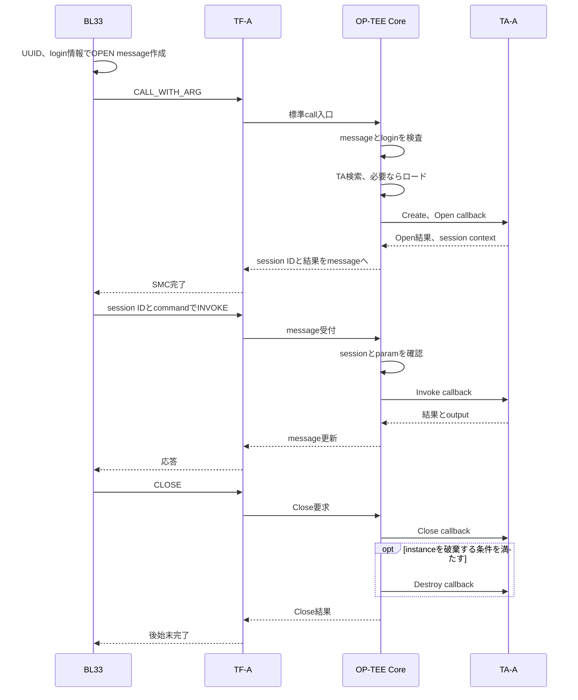
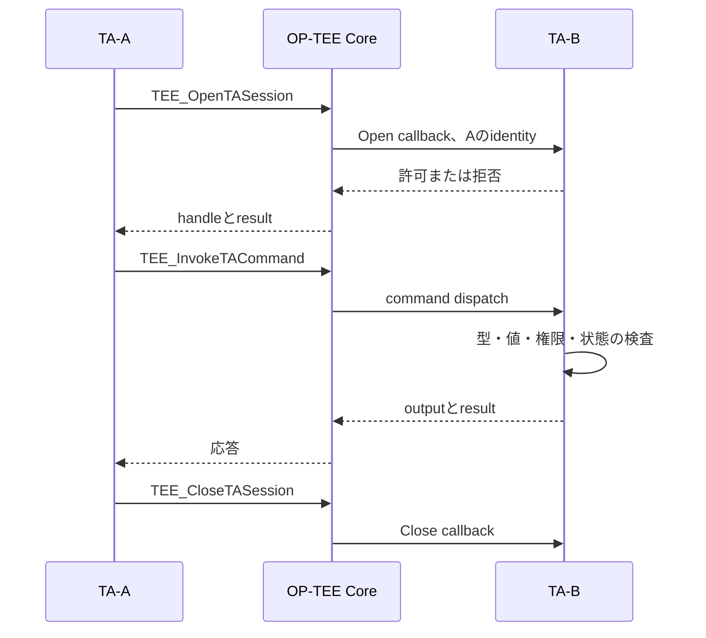
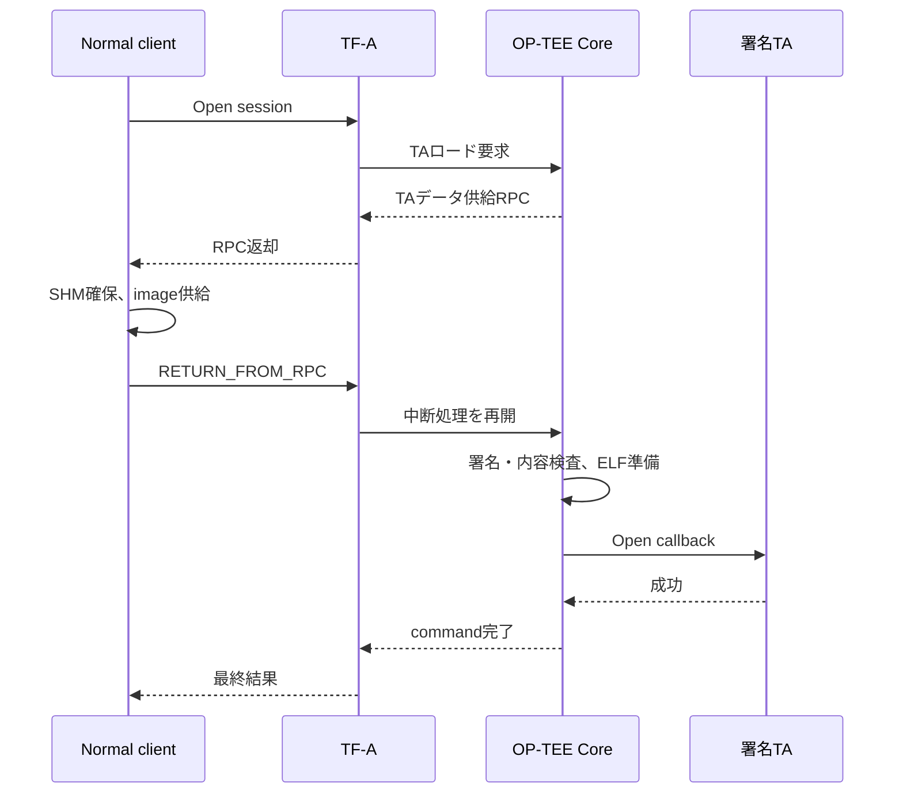

# OP-TEE 実行時ソフトウェア仕様・利用ガイド

対象：OP-TEE OS 4.5.0、AArch64 User TA、ZCU106の今回の構成。版と資料全体の読み方は[00_README](00_README.md)。本書は実行時の使い方を扱い、ビルド手順は扱わない。

## 目次

- [1. OP-TEEが提供するもの](#section-01)
- [2. Core、User TA、PTA、Normalの違い](#section-02)
- [3. Linux標準経路と今回の経路](#section-03)
- [4. UUID、session、instance、context](#section-04)
- [5. TAの5つのentry point](#section-05)
- [6. Normal→TAの詳細シーケンス](#section-06)
- [7. OP-TEE SMCとmessage ABI](#section-07)
- [8. 共有メモリ・cache・TOCTOU](#section-08)
- [9. 返値を三層で読む](#section-09)
- [10. Linux側Client APIの使い方](#section-10)
- [11. TA間通信の使い方](#section-11)
- [12. identity、認証、認可](#section-12)
- [13. TAから使うlibraryの分類](#section-13)
- [14. メモリ・property・時刻API](#section-14)
- [15. 鍵objectと暗号operation](#section-15)
- [16. 今回の鍵の実装を読み解く](#section-16)
- [17. 永続保存API](#section-17)
- [18. Early TA、外部署名TA、ldelf](#section-18)
- [19. RPCを理解する](#section-19)
- [20. trusted thread、同時実行、cancel](#section-20)
- [21. TA fault、panic、復旧](#section-21)
- [22. PTAとCore driverの使い方](#section-22)
- [23. Core内部で要求が処理される場所](#section-23)
- [24. 今回の独自clientの制約](#section-24)
- [25. レビューの確認事項](#section-25)
- [26. 公式資料の入口](#section-26)
- [コード索引](#section-27)

## 1. OP-TEEが提供するもの

OP-TEEはSecure側の実行環境を提供する。Normal側から要求を受け、TAを管理・実行し、暗号や保存等のAPIを提供する。ハードウェアのTrustZone機能を、ソフトウェアから利用するための基盤である。

|提供するもの|意味|自動保証ではないこと|
|---|---|---|
|TA実行環境|TAのロード、仮想空間、entry point|TA自身の処理の安全性|
|session管理|呼出元とTAの論理的な接続|製品の利用権限|
|message検査|型やmemref等の構造的検査|commandの業務上の意味|
|暗号API|鍵object、operation、暗号処理|乱数seedや製品鍵配備の妥当性|
|署名TAロード|信頼鍵に基づくTAの検証|Normal要求者の本人認証|
|保存API|構成したbackendを使う保護保存|backend未構成でも永続化できること|

OP-TEEが使うRAMとhardware interfaceは正しく保護されている必要がある。CoreのMMU設定とSoCのXMPU等は異なる層であり、Core導入だけで全masterの物理アクセスを防いだとはしない。

## 2. Core、User TA、PTA、Normalの違い

|要素|今回の実行位置|役割|使う主なinterface|
|---|---|---|---|
|Normal client|NS-EL1|要求を作り結果を使う|独自client、SMC/message|
|OP-TEE Core|S-EL1|thread、session、TA、VM、syscall管理|Core内部API|
|User TA|S-EL0|保護されたサービス処理|GlobalPlatform Internal Core API|
|PTA|S-EL1、Core内|Core権限が必要なサービス|Core API＋pseudo TA登録|
|ldelf|Secure user modeのloader|User TAのELF写像・再配置等|Coreとのloader用interface|
|libutee|User TA側library|TEE API実装とsyscall wrapper等|TEE API／utee syscall|

Early TAは「Core権限のTA」ではない。埋込み場所がCore image内でも、User TAならS-EL0で実行される。PTAはCoreコードとして動き、User TAと同じ分離境界は持たない。

## 3. Linux標準経路と今回の経路

### 3.1 Linuxを使う一般形

Normalアプリ→libteec→Linux TEE/OP-TEE driver→SMC→TF-A→Core→TA。必要な外部TAやstorage等のRPCは、driverとtee-supplicant等が処理する。

### 3.2 今回のStandalone BL33

BL33→自作`normal_world/client/client.c`→自作SMC wrapper→TF-A→Core→TA。Linux driver、libteec、tee-supplicantは動かしていない。署名TAの供給は`normal_world/client/signed_rpc.c`の限定RPC実装が担当する。

|見た関数|分類|どこを見るか|
|---|---|---|
|`TEEC_OpenSession`|標準Client API|optee_client/libteec|
|`TEE_OpenTASession`|TAから別TA/PTAを呼ぶInternal API|optee_os/libutee|
|`tee_session_open`|今回の独自BL33 client|プロジェクトclient.c|
|`entry_open_session`|Coreのmessage受付|optee_os/core/tee/entry_std.c|
|`TA_OpenSessionEntryPoint`|User TAのcallback|自分のTAソース|

これらは同じ名前の言い換えではなく、呼ぶ場所も引数も異なる。

## 4. UUID、session、instance、context

|用語|意味|よくある誤解|
|---|---|---|
|TA UUID|サービスを識別する公開のID|秘密のpasswordではない|
|session ID|Coreが接続を識別する数値|TAのUUIDそのものではない|
|TA instance|ロードされた実行単位|session数と必ず一致しない|
|session context|TAが接続ごとの状態を保持するpointer|Coreのraw session IDとは別|
|TEEC_Context|Normal clientとTEEの論理接続|TA instanceやCPU contextと別|
|TEE_ObjectHandle|鍵や保存objectへの参照|鍵のバイト列ではない|

同じUUIDへ2回Openすると、別sessionを得ることができる。TA instanceを共有するかはTA属性による。

### 4.1 instance属性

|属性|役割|注意|
|---|---|---|
|SINGLE_INSTANCE|単一instanceを共有する構成|共有するglobal状態の設計が必要|
|MULTI_SESSION|同じinstanceが複数sessionを受ける構成|globalとsession状態を混同しない|
|INSTANCE_KEEP_ALIVE|最後のsession終了後もinstanceを保持する構成|Closeごとにglobalが初期化されるとは限らない|

属性の組合せとCoreの実装に従って寿命が決まる。今回の外部署名TAはflags=0で、Close後に新instanceでcounterが1になることを検査している。これを全TAの一般挙動にしない。

## 5. TAの5つのentry point

|callback|呼ばれる契機|実装すること|失敗時の考え方|
|---|---|---|---|
|`TA_CreateEntryPoint`|instance生成|instance共通object、初期状態|途中確保を片付け、エラーを返す|
|`TA_DestroyEntryPoint`|instance破棄|instance共通資源の解放|panic時も必ず普通の終了順で呼ばれると期待しない|
|`TA_OpenSessionEntryPoint`|session確立要求|入力型、identity、接続許可、session context作成|確保途中を解放し接続を拒否|
|`TA_CloseSessionEntryPoint`|session終了|その接続のcontext解放|別sessionの状態を壊さない|
|`TA_InvokeCommandEntryPoint`|既存sessionへのcommand|command分岐、型、値、権限、状態、処理|意図したエラーを返す|

### 5.1 globalとsessionの分け方

今回の`session_context.authenticated`と`counter`はsessionごとの状態。TAのglobalに認証済みboolを置けば、別sessionに許可が漏れる可能性がある。

一方、`private_key`はinstanceに関連するhandle。sessionを一つCloseしただけで必ず解放されるとは限らない。`TA_CreateEntryPoint()`で準備し、`TA_DestroyEntryPoint()`から解放する設計になっている。

### 5.2 Open成功後の処理

Open成功時にCoreがclientへsession IDを返す。TAの`void **sessionContext`へ設定するpointerを、そのままNormalへ公開するわけではない。Invoke/Close時にCoreがTAへ対応するcontextを渡す。

## 6. Normal→TAの詳細シーケンス

新しいcommandを追加する際は、NormalとTAでID、param種類、サイズ、error、出力形式を一致させる。Coreは独自command IDの意味までは知らない。

## 7. OP-TEE SMCとmessage ABI

### 7.1 二段のcommand

|層|例|意味|
|---|---|---|
|SMC FID|CALL_WITH_ARG|共有messageを処理する要求|
|message command|OPEN_SESSION／INVOKE_COMMAND／CLOSE_SESSION|接続操作の種類|
|TA command|ECHO／READ／CRYPTO等|TA独自サービス|

今回の`message_argument.command`は公式`optee_msg_arg.cmd`に対応し、`function`はTAのcommand、`result`は公式`ret`に相当する。名前を変えてもABIの順番・幅は一致させる必要がある。

### 7.2 messageの主な項目

|項目|意味|
|---|---|
|cmd|Open/Invoke/Close等|
|func|TAへ渡すcommand ID|
|session|対象Core session ID|
|ret|TEE_Result|
|ret_origin|どの層の結果か|
|num_params|message parameter数|
|params|attrとvalue/memref情報|

公式のmessage parameterは32B、arg headerは32B。今回のclientはOpen用META二つ等に絞った独自layoutを使う。通常のTA APIは最大4 parameterだが、このclientがそれらすべてを一般形で実装したわけではない。

### 7.3 VALUEとTMEM

|種類|今回のABI上の例|解釈|
|---|---|---|
|VALUE_INPUT|attr=1|値の入力|
|VALUE_INOUT|attr=3|値の入出力|
|TMEM_INPUT|attr=9|物理buffer情報による入力|
|TMEM_OUTPUT|attr=10|物理buffer情報による出力|
|META flag|bit8|Open時UUID/login等、通常TA paramではない情報|

`TMEM_INPUT=9`はmessage ABIであり、TAの`TEE_PARAM_TYPE_MEMREF_INPUT=5`とは番号体系が異なる。Coreが変換してTAへ渡す。数字だけを同じ意味でコピーしない。

### 7.4 TAへ渡るparam

`TEE_Param params[4]`はvalueとmemrefを共有するunion。型を検査する前にmemref.bufferを読むと、valueをpointerと解釈する等の問題が起きる。

|型|TAが使うmember|確認するもの|
|---|---|---|
|VALUE_INPUT/OUTPUT/INOUT|`value.a`、`value.b`|方向、値範囲、状態|
|MEMREF_INPUT/OUTPUT/INOUT|`memref.buffer`、`memref.size`|方向、サイズ、NULL、出力容量|
|NONE|使用しない|期待どおりNONEか|

`TEE_PARAM_TYPES()`で4個をまとめて比較するか、`TEE_PARAM_TYPE_GET()`で各要素を検査する。許可していない余分なparamも拒否する。

## 8. 共有メモリ・cache・TOCTOU

### 8.1 共有メモリは秘密保管庫ではない

共有memoryはNormalからも見える。鍵、private state、非公開認証情報を不用意に置かない。TA内で処理するために渡したinputでも、Normal側が処理中に変更する可能性がある。

|問題|対策の考え方|
|---|---|
|範囲外・overflow|基点確認後、減算を用いた長さ検査|
|messageとdataの重複|範囲の交差を検査|
|検査後のinput変更|Secure private bufferへ一度コピーし、そのコピーを検査・使用|
|可変長headerとpayloadの不一致|同じsnapshotを使い、長さ・offsetの整合を検査|
|出力buffer不足|必要サイズを返しSHORT_BUFFERとする契約を設計|
|複数callerの競合|client、Core、TA各層の排他と寿命を設計|

コピーは「コピー前から一貫した内容だった」ことを自動保証しない。コピーしたsnapshot自体の形式と意味を検査する。整合したmessageを原子的に受け取る必要がある場合は、認証やprotocolを追加する。

### 8.2 バリアとcache maintenance

- `volatile`：コンパイラの読み書き省略等を制限する。CPU間排他やcache cleanをしない。
- `DMB/DSB`：メモリ操作の順序／完了を規定する。すべてのcache構成でデータをPoCへ書き出す命令ではない。
- clean：dirty lineを下位へ反映する。
- invalidate：cache lineを破棄する。dirtyな情報を不用意に捨てない。
- ISB：命令実行側へ制御設定の変更を反映する文脈で使う。

今回のclientは同一のcacheable属性、単一CPU、同期呼出しを前提にしている。Linux、多CPU、DMAへ広げるときはそのまま流用しない。

## 9. 返値を三層で読む

|層|今回の例|意味|
|---|---|---|
|client transport|`tee_reply.transport`|自作clientが通信を完了できたか|
|TEE処理結果|`tee_reply.result`|Core/TAが要求をどう処理したか|
|origin|`tee_reply.origin`|結果の発生層を分類|

|origin|意味|注意|
|---|---|---|
|1|API|標準Client APIの側|
|2|COMMS|通信層|
|3|TEE|Core側|
|4|TRUSTED_APP|TA service側。今回のPTAの応答にも使われる|

独自transportコードとoriginは別番号体系。`transport=0`でも`result=ACCESS_DENIED`なら処理は拒否されている。これは異常系試験では期待どおりの場合がある。

|代表result|意味|実装者の対応|
|---|---|---|
|SUCCESS|処理成功|必要なoutputの意味も検証|
|BAD_PARAMETERS|型・値・session等の不正|拒否層をoriginとコードで照合|
|ACCESS_DENIED|利用条件により拒否|認可状態やidentityを確認|
|SECURITY|integrity等のsecurity検査失敗|失敗段階と原因を確認|
|SHORT_BUFFER|出力容量不足|要求された容量と上限を確認し契約に沿って再試行|
|TARGET_DEAD|TAが終了した等|旧sessionの再利用を避け、必要な解放・再Open|
|ITEM_NOT_FOUND|対象不在|UUID、backend、object ID等を区別|
|OUT_OF_MEMORY|資源不足|失敗時の部分解放、上限、再試行条件を確認|
|BUSY|現在処理できない状態|無制限spinしない|
|CANCEL|cancelされた|副作用が途中まで起きたかを設計|

`TARGET_DEAD`だけでtranslation fault、permission fault、意図的panicを区別できない。例外種類の証拠はCoreのabort記録等が必要。

## 10. Linux側Client APIの使い方

今回未使用だが、Linuxへ移行する場合の標準経路として説明する。libteecはUser TAのlibraryではない。

|API|呼ぶ時点|主な入力／出力|終了処理|
|---|---|---|---|
|`TEEC_InitializeContext`|最初|接続先名またはNULL、context|FinalizeContext|
|`TEEC_OpenSession`|接続開始|context、UUID、login、operation、origin|CloseSession|
|`TEEC_InvokeCommand`|接続中|session、command、operation、origin|operation bufferの寿命を守る|
|`TEEC_CloseSession`|接続終了|session|contextの解放前に実行|
|`TEEC_FinalizeContext`|最後|context|残るsession/shmを先に解放|
|`TEEC_AllocateSharedMemory`|buffer確保|size、INPUT/OUTPUT flags|ReleaseSharedMemory|
|`TEEC_RegisterSharedMemory`|既存buffer共有|buffer、size、flags|ReleaseSharedMemory|
|`TEEC_ReleaseSharedMemory`|共有終了|shm object|後からoperationへ使わない|
|`TEEC_RequestCancellation`|進行operationの取消要求|operation|即時中断・rollbackを仮定しない|

### 10.1 operationの契約

`TEEC_Operation`をゼロ初期化し、paramTypesとparamsを一致させる。temporary memref、登録済みshmのwhole/partialなどを使い分ける。`TEEC_MEM_INPUT`等の方向flagはTA側型検査の代替ではない。

REGISTERは常にzero-copyとは限らず、実装・buffer条件によりshadow bufferになる場合がある。TAに渡るVAやPAを、Normalアプリのpointerから推測しない。

### 10.2 identityの信頼範囲

PUBLICは本人認証ではない。USER/GROUPのidentityはLinux driverがOSのUID/GID等から作る構成であり、Normal OSを信頼する境界を含む。侵害されたNormal kernelに対抗する本人認証として、その値だけへ依存しない。

## 11. TA間通信の使い方

TA-AがTA-Bを使うときは、Normalの`TEEC_*`ではなく`TEE_OpenTASession()`等を使う。

|API|入力|出力・扱い|
|---|---|---|
|`TEE_OpenTASession`|BのUUID、timeout、型、params|TA session handle、result、origin|
|`TEE_InvokeTACommand`|handle、timeout、command、型、params|result、output、origin|
|`TEE_CloseTASession`|handle|呼出し側が所有資源を片付ける|

別TAを呼ぶためにTA-Aが通常自分でSMCを発行する必要はない。TA-A→BはCoreのTA管理を使う。BがRPCを必要とする処理等を行えば、その途中でNormalへ戻る可能性はある。

timeoutは、あらゆるCore処理を即座に中断して副作用を元に戻す保証ではない。中断・再試行・重複要求の扱いはprotocolとして決める。

## 12. identity、認証、認可

### 12.1 TAでidentityを得る

`TEE_GetPropertyAsIdentity(TEE_PROPSET_CURRENT_CLIENT, "gpd.client.identity", &identity)`を使う。

|呼出元|identityの解釈|
|---|---|
|別User TA|TRUSTED_APP loginとCore管理の呼出元TA UUID|
|PUBLIC Normal client|公開login。自己申告のcommand引数を本人情報にしない|
|USER/GROUP Normal client|Normal OSのidentity検証を含む方式|

今回のBはAのUUIDとTRUSTED_APP loginを検査する。これはCoreが仲介したidentityによる認可であり、要求valueにAのUUIDらしい数値を入れれば許可される設計ではない。

### 12.2 認証と認可はTAのどこへ書くか

- Open：接続を許すか、session contextを何で初期化するか。
- Invoke：そのcommandを今そのsessionへ許すか。
- Close：credentialやsession stateを消去・解放する。
- 共通鍵service等：権限のあるoperationのみ公開する。

Openを許したから、全commandを無条件に許してよいわけではない。途中で認可状態が変わる設計では、Invokeのたびにその状態を確認する。

### 12.3 固定tokenの限界

今回の固定tokenはsession policyの動作試験。本物のNormal requester認証ではない。Normalに置いた秘密や署名済み固定requestは、Normal侵害時にコピー・再送され得る。署名は承認された内容の確認と、現在送った主体の認証と、要求の新しさを自動的に同時保証しない。

製品でcommand認証を追加する場合は、信頼起点、credential管理、operation/引数/対象端末のbinding、nonce/counter、失効と更新を定義する。

## 13. TAから使うlibraryの分類

|library・header|使う場所|目的|注意|
|---|---|---|---|
|libutee／`tee_internal_api.h`|User TA|GP Internal Core API|Core用headerではない|
|`tee_internal_api_extensions.h`|User TA|OP-TEE拡張|移植性・版依存を記録|
|`utee_syscalls.h`|User TA側の低レベル内部利用|直接syscall|標準公開APIの代替として安易に使わない|
|libutils系のTA提供runtime|User TA|必要なCの補助機能|hostのlibcと同一とは限らない|
|libteec／`tee_client_api.h`|Normal OSアプリ|TEE client通信|User TAへ入れるものではない|
|Core内部library／driver|Core/PTA|特権処理・VM・cache等|User TAから直接呼べない|
|crypto provider|Core|TEE暗号APIの実装|User TAがprovider内部構造へ直接依存しない|

外部C libraryをTAへ組み込む場合は、OS syscall、file、thread、socket、時刻、entropy、動的確保への依存を調べる。Linuxで動くlibraryをそのままTAで使えるとは限らない。秘密を扱う処理ではエラー、比較時間、buffer寿命、出力も確認する。

## 14. メモリ・property・時刻API

|API|用途|使い方・注意|
|---|---|---|
|`TEE_Malloc`|TA heap確保|失敗を検査。必要ならFILL_ZEROを使う|
|`TEE_Realloc`|サイズ変更|失敗時に元pointerを失わないよう所有権を管理|
|`TEE_Free`|heap解放|解放後参照や二重解放を防ぐ|
|`TEE_MemMove`|bufferコピー|重複可能なコピーにも使用。長さの妥当性を先に確認|
|`TEE_MemCompare`|バイト列比較|使用版headerは内容に依存せず長さに依存する比較と説明。長さや周辺protocolの漏えいは別|
|`TEE_MemFill`|初期化・消去|対象範囲・寿命を守る。全hardware上の痕跡消去とは別|
|`TEE_GetPropertyAsIdentity`|client identity|現在session等の対象property setを指定|
|`TEE_GetPropertyAsU32`等|property取得|型、存在、errorを確認|
|`TEE_GetSystemTime`|TEE時刻|単調性・精度・測定適性をplatform/仕様で確認|
|`TEE_GetREETime`|Normal側の時刻取得|攻撃者モデル上の信頼性を考慮|
|`TEE_GetCancellationFlag`|取消要求確認|協調的に処理を区切る|
|`TEE_Wait`|待機|Normal scheduling等の影響を含む。高精度busy timerの代替ではない|

User TAのstack、heap、Core heap、BL33 stackは別。BL33 heap=0という設定を、TAのTEE_Mallocが使えない意味へ広げない。

## 15. 鍵objectと暗号operation

### 15.1 二つのhandle

|handle|保持するもの|生成・設定例|解放|
|---|---|---|---|
|ObjectHandle|鍵属性・用途・鍵materialのobject|AllocateTransientObject、GenerateKey|FreeTransientObject|
|OperationHandle|algorithm、mode、処理途中の状態|AllocateOperation、SetOperationKey|FreeOperation|

operationへ鍵を設定することと、Normalへ鍵の値を返すことは別である。handleはsessionやTAを越えて任意に共有する認可tokenとして設計されていない。

### 15.2 鍵の基本API

|API|何をするか|実装上の確認|
|---|---|---|
|`TEE_AllocateTransientObject`|一時鍵objectを確保|objectType、最大bit数、失敗|
|`TEE_GenerateKey`|objectへ鍵を生成|鍵長、必要属性、entropy/PRNG構成|
|`TEE_InitRefAttribute`|buffer型の属性を表現|参照先の長さ・寿命|
|`TEE_InitValueAttribute`|値型の属性を表現|鍵型との整合|
|`TEE_PopulateTransientObject`|既知鍵属性を設定|外部鍵を導入する信頼経路|
|`TEE_GetObjectInfo1`|type、size、usage等を取得|鍵本体取得とは別|
|`TEE_RestrictObjectUsage1`|許される用途を狭める|制限した用途を元へ広げるAPIではない|
|`TEE_GetObjectBufferAttribute`|buffer属性を取得|extractable制約と、API固有のpanic条件を確認|
|`TEE_ResetTransientObject`|objectを再利用向けに初期化|既存materialと参照の扱い|
|`TEE_FreeTransientObject`|objectを解放|残る参照を再利用しない|

`usage`はAPI上の使用制約。鍵を物理的な専用HSMへ移したことや、JTAGから見えないことを意味しない。

### 15.3 対称暗号の流れ

1. 鍵objectを作る。
2. algorithmとENCRYPT/DECRYPTを指定してoperationを作る。
3. SetOperationKeyで鍵を結び付ける。
4. 必要なIV/nonce等で初期化する。
5. Update/DoFinalで処理する。
6. 戻り値と出力長を確認する。
7. operationと鍵を、所有者と寿命に従って解放する。

|API|目的|
|---|---|
|`TEE_AllocateOperation`|algorithm/mode/key sizeのoperation確保|
|`TEE_SetOperationKey`|operationへ鍵を設定|
|`TEE_CipherInit`|cipher開始、IV等を設定|
|`TEE_CipherUpdate`|中間データ処理|
|`TEE_CipherDoFinal`|最後のデータ処理|
|`TEE_FreeOperation`|operation解放|

今回のAES-ECB-NOPADは自己試験で1blockを扱うための方式。実データ保護へそのまま推奨しない。暗号化だけで改変検出できるとは限らない。

### 15.4 AE、MAC、digest、署名の使い分け

|目的|主なAPI|重要な契約|
|---|---|---|
|digest|DigestUpdate／DigestDoFinal|鍵のないhashだけでは送信者認証にならない|
|MAC|MACInit／MACUpdate／MACComputeFinal／MACCompareFinal|鍵の共有範囲、tag、再送対策|
|AEAD|AEInit／AEUpdateAAD／AEUpdate／AEEncryptFinal／AEDecryptFinal|nonce、AAD、tag、失敗時の出力扱い|
|公開鍵署名|AsymmetricSignDigest／AsymmetricVerifyDigest|鍵type、algorithm、digest長・方式|
|非対称暗号|AsymmetricEncrypt／AsymmetricDecrypt|algorithm、padding、サイズ|
|鍵導出|DeriveKey|入力鍵・導出param・用途の分離|
|乱数|GenerateRandom|platform entropyとseedの信頼性|

AEADで認証に失敗したplaintextを正常データとして公開しない。nonceを必要な条件で再利用しない。個々のAPIは、返値がTEE_Resultかvoidか、errorでpanicする条件が何かも異なるためheader/実装を確認する。

## 16. 今回の鍵の実装を読み解く

|鍵|生成|寿命|制限・検査|
|---|---|---|---|
|`security.c:private_key`|TA instance作成時のGenerateKey|instance破棄／KEY_CYCLEまで|ENCRYPT/DECRYPTのみへRestrict、属性取得拒否|
|`ta.c:generated`|CRYPTO command内のGenerateKey|command内|生成鍵の暗号復号一致。private_keyとは別|
|`ta.c:known`|全ゼロ属性をPopulate|command内|AES既知解比較。秘密鍵ではない|
|署名用RSA秘密鍵|PC側で生成|PCのファイル|TA imageへ署名。Coreに秘密鍵を埋め込まない|
|署名検証公開鍵|署名鍵pairから取得|Coreに組込み|外部署名TAの検証|

属性取得拒否子は、許可した対照objectでは取得成功、非抽出objectでは内部syscallがBAD_PARAMETERS、出力16Bが不変、拒否後も鍵が使えることを検査する。公開APIを呼んだ場合のpanic挙動と混同しない。

今回の設定はsoftware PRNGを有効にする。暗号APIが成功したことだけで乱数品質や製品鍵の信頼性は実証しない。必要なentropy、seed、再起動挙動は別評価である。

## 17. 永続保存API

今回はREE FS/RPMBの永続保存backendを無効化している。以下は**機能を利用する場合の説明**であり、今回使用・検証済みではない。

|API|役割|注意|
|---|---|---|
|`TEE_CreatePersistentObject`|object作成|storage ID、object ID、flags、初期data|
|`TEE_OpenPersistentObject`|既存objectを開く|read/write/share条件|
|`TEE_ReadObjectData`|data読出し|実際に読んだサイズを使う|
|`TEE_WriteObjectData`|data書込み|容量、error、途中状態の設計|
|`TEE_SeekObjectData`|位置変更|offsetとoriginの範囲|
|`TEE_TruncateObjectData`|長さ変更|失敗・拡張時の仕様|
|`TEE_CloseObject`|handle終了|TransientObjectの解放と区別|
|`TEE_CloseAndDeletePersistentObject1`|閉鎖と削除|業務transactionを自動保証しない|

TAごとのnamespace、暗号・integrity、rollback、停電耐性、backendの可用性は別々に確認する。REE FSを使うだけでNormalが古い保存状態へ戻す攻撃への保護が成立するとは限らない。RPMBやHUKの構成・鍵配備にも依存する。

TA instanceのglobal変数、session counter、RAMログは永続保存ではない。再起動後にも同じ鍵が要る場合は、秘密値の安全な保存か再導出の設計が必要になる。

## 18. Early TA、外部署名TA、ldelf

|種類|取得元|真正性の考え方|実行権限|
|---|---|---|---|
|Early User TA|Core image内の埋込みELF|包含するCore imageの信頼性に依存|S-EL0|
|外部署名User TA|Normal側等から供給されたTA container|Coreが信頼鍵で署名/digestを検査|S-EL0|
|PTA|Core内のCコード|Core image自体に含まれる|S-EL1|

ldelfはUser TAのELF、segment、依存、relocation、入口設定等を扱う。署名TAのcontainerと、内部のELFと、実行中のVA配置は異なる。

署名検証はTA commandのたびに同じfile全体を再検査する仕組みではない。必要なロード時に行い、既存instanceのsession処理はそのinstanceの管理に従う。instanceを破棄して再ロードするなら再びloaderが関係する。

### 18.1 署名とdigest

署名が信頼する鍵に基づくことと、読み出した内容のdigestが合うことを区別する。今回の改変試験は、署名対象のversion情報を変更し再署名しないため、署名headerの検査を通っても内容digestで拒否される構成を検査する。

bundleのSHA-256 manifestはファイル対応確認用で、信頼する署名に置き換わらない。署名は暗号化とも別。今回のTA containerは秘密のコード保管を保証するための暗号化構成ではない。

## 19. RPCを理解する

### 19.1 RPCの意味

CoreがNormal側サービスを必要とするとき、trusted threadを中断し、NormalへRPC要求を返す。Normalが要求に応答し、RETURN_FROM_RPCでCoreを再開する。この中間復帰をcommand完了と扱わない。

### 19.2 今回の限定RPC

`signed_rpc.c`は外部署名TAの供給と、そのための限られたメモリ管理を行う。tee-supplicantの全機能互換ではない。

|状態|必要な扱い|
|---|---|
|サイズ照会|対象UUID、slot、宣言サイズと上限を検査|
|実コピー|範囲、確保slot、渡すバイト列を検査|
|free|所有slotとlive数を更新|
|未知RPC|成功と偽装しない|
|途中で処理不能|保留threadやbufferを安易に再利用しない|

今回のclientは未処理RPC等でtransportをpoisonし、後の再利用を拒否する。Normal側のRPC失敗後に同じbufferで別要求を上書きすると、Secure側の保留要求と混線する危険がある。

Normalが供給したTA bytesを信用できる理由は、Normalを信頼したからではなく、Secure側の検査による。Normalへ委譲した時刻や外部dataも、用途ごとに信頼性を評価する。

## 20. trusted thread、同時実行、cancel

OP-TEEのtrusted threadはNormalの呼出しやRPC・割込みとの連携で進む。通常の汎用OSと同じ独立したTAプロセスschedulerを想定しない。Linux構成ではNormalのschedulingが進行へ影響する。今回の独自clientは単一CPU・同期処理を前提にする。

|制約|影響|
|---|---|
|trusted thread数|同時要求の資源上限|
|単一共有message|同時呼出しには独自排他が必要|
|TA global状態|複数session間の共有を設計|
|RPC待ち|Normal側処理が進まないとSecure処理も再開しない|
|cancel|処理の安全な区切りと副作用管理が必要|

TA内で通常のpthreadを作る感覚で設計しない。複数TA、複数session、Core側のserialization等は別概念である。

## 21. TA fault、panic、復旧

|事象|意味|再利用の注意|
|---|---|---|
|通常error返却|TAが要求を拒否/失敗|sessionが生存している場合がある|
|TEE_Panic|TAが異常終了を宣言|TARGET_DEAD等を受け旧状態の再利用を避ける|
|TAアクセスfault|CoreがTAの例外を処理|例外種別はCore記録を確認|
|Core panic|Core全体の問題|TAの再Openで回復するとは限らない|
|Normal Fatal|BL33自身の異常停止|Coreの故障と混同しない|

今回の`tee_invoke()`はTARGET_DEADでCore sessionをCloseし、localのopen/id/countを更新する。Close失敗時はtransportを再利用不能にする。別clientや一般TEECの挙動へ、この独自処理をそのまま一般化しない。

復旧後のTA instanceは新しい認可状態、counter、鍵を持つ場合がある。前instanceのsession権限を復旧後へ自動で引き継がない。

## 22. PTAとCore driverの使い方

PTAはCoreに登録するサービスであり、TAと似たOpen/Invoke/Closeを提供するがCore権限で実行される。

|User TAが適する処理|PTA/Core driverが必要になり得る処理|
|---|---|
|鍵APIによる暗号、認可、入力処理|専用MMIO、Core専用情報、platform資源管理|
|アプリごとのサービス|Coreの内部機能を限定interfaceで公開|
|個別faultの影響を限定したい処理|Core権限なしでは不可能な機能|

`pseudo_ta_register`へUUID、name、flags、Open/Close/Invoke callbackを登録する。PTAの入力も信用せず、param type、size、identity、資源所有者を検査する。Core内pointerや任意PAを無条件に渡す汎用read/write serviceは、保護境界を迂回する入口になる。

今回のPTA：

- physical_probe：専用ページ準備、全体検証、release。
- validation canary：Core側の試験用値等。
- signed loader audit：監査snapshotの取得。

これらは観測・試験用の追加コードであり、公開製品serviceとしてそのまま使う設計ではない。

## 23. Core内部で要求が処理される場所

|段階|主要ファイル・関数群|何を読むか|
|---|---|---|
|SMC標準call ABI|`optee_smc.h`|CALL_WITH_ARG、RPC、return code|
|message ABI|`optee_msg.h`|cmd、attr、param layout|
|message受付|`entry_std.c`|entry_open/invoke/close、copy_in_params|
|TA/session管理|`tee_ta_manager.c`|session検索、identity、TAの生死、呼出し|
|User TAへ入る|`user_ta.c`|user_ta_enter、user mode入口|
|TA側callback dispatch|`lib/libutee/user_ta_entry.c`|Create/Open/Invoke/Closeの呼分け|
|ELF loader|`ldelf/main.c`|ELF読込みとTA入口の確定|
|外部TA供給・検証|`ree_fs_ta.c`|署名検査とdigest|
|PTA|`pseudo_ta.c`、`pseudo_ta.h`|Core内callbackへのdispatch|
|暗号syscall|`tee_svc_cryp.c`等|公開APIから降りた後のobjectと属性検査|

TAのcommandだけを理解するなら、最初からCore全体を読む必要はない。Normal呼出し→自分のTA分岐→判定→応答を先につなぎ、拒否層や例外を詳しく説明する際にCoreへ降りる。

## 24. 今回の独自clientの制約

|項目|今回|拡張時の対応|
|---|---|---|
|active session|client側4枠|Core全体の上限と混同しない|
|message|単一固定共有領域|同時要求の排他・buffer管理|
|TA param|独自wrapperが扱う範囲に限定|任意4paramへの一般化が必要|
|login|通常OpenはPUBLIC|信頼モデルに合う認証を設計|
|RPC|署名用限定backend|storage等を追加するなら別実装|
|ABI|固定reserved SHM|dynamic shm、FF-Aへそのまま流用しない|
|cache|合意したcacheable前提|DMA/多CPU等で再評価|

`tee_probe_*`は通常clientのlocal拒否を迂回してCoreへ異常入力を送る試験用API。製品の一般APIへ無条件公開しない。

## 25. レビューの確認事項

1. UUIDとcommand番号だけで認証したつもりになっていないか。
2. param typeを読む前にunionを解釈していないか。
3. コピーしたsnapshotと検査・処理対象が同じか。
4. Open成功、Invoke成功、Close成功を別々に確認したか。
5. transport失敗後のbuffer再利用が安全か。
6. 鍵生成・利用・解放と、公開鍵の信頼起点を説明できるか。
7. transientとpersistentを区別しているか。
8. TA faultとCore/EL3 fatalを区別しているか。
9. test用PTAやtraceを製品の公開interfaceへ残していないか。
10. 機能APIの存在と、構成済み・検証済みを区別しているか。

## 26. 公式資料の入口

- [OP-TEE 4.5 TA作成・param・identity](https://optee.readthedocs.io/en/4.5.0/building/trusted_applications.html)
- [OP-TEE 4.5 FAQ](https://optee.readthedocs.io/en/4.5.0/faq/faq.html)
- [OP-TEE 4.5 crypto](https://optee.readthedocs.io/en/4.5.0/architecture/crypto.html)
- [GlobalPlatform TEE仕様の公開入口](https://globalplatform.org/specs-library/)
- 固定版の`tee_internal_api.h`、`tee_api_defines.h`がAPI宣言と定数の根拠。
- optee_client 4.5.0の`tee_client_api.h`がNormal側API宣言の根拠。

標準APIの全algorithmの数値、全エラー条件、暗号方式の証明を本書へ複製してはいない。採用するAPIの正確な型・panic条件・algorithm条件は、対応する標準仕様と固定版実装を確認する。本書のAPI索引とコード索引から該当箇所へ進める。

## コード索引

|参照先|確認する実装|
|---|---|
|[lib/libutee/include/tee_internal_api.h：TEE_Result TEE_OpenTASession](https://github.com/OP-TEE/optee_os/blob/0919de0f7c79ad35ad3c8ace5f823ad1344b4716/lib/libutee/include/tee_internal_api.h#L75)|`TEE_Result TEE_OpenTASession`の周辺を読む。本文の役割・API契約と照合する|
|[lib/libutee/include/tee_internal_api.h：TEE_Result TEE_AllocateTransientObject](https://github.com/OP-TEE/optee_os/blob/0919de0f7c79ad35ad3c8ace5f823ad1344b4716/lib/libutee/include/tee_internal_api.h#L173)|`TEE_Result TEE_AllocateTransientObject`の周辺を読む。本文の役割・API契約と照合する|
|[lib/libutee/include/tee_internal_api.h：TEE_Result TEE_CreatePersistentObject](https://github.com/OP-TEE/optee_os/blob/0919de0f7c79ad35ad3c8ace5f823ad1344b4716/lib/libutee/include/tee_internal_api.h#L225)|`TEE_Result TEE_CreatePersistentObject`の周辺を読む。本文の役割・API契約と照合する|
|[lib/libutee/include/tee_api_defines.h：TEE_PARAM_TYPE_MEMREF_INPUT](https://github.com/OP-TEE/optee_os/blob/0919de0f7c79ad35ad3c8ace5f823ad1344b4716/lib/libutee/include/tee_api_defines.h#L139)|`TEE_PARAM_TYPE_MEMREF_INPUT`の周辺を読む。本文の役割・API契約と照合する|
|[core/arch/arm/include/sm/optee_smc.h：OPTEE_SMC_CALL_WITH_ARG](https://github.com/OP-TEE/optee_os/blob/0919de0f7c79ad35ad3c8ace5f823ad1344b4716/core/arch/arm/include/sm/optee_smc.h#L151)|`OPTEE_SMC_CALL_WITH_ARG`の周辺を読む。本文の役割・API契約と照合する|
|[core/include/optee_msg.h：struct optee_msg_arg](https://github.com/OP-TEE/optee_os/blob/0919de0f7c79ad35ad3c8ace5f823ad1344b4716/core/include/optee_msg.h#L162)|`struct optee_msg_arg`の周辺を読む。本文の役割・API契約と照合する|
|[core/tee/entry_std.c：static TEE_Result copy_in_params](https://github.com/OP-TEE/optee_os/blob/0919de0f7c79ad35ad3c8ace5f823ad1344b4716/core/tee/entry_std.c#L171)|`static TEE_Result copy_in_params`の周辺を読む。本文の役割・API契約と照合する|
|[core/tee/entry_std.c：static void entry_invoke_command](https://github.com/OP-TEE/optee_os/blob/0919de0f7c79ad35ad3c8ace5f823ad1344b4716/core/tee/entry_std.c#L419)|`static void entry_invoke_command`の周辺を読む。本文の役割・API契約と照合する|
|[core/kernel/tee_ta_manager.c：TEE_Result tee_ta_invoke_command](https://github.com/OP-TEE/optee_os/blob/0919de0f7c79ad35ad3c8ace5f823ad1344b4716/core/kernel/tee_ta_manager.c#L750)|`TEE_Result tee_ta_invoke_command`の周辺を読む。本文の役割・API契約と照合する|
|[core/kernel/user_ta.c：static TEE_Result user_ta_enter](https://github.com/OP-TEE/optee_os/blob/0919de0f7c79ad35ad3c8ace5f823ad1344b4716/core/kernel/user_ta.c#L147)|`static TEE_Result user_ta_enter`の周辺を読む。本文の役割・API契約と照合する|
|[lib/libutee/user_ta_entry.c：static TEE_Result entry_open_session](https://github.com/OP-TEE/optee_os/blob/0919de0f7c79ad35ad3c8ace5f823ad1344b4716/lib/libutee/user_ta_entry.c#L326)|`static TEE_Result entry_open_session`の周辺を読む。本文の役割・API契約と照合する|
|[core/kernel/ree_fs_ta.c：static TEE_Result check_digest](https://github.com/OP-TEE/optee_os/blob/0919de0f7c79ad35ad3c8ace5f823ad1344b4716/core/kernel/ree_fs_ta.c#L525)|`static TEE_Result check_digest`の周辺を読む。本文の役割・API契約と照合する|
|[ldelf/main.c：void ldelf](https://github.com/OP-TEE/optee_os/blob/0919de0f7c79ad35ad3c8ace5f823ad1344b4716/ldelf/main.c#L137)|`void ldelf`の周辺を読む。本文の役割・API契約と照合する|
|[core/include/kernel/pseudo_ta.h：struct pseudo_ta_head](https://github.com/OP-TEE/optee_os/blob/0919de0f7c79ad35ad3c8ace5f823ad1344b4716/core/include/kernel/pseudo_ta.h#L29)|`struct pseudo_ta_head`の周辺を読む。本文の役割・API契約と照合する|
|[core/kernel/pseudo_ta.c：pseudo_ta_enter_invoke_cmd](https://github.com/OP-TEE/optee_os/blob/0919de0f7c79ad35ad3c8ace5f823ad1344b4716/core/kernel/pseudo_ta.c#L188)|`pseudo_ta_enter_invoke_cmd`の周辺を読む。本文の役割・API契約と照合する|
|[libteec/include/tee_client_api.h：TEEC_Result TEEC_OpenSession](https://github.com/OP-TEE/optee_client/blob/4.5.0/libteec/include/tee_client_api.h#L496)|`TEEC_Result TEEC_OpenSession`の周辺を読む。本文の役割・API契約と照合する|
|[libteec/src/tee_client_api.c：TEEC_Result TEEC_InvokeCommand](https://github.com/OP-TEE/optee_client/blob/4.5.0/libteec/src/tee_client_api.c#L678)|`TEEC_Result TEEC_InvokeCommand`の周辺を読む。本文の役割・API契約と照合する|
|[normal_world/client/client.c：struct tee_reply tee_invoke](https://github.com/ririmon22/trustzone-validation/blob/7e51908c64e35808139845c8a07c05f0ca511dab/normal_world/client/client.c#L177)|`struct tee_reply tee_invoke`の周辺を読む。本文の役割・API契約と照合する|
|[normal_world/client/signed_rpc.c：bool signed_rpc_call](https://github.com/ririmon22/trustzone-validation/blob/7e51908c64e35808139845c8a07c05f0ca511dab/normal_world/client/signed_rpc.c#L269)|`bool signed_rpc_call`の周辺を読む。本文の役割・API契約と照合する|
|[secure_world/ta/security.c：TEE_Result security_create](https://github.com/ririmon22/trustzone-validation/blob/7e51908c64e35808139845c8a07c05f0ca511dab/secure_world/ta/security.c#L22)|`TEE_Result security_create`の周辺を読む。本文の役割・API契約と照合する|
|[secure_world/ta/ta.c：static TEE_Result run_crypto_test](https://github.com/ririmon22/trustzone-validation/blob/7e51908c64e35808139845c8a07c05f0ca511dab/secure_world/ta/ta.c#L18)|`static TEE_Result run_crypto_test`の周辺を読む。本文の役割・API契約と照合する|
|[secure_world/ta_signed/user_ta_header_defines.h：#define TA_FLAGS](https://github.com/ririmon22/trustzone-validation/blob/7e51908c64e35808139845c8a07c05f0ca511dab/secure_world/ta_signed/user_ta_header_defines.h#L3)|`#define TA_FLAGS`の周辺を読む。本文の役割・API契約と照合する|
|[build_config/components.mk：CFG_REE_FS=n](https://github.com/ririmon22/trustzone-validation/blob/7e51908c64e35808139845c8a07c05f0ca511dab/build_config/components.mk#L31)|`CFG_REE_FS=n`の周辺を読む。本文の役割・API契約と照合する|
|[scripts/stage_signed_loader.py：def apply](https://github.com/ririmon22/trustzone-validation/blob/7e51908c64e35808139845c8a07c05f0ca511dab/scripts/stage_signed_loader.py#L5)|`def apply`の周辺を読む。本文の役割・API契約と照合する|

## 作成時の確認範囲

固定版ソースとAPI宣言、本文のコードリンク・章リンク、Mermaidの構造を照合した。Linux clientの独立例はoptee_client 4.5.0の実headerを使ったC11構文検査を通過した。TA/PTA/TF-A例は利用箇所や前提を示す抜粋を含み、全体リンク・実機動作は未実施。図のMermaidレンダリングは未確認。手元のローカル修正・ロード済みimage・実機ログの一致確認は本資料の検証に含まれない。
