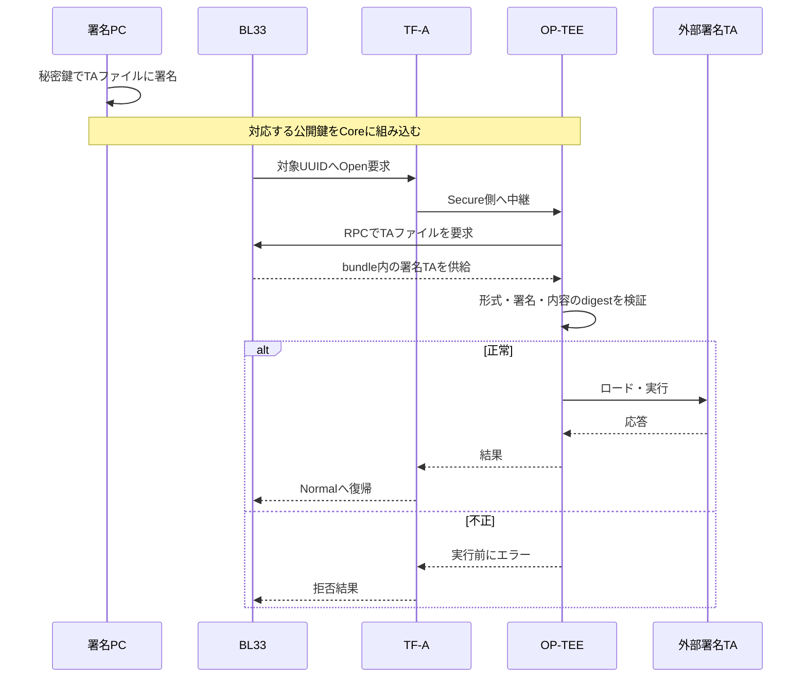
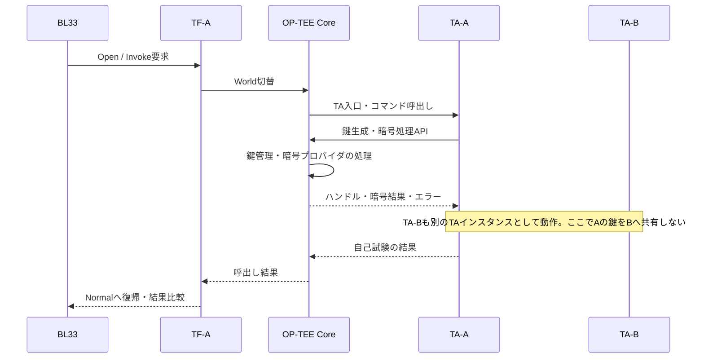

# OP-TEEの鍵の種類と、今回の試験で使っている鍵

作成日：2026-11-13  
対象：ZCU106 / BL33 + TF-A + OP-TEE 4.5.0 + 検証用TA  
ソースの基準：`ririmon22/trustzone-validation` の `7e51908c64e35808139845c8a07c05f0ca511dab`

この資料は、鍵の種類・用途・生成・利用・保持・破棄を説明する。ビルドコマンドは対象外。手元の未コミット修正や、実機にロードしたファイルの一致を保証する資料ではない。実機の試験結果は別のreportと照合する。

## 1. 最初に押さえる全体像

今回の鍵は、大きく「TAファイルが正しいことを確認する鍵」と「動作中のTAが暗号処理に使う鍵」に分かれる。ただし、コードで見ると後者には複数の試験用鍵がある。

| 区分 | 今回の具体物 | 役割 | 秘密を保持する場所 |
|---|---|---|---|
| 正規TAの署名用 | `trusted.pem` | 正規の署名TAを作る | 署名するPC |
| 正規TAの検証用 | `trusted.pub.pem` | OP-TEEがTAの署名を検証する | OP-TEE Coreに公開鍵を組み込む |
| 不正署名の対照用 | `wrong.pem` / `wrong.pub.pem` | 信頼していない鍵のTAを拒否できるか調べる | 秘密鍵はPC。公開鍵は生成されるがCoreの信頼鍵にはしない |
| 鍵保護の試験用 | `security.c` の `private_key` | 鍵を利用できても秘密属性を取り出せないことを調べる | OP-TEEが管理する一時鍵オブジェクト |
| 暗号処理の往復用 | `ta.c` の `generated` | 暗号化したものを同じ鍵で元に戻せるか調べる | 同上。コマンド実行中だけ |
| 暗号の既知解用 | `ta.c` の `known` | 決まった入力で正しい暗号文になるか調べる | 同上。値は既知で秘密ではない |
| 属性取得の正常対照用 | `security.c` の `control` | 取り出しが許可された鍵では属性取得が成功することを確認する | 同上。試験中だけ |

**重要：今回の署名用秘密鍵はOP-TEEが生成・保管するものではない。PCで生成してPCで使う。OP-TEEが持つのは検証用公開鍵。実行時のAES鍵は、TAの要求に応じてOP-TEE側で生成・管理する。**

## 2. 「鍵の種類」は3つの軸で整理する

| 軸 | 何を表すか | 例 |
|---|---|---|
| 用途 | 何を守るか | TA署名、データ暗号化、通信認証、鍵導出 |
| 暗号方式 | どの計算を使うか | AES、RSA、ECDSA、HMAC |
| 寿命・保管 | いつ作り、いつ捨てるか | 長期鍵、一時鍵、接続ごとの鍵、永続保存する鍵 |

「通信鍵」という専用のアルゴリズムがあるわけではない。例えばAES鍵を、通信データ用として使えば通信鍵になる。署名鍵・認証鍵も用途の呼び名であり、暗号方式とは別に整理する。

共通鍵は同じ秘密の鍵を使う方式。公開鍵方式は、秘密鍵と公開鍵を組み合わせる方式。署名では秘密鍵で署名して公開鍵で検証する。公開鍵暗号による暗号化では、受取側の公開鍵で暗号化して対応する秘密鍵で復号する。鍵共有では、双方の秘密と公開情報から共通の秘密を計算する。

## 3. OP-TEEで実現できる用途

| 用途 | OP-TEEが提供する処理 | TA・システムで決めること | 今回の実装 |
|---|---|---|---|
| 署名・検証 | RSA、ECDSA、Ed25519など | 信頼鍵、署名対象、鍵更新・失効 | 外部署名TAの検証を使用 |
| データ暗号化・復号 | AESなど | 対象データ、鍵、IV・nonce、形式 | AES自己試験を使用 |
| メッセージ認証 | HMAC、CMACなど | コマンド形式、相手との鍵共有、リプレイ防止 | コマンド認証としては未実装 |
| 鍵共有 | DH、ECDH、X25519など | 相手の認証、通信手順、導出処理 | 未使用 |
| 鍵導出 | HKDF、Concat KDF、PBKDF2 | 元の秘密、用途ラベル、salt等 | TAの試験では未使用 |
| 鍵のラッピング | 暗号処理を組み合わせて鍵を保護 | 格納形式、完全性、受取側の権限 | 未実装 |
| 通信保護 | 暗号・署名・MAC・鍵共有の部品 | 通信プロトコル全体 | 未実装 |
| 機器・利用者の認証 | 署名・MAC等の部品 | 身元の登録、信頼の起点、認可 | 固定資格情報による試験のみ。本物の要求者認証ではない |
| アテステーション | 署名等の部品 | 測定対象、信頼できる測定経路、証明書、検証者 | 未実装 |
| 鍵の永続保存 | Persistent Object APIと保存機構 | バックエンド、復旧、更新、削除 | 今回の構成では未使用 |

暗号APIがあっても、相手認証や通信手順まで自動で完成するわけではない。例えばECDHだけでは相手が本物であることは確認できず、署名や事前共有情報などによる認証を組み合わせる必要がある。

## 4. OP-TEE 4.5.0で扱う鍵・方式の一覧

以下はTAが使うInternal Core APIを中心とした一覧。**定義が存在すること、Coreに処理があること、実際のバックエンドで利用できることは別。** 最終的な可否は構成と実際のAPI戻り値で確かめる。

| 鍵・方式の系列 | 主な用途 | 主な鍵の型・補足 |
|---|---|---|
| AES | 暗号化、認証付き暗号化、MAC | `TEE_TYPE_AES`。128/192/256ビット |
| DES / 3DES | 共通鍵暗号、MAC | `TEE_TYPE_DES` / `TEE_TYPE_DES3`。旧方式との互換用として区別 |
| SM4 | 共通鍵暗号 | `TEE_TYPE_SM4`。128ビット |
| HMAC-MD5 / SHA-1 | MAC | 対応するHMAC鍵型。旧方式との互換を考慮する系列 |
| HMAC-SHA-224/256/384/512 | MAC | `TEE_TYPE_HMAC_SHA256`など |
| HMAC-SHA3-224/256/384/512 | MAC | `TEE_TYPE_HMAC_SHA3_256`など |
| HMAC-SM3 | MAC | `TEE_TYPE_HMAC_SM3` |
| RSA | 署名・検証、暗号化・復号 | `TEE_TYPE_RSA_KEYPAIR` / `TEE_TYPE_RSA_PUBLIC_KEY` |
| DSA | 署名・検証 | `TEE_TYPE_DSA_KEYPAIR` / `TEE_TYPE_DSA_PUBLIC_KEY` |
| DH | 鍵共有 | `TEE_TYPE_DH_KEYPAIR` |
| ECDSA | 楕円曲線署名 | 鍵ペア・公開鍵。NIST P-192/224/256/384/521の定義 |
| ECDH | 楕円曲線による鍵共有 | ECDSAとは別の鍵型を使う |
| Ed25519 | 署名・検証 | `TEE_TYPE_ED25519_KEYPAIR` / 公開鍵型 |
| X25519 | 鍵共有 | `TEE_TYPE_X25519_KEYPAIR`。Ed25519と用途を混同しない |
| SM2 | 署名、暗号化、鍵交換 | DSA/PKE/KEPごとに鍵型が分かれる |
| HKDFの入力 | 鍵導出 | 4.5.0のCoreは拡張の `TEE_TYPE_HKDF_IKM` を使用。標準名の定義だけで利用方法を判断しない |
| Concat KDFの入力 | 鍵導出 | `TEE_TYPE_CONCAT_KDF_Z` |
| PBKDF2の入力 | パスワードからの鍵導出 | `TEE_TYPE_PBKDF2_PASSWORD` |
| 汎用の秘密データ | 導出結果や共有秘密等 | `TEE_TYPE_GENERIC_SECRET` |

### 4.1 名前が定義されていても、そのまま利用可能とは言えないもの

| 方式 | 4.5.0での扱い |
|---|---|
| X448 | Core側に鍵生成・共有秘密計算の処理があるが、通常の暗号設定でX25519と同様に利用できるとは限らない。バックエンドの実装・有効化を個別確認する |
| Ed448 | ヘッダに識別子はあるが、確認したCoreの鍵生成・署名処理からは利用可能と扱えない |
| 耐量子暗号 | この一覧の4.5.0標準TA暗号APIに、ML-KEMやML-DSAが利用できるものとして含めていない |

「一覧にある＝今回の実機で検証済み」ではない。今回直接使っている中心はRSA署名TAとAES-128の試験。

### 4.2 方式の中にあるモード・処理

| 系列 | 4.5.0の定義・実装で確認する処理 |
|---|---|
| AES暗号 | ECB、CBC、CTR、CTS、XTS |
| AES認証付き暗号 | GCM、CCM |
| AES MAC | CMAC、CBC-MAC |
| DES / 3DES | ECB、CBC、CBC-MAC。3DES-CMACの拡張定義もある |
| SM4 | ECB、CBC、CTR。XTSの拡張定義もある |
| RSA署名 | PKCS#1 v1.5、PSS。ハッシュとの組合せを選択 |
| RSA暗号 | PKCS#1 v1.5、OAEP。パディングなし演算もあるが、完成した安全な暗号化手順とは別 |
| HKDF | MD5、SHA-1、SHA-224/256/384/512を使う拡張識別子。標準形式の識別子も定義される |
| Concat KDF | SHA-1、SHA-224/256/384/512 |
| PBKDF2 | 4.5.0の拡張はHMAC-SHA1。新しい版の方式一覧を混ぜない |

各行の全組合せを保証する表ではない。方式・モード・ハッシュの組合せは、Coreと暗号プロバイダの対応を確認する。

### 4.3 ハッシュと乱数は「鍵の種類」ではない

SHA-256やSHA-3そのものは、通常は秘密鍵を必要としないハッシュ処理。HMAC-SHA256は鍵を使う認証処理なので別物。乱数生成は鍵の材料を作るためにも使われるが、乱数生成器自体を鍵の種類として数えない。

## 5. 今回の署名TA用の鍵

### 5.1 生成と配置

根拠：`scripts/make_signed_bundle.py` の `generate_keys()`。

| 項目 | 今回の実装 |
|---|---|
| 生成する場所 | PC上のPython処理 |
| 使用ライブラリ | Python `cryptography` |
| 方式 | RSA 2048ビット、公開指数65537 |
| 正規鍵ペア | `trusted.pem` と `trusted.pub.pem` |
| 不正対照鍵ペア | `wrong.pem` と `wrong.pub.pem` |
| 秘密鍵の形式 | PEM / PKCS#8。ファイル自体にはパスワード暗号化をしない |
| 秘密鍵の権限 | スクリプトで0600にする |
| 公開鍵の形式 | PEM / SubjectPublicKeyInfo |
| 既定の生成先 | `build/signed-test-keys/`。実際の指定パスは設定による |

0600はOS上のファイル権限制限であり、秘密鍵ファイルの暗号化ではない。今回の鍵は試験専用で、製品の署名鍵管理方式を評価したものではない。

### 5.2 署名から実行まで

RPCを含む詳細なレジスタ往復は省略した概念シーケンス。TF-AはWorld切替を中継し、TAファイルの署名検証はOP-TEEが行う。

設定のつながりは `build_config/components.mk` を見る。

| 指定 | 渡すもの | 使用側 |
|---|---|---|
| `TA_SIGN_KEY` | 署名用秘密鍵のパス | TA SDKの署名処理 |
| `TA_PUBLIC_KEY` | 信頼する公開鍵のパス | OP-TEE Core |

OP-TEE公式の `scripts/sign_encrypt.py` は、既定の署名方式としてRSA-PSS / SHA-256を選ぶ。実際の正規TAはSDK側の指定・生成物ヘッダも確認対象であり、ファイル名だけで方式を確定しない。今回の不正鍵TA生成呼出しは `--algo` を指定せず、この既定を使用する。

### 5.3 正規・改変・不正鍵の違い

根拠：`build_bundle()`。

| TAファイル | 作り方 | 確認すること |
|---|---|---|
| `normal.ta` | 正規鍵による署名済みTAを使用 | 信頼するTAがロード・実行できる |
| `tampered.ta` | 正常TAのbootstrapヘッダ内 `ta_version` の1バイトを変更し、再署名しない | 署名で保護された内容とdigestの不一致を拒否する |
| `wrong-key.ta` | 同じペイロードを別の秘密鍵で署名 | 信頼していない署名鍵を拒否する |

改変試験は「ELFの命令を書き換えた試験」ではない。bootstrapのバージョンバイトを変えた試験として説明する。bundleに記録するSHA-256はファイル同一性の照合用であり、信頼する公開鍵による署名検証とは役割が違う。

### 5.4 TA-A / TA-Bとの違い

| 対象 | UUID末尾側の識別 | 今回の入口 |
|---|---|---|
| TA-A | `6dc13418-...` | `.stripped.elf` をEarly TAとしてCoreへ組み込む |
| TA-B | `6dc13419-...` | 同上 |
| 外部署名TA | `6dc1341c-...` | 外部 `.ta` を実行時loaderで検証する |

TA-A/Bのビルド過程で `.ta` ができても、今回のEarly TA入口でそれを外部loaderが検証しているとは限らない。組込みTAの実行と、T-16の実行時署名検証は分けて説明する。

**TAの署名はTAコードの真正性を確認する仕組み。Normal側の呼出し元が正当な利用者か、コマンド実行権限があるかは別の認証・認可。**

## 6. 今回の実行時AES鍵：4つを区別する

### 6.1 `private_key`：抽出禁止の鍵を利用する試験

根拠：`secure_world/ta/security.c`。

| 段階 | 関数・処理 | 意味 |
|---|---|---|
| 生成開始 | `security_create()` | AES-128の一時オブジェクトを確保 |
| 値の生成 | `TEE_GenerateKey()` | OP-TEE側の乱数生成機構を使って鍵を生成 |
| 用途制限 | `TEE_RestrictObjectUsage1()` | `ENCRYPT | DECRYPT` に制限し、`EXTRACTABLE`を除く |
| 正常利用 | `key_policy_test()` | 抽出禁止のままAES暗号化ができることを確認 |
| 抽出拒否 | `key_attribute_test()` | Coreの秘密属性取得syscallで拒否されることを確認 |
| 明示的な破棄・再生成 | `TA_COMMAND_KEY_CYCLE` | 解放→NULL確認→再生成→利用確認 |
| 終了時 | `security_destroy()` | オブジェクトを解放してハンドルをNULLにする |

`private_key` というC変数に鍵の16バイトがそのまま入っているわけではない。これはOP-TEEが管理する鍵オブジェクトを指すハンドル。TAはハンドルを暗号操作へ設定する。

この変数はTAインスタンス内のstatic変数であり、`session_context`のメンバではない。「セッションごとに固有鍵を作っている」とは説明しない。

### 6.2 `generated`：暗号化・復号の往復用

根拠：`secure_world/ta/ta.c` の `run_crypto_test()`。

1. AES-128の一時鍵オブジェクトを確保する。
2. `TEE_GenerateKey()` で鍵を作る。
3. 16バイトのゼロ入力をAES-ECB / パディングなしで暗号化する。
4. 同じ鍵で復号する。
5. 復号結果が入力と一致し、出力長も16バイトであることを比較する。
6. 終了経路で操作ハンドルと鍵を解放する。

この鍵には `private_key` と同じ抽出禁止設定をしていない。**今回の実行時鍵すべてに抽出禁止が設定されているわけではない。** またこの処理は暗号APIの自己試験であり、保存ファイルや通信データを保護するサービスの完成形ではない。

### 6.3 `known`：既知解試験用

同じ `run_crypto_test()` 内で、別のAESオブジェクトに既知の全ゼロ128ビット鍵を設定する。

| 入力 | 値 |
|---|---|
| 鍵 | 16バイトの `00` |
| 平文 | 16バイトの `00` |
| AES-ECBの期待暗号文 | `66e94bd4ef8a2c3b884cfa59ca342b2e` |

`TEE_PopulateTransientObject()` で既知の鍵値を取り込み、結果をコード内の `expected` と比較する。暗号化して復号できるだけでなく、既知の結果と一致するかを確認するための鍵。秘密保持の対象ではない。

### 6.4 `control`：属性取得の正常対照用

根拠：`key_attribute_test()`。

生成した `control` では秘密属性取得を成功させる。その後、出力bufferを `0xa5` で埋め、抽出禁止の `private_key` に同じ属性取得を行う。

| 対象 | 期待結果 |
|---|---|
| `control` | 属性取得成功、16バイトを取得 |
| `private_key` | `_utee_cryp_obj_get_attr()` が `TEE_ERROR_BAD_PARAMETERS` を返す |
| 拒否時のbuffer | 全バイトが `0xa5` のまま |

常に失敗する壊れた経路で合格にならないよう、成功対照を先に実行している。終了時にはbufferを消去し、`control`を解放する。

ここは試験のため内部syscallを直接使っている。通常のTAアプリ開発では公開APIを使い、この内部呼出しを一般的な推奨手順としてコピーしない。

## 7. 実行時の呼出しシーケンス

TAからOP-TEE CoreへのInternal Core API呼出しは、Secure側のSVCを使う経路。暗号APIを呼ぶたびにNormalへ戻り、TF-Aを往復するわけではない。BL33からのTAコマンド要求にはSMCのWorld切替が関係する。

今回の `TA_COMMAND_CRYPTO` はTA内部で暗号化・復号・既知解比較を完了して結果を返す。Normal側が任意の鍵とデータを送って暗号化する汎用サービスではない。

## 8. 誰が何を担当するか

| 構成要素 | 鍵に関する担当 | 今回担当しないもの |
|---|---|---|
| TrustZone対応ハードウェア | Security Stateやアクセス属性に基づく分離の基盤 | 自動的な鍵生成・利用者認証 |
| TF-A / BL31 | EL3でWorld切替・状態管理を中継 | 今回のTA内AES処理、TA署名の検証処理 |
| OP-TEE Core | 鍵オブジェクト、用途制限、暗号API、外部TA検証 | アプリ固有の利用者登録や業務上の権限設計 |
| TA | 生成タイミング、用途制限、許可するコマンド、後始末 | ハードウェア保護回路の代替 |
| BL33 | 要求を出し結果を比較・記録 | 保護対象AES鍵の秘密属性を受け取ること |
| PC | 試験署名鍵生成、署名ファイル作成 | ボード実行中のAES鍵の管理 |

## 9. 鍵APIの基本的な使い方

| API | 何をするか | 読むときの注意 |
|---|---|---|
| `TEE_AllocateTransientObject()` | 鍵を入れる一時オブジェクトの器を確保 | これだけでは鍵値の生成は終わっていない |
| `TEE_GenerateKey()` | 対応する種類の鍵を生成 | 方式によって追加属性が必要 |
| `TEE_InitRefAttribute()` / `TEE_InitValueAttribute()` | 取込み・生成条件用の属性を準備 | buffer属性と値属性を使い分ける |
| `TEE_PopulateTransientObject()` | 既存の鍵値・属性を取り込む | 外で作った秘密を送るなら、その経路の保護も必要 |
| `TEE_RestrictObjectUsage1()` | 鍵の利用権限を狭める | 制限後に同じオブジェクトの権限を増やすためのAPIではない |
| `TEE_GetObjectInfo1()` | 鍵の型・サイズ・usage等を得る | 鍵の秘密値そのものを取得する処理ではない |
| `TEE_AllocateOperation()` | 方式・モードを指定して操作を確保 | 鍵オブジェクトとは別のハンドル |
| `TEE_SetOperationKey()` | 操作へ鍵を設定 | 型・サイズ・usageの適合が必要 |
| `TEE_CipherInit()` / `TEE_CipherDoFinal()` | 暗号処理の初期化・実行 | 方式によってIVや入力長の条件が違う |
| `TEE_AE*()` 系 | GCM/CCM等の認証付き暗号処理 | nonce、AAD、タグの管理を含めて設計する |
| `TEE_MAC*()` 系 | MAC計算・比較 | 暗号化とは別。内容の秘匿はしない |
| `TEE_AsymmetricSignDigest()` 等 | 署名・検証など | 方式による入力の意味・対応APIを確認する |
| `TEE_DeriveKey()` | 共有秘密・導出元から別の鍵を作る | 導出元・属性・出力型を合わせる |
| `TEE_CreatePersistentObject()` | 鍵等の永続オブジェクトを作成 | 保存バックエンドが必要 |
| `TEE_FreeOperation()` / `TEE_FreeTransientObject()` | 操作・一時鍵を解放 | 正常時と異常時の両方で後始末する |

基本の読解順は「器を確保 → 鍵生成または取込み → 用途制限 → 操作を確保 → 鍵設定 → 処理 → 操作と鍵を解放」。方式ごとの正式なAPI仕様・戻り値条件に従う。

## 10. 鍵の寿命・保存・乱数

### 10.1 今回は電源を切った後も保持する鍵ではない

実行時のAES鍵はTransient Objectとして作る。再起動をまたぐ保存は行っていない。`private_key`もTAインスタンスの生存中に保持する一時鍵である。

今回の `components.mk` は `CFG_REE_FS=n`、`CFG_RPMB_FS=n` を指定する。OP-TEEに永続保存APIがあっても、今回の構成で保存・再起動・復元を検証したとは説明しない。

### 10.2 乱数で鍵を作ることと、乱数品質の評価は別

今回の構成は `CFG_WITH_SOFTWARE_PRNG=y`。`TEE_GenerateKey()`を使ったことは確認できるが、それだけでハードウェア乱数源の品質、初期seedの十分性、再起動間での独立性まで証明したことにはならない。

## 11. OP-TEE内部にも別の鍵があり得る

TAから作る鍵以外に、保存や機器固有機能のための内部鍵がある。これらを「TAが自由に生成・取得できる鍵の型」と混同しない。

| 名称・役割 | 一般的なOP-TEE構成での位置付け | 今回の扱い |
|---|---|---|
| HUK（機器固有秘密） | 機器固有の鍵導出の起点。実装はプラットフォーム依存 | 今回のAES鍵をHUK由来とはしていない。実機のHUK実装・秘密保持を評価していない |
| Secure Storage用の導出鍵 | 保存データやTAごとの保存領域を保護 | 保存バックエンド未使用につき対象外 |
| RPMB認証鍵 | RPMBへの認証付きアクセス | RPMB未使用につき対象外 |
| 暗号化TA用の鍵 | 暗号化したTAファイルの復号 | 今回は署名TA。TA暗号化の鍵を使う試験ではない |
| Secure Boot用の鍵 | 起動イメージを信頼するための署名・検証 | 今回のJTAGロードとTA署名試験では検証しない |

これらの存在や安全性は、SoC・起動方式・バックエンド・移植実装を確認して初めて説明できる。

## 12. 合格から何が言えるか、どこまで言えないか

| 試験 | 正常終了で確認するもの | その結果だけでは言えないもの |
|---|---|---|
| 正規署名TA | 対象ファイルが信頼鍵の検証を通って実行される | 起動チェーン全体の真正性、呼出し元の本人性 |
| 改変TA | 今回変更したバージョンバイトによる不一致を拒否 | 全種類の攻撃・全形式の入力の網羅 |
| 不正鍵TA | 対象の未信頼鍵署名を拒否 | 署名鍵の更新・失効運用の完成 |
| `key_policy_test()` | 抽出禁止usageで暗号化を実行できる | 復号・全暗号方式の検証、物理抽出耐性 |
| `key_attribute_test()` | 正常対照成功、禁止属性取得拒否、buffer非改変 | デバッガ、生メモリ読出し、サイドチャネルへの全面的耐性 |
| `TA_COMMAND_KEY_EXPORT` | 独自exportコマンドが拒否を返す | Coreが鍵を保護していることの単独証明 |
| `run_crypto_test()` | AES往復と既知解が一致 | 本物の通信・保存サービスの安全性 |
| `TA_COMMAND_KEY_CYCLE` | 解放・再生成後も利用可能 | 永続鍵の更新、電断復旧、古い鍵の完全消去の実測 |

関連する評価項目は、T-12（EXT-KEY-V01）、T-16（EXT-TA-V03）、T-21（PERF-05）。結果reportの具体的な子項目と、実行した構成を合わせて確認する。この資料自体は新しい実機結果を追加するものではない。

## 13. レビューでの説明例

> 今回は、TAファイルの真正性を検証するRSAの署名鍵と、TA内部で暗号APIや鍵保護を確認するAES-128鍵を使用しています。署名用秘密鍵はPCで管理し、OP-TEEには検証用公開鍵を組み込みます。実行時のAES鍵はTAの要求でOP-TEEが生成・管理し、鍵保護試験の対象には抽出禁止のusageを設定しています。暗号の往復試験や既知解試験には別のAES鍵を使っており、すべての鍵に同じ制限を設定したわけではありません。今回の範囲は署名検証、暗号処理、API上の抽出制限の確認であり、Secure Boot、永続鍵保存、実利用者の認証、生メモリ抽出耐性まで確認したものではありません。

## 14. コードを読む順番と公式の根拠

### 14.1 今回のコード

以下はすべて同じコミットに固定している。

| 読む順 | ファイル | 探す関数・指定 |
|---|---|---|
| 1 | [ta.c](https://github.com/ririmon22/trustzone-validation/blob/7e51908c64e35808139845c8a07c05f0ca511dab/secure_world/ta/ta.c) | `TA_CreateEntryPoint`、`TA_InvokeCommandEntryPoint`、`run_crypto_test` |
| 2 | [security.c](https://github.com/ririmon22/trustzone-validation/blob/7e51908c64e35808139845c8a07c05f0ca511dab/secure_world/ta/security.c) | `security_create`、`key_policy_test`、`key_attribute_test`、`security_invoke` |
| 3 | [make_signed_bundle.py](https://github.com/ririmon22/trustzone-validation/blob/7e51908c64e35808139845c8a07c05f0ca511dab/scripts/make_signed_bundle.py) | `generate_keys`、`build_bundle` |
| 4 | [components.mk](https://github.com/ririmon22/trustzone-validation/blob/7e51908c64e35808139845c8a07c05f0ca511dab/build_config/components.mk) | `TA_SIGN_KEY`、`TA_PUBLIC_KEY`、`EARLY_TA_PATHS`、保存とPRNG設定 |

### 14.2 OP-TEE公式ソース・仕様

| 根拠 | 内容 |
|---|---|
| [tee_api_defines.h / 4.5.0](https://github.com/OP-TEE/optee_os/blob/4.5.0/lib/libutee/include/tee_api_defines.h) | 鍵型、方式、usage、属性の識別子 |
| [tee_api_defines_extensions.h / 4.5.0](https://github.com/OP-TEE/optee_os/blob/4.5.0/lib/libutee/include/tee_api_defines_extensions.h) | HKDF・Concat KDF・PBKDF2などの拡張 |
| [tee_internal_api.h / 4.5.0](https://github.com/OP-TEE/optee_os/blob/4.5.0/lib/libutee/include/tee_internal_api.h) | TAから使うAPI宣言 |
| [tee_api_operations.c / 4.5.0](https://github.com/OP-TEE/optee_os/blob/4.5.0/lib/libutee/tee_api_operations.c) | 操作APIの実装・引数検査 |
| [tee_svc_cryp.c / 4.5.0](https://github.com/OP-TEE/optee_os/blob/4.5.0/core/tee/tee_svc_cryp.c) | Core側の鍵型・生成・属性・usage・導出の処理 |
| [crypto.mk / 4.5.0](https://github.com/OP-TEE/optee_os/blob/4.5.0/core/crypto.mk) | 暗号方式の構成とプロバイダ依存 |
| [sign_encrypt.py / 4.5.0](https://github.com/OP-TEE/optee_os/blob/4.5.0/scripts/sign_encrypt.py) | TA署名形式、既定の署名方式、署名・暗号化の区別 |
| [Cryptographic implementation](https://optee.readthedocs.io/en/4.5.0/architecture/crypto.html) | 暗号APIからCore・暗号ライブラリまでの構造 |
| [Secure storage](https://optee.readthedocs.io/en/4.5.0/architecture/secure_storage.html) | 保存保護と内部の鍵階層 |
| [GlobalPlatform公式仕様一覧](https://globalplatform.org/specs-library/) | TEE Internal Core API Specification。鍵オブジェクト・暗号操作・usage等の規定 |

本資料はソース読解に基づく整理。未使用方式の実行確認や、鍵の乱数品質・物理的耐性の新規評価は行っていない。
