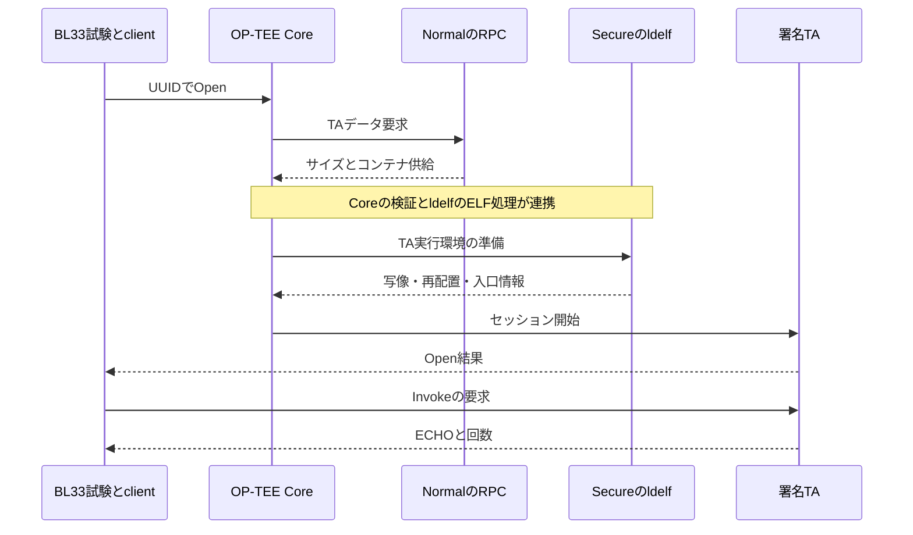

# TrustZone検証で理解するリンカ・ローダ：基礎から実装・レビュー説明まで

作成日：2026-11-08（日本時間）  
対象：ZCU106 / TF-A BL31 + OP-TEE BL32 + Standalone BL33  
対象ブランチ：`refactor/readable-components-review-20261102`  
対象commit：`70bc1c288c962c3368ca53295a146db690213d8b`

## この資料の使い方

目標は、この構成について「どのソースが、どう実行ファイルになり、どこへ配置され、誰が起動し、どうTAへ届くか」をコードと設定を根拠に説明できること。まず第1〜6章で基本とBL33の配置を理解し、第7〜11章で起動・MMU・TAロードを結び付ける。第12〜16章は調査手順とレビュー準備に使う。

「基本原理」「確認commitの実装」「説明用の仮定」を区別する。手元の未push修正・ロード済みELF・実機ログは今回取得していない。以下の具体アドレスは確認commitの設定であり、実機がその通り動いたという記録ではない。確認環境にはAArch64コンパイラがないため、今回はソース・設定・公式仕様を照合し、BL31/32/33の新規ビルドや実機試験は実施していない。

**参照位置の訂正：`clear_bss()`の実装は`runtime/result_report/console.c`。`runtime/memory.c`は`memcpy()`と`memset()`を実装する。前のフォルダ説明にあった`clear_bss()`の所在はこの内容に訂正する。**

### 目次

1. 今回の構成を90秒で説明する
2. 基本：コンパイル・アセンブル・リンク・ロード・実行
3. 基本：セクション、シンボル、再配置、ライブラリ
4. 基本：ELFを読み解く
5. 今回のビルド構成と生成物
6. BL33リンカスクリプトの全行解説
7. 起動ASMとC初期化をつなげる
8. リンクアドレス・ロードアドレス・VA/PA・保護
9. JTAGロードとTF-A/OP-TEE起動
10. Early TA・署名TA・PTAの違い
11. 外部署名TA：bundle、RPC、署名、ELFローダ
12. readelf・nm・objdump・mapによる調査
13. 症状から追う不具合解析
14. 配置・構成を変更するときの確認
15. レビュー想定問答50問
16. 説明練習と理解確認
17. 用語集と参照資料

## 1. 今回の構成を90秒で説明する

> BL33のC/ASMをコンパイル・アセンブルし、専用リンカスクリプトでコード、データ、BSS、ベクタ、スタックの配置を決めたELFを作ります。BL31とBL32はそれぞれ外部TF-AとOP-TEEのビルドで作ります。JTAG方式ではデバッガが各ELFをRAMへ配置し、BL31からOP-TEE初期化とNormal側BL33への引渡しへ進みます。BL33の起動ASMがEL1、SP、BSS、例外ベクタを準備してCへ入ります。TA-A/BはELFをCoreにデータとして埋め込むEarly TAです。外部署名TAはNormal RAMに置いたbundleからRPCで渡し、Secure側が署名・digestを検証し、ELFの写像・再配置を経て実行します。配置・署名・MMU権限・XMPU保護はそれぞれ確認する層が異なります。

この説明の各文を掘り下げたものが以下の各章。

| 層 | 主な責任者 | 今回の根拠 |
|---|---|---|
| ソース→命令 | コンパイラ・アセンブラ | Makefile、外部Make |
| 命令・データの結合と配置 | リンカ | linker_bl33.ld、各外部リンカ設定 |
| RAMへの配置 | XSDB、または実行時TAロード機構 | b2_boot.tcl、OP-TEE |
| CPU実行開始・引渡し | デバッガ、TF-A、起動ASM、Core | con、BL31、bl33_start.S、TA実行経路 |
| VA→PAとCPU権限 | 各実行環境のMMU設定 | client_mmu.c、外部OP-TEE |
| メモリ経路の物理保護 | SoC保護ハードウェアと設定 | XMPU等。リンカだけでは成立しない |
| 結果の証拠化 | 試験・回収・デコーダ | functional/review、capture、decode系 |

## 2. 基本：コンパイル・アセンブル・リンク・ロード・実行

### 2.1 5段階は何が違うか

| 段階 | 入力→出力 | 解決すること | 解決しないこと |
|---|---|---|---|
| プリプロセス | .c/.S + .h→展開後ソース | include、define、条件コンパイル | 関数の最終配置 |
| コンパイル | C→ASM等の中間表現 | 型・式をCPU命令へ変換 | 他ファイルの未解決関数の最終番地 |
| アセンブル | ASM→.o | 命令を機械語へ、シンボル・再配置情報を出力 | 全部品の最終配置 |
| リンク | .o/.a + スクリプト→ELF | 名前の解決、section配置、可能な再配置の適用 | 実機RAMへの書込み、CPUの実行 |
| ロードと起動 | ELF/バイナリ→実行環境 | RAMへの配置、必要な初期化・写像・再配置、入口へ制御移譲 | 誰が何まで行うかはローダ・方式による |

コンパイラドライバ（GCC/Clang）は複数段階をまとめて呼べる。今回のBL33のMakeレシピは複数の`.c`/`.S`を一度にドライバへ渡してELFを作るので、作業フォルダに全`.o`が残るとは限らない。それでも内部ではコンパイル・アセンブル・リンクの仕事がある。

### 2.2 `.S`と`.s`

一般にGCC系では大文字`.S`はプリプロセッサを通すASM、小文字`.s`はそのままアセンブルするASM。今回の`boot/bl33_start.S`は`#include "memory_map.h"`を使う。

ただし、このincludeがあるから`linker_bl33.ld`も自動的に同じマクロ値を使うわけではない。今回の`.ld`は数値を直接記述しており、Makeの`-T`で渡される。ヘッダ・リンカ・外部Make間の一致は別途照合する。

### 2.3 例：別ファイルの関数を呼ぶまで

```c
/* 説明用。実リポジトリのコードそのものではない */
extern int service(int);
int run(void) { return service(7); }
```

コンパイル時にはserviceの呼出し規約と型が分かればよい。serviceの最終番地はまだ決まらなくても`.o`に未解決シンボルと再配置を残せる。リンクで定義が見つかると命令の参照先を調整する。定義がなければ通常`undefined reference`になる。

**ヘッダに宣言があることと、リンクに実装が入っていることは違う。** `standalone_main()`が宣言できても、定義を含む`tests/validation/main.c`をリンクしなければ完成しない。

### 2.4 一般的なOSアプリとの違い

Linux等ではカーネルや動的リンカ、Cランタイムが入口・プロセス・初期化を用意する。今回のBL33ではそれを前提にせず、`_start`、SP、BSS、例外、最小限のメモリ関数、停止処理を自分たちで用意する。

`main()`という名前にCPUが自動で飛ぶ仕組みではない。今回のC入口は`standalone_main()`で、ASMの`bl`が明示的に呼ぶ。

## 3. 基本：セクション、シンボル、再配置、ライブラリ

### 3.1 セクションの意味

| 種類 | 通常の内容 | ファイル中の初期値 | 実行時の扱い |
|---|---|---|---|
| .text | 命令 | ある | 通常は実行可・書込不可 |
| .rodata | 定数・文字列等 | ある | 通常は読取専用 |
| .data | 初期値付きの静的データ | ある | RAMへ配置し読書き |
| .bss | ゼロ初期化する静的データ | 通常は内容をファイルに持たない | 容量確保とゼロ化が必要 |
| .vectors | 例外入口コード | ある | 必要整列で配置し実行可にする |
| .stack | スタック予約 | 通常は内容をファイルに持たない | SPと利用範囲を設定 |
| .symtab/.strtab | 名前とアドレス/文字列 | あることが多い | 解析・リンク・デバッグ用。普通の命令実行のたびに読むものではない |
| .debug_* | 行番号・型等の情報 | デバッグ版ではある | 通常は対象RAMへロード不要 |

名前だけですべてが決まるわけではない。配置・属性は入力sectionのフラグ、リンカ設定、生成ELF、実際の写像を確認する。

今回の出力`.text`は入力の`.rodata`も含む。つまり**入力section名と出力section名は一対一とは限らない**。const文字列が出力ELFの`.text`内にあっても、今回のスクリプトでは正常。

### 3.2 Cの変数とsection

```c
/* 配置傾向の説明例。最適化・コンパイラ設定で変わり得る */
int initialized = 7;              /* 通常.data */
int uninitialized;                /* 通常.bss */
int explicitly_zero = 0;          /* 多くの場合.bss */
const char message[] = "hello";   /* 通常.rodata */
```

ローカル変数がすべてスタックへ行くわけではなく、レジスタに置かれたり最適化で消えたりする。staticなローカル変数は自動変数とは寿命が異なる。

### 3.3 BSSは「初期値が不定でよい場所」ではない

Cの静的記憶域で明示初期化されない対象にはゼロ初期化の要件がある。BSSはその容量を効率よく表す仕組み。ELFファイルに巨大なゼロ列を持たせなくても、必要RAMサイズを記述できる。

ロード方式によってゼロ化を誰が行うかは異なる。今回のBL33は`clear_bss()`を自分で呼ぶため、XSDBがBSSをクリアすることだけに依存しない。

### 3.4 シンボルは名前と番地等の対応

`standalone_main`、`debug_ram_log`、`__bss_start`、`__stack_top`などが例。

| シンボル | 定義の種類 | 意味 |
|---|---|---|
| standalone_main | C関数 | 命令の位置 |
| debug_ram_log | Cのオブジェクト | RAMログ領域の位置とサイズ |
| __bss_start/__bss_end | リンカでの値割当て | BSS範囲の境界 |
| __stack_top | リンカでの値割当て | 初期SPに使うアドレス値 |

リンカの`__stack_top = 0x10500000;`は、その番地に数値0x10500000を書き込む命令ではない。また8バイトの変数領域を確保する宣言でもない。名前にその数値を対応付ける。

Cから境界を参照するときは、今回のように`extern char __bss_start[], __bss_end[];`と宣言してアドレスとして扱う。`extern uint64_t __stack_top;`を普通の変数のつもりで読み出すと、その番地にあるRAMの内容を読んでしまう。境界の数値と境界に置かれた内容を区別する。[G3]

### 3.5 再配置（relocation）

コード中のアドレス参照や分岐先を、最終配置に合わせて調整する処理。リンク時に解決するものと、ロード時に残して処理するものがある。

BL33は固定配置で、通常のLinux動的リンカによる再配置を前提にしない。これに対し今回のuser TAはET_DYNとして検査され、外部OP-TEEのldelfがロード先に合わせた処理を行う。

**MMUでVA→PAを変換することは再配置ではない。** 再配置は参照値・命令などを調整する。MMUは実行時アクセスを変換する。

### 3.6 静的リンク・動的リンク・PIC

| 用語 | 意味 | 今回との関係 |
|---|---|---|
| 静的ライブラリ .a | .oをまとめたアーカイブ | 外部SDK等で利用。必要オブジェクトをリンクへ取り込む |
| 静的リンク | 必要なコードを実行イメージへ結合する方式 | BL33は-staticを指定 |
| 動的リンク | 実行時等に別イメージとの参照を解決する方式 | TAのldelfによる再配置等を理解する背景 |
| PIC/PIE | 配置変更に対応しやすいコード生成・実行形式 | BL33は-fno-pic/-fno-pie。user TAとは設計が異なる |
| GOT/PLT | アドレス参照・関数解決を補助する表/仕組み | 一般知識。BL33にLinux用動的解決機構があると考えない |

ET_DYNだから常にOS共有ライブラリという意味ではない。PIEやTAのように、ロード時配置へ対応する実行イメージにも使われる。

## 4. 基本：ELFを読み解く

### 4.1 ELFは「機械語だけ」ではない

ELFは命令・データに加え、CPU種別、入口、section、segment、symbol、再配置、デバッグ情報などを持てる形式。拡張子だけで判断せずヘッダを見る。

| ELF種別 | 典型例 | 今回 |
|---|---|---|
| ET_REL | リンク前の.o | 中間生成物 |
| ET_EXEC | 固定配置の実行形式 | 検査ではBL31/BL32/BL33に要求 |
| ET_DYN | 共有オブジェクト/PIE等 | 検査ではTA-A/Bに要求。ldelfもTAの形式を確認 |

TAの署名コンテナ`.ta`や独自`bundle.bin`は、そのファイル先頭がそのままELFヘッダとは限らない。

### 4.2 sectionとsegment

**sectionは部品の意味・リンク編集の単位、segmentは実行時のロード等を記述する単位。** 一つのsegmentに複数sectionが入る。[E1]

今回なら`.data`と`.bss`を同じ`data` PT_LOADに対応付け、`.vectors`は別RX PT_LOAD、`.stack`は別RW PT_LOADにする。sectionとsegmentを同じ言葉として扱わない。

### 4.3 ELFヘッダで見ること

- ELF64か、Little Endianか、MachineがAArch64か。
- Typeが想定通りか。
- Entry pointがどのシンボル・実行可範囲に入っているか。
- Program Header/Section Headerの位置・個数・サイズが妥当か。

`ENTRY(_start)`はe_entryを設定する。ファイルを作った時点でCPUのPCを書き換える命令ではない。ロード・起動側がその入口へ制御を渡す必要がある。[G2]

### 4.4 PT_LOADと重要フィールド

| フィールド | 意味 | 今回の読み方 |
|---|---|---|
| p_offset | ファイル先頭からsegmentデータまでの距離 | ファイルを読む位置。RAM番地ではない |
| p_vaddr | segmentの仮想アドレス | 実行時配置の確認 |
| p_paddr | 物理配置用の値 | 組込みツール等で使用。OS/ツール依存の解釈がある |
| p_filesz | ファイルにあるデータの長さ | コピーする初期値の範囲 |
| p_memsz | 実行時に必要なメモリ長 | BSS等も含む予約に使用 |
| p_flags | R/W/Xの属性ビット | ELF上の意図。生きたMMU設定の証明ではない |
| p_align | segmentの整列要件 | 通常p_offsetとp_vaddrの合同関係等を確認 |

PT_LOADではp_filesz≤p_memsz。一般的なELFロードでは差分をゼロで初期化する。[E1] ただしデバッグツールのBSSクリア・実行前処理はオプションと実装を確認し、今回の起動コードが自分で何をするかを合わせて読む。

**説明用の仮定例**：p_offset=0x2000、p_paddr=0x10300000、p_filesz=0x100、p_memsz=0x500なら、ファイルからの初期値は256バイト、実行時範囲は1280バイト。残り1024バイトはゼロ領域となる。今回の実生成物から採取した数値ではない。

### 4.5 ファイルサイズだけで重複判定しない

`base + p_filesz`まで空いていても、`base + p_memsz`までBSS等が使う。スタック・ヒープ・動的確保がELFのLOAD外にある設計なら、それも別途予約として含める。

今回の`elf_inventory()`は`p_paddr + p_memsz`を終端として保存し、`zero_fill_bytes = p_memsz - p_filesz`も計算する。スタックをELFの予約へ含める理由もここにある。

### 4.6 stripped ELFとraw binary

| 形式 | 残る情報 | 注意 |
|---|---|---|
| 元ELF | LOAD、symbol、debug等 | 詳細解析や回収計画に使う |
| stripped ELF | ロードに必要なELF情報等。除去内容はstripオプション次第 | .binではない。必要な動的情報まで無条件に消してよいわけではない |
| raw .bin | バイト列。通常ELFの番地・symbol情報はない | 置く番地・意味・サイズを外から指定する |
| 署名.ta | 署名ヘッダやハッシュ等＋TAペイロード | 単純なreadelf入力と同一視しない |

デバッグsectionを外してもRAM使用量が大幅に減るとは限らない。元から非ALLOCでロード対象でない情報もある。逆にRAM予約は大きくてもBSS/stackはファイルを同じだけ大きくしない。

## 5. 今回のビルド構成と生成物

### 5.1 一つのリンカで全システムを作るのではない

BL31・BL32・BL33・TAは別々のELF。BL33用の`linker_bl33.ld`でOP-TEE CoreやTAの全配置まで決めているわけではない。

| 対象 | ソース/ビルドの入口 | 配置の責任 | 出力の例 |
|---|---|---|---|
| BL31 | 外部TF-A、components.mkのbl31 | TF-Aのリンカ・platform設定 | bl31.elf |
| BL32 | 外部OP-TEE、components.mkのbl32 | OP-TEEのリンカ・メモリ設定 | tee.elf、tee-raw.bin等 |
| BL33 | ルートMakefile | platform/zcu106/b2/linker_bl33.ld | optee_bl33.elfと.map |
| TA-A/B | secure_world/ta/Makefile + SDK | SDKのTAリンカ設定 | UUID.elf、UUID.stripped.elf等 |
| 外署名TA | secure_world/ta_signed/Makefile + SDK | SDKのTAリンカ設定、署名処理 | UUID.ta等 |
| bundle | make_signed_bundle.py | 独自コンテナのoffset/slot設計 | bundle.bin、manifest等 |

### 5.2 BL33の主要フラグ

| 設定 | 目的 | 説明時の注意 |
|---|---|---|
| -mcpu=cortex-a53 | 対象CPUに合わせる | AArch64の選択はtarget/toolchainと併せて確認 |
| -ffreestanding | ホストOSの完全なC実行環境を前提にしない | それだけで必要ランタイムが全部提供されるわけではない |
| -fno-builtin | 標準関数の組込み扱い等を抑制 | コンパイラが補助関数を一切要求しない保証ではない |
| -nostdlib | 通常の起動コード・標準ライブラリを自動リンクしない | 必要なmemcpyやコンパイラ補助関数は別途解決する |
| -static | 動的共有ライブラリへの通常の依存を避ける | 固定アドレスで動くかはスクリプト等も含めて判断 |
| -fno-pic/-fno-pie | BL33で配置独立のコード生成を前提にしない | 好きな番地へrawコピーして動くとはいえない |
| -Wl,-T,... | リンカへ専用スクリプトを渡す | -Wl,はコンパイラドライバ経由の引渡し |
| -Wl,-Map,... | リンクmapを生成 | 関数・データ・入力ファイルの配置を追う |
| -gと-O2 | デバッグ情報付きで最適化 | 行と命令、変数表示は一対一でない |
| --build-id=none | 今回はbuild-id生成を無効化 | ファイル同一性は別途SHA-256等で結び付ける |

GCCとClang/LLDでデフォルトや出力が異なる場合がある。最終的なEntry、PT_LOAD、section、symbolを両者で確認する。[C1][C2]

### 5.3 include順も配置理解に関わる

ZCU106のBL33では`-Iplatform/zcu106/b2`が親の`-Iplatform/zcu106`より前。`#include "memory_map.h"`は呼出し元の位置等の検索規則も含めて解決され、今回の通常ビルドではB2ヘッダが選ばれる構成になっている。B2ヘッダは`../memory_map.h`を読み、SHMやOP-TEE予約等を上書きする。

親ヘッダだけを見て「BL32は0x60100000」と説明するとB2構成と食い違う。今回のB2ではBL32予約は0x60000000〜0x70000000。

### 5.4 ビルド順とprofile

SDKを作る→TA-A/Bを作る→そのstripped ELFをBL32へ埋め込む、という依存がある。BL31/BL33は別に作れるが、引渡し・配置・機能が全体で一致する必要がある。

| profile | Core側の特徴 | BL33側の特徴 |
|---|---|---|
| basic | Early TA-A/B。外部署名TAローダは無効 | 通常試験用。既定選択14 |
| signed | 追加canary PTA・署名監査PTA、REE-FS TAローダと試験公開鍵 | 署名RPC、入力bundle写像、既定選択17 |
| physical | 追加canary PTA・物理probe PTA、専用PA設定 | 物理probe構成、既定選択15 |

profileは「署名を付けたファイル名」だけではなく、CoreとNormal両方のビルド条件に影響する。個別に上書きした場合は最終ELFとconfを確認する。

## 6. BL33リンカスクリプトの全行解説

対象：`platform/zcu106/b2/linker_bl33.ld`。小さいので全体を説明できるようにする。

### 6.1 元のスクリプト

```ld
ENTRY(_start)
PHDRS { text PT_LOAD FLAGS(5); data PT_LOAD FLAGS(6); vectors PT_LOAD FLAGS(5); stack PT_LOAD FLAGS(6); }
SECTIONS {
    . = 0x10200000;
    .text : { KEEP(*(.text.boot)) *(.text .text.*) *(.rodata .rodata.*) } :text
    ASSERT(. <= 0x10300000, "text overflow")
    . = 0x10300000;
    .data : { *(.data .data.*) } :data
    .bss (NOLOAD) : { __bss_start = .; *(.bss .bss.* COMMON) . = ALIGN(16); __bss_end = .; } :data
    ASSERT(. <= 0x10400000, "data overflow")
    . = ALIGN(4096);
    .vectors : { __b2_vectors_start = .; KEEP(*(.vectors)) . = ALIGN(4096); __b2_vectors_end = .; } :vectors
    ASSERT(. <= 0x10400000, "vectors overflow")
    __heap_start = __bss_end;
    __heap_end = __bss_end;
    . = 0x10400000;
    .stack (NOLOAD) : {
        __stack_bottom = .;
        . += 0x100000;
        __stack_reserved_end = .;
    } :stack
    __stack_top = 0x10500000;
    ASSERT(__stack_reserved_end == __stack_top, "stack reservation mismatch")
    ASSERT((__stack_top & 15) == 0, "stack alignment")
    /DISCARD/ : { *(.comment) *(.note*) *(.eh_frame*) }
}
```

上は確認commitのコメントを省いた内容。説明用に数値や順序を変えていない。

### 6.2 ENTRYとPHDRS

`ENTRY(_start)`はELF入口を`_start`へ設定する。`_start`の定義は起動ASMのラベル。

`PHDRS`は4つのProgram Headerを指定する。`text`等の名前はこのスクリプト内で使う対応名で、出力ELFに同名segment名が文字列として必ず保存される意味ではない。[G1]

| 指定 | flags | bitの意味 | 対応する内容 |
|---|---|---|---|
| text PT_LOAD FLAGS(5) | 4+1=R+X | 読取・実行 | コード＋定数 |
| data PT_LOAD FLAGS(6) | 4+2=R+W | 読取・書込 | 初期値付きデータ＋BSS |
| vectors PT_LOAD FLAGS(5) | R+X | 読取・実行 | 例外ベクタ |
| stack PT_LOAD FLAGS(6) | R+W | 読取・書込 | スタック予約 |

これらはELFが示す属性。これだけでCPUのPTEやXMPUレジスタが書き換わるわけではない。

### 6.3 `.`とワイルドカード

`.`はリンカのlocation counterで、現在配置している仮想アドレスを表す。`. = 0x10200000;`は次の配置位置を変える。CPUで実行する代入ではない。

`*(.text .text.*)`は「入力ファイル全体から、.textまたは.text.で始まる入力sectionを集める」。Cのポインタの逆参照ではない。

`.text : { ... } :text`は、出力section`.text`の内容を定義し、PHDRSの`text`へ所属させる。

### 6.4 起動コードを先頭へ置く

```ld
.text : { KEEP(*(.text.boot)) *(.text .text.*) *(.rodata .rodata.*) } :text
```

最初に起動ASMの`.text.boot`を置き、その後に普通の命令と定数を並べる。この構成ではBL33入口0x10200000と起動コードを結び付ける。

`KEEP()`はsection garbage collectionを使った場合にも対象を残す指定。[G4] 今回のMakeには`--gc-sections`の明示指定がないため、「KEEPがなければ現在必ず消える」という説明はしない。先頭配置の指定と削除抑止は別の役割。

`.rodata`を出力`.text`へまとめるため、ELFのsection名を見ただけで定数が見つからないと思わない。

`ASSERT(. <= 0x10300000, "text overflow")`はコード・定数が1MiB枠を越えたらリンクを失敗させる。命令は4バイト単位でも枠全体を使い切るとは限らない。余りは予約内の空き。

### 6.5 `.data`とBSS

データは0x10300000から配置。`.data`の初期値はELFからRAMへ供給する。このスクリプトにはROMからRAMへの別LMAを指定する`AT()`がなく、起動コードに`.data`コピー処理もない。したがって適切なRAMへ初期値が配置された状態で起動する方式を前提にしている。

```ld
.bss (NOLOAD) : {
    __bss_start = .;
    *(.bss .bss.* COMMON)
    . = ALIGN(16);
    __bss_end = .;
} :data
```

- `__bss_start`はゼロ化開始、`__bss_end`はゼロ化終端。終端は範囲に含めない。
- COMMONは古い/tentativeな共通シンボル等の扱いに対応する入力指定。
- ALIGN(16)は終端を16バイト境界に切り上げる。
- NOLOADは初期内容をファイルからロードするsectionとして扱わない指定。ELFでは実行時の予約が存在し得るので「RAMを使わない」意味ではない。最終的なNOBITSとPT_LOADのFileSiz/MemSizを確認する。[G5]

`data overflow`のASSERTはこの時点の終端を検査する。その後にベクタを置くため、別に`vectors overflow`の検査もある。

### 6.6 例外ベクタを別ページにする

```ld
. = ALIGN(4096);
.vectors : {
    __b2_vectors_start = .;
    KEEP(*(.vectors))
    . = ALIGN(4096);
    __b2_vectors_end = .;
} :vectors
```

ベクタの先頭・終端を4KiB境界に揃える。起動ASMではVBAR_EL1へ入口を設定し、後のMMU設定ではこの範囲だけをRXにする。

例外表自体にはASM側で2048バイトの整列指定がある。4KiBページ境界はその要件も満たす。ベクタと書込データが同じページに混ざると、そのページだけRXにする設計が難しくなるので分離する。

**ベクタの開始アドレスは0x10300000固定ではない。** `.data`・BSSの後を4KiBに切り上げて決まる。正確な値はELF/mapで読む。

### 6.7 ヒープは空、スタックは1MiB

`__heap_start = __bss_end; __heap_end = __bss_end;`は利用可能ヒープ長が0であることを表す。一般的なmallocヒープを用意したことにはならない。BL33側RPCの「allocate」は、固定予約SHM内のslot管理であり、BL33の一般ヒープとは異なる。OP-TEE Core/TAのヒープも別。

`.stack (NOLOAD)`ではlocation counterを1MiB進め、0x10400000〜0x10500000を予約する。`.stack`をRW PT_LOADに所属させることで、ELFの実行時占有範囲を調べるPC検査が予約を把握できる設計。

SP初期値0x10500000は終端を指す。AArch64の通常のスタック操作は先にSPを減らして、その下の領域へ保存する。SHM開始も0x10500000だが、範囲は`[0x10400000, 0x10500000)`なのでそれ自体は重複ではない。

ただしstack overflowを自動防止するガードページはこのスクリプトだけでは成立しない。スタック予約と、利用時の境界検出は別の話。

### 6.8 ASSERTとDISCARDの限界

`ASSERT((__stack_top & 15) == 0, ...)`は初期SPの16バイト整列を検査する。実行中の全関数が規約を守ることまでは検査しない。

`/DISCARD/`はcomment/note/eh_frame等を出力から除く。`.eh_frame`等のunwind情報を削除するので、例外処理や汎用スタック巻戻しが必要な別環境へ無検討で転用しない。

リンカで想定していない入力sectionが増えると、孤立section（orphan section）として配置される場合がある。ASSERTがあるから未知のsectionまで全部安全というわけではない。最終ELFのALLOC sectionとLOAD全体を確認する。

## 7. 起動ASMとC初期化をつなげる

### 7.1 `_start`からCへ

| 処理 | 実装 | 意味 |
|---|---|---|
| 非同期例外マスク | msr daifset, #15 | stack/vector準備中の割込み等を抑える |
| CurrentEL読出し | mrs/cmp/b.eq | EL2ならfrom_el2、EL1ならstart_el1、他は待機 |
| EL1実行状態準備 | HCR_EL2.RW等 | EL1をAArch64で動かす準備 |
| タイマ権限 | CNTHCTL_EL2/CNTVOFF_EL2 | EL1で計測用counter等を扱う準備 |
| SCTLR_EL1初期値 | 0x30d00800 | M/C/Iが0の初期状態を用意 |
| stack予約の利用 | ldr =__stack_top、SP_EL1設定 | リンカで決めた終端を初期SPにする |
| EL2→EL1 | ELR_EL2、SPSR_EL2、eret | start_el1、EL1h、DAIFマスクへ移行 |
| 共通スタック | mov sp,x0 | C呼出しの前提 |
| BSSゼロ化 | bl clear_bss | Cの静的状態を成立させる |
| handoff保存 | debug_handoffへstp | EL2経由か、HCR等の情報をRAMへ残す |
| 例外入口設定 | VBAR_EL1 + isb | 新しいベクタを以後の例外に反映 |
| Cへ | bl standalone_main | main.cへ |

EL1から直接来る場合は、EL2経路の設定を行わない。SPSel、MMU/cache、EL2のStage2等を含む引渡し条件は起動側で確認すべき前提。CurrentELだけでそれら全部が正しいとは分からない。

### 7.2 `ldr x0, =__stack_top`は何を読むか

`ldr ..., =symbol`はアセンブラの擬似命令で、指定値/アドレスをレジスタへ入れるためのコードやliteral参照等に展開される。ここでは__stack_topに対応する0x10500000をx0へ入れる。

`ldr x0, [x1]`のように「x1番地のRAM内容を読む」とは意味が違う。命令の実展開はobjdumpで確認できる。

`adrp`と`add :lo12:`はアドレスをページ単位と下位部分に分けて組み立てる。ここでもリンカがシンボル参照を解決する。対して`stp x19,x20,[x0]`は実際のRAM書込み。

### 7.3 BSS初期化を詳しく

実装は`runtime/result_report/console.c`。

```c
void clear_bss(void)
{
    for (char *p = __bss_start; p < __bss_end; ++p) {
        *p = 0;
    }
    debug_stage(10U, 0U);
}
```

リンカが決めた範囲を1バイトずつゼロにし、初期段階を記録する。起動ASMはこの後でdebug_handoffへ書くため、その保存値をBSSクリアで消さない。EL2由来の情報はそれまでx19〜x22に保持し、C関数呼出し規約上のcallee-savedとして保たれる前提で扱う。

`__bss_end`は「その位置まで含めて最後の1バイト」ではなく「次の位置」。Cループが`<`なのもそのため。

### 7.4 なぜCへ直接飛ばさないか

C関数は適切なSP、初期化済み静的データ、ABIに沿う呼出しを前提にする。未準備のまま入ると、関数冒頭のレジスタ退避だけでメモリ破壊や例外になる。BSS内のカウンタ・session状態が前回の値だと、試験の制御も壊れる。

なおこのBL33はC構成。C++の静的コンストラクタ、TLS、全libc機能等まで一般的に起動するCRTではない。

## 8. リンクアドレス・ロードアドレス・VA/PA・保護

### 8.1 四つの位置を分ける

| 観点 | 意味 | 例 |
|---|---|---|
| ファイルoffset | ELF/コンテナの何バイト目か | p_offset、bundle内offset |
| リンク時VMA | sectionが実行時に存在する仮想アドレス | BL33 .textの0x10200000 |
| LMA/配置先 | 初期イメージをどこへ配置する設計か | 今回BL33はVMAと一致する設計 |
| 実行時VA/PA | CPUの参照番地と変換後の番地 | client_mmu.cは必要領域をVA=PAで写像 |

LMAとELFのp_paddrをすべての環境で同じ意味だと断定しない。GNUリンカ、対象ABI、ローダの使用方法を確認する。今回の検査はBL31/32/33のLOADにp_vaddr=p_paddrを要求する。

### 8.2 一般的なROM→RAMの例との違い

組込みでは`.data`の初期値をFlashに置き、起動時にRAMへコピーする設計がある。リンカの`AT()`等でVMAとLMAを分け、起動コードがコピーする。[G6]

今回のBL33スクリプトにはその指定もコピー処理もなく、JTAG等がRAMへ初期値を置く。別アドレスへ置いたファイルを、BL33が自動的に正しい場所へコピーするわけではない。

### 8.3 恒等写像でもMMUは働く

`client_mmu.c`は必要領域だけにVA=PAのページテーブルを作る。MMU有効でも数値が同じになるだけで、属性・権限・未写像による検査は有効。

| 領域 | 意図した属性 |
|---|---|
| BL33コード・定数 | Normal memory、読取専用・EL1実行可 |
| データ/BSS/stack/SHM | Normal memory、書込可・実行不可 |
| vectors | 別ページ、読取専用・実行可 |
| UART | Device属性、実行不可 |
| 署名bundle | signed構成で入力領域を読取専用・実行不可 |
| Secure予約全体 | Normalの通常写像には含めない |

MAIRはmemory属性、TCRは変換条件、TTBRはページテーブル先頭、SCTLRはMMU/cache有効化等に関係する。表の準備とCPUへの反映は異なる段階。DSB/ISB/TLBI等の順序を含めて読む。

### 8.4 ELF flags・MMU・XMPUは三層

ELFのRX/RWは配置情報。MMUはCPUのアクセス権。XMPUはSoCのメモリ経路でのアクセス制御。リンカにRWと書いてもSecure状態にはならず、RXと書いても実機で書込み不能とは限らない。

確認commitのOP-TEE ELFはPC検査で単一RWX LOADを許容する一方、個々のALLOC sectionのW+Xは拒否する。これはCoreのイメージ形式の扱いであり、実行中の全SecureページがRWXであることを意味しない。生きたPTEを別途確認する。

### 8.5 TA-A/Bの同じVAは同じPAを意味しない

user TAはそれぞれの仮想空間を持つ。同じ数値のVAでも別の物理ページに対応し得る。逆に秘密VAを他TAへ渡してアクセスさせる試験では、攻撃側の自分のページが偶然同じVAにあると目的が変わるため、今回のTA間試験はalias条件を確認する。

TA間のVA分離と、NormalからSecure PAへの物理保護は異なる試験。リンカのsection分割だけで両方を証明できない。

## 9. JTAGロードとTF-A/OP-TEE起動

### 9.1 「ローダ」は一つのプログラム名ではない

今回には少なくとも次の異なる仕事がある。

| 担当 | 仕事 |
|---|---|
| XSDB | ELFやraw binaryを対象RAMへ配置する |
| FSBL/PMUFW | SoC初期化・電源管理等の前提を用意する |
| TF-A BL31 | Secure/Normalの初期化・引渡しとEL3のWorld切替仲介 |
| OP-TEE | TAの取得・認証・実行環境作成等 |
| ldelf | user TAのELF読解、写像/再配置の処理を担う |
| BL33 _start | 既にロードされたBL33の実行環境を整える |

BL33の起動ASMは、ディスクから自分自身を読む一般ローダではない。TF-Aも、このJTAG方式で全ELFをファイルから読み込む担当ではない。

### 9.2 ELFロードとrawロード

```tcl
# 構文説明。実機でそのまま実行する手順ではない。
dow path/to/optee_bl33.elf
dow -data path/to/bundle.bin 0x10600000
```

ELFは内部の配置情報を持つ。rawは外部指定の番地へバイト列を置く。AMD公式では`dow -data`がその構文、`-clear`はBSSクリア、`-vaddr`はELFの仮想アドレスを使用するオプション。[A1]

したがって、全ツール・オプションについて「ELFなら常に同じアドレス解釈で全初期化をする」とは扱わない。今回の固定ELFはVA/PA一致を検査し、BL33のBSSも自分で初期化する。

rawロードにはELFの入口情報がない。bundleはそもそも命令イメージではなくTAの入力データ。0x10600000へPCを向けて実行するものではない。

### 9.3 確認commitのJTAG計画

`scripts/jtag/b2_boot.tcl`の処理は概ね次の順。

1. 対象・許可・bundleサイズ等を確認する。
2. PMUFWをロード・実行し、指定されたready条件を確認する。
3. FSBLをロードして実行し、指定終了位置で止める。
4. BL32とBL33のELFを配置する。
5. 署名構成ならbundleを0x10600000へraw配置する。
6. 最後にBL31を配置し、BL31入口PCを確認して止まる。
7. 別段階の継続処理でOP-TEE初期化位置、BL33 C入口等へ進む。

このTclはsourceしただけで全操作を実行しない。確認commitの計画・runtime gateは未確認条件を残している。ここではその仕組みを説明しており、値を書き換えて迂回する手順は作らない。

最後にBL31を置くのは、計画上の次の実行入口をそこへ結び付けて確認するため。**ロード順とCPUの実行順を同じだと思わないこと。** BL32/BL33を先に配置しても、先に実行したという意味ではない。

### 9.4 TF-Aのビルド引数と引渡し

| 引数 | 今回の値/意味 |
|---|---|
| RESET_TO_BL31=1 | ZynqMPでBL31を入口とする方式のビルド条件 |
| SPD=opteed | OP-TEE向けSecure Payload Dispatcher |
| PRELOADED_BL33_BASE=0x10200000 | 事前配置されたNormal側の既定入口 |
| ZYNQMP_ATF_MEM_BASE=0x1000 | BL31配置の開始 |
| ZYNQMP_ATF_MEM_SIZE=0x7f000 | BL31予約の大きさ |
| ZYNQMP_BL32_MEM_BASE=0x60000000 | BL32の開始 |
| ZYNQMP_BL32_MEM_SIZE=0x10000000 | BL32予約の大きさ |

ZynqMPではboot modeやFSBL handoffの分岐がある。ローカル資料はJTAG modeでの既定入口と、非JTAGでのFSBL引渡しの違いを記している。一般的なBL1→BL2→BL31図をこの手順へそのまま当てはめない。BL2/FIPを通常経路としないJTAG計画である。[T1]

`SPD=opteed`はTAの署名公開鍵設定ではない。World切替の仲介とTA署名検証は別。

### 9.5 tee.elfとtee-raw.bin

同じCore由来でも形式と用途が違う。`tee.elf`はロード位置やsymbolを持つためデバッグ・検査に向く。`tee-raw.bin`は別のブート方式で使うrawイメージになり得るが、置き方は外部OP-TEEの出力形式と実際の手順を確認する。

**確認commitのb2_boot.tclはBL32 ELFをdowする計画で、tee-raw.binを追加dowする処理はない。** 手元で「tee-raw.binの投入が必要だった」別の手順・変更版があっても、その結論を無条件にこのTclへ混ぜない。どのELF/バイナリをどの番地に置くかを一つの起動方式として揃える。

異なる形式を同じ範囲へ重ねて置けば、最後の書込みが先のデータを上書きし得る。「両方入れればより確実」と考えない。

## 10. Early TA・署名TA・PTAの違い

### 10.1 比較

| 種類 | このリポジトリ | ビルド時のCoreとの関係 | 実行場所 | ロードの意味 |
|---|---|---|---|---|
| Early user TA | secure_world/ta/ | TAのELFをデータとしてCoreへ埋め込む | Secure EL0 | 埋込みELFからuser TA環境を作る |
| 外署名user TA | secure_world/ta_signed/ | TAは別ビルド、Coreに検証公開鍵等 | Secure EL0 | Normal提供コンテナを検証しuser TA環境を作る |
| PTA | secure_world/pta/、監査PTA | CコードをCore本体へリンク | Secure EL1 | Core内サービスへのdispatch。独立user TAのELFロードとは違う |

Early TAは「Coreへ埋めたのでCore権限で動くTA」という意味ではない。[O1] その点がPTAとの重要な違い。

### 10.2 TA-A/Bを作り分ける

`secure_world/ta/Makefile`でTA_VARIANTによりUUIDとB用マクロを選ぶ。Bの定義をSDK側のTAヘッダ生成にも届かせるため`CPPFLAGS_ta_arm64`を指定している。

| TA | UUID |
|---|---|
| A | 6dc13418-534f-4642-9138-215876304910 |
| B | 6dc13419-534f-4642-9138-215876304910 |
| 外署名TA | 6dc1341c-534f-4642-9138-215876304910 |

UUIDはサービスを選ぶ識別子であり、その値だけで署名の正当性やアクセス権を保証しない。

### 10.3 Early TAは何を埋めるか

`components.mk`は`EARLY_TA_PATHS`へA/Bの`.stripped.elf`を渡す。Coreへ単にA/BのC関数を直結するのではない。PC検査はCore内の`ts_bin_<UUID>`を取り出し、zlibで復元したデータが指定したstripped ELFと一致するか調べる。

ここには二つの「リンク/ロード」がある。

1. TA自身をリンクし、TAのELFを作る。
2. TA ELFを埋込みデータとしてCoreイメージへリンクする。
3. 実行時にはそのELFからuser TAの環境を作る。

Core内の保存位置と、TAの実行時VA/PAは同じとは限らない。A/BがCore内にあるだけで、外部署名TAローダの検証が完了したことにもならない。

### 10.4 TAの独自リンカ設定

SDK側`ta/arch/arm/ta.ld.S`は`.text`、`.rodata`、`.dynamic`、`.got`、再配置、`.data`、`.bss`等を整理し、読書きデータの前を4KiBに整列する。BL33の`.ld`とは別。

user TAには`TA_OpenSessionEntryPoint()`等のAPI入口があるが、ELFのe_entryがその関数のいずれかをそのまま指すとは限らない。SDKのランタイム入口がCoreからの操作を受け、TAの公開関数へdispatchする。ELF入口とアプリケーションAPI入口を区別する。

## 11. 外部署名TA：bundle、RPC、署名、ELFローダ

### 11.1 全体の役割分担



図は責任分担の概念図。署名/digest検査とELF読出しはストリーミングの都合で連携するため、「すべての検査完了後に初めてELFの1バイト目を読む」という厳密な時系列を表していない。最終的に未検証イメージを正規TAとして実行しないことが要点。

### 11.2 bundle.binは独自形式

`make_signed_bundle.py`と`signed_rpc.h`が形式を定義する。bundle全体は0x100000バイト=1MiB。先頭メタデータは176バイト、TAデータは最初の4KiBを空けたslotへ置く。

| 内容 | 位置/大きさ |
|---|---|
| magic/version/全体bytes/count | 先頭16バイト |
| 対象UUID | 続く16バイト |
| 画像レコード3個 | 各48バイト：offset 8、size 8、SHA-256 32 |
| 正常TA | offset 0x1000 |
| 改変TA | offset 0x41000 |
| 別鍵TA | offset 0x81000 |
| 各slotの最大 | 0x40000=256KiB |

bundleのRAMベースは0x10600000。各画像の先頭はbase+offsetで計算する。これはTAの実行VAではなく、Normal側に置いた入力ファイルの位置。

署名TA入力領域は`[0x10600000,0x10700000)`。物理probe専用予約`[0x10800000,0x10900000)`とは別。slot最大長はTAの実行時メモリ全体の上限を直接表すものではない。

### 11.3 三つの画像と改変位置

| 画像 | 作り方 | 何を区別するか |
|---|---|---|
| normal | trusted鍵で署名した.ta | 正常に受理・実行される対照 |
| tampered | 署名ヘッダ後のbootstrap ta_versionの1バイトを反転 | 署名ヘッダの検査と、保護対象データのdigest検査の違い |
| wrong-key | 同一stripped ELFをwrong鍵で署名 | 信頼していない鍵による署名の拒否 |

改変はELF本体やUUIDを無作為に壊すものではない。生成スクリプトはヘッダ形式・UUID・長さを確認し、別鍵版ではペイロードが正常版と同じことも確認する。異なる理由の拒否を混ぜないための対照設計。

bundle内SHA-256は画像の対応確認に使う。Normal側が書けるhash値だけでTAを信頼するのではない。Coreの信頼公開鍵を用いた署名検証が別に必要。

### 11.4 RPCのサイズ照会・供給・再開

1. clientがOpenを開始し、SMCでCoreへ渡す。
2. CoreがTA供給等を必要とするとRPCとしてNormalへ戻る。
3. `signed_rpc.c`は引数用メモリ、payload用メモリ、LOAD_TA等へ応答する。
4. サイズ照会では必要な長さを返す。データ要求では所有slot・アドレス・容量を確認してコピーする。
5. `RPC_RETURN`（0x32000003）で中断していたCore処理を再開する。
6. 最終的なOpen結果まで繰り返す。

各RPCのたびに新しいOpenを始めるわけではない。RPCはネットワーク通信でもない。ここでは中断中のSecure処理からNormalへの作業依頼。

Linuxのファイルシステムやtee-supplicantの全機能は実装していない。必要なTA供給を固定RAMと限定RPCで代替している。Coreの`CFG_REE_FS_TA=y`はこのロード経路の有効化であって、今回NormalにLinuxが存在する意味ではない。

### 11.5 RPCのallocationは何を確保するか

固定SHMの`SIGNED_RPC_BASE = SHARED_MEMORY_BASE + 0x10000`から、最大3slot×0x40000を使う。範囲は0x10510000〜0x105d0000でSHM内に収まる。

cookieはslotと世代を識別し、種類・長さ・アドレスを照合する。release時に使用範囲をゼロ化し、live数やalloc/free数を記録する。BL33一般mallocヒープが0でも、この固定slot方式は成立する。

未対応RPCや途中状態ではpoisoned等を残し、単に空きslot扱いして使い続けない。署名検証だけでなく後始末の成立も試験対象。

### 11.6 Coreの署名検証と監査

`stage_signed_loader.py`は外部Coreの`core/kernel/ree_fs_ta.c`へ監査コードを配置し、既存署名/digest処理の戻り値を記録する。監査は署名検証そのものをNormal側へ移すものではない。

| 記録 | 意味 |
|---|---|
| signature結果 | Coreの署名検証が成功/拒否したか |
| digest結果 | 読み込んだ保護対象データの整合性確認結果 |
| stage flags | どの段階まで進んだか |
| UUID | どのTAのロード試行か |
| overflow | 記録容量を越えたか |

監査PTAが固定形式を返し、Normal側は`b2_signed_loader_snapshot[1040]`へコピーする。PCデコーダはその記録を用いて拒否原因を照合する。

同じTEE_ERROR_SECURITYでも、署名ヘッダの検査で拒否されたのか、署名成功後にdigest不一致だったのかは異なる。戻り値だけで原因を断定しない。

### 11.7 ELFロードの実処理：ldelf

外部OP-TEE 4.5.0の`ldelf/main.c`は、主TAを読み、必要なら依存を読み、再配置、最終写像、入口情報確定という処理を行う。`ldelf/ta_elf.c`はET_DYN/CPU種別の確認、PT_LOADの処理、load bias等を扱う。

ldelfはSecure側のuser modeローダで、Coreのsyscallを通じてメモリ・TAデータ等を扱う。すべてがSecure EL1のCore C関数だけで完結していると説明しない。

| 処理 | なぜ必要か |
|---|---|
| ELF形式・範囲確認 | 不正なoffset/サイズ/CPU形式を拒否する |
| VA範囲・メモリ確保と写像 | TAが実行できる空間を作る |
| 初期値とゼロ領域の準備 | .data/.bss等の実行時状態を成立させる |
| 再配置 | 配置先に合わせて参照値等を調整する |
| 最終権限の設定 | 命令・データのアクセス権を整える |
| 入口・stack情報 | TAランタイムへ制御を渡せるようにする |

BL33が行うのは供給側と試験。TA ELFの全解析・再配置を`signed_rpc.c`が実装しているわけではない。

### 11.8 Open、Invoke、Closeと8つのシナリオ

| index | 操作対象 | 期待されるOpen結果 | 目的 |
|---|---|---|---|
| 0 | 正常 | SUCCESS | 基本対照 |
| 1 | 改変 | SECURITY | 改変拒否 |
| 2 | 正常 | SUCCESS | 拒否後の復旧 |
| 3 | 別鍵 | SECURITY | 非信頼鍵拒否 |
| 4 | 正常 | SUCCESS | 別鍵拒否後の復旧 |
| 5 | 不在UUID | ITEM_NOT_FOUND | 供給対象の限定 |
| 6 | サイズ上限超過 | BAD_PARAMETERS | Normal側の範囲拒否 |
| 7 | 正常 | SUCCESS | 異常系後も正常ロード可能 |

成功caseはECHOとcount取得をInvokeし、count=1を確認してCloseする。署名TAはKEEP_ALIVE/SINGLE_INSTANCE等を付けない構成なので、再Open後に新しい実体の状態であることを確認する。API上のsessionと、TAのinstanceの生存期間は一般には同一ではなく、属性に依存する。

不在UUID・サイズ超過はNormal側の供給制御による拒否で、Coreの署名検証で改ざんを見抜いた証拠には数えない。

合否はOpen結果だけでなくorigin、正常Invoke値、拒否caseで未実行、alloc/freeとlive、RPC未対応・poisoned、Core監査取得等も組み合わせる。詳細は`tests/validation/signed_ta_tests.c`と`decode_signed_results.py`を参照する。

## 12. readelf・nm・objdump・mapによる調査

以下はPC上の読取りコマンド。リポジトリ直下で実行する例で、対象のビルド済みファイルが必要。profileやtoolchainが手元と違う場合はパスを合わせる。この資料には今回採取していない実ELF出力を実測例として掲載しない。

### 12.1 BL33を確認する順番

```sh
BL33_ELF=build/bl33/gcc/signed/optee_bl33.elf

# 形式、CPU、入口
readelf -h "$BL33_ELF"

# LOADの配置・長さ・属性とsection所属
readelf -lW "$BL33_ELF"

# sectionの種別、ALLOC/WRITE/EXEC等
readelf -SW "$BL33_ELF"

# 関数・記録領域・境界の位置とサイズ
readelf -sW "$BL33_ELF"

# 残存する再配置/動的依存の確認
readelf -rW "$BL33_ELF"
readelf -dW "$BL33_ELF"
```

`readelf`はホスト版でも対象ELF形式を解釈できる場合が多い。一方disassembleは対象AArch64対応のツールを使う。GNUの各オプションは公式マニュアル[B1]参照。

```sh
aarch64-none-linux-gnu-nm -n "$BL33_ELF"
aarch64-none-linux-gnu-nm -S --size-sort "$BL33_ELF"
aarch64-none-linux-gnu-objdump -d --disassemble=_start "$BL33_ELF"
aarch64-none-linux-gnu-objdump -d --disassemble=clear_bss "$BL33_ELF"
aarch64-none-linux-gnu-addr2line -e "$BL33_ELF" -f -C 0x10200000
```

`addr2line`の0x10200000はこの構成の入口を確認する例。任意のfault PCを解析するときは記録されたEL・VA/PA・対象イメージを先に確認する。TAのPCをBL33 ELFへ渡しても正しい説明にならない。ET_DYNのTAはload biasやmappingを加味する必要がある。

### 12.2 確認すべき項目と期待

| 観測 | この構成で確認すること |
|---|---|
| Machine | BL31/32/33はAArch64。PMUFWは別CPUなので同じ条件を当てない |
| Entry | BL33は0x10200000、BL31は指定0x1000、BL32は指定0x60000000と生成物が整合 |
| BL33 LOAD | コードRX、データRW、ベクタRX、stack RWの予約が表現されているか |
| p_filesz/p_memsz | ファイル内容と実行時予約の差。特にBSS・stack |
| Section-to-Segment | .dataと.bssがどのLOADへ入り、vectorsが別か |
| __bss_start/end | 範囲がデータ予約内、順序が正しいか |
| __stack_bottom/top | 0x10400000/0x10500000か |
| __b2_vectors_start/end | 4KiB整列、データ枠内、RX LOADと一致するか |
| client_tables | 4KiB整列と構造サイズがprofileと整合するか |
| INTERP/NEEDED等 | BL33に想定外のOSローダ・共有ライブラリ依存がないか |
| debug_* / b2_* | 選んだELFに記録symbolと正しいsizeがあるか |

`readelf -r`に何もないことだけであらゆる位置依存がなくなったとは言えない。逆にdebug用sectionの再配置と実行時必須の動的再配置を混同しない。

### 12.3 mapの読み方

BL33の出力mapは通常`optee_bl33.elf.map`。次を調べる。

```sh
rg -n '\.text|\.rodata|\.bss|\.vectors|\.stack|__stack|__bss|standalone_main|debug_ram_log' \
  build/bl33/gcc/signed/optee_bl33.elf.map
```

mapは「どの入力ファイル/sectionが、最終出力のどこへ来たか」を追うのに向く。コンパイラ・リンカで形式が違うため、列を固定解釈しない。最終LOADはreadelfで併せて見る。

O2で関数がinline化・除去されることがある。Cの関数名が全部一対一でシンボルに残るとは限らない。

### 12.4 .stripped.elfと.taを間違えない

```sh
readelf -h build/components/signed/ta-external/6dc1341c-534f-4642-9138-215876304910.stripped.elf
readelf -lW build/components/signed/ta-external/6dc1341c-534f-4642-9138-215876304910.stripped.elf
```

署名`.ta`は先頭にコンテナがあるため、そのままreadelfで読めないことは形式不良の証拠ではない。解析したいELF本体は対応するビルド生成物を選ぶ。署名コンテナの切り出しを手作業で推測しない。

### 12.5 シンボルとRAM回収

`prepare_jtag_capture.py`はELFから`debug_ram_log`、`debug_exception`、`b2_results`等のアドレスとsizeを取得し、回収計画を作る。配置変更やログ容量変更で番地・長さが変わるため固定番地のコピペを避ける。

`elf_symbols.py`の`symbol_payload()`はファイルに初期値があるsectionの内容を読む。NOBITS上の実行時結果をELFから取得する関数ではない。BSSにある実行時ログは実RAMを回収する必要がある。

- ELF：どこに何がある設計か、どんな初期値か。
- RAM dump：その実行で何が記録されたか。
- run ID/hash/ロード履歴：どの実行と生成物の組合せか。

この3つを組み合わせる。PC上のhash一致だけでロード済み実機を認証したことにはならない。

## 13. 症状から追う不具合解析

| 症状 | 主な候補 | 最初に見るもの | すぐ断定しないこと |
|---|---|---|---|
| undefined reference | 実装未リンク、条件コンパイル、名前不一致、ライブラリ不足 | エラーのsymbol、Make入力、nm | ソースに関数名があるだけでリンク済みとはいえない |
| multiple definition | 同じ実体を二重リンク、ヘッダ内の定義 | 入力一覧、symbol、include構造 | extern宣言と実体定義を混ぜない |
| text/data/vectors overflow | コード・ログ・結果領域等の増大 | map、sectionサイズ、ASSERT | 枠を広げるだけでは他領域と衝突し得る |
| 初期SP使用で停止 | SP未設定、整列、DDR未初期化、予約/権限不整合 | PC/SP、stack LOAD、起動順 | C本体のバグだけを疑わない |
| Cの初期状態がおかしい | BSSクリア範囲、入口を飛ばした、古いRAM、ELF混在 | _start、clear_bss、境界symbol | debuggerの表示だけでstatic初期値を判断しない |
| mainでなく想定外PCへ進む | 最後のロード、entry、boot mode、handoff | e_entry、PC、BL31設定 | 複数ELFをロードしただけで正しい実行順とはならない |
| MMU有効化直後にfault | コード/stack/vector未写像、属性、table位置、TLB等 | FAR/ELR/ESR、TTBR/TCR/MAIR、PTE | VA=PAだから表不要とはいえない |
| exception_vectorsへ行かない | VBAR、EL/例外種別、vector配置・実行権 | VBAR_EL1、CurrentEL、該当vector | 全例外が同じCハンドラへ来るわけではない |
| 署名TA OpenがNOT_FOUND | UUID・bundle供給条件・ローダ構成 | local_refusals、UUID、RPC要求 | 署名検証失敗とは限らない |
| SECURITYが返る | 署名拒否、digest拒否等 | Core監査stage、対象画像 | SECURITY一つで改変検知の場所は確定しない |
| Core監査読出し不可 | PTA未配置、Core混在、ABI/容量不一致 | Coreの監査symbol、conf、reply/origin | Normalの試験PASSだけで署名帰属を完結しない |
| TA load後に異常 | ELF形式・再配置・TA stack/data・ABI | TA ELFとmapping、ldelf/Core trace | 署名成功だけでELFの実行可能性は保証されない |
| Normalから秘密値が返る | 保護未成立、対象PA/alias誤り、設定不一致等 | 変換先、実load、XMPU設定・経路 | linkerでSecure枠に置いたから安全とはいえない |
| dumpが古い/途中 | 違うELF計画、run ID、cache、完了前、回収対象 | capture計画、state、hash、cache/JTAG経路 | ファイルができたことと完全結果を混同しない |

解析では「ファイルを作れた→RAMへ正しく置けた→正しい入口/ELで動いた→初期化完了→TAを呼べた→試験の期待値に一致」のどこまで確認できたかを順に区切る。

## 14. 配置・構成を変更するときの確認

### 14.1 BL33を移動する場合

`linker_bl33.ld`の0x10200000だけ変更して終わりにはしない。

| 照合箇所 | 確認すること |
|---|---|
| 親/B2 memory_map.h | CODE/DATA/STACK/SHM等の値 |
| linker_bl33.ld | section、stack、ASSERT、境界symbol |
| client_mmu.c | 新しい番地が対応table/indexと写像範囲に入るか |
| components.mk | PRELOADED_BL33_BASE等のTF-A引渡し |
| memory_map.json / boot_plan | 予約と他部品の占有範囲 |
| JTAG計画 | 新しいELF/entry/hashと停止位置 |
| 回収計画 | 新しいsymbol位置・sizeで再生成 |
| 実機の配置・保護 | DDR実効範囲、FSBL/他masterの使用範囲、XMPU等 |

今回の`map_region()`は特定2MiB範囲に対応するtableを選ぶ実装なので、アドレス定数を変えれば任意の範囲へ自動対応する一般マッパではない。

### 14.2 ログ容量や試験を追加する場合

RAMログ容量、check件数、署名監査サイズ等を増やすとBSS/データが増え、vector開始が動くことがある。mapとLOADを再確認し、デコーダABIと回収sizeを照合する。

RAMを確保できても、監査容量不足やdropped件数、完了publish、cache/JTAG整合など結果の完全性は別途必要。

### 14.3 鍵やTAのUUIDを変える場合

署名秘密鍵、Coreに組み込む公開鍵、署名TA、bundle、clientが要求するUUIDを揃える。Early A/BのUUIDと外署名TAのUUIDを取り違えない。

Core側の信頼公開鍵を同時に攻撃者の鍵へ置換した環境で、その鍵のTAが受理されても元の信頼設定に対する署名保護の証拠にはならない。

### 14.4 変更後に必要な証拠

最終ELFのentry/LOAD/section、map、Core conf、実コンパイル/リンク引数、TA埋込み一致、署名bundle、回収計画を更新する。新しいrun IDとhashを実ロード履歴に対応付ける。

チェックツールがPASSでもその範囲は静的整合。実機でのhandoff、MMU/XMPU、TA実行は実機の証拠が必要。ソース上のgateをデバッガで書き換えたことを「条件を確認した」と扱わない。

## 15. レビュー想定問答50問

回答を丸暗記するより、答え→根拠ファイル→確認手段の順に話せるようにする。

### Q01. リンカは何をしますか？

複数のオブジェクトの名前を解決し、sectionを最終配置へまとめ、必要な参照調整をして実行形式を作ります。今回BL33は専用`.ld`でコード・データ・BSS・vector・stackを配置します。根拠はMakefileの`-T`とlinker_bl33.ldです。

### Q02. ローダは何をしますか？

実行ファイルを読み、実行できるメモリ状態へ用意する処理です。今回の初期配置はXSDB、実行時TAはOP-TEEとldelfが担当します。どこまで初期化するかは方式ごとに確認します。

### Q03. リンク成功は実行成功ですか？

違います。未解決参照がなく配置可能でも、実機RAM・初期EL・SP・MMU・保護・鍵等が違えば起動やTA処理は失敗します。静的整合と実機結果を分けます。

### Q04. CPUはmainを知っていますか？

知りません。PCで指定された命令から実行します。今回ELF入口は_startで、起動ASMがstandalone_mainを明示的に呼びます。

### Q05. ENTRY(_start)だけで起動しますか？

ELFの入口値を定義するだけです。RAMへの配置と、その入口・適切なEL/状態への制御移譲は別に必要です。

### Q06. なぜCの前にASMが必要ですか？

C関数が前提とするstack・EL・静的初期化・例外入口等がまだ整っていないからです。bl33_start.Sで準備します。

### Q07. `.text`と`.rodata`は別ですか？

意味は別ですが今回の出力.textには両方を集めています。入力sectionと出力sectionの名前・まとまりが違うためです。

### Q08. `.bss`は何ですか？

ゼロ初期化対象の静的データ等の容量を表す領域です。初期値のゼロ列を通常ファイルに持たず、実行時RAMを確保しゼロ化します。

### Q09. なぜBSSを自分でゼロ化しますか？

OSのCRT等を前提にせずCの初期化を成立させるためです。今回の_startはconsole.cのclear_bssを呼びます。

### Q10. NOLOADならRAMを使わないのですか？

使います。今回のBSS/stackは初期内容をファイルから持ち込む必要がない領域ですが、実行時の占有範囲があります。最終ELFのNOBITSとLOADのMemSizで確認します。

### Q11. `__stack_top`は変数ですか？

リンカが値を対応付けるシンボルです。その名前だけでRAMに8バイトの変数を確保したり、その位置へ数値を書いたりはしません。

### Q12. SP=0x10500000はSHMと重なりませんか？

stackはその手前までの半開区間で、通常のpush相当ではSPを減らして使います。初期SPの数値がSHM開始と一致するだけなら重複ではありません。境界外使用は別問題です。

### Q13. スタック1MiBはELFファイルを1MiB増やしますか？

必ずしも増やしません。NOLOAD/NOBITSの予約では初期内容を持たず、主に実行時MemSizへ反映されます。ファイルとRAM容量は分けます。

### Q14. ヒープはありますか？

BL33の一般ヒープはstart=endで0長です。RPCは固定SHM slotを管理します。Core/TAのヒープは別です。

### Q15. ELFのsectionとsegmentの違いは？

sectionはリンク編集上の部品、segmentは実行時ロード等の情報です。一つのPT_LOADに.dataと.bssが入る例があります。

### Q16. FileSizとMemSizの違いは？

ファイルが持つ初期内容の長さと、実行時に占有する長さです。差分にBSS等があり、重複検査にはMemSizまで必要です。

### Q17. p_offsetはRAMアドレスですか？

ファイル内の位置です。RAM配置はp_vaddr/p_paddr、またはローダの規則を確認します。

### Q18. ELFのRW/RXはハードウェア保護ですか？

ELF上の属性です。今回のCPU保護はページテーブル、物理経路保護はXMPU等を別に確認します。

### Q19. ベクタだけ別ページなのはなぜですか？

書込データと混ぜず、vectorのページだけ読取専用・実行可にできるようにするためです。リンカとclient_mmu.cが対応します。

### Q20. KEEPは何をしますか？

section GCを使用するときに削除されないよう残します。今回の起動sectionを先頭へ置く役割とは分けて説明します。

### Q21. ASSERTでメモリ安全は全部確認できますか？

指定した配置条件の検査だけです。実行時stack overflow、他firmwareの動的領域、未知section、XMPUやMMUの実動作までは保証しません。

### Q22. 再配置とは何ですか？

配置先に合わせてアドレス参照等を調整することです。リンク時にもロード時にも行われ得ます。MMU変換とは異なります。

### Q23. BL33を別の番地へrawコピーすれば動きますか？

固定リンク・非PICを前提とするため保証できません。再リンク、TF-A入口、MMU写像、予約等を合わせて変更します。

### Q24. VMAとLMAは何が違いますか？

実行時に置く仮想位置と、初期イメージを配置する位置という区別です。Flashから.dataをRAMへコピーする例では異なります。今回のBL33は別LMAコピーを設けていません。

### Q25. VA=PAならMMU不要ですか？

変換後の数値が同じでも権限・属性・未写像の管理に意味があります。今回のNormalは必要領域だけを恒等写像してMMU/cacheを有効にします。

### Q26. Secure予約へリンクすればSecureになりますか？

なりません。実行Security State、写像、メモリ経路の保護設定が必要です。リンカはSecurity Stateを切り替えません。

### Q27. すべて同じELFですか？

BL31/BL32/BL33/TAは別々です。各ビルドが別のリンカ設定を使い、BL33用.ldは他の全配置を直接決めません。

### Q28. `-nostdlib`ならmemcpy不要ですか？

標準ライブラリが自動供給されないため、必要なら自分で実装/リンクします。コンパイラが構造体コピー等で補助関数を要求する場合もあります。今回memory.cにmemcpy/memsetがあります。

### Q29. GCCというコマンドがリンクもするのですか？

GCCはドライバとしてコンパイラ・アセンブラ・リンカを呼び出せます。今回のBL33レシピも複数段階を一度の呼出しで実行します。

### Q30. stripped ELFはraw binaryですか？

違います。不要なsymbol/debug等を除いたELFです。ロード情報を持ちます。raw binaryは番地や入口を通常外から指定する必要があります。

### Q31. なぜBL33解析に元ELFを残しますか？

回収計画、関数名、記録領域のアドレス/size、PCの行番号対応が必要だからです。実行用の最小情報だけでは不足します。

### Q32. dowとconの違いは？

dowは配置、conは実行継続です。raw入力や別ELFを置いたことと、そのコードを実行したことは別です。

### Q33. なぜBL31を最後にロードしますか？

確認Tclではすべての入力を配置してからBL31入口PCを確認し、そこからの継続を別段階にするためです。ロード順がCPU実行順という意味ではありません。

### Q34. TF-Aがbundle.binを読み込むのですか？

この方式ではXSDBがNormal予約へ置き、BL33のRPCがCoreへ供給します。TF-Aの主な役割は起動引渡しとWorld切替仲介です。

### Q35. tee.elfとtee-raw.binは両方必須ですか？

起動方式次第です。このcommitのTclはBL32 ELFをロードしraw追加投入はしません。別手順の必要性をそのまま混ぜず、実手順と生成形式を揃えます。

### Q36. Early TAはPTAですか？

違います。Early TAはCoreにELFをデータとして埋めたuser TAでSecure EL0、PTAはCoreへコードをリンクするSecure EL1のサービスです。

### Q37. Early TAはもうリンク済みなのになぜ実行時ロードが必要ですか？

Coreへ埋めた保存用ELFと、TAが使う仮想空間・stack・実行状態は別だからです。埋込み位置でCore関数として直接動かす設計ではありません。

### Q38. TAのUUIDは何を保証しますか？

対象サービスの識別を助けます。UUIDが一致するだけで正当な署名・認可が成立するわけではありません。

### Q39. bundleの0x10600000はTAの実行アドレスですか？

Normal側の入力コンテナの位置です。Core/ldelfが別にTAの実行時VA/PAを用意します。

### Q40. `.ta`をdowしてPCを向ければ実行できますか？

今回のuser TAは署名コンテナ、ET_DYN、TA用API/実行環境を前提にするため、そのような単純起動ではありません。Coreによる検証・ELF処理が必要です。

### Q41. Normal側は署名を検証しますか？

この構成の信頼判断はSecure Coreです。Normal側は範囲や形式を守って供給します。Normalの自己申告だけで署名成功にしません。

### Q42. なぜRPCが必要ですか？

Coreが必要とするTAデータをNormal側の保存領域から受け取るためです。今回はLinuxのsupplicantを置かず、必要機能を限定実装しています。

### Q43. RPCで戻ったらOpen失敗ですか？

途中の作業依頼であり、最終失敗とは限りません。Normalが応答しRETURN_FROM_RPCで同じ処理を再開します。

### Q44. 署名とdigestを別に見る理由は？

信頼鍵による署名ヘッダの正当性と、実際に読んだデータの整合性の確認段階を区別するためです。同じSECURITYでも失敗箇所が違い得ます。

### Q45. bundle内SHA-256だけで安全ですか？

Normal入力と一緒に変更できるhashは、単独では信頼根拠になりません。Coreの信頼公開鍵による認証と結び付けます。

### Q46. ldelfは何をしますか？

Secure側でTA ELFを解釈し、依存・写像・再配置・最終権限・入口情報を扱います。BL33のRPCはELF再配置ローダではありません。

### Q47. 不在UUIDや上限超過の拒否は署名検証の証拠ですか？

今回それらは供給側で拒否する対照試験です。改変・別鍵をCoreが拒否した証拠と区別します。

### Q48. TA Open成功だけでロード試験合格ですか？

不足です。期待origin、正常Invokeとcount、拒否時未実行、Close、alloc/free、Core監査、復旧等も確認します。

### Q49. 同じsymbol名なら別ELFの回収計画も使えますか？

使えるとは限りません。構成・コンパイラ・データ量で位置とsizeが変わります。ロード済み版に対応するELFで作り直します。

### Q50. この説明で何が証明でき、何がまだ必要ですか？

確認commitのビルド・配置・ロード設計と、試験が要求する証拠を説明できます。手元で実行した事実の証明には、実ELF/hash、ロード履歴、レジスタ/PTE/XMPU、raw dump、完了・後始末を伴う結果が別途必要です。

## 16. 説明練習と理解確認

### 16.1 1分説明の達成条件

資料を閉じて、BL33の`.c/.S`→ELF→RAM→_start→standalone_main→Open→RPC→Secure検証/ELF準備→Invoke→結果回収を順に説明する。次の語を「どこで誰が使うか」と結び付ける。

`linker_bl33.ld / __stack_top / __bss_start / e_entry / PT_LOAD / p_memsz / VA / PA / UUID / .ta / bundle / ldelf / Core audit`

### 16.2 コードを指して答える課題

| 課題 | 参照 | 答えの要点 |
|---|---|---|
| 初期SPの数値はどこで決まる？ | linker_bl33.ldとbl33_start.S | リンカsymbolの0x10500000をASMがSPへ設定 |
| 誰がBSSをゼロにする？ | console.c | clear_bssがリンカ境界の半開区間を走査 |
| どのELF範囲で重複を調べる？ | check_boot_plan.py | PT_LOADのp_memszまで。別runtime予約も含める |
| 例外コードを実行可能にするのは？ | .ld、VBAR設定、client_mmu.c | 配置、例外入口、CPU権限の三段階 |
| なぜTA-A/Bを作ってからBL32？ | components.mk | stripped ELFをEarly TAデータとして埋め込む |
| bundle先頭を実行しないのはなぜ？ | signed_rpc.h/.c | 先頭は独自メタデータ、内容は供給用TAコンテナ |
| 改変と別鍵をどう区別する？ | stage_signed_loader.py、audit、decode | Coreの署名/digest段階と応答を照合 |
| RAM結果をELFから読めない理由は？ | elf_symbols.py、capture | ELFの初期内容と実行時BSSの内容は異なる |

### 16.3 数値を使う練習

以下は説明用の仮定であり実測出力ではない。

**問A**：LOADがbase=0x10300000、FileSiz=0x200、MemSiz=0x1800なら予約終端とゼロ領域サイズは？  
**答**：終端0x10301800、差分0x1600バイト。占有は終端を含まない。

**問B**：このLOADの直後に4KiB整列でvectorを置くと開始は？  
**答**：0x10302000。0x10301800を0x1000境界に切り上げる。

**問C**：bundleベース0x10600000、別鍵画像offset 0x81000なら入力先頭は？  
**答**：0x10681000。ただしTAの実行VAではない。

**問D**：SP初期値0x10500000から`stp x29,x30,[sp,#-16]!`を実行すると？  
**答**：SPは0x104ffff0へ減り、その位置から16バイトへ保存する。SHM側へpushするわけではない。

**問E**：TAのリンク上相対アドレス0x2000、load biasが仮に0x40000000なら対応VAは？  
**答**：単純化した例では0x40002000。そこからPAへの変換はページテーブルの別処理。

### 16.4 説明を終えてよい基準

50問のうち曖昧な回答があったら、関連コードへ戻り「責任者」「入力」「出力」「証拠」を書く。全行の命令エンコードを暗記する必要はないが、次を取り違えず説明できることを完了条件とする。

- 配置と実行、sectionとsegment、ファイル長とRAM予約。
- linker symbolの値と、そのアドレスのRAM内容。
- BL33の固定配置と、user TAの実行時写像・再配置。
- Early TAの埋込みと、PTAのCoreコード組込み。
- TA供給と署名検証、署名とdigest、MMUとXMPU。
- コード上の条件と、実機で取得した証拠。

## 17. 用語集と参照資料

### 17.1 最小用語集

| 用語 | この資料での意味 |
|---|---|
| ABI | 引数・戻り値・保存レジスタ・構造体配置等のバイナリ上の約束 |
| AAPCS64 | AArch64の関数呼出し規約。SP整列やcallee-saved等の背景 |
| ALLOC | sectionが実行時メモリへ割当てられる属性 |
| BSS | 通常ファイルに初期値の実体を持たないゼロ初期化領域 |
| CRT | Cの起動・終了等のランタイム。今回BL33は必要処理を独自実装 |
| Entry point | CPU実行を開始する入口としてELF等が示す位置 |
| ET_DYN | 実行時配置へ対応する共有オブジェクト等のELF種別 |
| ELF | 命令・データと配置/名前等のメタデータを保持する形式 |
| Freestanding | 完全なホストOS/Cライブラリ環境を前提としないC実行環境 |
| Handoff | 起動段階間で入口・CPU状態・引数等を引き渡すこと |
| LMA/VMA | 初期イメージの配置位置と、実行時に置く仮想位置の区別 |
| Load bias | ET_DYN等を実際の位置へ載せる際の基準差分 |
| NOBITS | sectionがファイル上のデータバイトを持たない種別 |
| PT_LOAD | 実行時にロードするsegmentを表すProgram Header種別 |
| Relocation | 配置に合わせて参照等を調整する処理 |
| SHM | Normal/Secure間のメッセージ・RPC等に使う共有メモリ |
| Symbol | 名前にアドレス・サイズ・属性等を対応付ける情報 |
| TA | Coreが管理するSecure側ユーザーアプリ |
| PTA | Core権限の機能をTAに似た呼出し口で提供するサービス |
| W^X | 同じ領域を同時に書込可かつ実行可にしない設計方針 |

### 17.2 リポジトリ内の主要根拠

以下のリンクは説明対象commitへ固定。ファイル名が同じでも別ブランチ/手元変更版の内容を自動的に指すものではない。

- [Makefile](https://github.com/ririmon22/trustzone-validation/blob/70bc1c288c962c3368ca53295a146db690213d8b/Makefile)
- [build_config/components.mk](https://github.com/ririmon22/trustzone-validation/blob/70bc1c288c962c3368ca53295a146db690213d8b/build_config/components.mk)
- [boot/bl33_start.S](https://github.com/ririmon22/trustzone-validation/blob/70bc1c288c962c3368ca53295a146db690213d8b/boot/bl33_start.S)
- [platform/zcu106/b2/linker_bl33.ld](https://github.com/ririmon22/trustzone-validation/blob/70bc1c288c962c3368ca53295a146db690213d8b/platform/zcu106/b2/linker_bl33.ld)
- [platform/zcu106/memory_map.h](https://github.com/ririmon22/trustzone-validation/blob/70bc1c288c962c3368ca53295a146db690213d8b/platform/zcu106/memory_map.h)
- [platform/zcu106/b2/memory_map.h](https://github.com/ririmon22/trustzone-validation/blob/70bc1c288c962c3368ca53295a146db690213d8b/platform/zcu106/b2/memory_map.h)
- [platform/zcu106/b2/client_mmu.c](https://github.com/ririmon22/trustzone-validation/blob/70bc1c288c962c3368ca53295a146db690213d8b/platform/zcu106/b2/client_mmu.c)
- [runtime/result_report/console.c](https://github.com/ririmon22/trustzone-validation/blob/70bc1c288c962c3368ca53295a146db690213d8b/runtime/result_report/console.c)
- [runtime/memory.c](https://github.com/ririmon22/trustzone-validation/blob/70bc1c288c962c3368ca53295a146db690213d8b/runtime/memory.c)
- [runtime/el1_vectors.S](https://github.com/ririmon22/trustzone-validation/blob/70bc1c288c962c3368ca53295a146db690213d8b/runtime/el1_vectors.S)
- [runtime/include/exception_capture.inc](https://github.com/ririmon22/trustzone-validation/blob/70bc1c288c962c3368ca53295a146db690213d8b/runtime/include/exception_capture.inc)
- [normal_world/client/client.c](https://github.com/ririmon22/trustzone-validation/blob/70bc1c288c962c3368ca53295a146db690213d8b/normal_world/client/client.c)
- [normal_world/client/signed_rpc.c](https://github.com/ririmon22/trustzone-validation/blob/70bc1c288c962c3368ca53295a146db690213d8b/normal_world/client/signed_rpc.c)
- [normal_world/client/signed_rpc.h](https://github.com/ririmon22/trustzone-validation/blob/70bc1c288c962c3368ca53295a146db690213d8b/normal_world/client/signed_rpc.h)
- [secure_world/ta/Makefile](https://github.com/ririmon22/trustzone-validation/blob/70bc1c288c962c3368ca53295a146db690213d8b/secure_world/ta/Makefile)
- [secure_world/ta/user_ta_header_defines.h](https://github.com/ririmon22/trustzone-validation/blob/70bc1c288c962c3368ca53295a146db690213d8b/secure_world/ta/user_ta_header_defines.h)
- [secure_world/ta_signed/ta.c](https://github.com/ririmon22/trustzone-validation/blob/70bc1c288c962c3368ca53295a146db690213d8b/secure_world/ta_signed/ta.c)
- [secure_world/ta_signed/user_ta_header_defines.h](https://github.com/ririmon22/trustzone-validation/blob/70bc1c288c962c3368ca53295a146db690213d8b/secure_world/ta_signed/user_ta_header_defines.h)
- [scripts/make_signed_bundle.py](https://github.com/ririmon22/trustzone-validation/blob/70bc1c288c962c3368ca53295a146db690213d8b/scripts/make_signed_bundle.py)
- [scripts/stage_signed_loader.py](https://github.com/ririmon22/trustzone-validation/blob/70bc1c288c962c3368ca53295a146db690213d8b/scripts/stage_signed_loader.py)
- [secure_world/loader/signed_loader_audit.h](https://github.com/ririmon22/trustzone-validation/blob/70bc1c288c962c3368ca53295a146db690213d8b/secure_world/loader/signed_loader_audit.h)
- [tests/validation/signed_ta_tests.c](https://github.com/ririmon22/trustzone-validation/blob/70bc1c288c962c3368ca53295a146db690213d8b/tests/validation/signed_ta_tests.c)
- [scripts/decode_signed_results.py](https://github.com/ririmon22/trustzone-validation/blob/70bc1c288c962c3368ca53295a146db690213d8b/scripts/decode_signed_results.py)
- [scripts/elf_symbols.py](https://github.com/ririmon22/trustzone-validation/blob/70bc1c288c962c3368ca53295a146db690213d8b/scripts/elf_symbols.py)
- [scripts/check_boot_plan.py](https://github.com/ririmon22/trustzone-validation/blob/70bc1c288c962c3368ca53295a146db690213d8b/scripts/check_boot_plan.py)
- [scripts/check_components.py](https://github.com/ririmon22/trustzone-validation/blob/70bc1c288c962c3368ca53295a146db690213d8b/scripts/check_components.py)
- [scripts/prepare_jtag_capture.py](https://github.com/ririmon22/trustzone-validation/blob/70bc1c288c962c3368ca53295a146db690213d8b/scripts/prepare_jtag_capture.py)
- [scripts/jtag/b2_boot.tcl](https://github.com/ririmon22/trustzone-validation/blob/70bc1c288c962c3368ca53295a146db690213d8b/scripts/jtag/b2_boot.tcl)
- [docs/zcu106_run.md](https://github.com/ririmon22/trustzone-validation/blob/70bc1c288c962c3368ca53295a146db690213d8b/docs/zcu106_run.md)
- [docs/profiles.md](https://github.com/ririmon22/trustzone-validation/blob/70bc1c288c962c3368ca53295a146db690213d8b/docs/profiles.md)
- [third_party/dependencies.lock.json](https://github.com/ririmon22/trustzone-validation/blob/70bc1c288c962c3368ca53295a146db690213d8b/third_party/dependencies.lock.json)

### 17.3 外部ソースを読む入口

依存情報は対象リポジトリの`third_party/dependencies.lock.json`に基づく。外部ソース全体を今回ビルドしたものではなく、必要な該当ファイルを参照した。

- [OP-TEE 4.5.0: ldelf/main.c](https://github.com/OP-TEE/optee_os/blob/0919de0f7c79ad35ad3c8ace5f823ad1344b4716/ldelf/main.c)：主TA、依存、再配置、最終写像、入口確定の流れ。
- [OP-TEE 4.5.0: ldelf/ta_elf.c](https://github.com/OP-TEE/optee_os/blob/0919de0f7c79ad35ad3c8ace5f823ad1344b4716/ldelf/ta_elf.c)：ELF種別、PT_LOAD、load bias、写像等。
- [OP-TEE 4.5.0: ta/arch/arm/ta.ld.S](https://github.com/OP-TEE/optee_os/blob/0919de0f7c79ad35ad3c8ace5f823ad1344b4716/ta/arch/arm/ta.ld.S)：TA側section配置。
- [OP-TEE 4.5.0: ta/mk/ta_dev_kit.mk](https://github.com/OP-TEE/optee_os/blob/0919de0f7c79ad35ad3c8ace5f823ad1344b4716/ta/mk/ta_dev_kit.mk)：TA SDKビルドの入口。

### 17.4 基本原理の一次資料

本文の[G1]等はこの一覧に対応する。説明は今回のコードに合わせて要約しており、公式資料の長文引用はしていない。GNU ldの説明はGNUの仕様で、Clang/LLDについては最終生成物でも確認する。

| ID | 一次資料 | 参照目的 |
|---|---|---|
| E1 | [ELF gABI：Program Loading](https://gabi.xinuos.com/elf/07-pheader.html) | Program Header、PT_LOAD、長さ、flags等 |
| G1 | [GNU ld：PHDRS](https://sourceware.org/binutils/docs/ld/PHDRS.html) | segment指定、出力sectionとの対応 |
| G2 | [GNU ld：Entry Point](https://sourceware.org/binutils/docs/ld/Entry-Point.html) | ENTRYの意味 |
| G3 | [GNU ld：Source Code Reference](https://sourceware.org/binutils/docs/ld/Source-Code-Reference.html) | linker symbolとCの変数の違い |
| G4 | [GNU ld：KEEP](https://sourceware.org/binutils/docs/ld/Input-Section-Keep.html) | section GCからの保持 |
| G5 | [GNU ld：Output Section Type](https://sourceware.org/binutils/docs/ld/Output-Section-Type.html) | NOLOAD等 |
| G6 | [GNU ld：Output Section LMA](https://sourceware.org/binutils/docs/ld/Output-Section-LMA.html) | VMA/LMAとAT/AT> |
| C1 | [GCC：Link Options](https://gcc.gnu.org/onlinedocs/gcc/Link-Options.html) | -nostdlib、-static、-Wl等 |
| C2 | [GCC：C Dialect Options](https://gcc.gnu.org/onlinedocs/gcc/C-Dialect-Options.html) | freestanding等 |
| B1 | [GNU Binutils：readelf](https://sourceware.org/binutils/docs/binutils/readelf.html) | ELF調査コマンド |
| A1 | [AMD UG1725：dow（2026.1）](https://docs.amd.com/r/en-US/ug1725-xsdb-reference-guide/dow) | ELF/raw、BSSクリア等の構文・オプション |
| O1 | [OP-TEE 4.5.0：Trusted Applications](https://optee.readthedocs.io/en/4.5.0/architecture/trusted_applications.html) | Early TA、外部TA、PTA、コンテナ |
| T1 | [TF-A：Xilinx Zynq UltraScale+ MPSoC](https://tf-a.docs.trustedfirmware.org/en/latest/plat/xilinx-zynqmp.html) | BL31とZynqMPの配置オプション |

AMD資料は確認時に閲覧できた2026.1版。対象プロジェクト資料には2025.1の記述もあるため、手元XSDB版のhelpと該当版資料を照合する。TF-Aの一般資料は最新版で、プロジェクトの外部参照版はXilinxの特定commit。プロジェクト固有の動作はcomponents.mkと対象外部ソース・実生成物を優先する。

### 17.5 この資料の検証範囲

対象ソースのリンカ全行、起動ASM、clear_bss、Make、B2メモリ定義、client MMU、署名bundle/RPC/試験/監査配置、ELF検査と回収計画を照合した。外部OP-TEEのTAリンカ・ldelfの関連処理と、ELF/リンカ/XSDBの一次資料も参照した。

今回の作成では新規ELFのビルド、実XSDB操作、実機PTE/XMPU観測、ロード済みimageとの同一性確認は実施していない。ソースから説明できる設計と実機結果を分けて使う。
