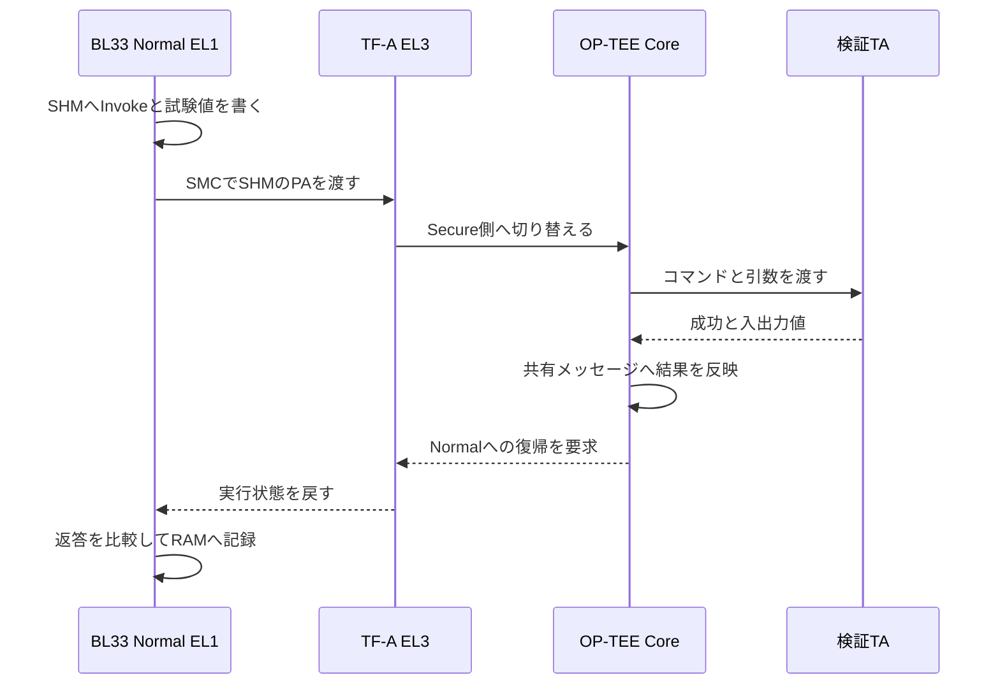

# TrustZone／OP-TEE検証コードを読むための基礎

作成：2026-11-06。対象：ZCU106、B2（TF-A＋OP-TEE＋Standalone BL33）。

目的は、コードの各行を「誰が、どこで、何を受け渡し、何を根拠に判定する処理か」と説明できるようになること。
一般的な仕組みと、このプロジェクト独自の実装を分けて記す。ファイル名はリポジトリ直下からの相対パス。
手元での変更や版によって行番号が変わるため、関数名を検索する。

## 先に押さえる全体像

> Normal側が共有メモリに要求を書く。SMCでSecure側へ処理を頼む。OP-TEEがTAを実行し、結果を返す。Normal側が期待値と比較し、RAMに記録する。

これが基本の往復。ただし、途中でNormal側への追加要求（RPC）が挟まる場合や、共有メモリを使わずレジスタだけで完了する呼び出しもある。

最初に読む範囲は1〜8章。メモリ保護・署名試験へ進むときに9章以降を使う。

---

## 1. ソフトウェアの役割を区別する

| 名前 | 今回の役割 | 読むときの注意 |
|---|---|---|
| BL31／TF-A | EL3で動くSecure Monitor。NormalとOP-TEEの切替・要求の振り分け | 自作TAのECHO処理を実行する場所ではない |
| BL32／OP-TEE Core | Secure OS。TAのロード・セッション・メモリ・呼び出しを管理 | TAと同じものではない |
| BL33 | Normal側の試験プログラム。要求作成、結果比較、RAM記録 | 今回はLinuxではなくStandalone |
| TA-A／TA-B | Secure側のユーザー権限で動く検証用アプリ | コマンドや認証状態の扱いは自作部分 |
| PTA | OP-TEE Core内の特権サービス | 通常のTAと同じ隔離境界ではない |
| XSDB | 外からロード・停止・メモリ回収を行うデバッガ | テスト実行コードそのものではない |
| Python解析ツール | 回収したBINを検証し、TXT／JSON／CSVへ変換 | 実機の代わりに試験を実行しているわけではない |

一般的なLinux構成には、アプリ、libteec、Linux TEEドライバ、tee-supplicantがある。
今回はその構成を丸ごと使わず、Normal側の自作クライアントで必要なメッセージ通信を行う。
`tee_invoke()` はこのプロジェクトの関数で、標準Client APIの `TEEC_InvokeCommand()` と同じ関数ではない。

**根拠ファイル**

- `tests/validation/main.c`
- `normal_world/client/client.c`
- `runtime/arch.c`
- `secure_world/ta/ta.c`
- `secure_world/pta/physical_probe.c`
- TF-Aソースの `services/spd/opteed/opteed_main.c`

## 2. WorldとELは別の軸

Worldはセキュリティ状態、ELは実行権限の階層。Normal／Secureと、ユーザー／特権を同じ意味で使わない。

| 実行場所 | 今回の代表 |
|---|---|
| EL3 | TF-AのSecure Monitor |
| Secure EL1 | OP-TEE Core、PTA |
| Secure EL0 | 通常のユーザーTA |
| Non-secure EL2 | BL33への起動時の引き渡し経路 |
| Non-secure EL1 | 起動処理後のBL33試験本体 |

今回のBL33はEL2から入り、EL1へ移る起動コードを持つ。EL1で動くからといってSecureになったわけではない。
同じEL1でも、Normal側とSecure側では使う実行状態やメモリ権限が違う。

**言えるようにすること**：
「NormalのEL1からSMCでEL3に入り、Monitorを介してSecure EL1のOP-TEEへ処理を渡します。ユーザーTAはSecure EL0で動きます。」

**根拠ファイル**：`boot/bl33_start.S`、`runtime/arch.c`。

## 3. 関数呼び出し・SMC・TAコマンドを区別する

```c
tee_invoke(&first, TA_COMMAND_ECHO, B2_TEST_VALUE);
```

この1行には3つの意味がある。

| 要素 | 意味 |
|---|---|
| `tee_invoke()` | Normal側の普通のC関数呼び出し |
| `TA_COMMAND_ECHO` | 自作TAが解釈するコマンド番号の名前 |
| `B2_TEST_VALUE` | 試験で渡す値。確認した版では `0x45A7` |

この行そのものが直接Secure側のC関数を呼ぶわけではない。
内部で要求を整形し、最終的にCPUの `smc #0` 命令を実行する。

`smc #0` の `#0` がECHO番号ではない。OP-TEEの呼び出し種別はレジスタへ、TAのコマンド番号は共有メッセージへ入れる。

**根拠ファイル**：`tests/validation/functional.c`、`secure_world/ta/validation_ta.h`、`normal_world/client/client.c`、`runtime/arch.c`。

## 4. 共有メモリはデータ、SMCは制御の受け渡し

共有メモリは、Normal側とSecure側の両方からアクセスできるようにしたRAM。
「書けば自動で処理が始まるメッセージキュー」とは限らない。

| 経路 | 渡すもの |
|---|---|
| 共有メモリ | セッションID、TAコマンド、引数、結果などのメッセージ |
| CPUレジスタ | SMCの機能番号、メッセージのアドレス、SMCの戻り値など |
| SMC／Monitor | 実行制御とWorldの切替 |

今回の基本的な流れ：

1. Normal側が共有メッセージに要求を書く。
2. 書込みの順序を整えてSMCを実行する。
3. TF-AがOP-TEEへ制御を渡す。
4. OP-TEEがメッセージを読み、要求を処理する。
5. 共有メモリへ結果を書き、Normal側へ復帰する。
6. Normal側が戻り値と共有メモリの結果を読む。

能力照会 `OPTEE_SMC_EXCHANGE_CAPABILITIES` や共有領域照会 `OPTEE_SMC_GET_SHM_CONFIG` は、レジスタによる要求・応答を使う。
TA実行の `OPTEE_SMC_CALL_WITH_ARG` は、共有メッセージの物理アドレスを渡す。

**根拠ファイル**：`normal_world/client/client.c` の `tee_client_initialize()`、`transport_call()`。

## 5. メッセージ形式＝ABIという契約

ABIは、別々に作ったソフト同士がデータの並びや引数の渡し方を一致させるための契約。
Normal側のC構造体と、OP-TEE側の読み方が一致していなければ通信できない。

今回の構造体はOP-TEEメッセージABIに合わせた自作定義。

```c
struct message_argument {
    uint32_t command, function, session, cancel_id;
    uint32_t padding, result, origin, count;
    struct message_parameter parameters[2];
};
```

| フィールド | 役割 | ECHO時の例 |
|---|---|---|
| `command` | OP-TEEに頼む操作の種類 | `OPTEE_MSG_INVOKE_COMMAND` |
| `function` | TAへ渡すコマンド番号 | `TA_COMMAND_ECHO` |
| `session` | 開いているセッションの識別子 | `first.id` |
| `count` | 渡すパラメータの数 | 1 |
| `parameters[0].attr` | 引数の種類・入出力方向 | VALUE_INOUT |
| `parameters[0].a` | 今回使う入出力値 | `0x45A7` |
| `result` | 処理結果コード | `TEE_SUCCESS` など |
| `origin` | エラー等の発生元を示す情報 | 解析時の手掛かり |

**同じ「コマンド」でも階層が違う。**

- SMC機能番号：OP-TEEへメッセージ処理を依頼する。
- `message->command`：Open／Invoke／Closeなどを指定する。
- `message->function`：TAのECHO／認証／暗号処理などを指定する。

`uint32_t` は32bit、`uint64_t` は64bit。幅・順序・padding・alignmentを勝手に変えない。
このコードの `_Static_assert` は、パラメータ開始offsetが32byte、1パラメータが32byteであることをビルド時に検査する。

**根拠ファイル**：`normal_world/client/client.c`。OP-TEE側：`core/include/optee_msg.h`、`core/arch/arm/include/sm/optee_smc.h`。

## 6. 共有メッセージの場所をSMCへ渡す

`transport_call()` の基本経路は次の形。

```c
result = smc_call(OPTEE_SMC_CALL_WITH_ARG,
                  address >> ADDRESS_HIGH_SHIFT,
                  address & UINT32_MAX, 0UL);
```

今回の実装では、機能番号をx0、共有メッセージのPAの上位32bitをx1、下位32bitをx2へ入れる。
`address >> 32` は上位部分、`address & UINT32_MAX` は下位部分を取り出す操作。

ここで `message` のポインタ値をPAとして使えるのは、この構成で対象領域のVA=PAを成立させていることが前提。
任意のOS・任意のポインタで同じ書き方をしてよいわけではない。

`runtime/arch.c` の `smc_call()` は、引数をレジスタへ置いて `smc #0` を実行し、戻ったx0〜x3をC構造体へ取り出す。
インラインアセンブリのclobber指定は、呼び出しで壊れる可能性のあるレジスタ等をコンパイラへ伝える契約。

**根拠ファイル**：`normal_world/client/client.c` の `transport_call()`、`runtime/arch.c` の `smc_call()`。

## 7. セッションとTAの入口

| 操作 | 目的 | 今回の関数 |
|---|---|---|
| Open | UUIDで対象TAを指定し、セッションを作る | `tee_session_open()` |
| Invoke | そのセッションへコマンドを送る | `tee_invoke()` |
| Close | セッションを閉じ、対応する資源を解放する | `tee_session_close()` |

UUIDは対象TAを選ぶ識別子。UUIDを知っていることやセッションを開けたことだけで、要求者の本人性が証明されるわけではない。
セッションごとの認証状態やカウンタは、別の検証項目。

OP-TEEは要求を解釈し、ユーザーTAの標準入口へつなぐ。

```c
TEE_Result TA_InvokeCommandEntryPoint(
    void *context, uint32_t command,
    uint32_t types, TEE_Param params[4]);
```

`command` はTAのコマンド番号、`types` はパラメータの種類、`params` は入力／出力。
Normal側の生の共有構造体が、そのままTAのローカルC構造体になるわけではない。Coreがメッセージを解釈し、必要な検査・変換を行う。

今回のECHO処理は、入力値を書き換えずに `TEE_SUCCESS` を返す実装。
そのため値が入出力パラメータの往復で保持されたことを検査できる。
ただし「同じ値だった」だけではTA実行の強い証明にならない。処理結果や別の異常系・状態変化の試験も組み合わせる。

**根拠ファイル**：`secure_world/ta/ta.c` の `TA_InvokeCommandEntryPoint()`、`normal_world/client/client.c`。

## 8. ECHOの往復をコードで追う



読む順番：

1. `tests/validation/functional.c`：`b2_run_service()`
2. `normal_world/client/client.c`：`tee_invoke()` → `transport_call()`
3. `runtime/arch.c`：`smc_call()`
4. `secure_world/ta/ta.c`：`TA_InvokeCommandEntryPoint()` のECHO分岐
5. `normal_world/client/client.c`：`transport_call()` の返答取り出し
6. `tests/validation/functional.c`：`first_ok` と `b2_check_value()`

最初からTF-A・OP-TEE内部の全関数を追う必要はない。まず入口と出口の契約を説明し、必要になったらOSS側へ降りる。

---

## 9. 成功には複数の段階がある

| 段階 | 確認対象 | 成功しても残る問題 |
|---|---|---|
| 通信・復帰 | `transport` | TAの処理がエラーかもしれない |
| 処理結果 | `result` | 返却データが期待値と違うかもしれない |
| データ・状態 | `value`や検査用buffer | 別セッションの隔離や後始末はまだ分からない |
| 資源解放 | close／live数／cleanup_errors | 別試験の合格を意味しない |

```c
bool first_ok =
    echoed.transport == TEE_CLIENT_OK &&
    echoed.result == TEE_SUCCESS &&
    echoed.value == B2_TEST_VALUE;
```

`&&` は全部が真であることを要求し、左が偽なら右を評価しない。
`b2_check_value("first-echo", 1UL, first_ok)` は期待する真偽値1と実測値を保存する。

`TEE-01` 全体では、2セッションのECHOと未知コマンドの拒否を合わせて判定する。
TAを開けなければBLOCKED。セッションのClose失敗はcleanup_errorsへ反映し、全体の完了判定でも確認する。

**注意**：`b2_check_value()` は比較結果を返すが、それを呼ぶだけで全体が自動的にFAILになるとは限らない。
戻り値が最終的な `service_ok`／statusへつながっているかまで読む。

**根拠ファイル**：`tests/validation/functional.c` の `b2_run_service()`、`b2_check_value()`、`b2_close_session()`、`b2_results_end()`。

## 10. RPC：処理途中にNormal側へ仕事を頼む

RPCは、Secure側からNormal側へ追加処理を依頼する往復。
例えば外部TAをロードする際、Normal側にTAデータの提供を求める場合がある。

流れ：TA呼び出し → Coreがデータを必要とする → RPCとしてNormalへ戻る → Normalが応答を用意 → 専用のSMCでCoreを再開 → 最終結果を返す。

RPCでNormalへ戻った時点は、元のTA呼び出しが完了した時点ではない。
今回の `signed_rpc_call()` はRPCを処理し、元の呼び出しが最終応答に至るまでを扱う。
未対応RPC・不正要求・回数上限等は、無条件に成功にしない。

| 一般的なLinux構成 | 今回の構成 |
|---|---|
| ドライバ／tee-supplicant等が協力 | BL33の自作RPC処理が必要な範囲を担当 |
| REE filesystem等からTAを供給 | XSDBで置いた署名TA bundleを供給 |

**根拠ファイル**：`normal_world/client/client.c`、`normal_world/client/signed_rpc.c`、`signed_rpc.h`。

## 11. TA・PTA・Early TA・署名TA

この4つは同じ分類軸ではない。

| 用語 | 主に表しているもの |
|---|---|
| ユーザーTA | Coreとは別のユーザー権限で動くアプリ |
| PTA | Core内の特権サービスとしての実装方式 |
| Early TA | TAイメージをCoreへ組み込んで供給する方式 |
| 外部署名TA | 外から供給した署名付きTAイメージをロードする方式 |

Early TAとして起動できたことだけで、外部TAの署名ファイルローダを検査したことにはならない。
Normal側がTAデータを運べたことだけで、Coreが署名を検証したことにもならない。

署名試験では、正常入力・改変入力・別鍵等に対する期待結果と、Coreローダ監査の段階を照合する。
署名検証は「信頼する公開鍵に対応する署名か」、digest検証は「署名対象とデータ内容が一致するか」という別の確認。
署名は暗号化とは異なる。署名TAが読めない状態に暗号化されているとは限らない。

**根拠ファイル**：`build_config/components.mk`、`scripts/prepare_core.py`、`tests/validation/signed_ta_tests.c`、`secure_world/loader/signed_loader_audit.h`、`scripts/decode_signed_results.py`。

## 12. VA・PA・MMU・XMPU

| 用語 | 何を扱うか | 今回の注意 |
|---|---|---|
| VA | CPU命令が使う仮想アドレス | 数値が同じでも別Worldでは同じ変換とは限らない |
| PA | アドレス変換後の物理アドレス | SMCに渡す共有メッセージの場所を区別する |
| MMU | VA→PA変換、アクセス権、メモリ属性 | MMUで拒否されたこととXMPUで拒否されたことは別 |
| XMPU | バス側で領域・master・security属性等を検査 | MMUを通ったアクセスに対する物理側の拒否を調べる |
| MMIO | ハードウェアレジスタのアドレス空間 | RAMのように任意に読み書きしてよい領域ではない |

物理保護試験では、Normalの一時VA `0x80000000` を、Secure試験ページのPAへ写像する。
先に `AT S1E1R/W` と `PAR_EL1` で、変換結果が狙ったPAかを確認する。
そのうえでデータアクセスを行い、例外やXMPU記録を調べる。

MMUのpermission faultだけでは、「外側の物理保護が拒否した」とは言えない。
同じく、XMPUへ設定値を書いて読み返せただけでは、試験アクセスが実際に拒否された証明にならない。

**根拠ファイル**：`platform/zcu106/b2/client_mmu.c`、`tests/validation/physical_memory.c`、`physical_policy.c`、`scripts/jtag/xmpu_readonly.tcl`。

## 13. cache・volatile・barrier

| 仕組み | 保証すること／しないこと |
|---|---|
| `volatile` | 対象アクセスをコンパイラが省略しないようにする。排他・cache整合・原子性の保証ではない |
| compiler barrier | コンパイラによる並べ替えを制約する。CPU cacheをflushする命令ではない |
| DSB | 指定範囲のメモリアクセス等の完了・順序を保証する。dirty cache lineを自動で全部書き戻す意味ではない |
| ISB | 制御レジスタ等の変更を後続の命令実行へ反映させるために使う |
| cache clean | 更新したcacheの内容を指定の整合点へ書き戻す |
| cache invalidate | cacheの保持内容を無効化する。dirty dataの扱いには注意が必要 |

共有メモリのcache属性・shareability・coherency経路が両側の契約と合っていることが前提。
`dsb sy` があるから任意の非整合cache構成で通信できる、とは説明しない。

物理試験では、Secure側のdirty cacheが改変を隠さないように、準備・検査・公開時にcache maintenanceを行う。
JTAGでRAMを読む場合も、CPUの最新の書込みが外部から見える状態かを考える。

**根拠ファイル**：`normal_world/client/client.c` の `synchronize_message()`、`secure_world/pta/physical_probe.c`、`tests/validation/physical_memory.c`、`runtime/include/exception_capture.inc`。

## 14. 例外の種類と記録

例外は、CPUが決められた入口へ制御を移す仕組み。すべてが同じ「エラー」ではない。

| 種類 | 今回の意味 |
|---|---|
| SMC例外 | Secure側へ処理を依頼するための意図した入口 |
| 同期Data Abort | 特定のデータアクセスに対応して生じる例外 |
| SError | 非同期に通知されるシステムエラー。直前の1命令へ単純に結び付けられない |
| IRQ／FIQ | 割り込み。今回の全性能項目が対応しているわけではない |

| レジスタ | 読む意味 |
|---|---|
| PC | 今止まっている命令の位置 |
| ESR_ELx | 例外の種類と詳細原因 |
| ELR_ELx | その例外に関係する復帰位置。種類により解釈が違う |
| FAR_ELx | 有効な種類の例外での対象アドレス。常に有効ではない |
| SPSR_ELx | 例外前のCPU状態 |
| VBAR_ELx | 例外ベクタの基点 |
| DAIF | debug／SError／IRQ／FIQのmask |

同期外部abortの照合では、種類・fault PC・FAR・読書き方向・変換状態を合わせて確認する。
SErrorではFARやELRだけから原因となった物理アクセスを断定しない。

例外から復帰するコードは、汎用レジスタ・stack・ELR・SPSRを壊さない必要がある。
`eret` は通常のC関数の `return` ではなく、保存された例外状態へ戻る命令。

`platform_halt`・`idle.c`・`panic` のループへ来たこと自体はPASSの根拠にならない。
成功・失敗・致命例外で、いずれも待機ループに到達する可能性がある。

**根拠ファイル**：`runtime/el1_vectors.S`、`runtime/el1_fault.c`、`runtime/include/exception_capture.inc`、`runtime/arch.c`。

## 15. Cコードを読むときの最小限の約束

| 書き方 | このコードでの読み方 |
|---|---|
| `&first` | 構造体firstのアドレスを関数へ渡す |
| `session->id` | ポインタが指す構造体のidフィールド |
| `params[0].value.a` | 第0パラメータ内の値a |
| `const` | その参照を通して変更しない指定。外部入力の真正性の保証ではない |
| `static`な関数 | そのCファイル内だけで使う関数 |
| `extern` | 別ファイル等で定義された実体を参照する宣言 |
| `#define`／`#if` | ビルド時の置換／選択。実行時のifとは違う |
| `1UL << n` | n番目のbitのmaskを作る |
| `v & mask` | 必要なbitを取り出す |
| `v | mask` | 指定bitを立てた値を作る |
| `goto cleanup` | 資源解放等の共通出口へ進む |
| `_Static_assert` | ビルド時に構造や定数条件の整合性を確認する |

`value == 0` の意味は変数ごとに違う。`TEE_SUCCESS`、SMCの戻り値、bool、例外bitを混同しない。
また、名前が `check_*` でも、検査結果が最終判定へ反映されているかを確認する。

## 16. ELF・BIN・リンカ・起動

| 用語 | 役割 |
|---|---|
| ELF | LOAD先、entry、section、symbol、デバッグ情報等を保持する形式 |
| BIN | 生のbyte列。通常それ自体にロード先・entryの説明はない |
| linker script | コード・data・BSS・stack等の配置を決める |
| BSS | Cのゼロ初期化領域。起動コードで初期化する |
| stack | 関数呼び出しや一時保存に使う領域 |
| entry | 実行を開始する位置。ファイル名だけでは決まらない |

`dow ELF` はELFのロード情報を使う。`dow -data BIN address` は指定場所へbyte列を置く。
ロードしただけで、DDR初期化や適切なEL・Worldへの復帰が済むわけではない。

今回の予約の目安：

| 用途 | PA区間（終端を含まない） |
|---|---|
| BL31 | `[0x00001000, 0x00080000)` |
| BL33 code | `[0x10200000, 0x10300000)` |
| BL33 data等 | `[0x10300000, 0x10400000)` |
| BL33 stack | `[0x10400000, 0x10500000)` |
| SHM | `[0x10500000, 0x10600000)` |
| signed bundle | `[0x10600000, 0x10700000)` |
| physical専用窓 | `[0x10800000, 0x10900000)` |
| OP-TEE予約 | `[0x60000000, 0x70000000)` |

予約区間と実際のELF占有は別。RAMログ等の内部symbol位置はビルドで動く。
同じprofile・同じビルドの `tee.elf` と `tee-raw.bin` を使い、別構成のBINで上書きしない。

**根拠ファイル**：`platform/zcu106/b2/linker_bl33.ld`、`platform/zcu106/b2/memory_map.h`、`platform/zcu106/memory_map.h`、`build_config/components.mk`、`boot/bl33_start.S`。

## 17. Normalから見た結果だけで何を言えるか

最終的な比較・記録は主にBL33で行うが、実際の検査はSecure側にもある。
例えばSecureページの非改変は、PTAがページ全体を比較し、その結果をNormalへ返す。
Normalの返答だけを見るのではなく、PTA側が本当に必要な範囲を検査しているかをコードで確認する。

| 証拠 | 分かること |
|---|---|
| 試験コード | 何を操作し、何を比較したらPASSになる設計か |
| TA／PTAコード | Secure側が何を検査して返しているか |
| RAMログ・結果BIN | 今回の実行で記録した返答・比較・到達段階 |
| Coreローダ監査 | 署名検証等のCore内部の段階 |
| 例外・XMPU記録 | どの機構の拒否として観測したか |
| ELF hash・run ID・回収計画 | 結果をどのビルド／実行に結び付けたか |

これはデバッガとNormal側の試験プログラムを管理できる検証環境での証跡。
敵対的なNormal側が任意に偽造できない、暗号学的なリモート証明を実装したという意味ではない。

**レビューでの説明型**：
「この関数でこの要求を出します。Secure側のこの処理が検査します。Normal側ではこの期待値と比較し、今回の記録はこの値でした。したがってこの範囲を確認しました。」

## 18. PASS・BLOCKED・COMPLETE・MEASURED

| 表示 | 説明 |
|---|---|
| PASS | その試験が定義した合格条件を満たした |
| FAIL | 実行結果が期待条件に反した |
| BLOCKED | 必要な前提・機能・証跡がそろわず、合格を判断できない |
| Collection COMPLETE | 選択した試験結果・ログ等を整合する形で回収／解析できた。全項目PASSとは別 |
| MEASURED | 性能サンプルを得た。要求性能の基準値との比較合格とは別 |

性能のticksはタイマcount。`時間[µs] = ticks / timer_hz × 1,000,000`。
p50は中央値、p95・p99は遅い側の分布を見るpercentile。統計検定のp値とは違う。
平均／percentileを比較するときは、測定区間、cache状態、timer周波数、サンプル数、外れ値の扱いをそろえる。

**根拠ファイル**：`runtime/benchmark/benchmark.c`、`tests/validation/main.c`、`scripts/decode_b2_results.py`、`scripts/decode_b2_review.py`。

### Secure側でも入力検査が必要な理由

共有メモリはNon-secure側にあるため、Secure側からは信頼済みの秘密領域として扱えない。
今回の試験プログラムが意図どおり書いていても、実際のシステムでは悪意のある要求を想定する。

- アドレスと長さが許可範囲内か。`base + size` の整数overflowがないか。
- パラメータの個数・種類・入出力方向がコマンドの契約どおりか。
- sessionが有効で、そのsessionに必要な権限・状態があるか。
- 共有入力を検査した後、使うまでに書き換わる問題（TOCTOU）がないか。
- bufferの寿命、排他、再利用、解放後の参照をどう扱うか。

Normal側の検査だけではSecure側の防御にならない。TA／Core側にも必要な検査があるかを追う。
逆に、単にSecure側に置いたコードが自動的に安全になるわけでもない。
このプロジェクトは単一CPU・同期呼び出しを基本前提としており、任意の並列実行の安全性まで証明していない。

## 19. コードを読む順番と止めどころ

| 順 | 読む場所 | 最初に答える問い |
|---|---|---|
| 1 | `tests/validation/main.c` の `standalone_main()` | 初期化と試験開始の条件は何か |
| 2 | `tests/validation/functional.c` の `b2_run_service()` | 入力・期待値・判定・cleanupは何か |
| 3 | `normal_world/client/client.c` の `tee_invoke()` | どの要求をどのフィールドへ入れるか |
| 4 | 同 `transport_call()` | SMCへ何を渡し、何を返すか |
| 5 | `runtime/arch.c` の `smc_call()` | Cの引数とCPUレジスタの対応は何か |
| 6 | `secure_world/ta/ta.c` | TAが何を確認し、何を変更するか |
| 7 | `b2_check_value()`／`b2_results_end()` | 比較結果と終了状態をどう保存するか |
| 8 | `scripts/decode_b2_results.py` | 不完全・不一致・古い結果をどう拒否するか |
| 9 | 署名／物理の個別試験コード | 基本経路に何を追加しているか |

全関数を暗記する必要はない。まず一つのECHOについて、要求作成→SMC→TA→結果比較の説明を完成させる。
そこから他の試験は「入力」「期待する拒否／成功」「追加の証跡」「後始末」の違いとして読む。

## 20. 説明前の自己確認

各試験について、この6点を自分の言葉で答える。

1. 誰がどのWorld／ELから要求するか。
2. 入力値・コマンド・bufferは何か。
3. Secure側が実際に行う処理は何か。
4. どの戻り値・データ・例外を比較するか。
5. 今回の実行記録のどこに、その結果があるか。
6. この試験だけでは確認できないことは何か。

特に混同しやすいもの：

- WorldとEL
- C関数とSMC命令
- SMC機能番号とTAコマンド番号
- `message->command` と `message->function`
- 通信の成功とTA処理の成功
- 同期外部abortとSError
- MMUの拒否とXMPUの拒否
- 署名検証と暗号化
- セッションと本人認証
- 結果回収完了と全試験合格

---

## 付録A：現時点の実機結果を説明するときの注意

以下は会話でのユーザー報告に基づく整理で、生dumpを本書作成時に再解析した結果ではない。

- signedレビュー再試験：run ID `0x2026110504`。`EXT-TA-V03` はPASS、Collection COMPLETEと報告。
- `PERF-03` は今回の構成で対象外の項目として扱う。測定可能項目の性能値の評価とは別。
- physical：最初のNormal読取りで同期外部abortを記録。XMPU1に試験領域のAPU SecurityVIOも記録。
- その後の保留SErrorを確認。現行の手元診断版は記録して停止し、全4アクセス・非改変・継続・cleanupの完走は未確認。
- SError復帰用の完成候補は、ユーザー環境で適用・実機確認済みとは扱わない。
- OP-TEEコピーで物理試験窓をNon-secure DDRから除外した修正など、手元差分がある。レビュー対象はcommit IDだけでなく差分も含めて固定する。

## 付録B：根拠資料

### このプロジェクト

`ririmon22/trustzone-validation` の `refactor/readable-components-review-20261102` ブランチを基に確認したコードと、会話で共有された手元修正が対象。

https://github.com/ririmon22/trustzone-validation/tree/refactor/readable-components-review-20261102

### OP-TEE標準の仕組み

- Shared Memory／SMC／OP-TEE Message ABI： https://optee.readthedocs.io/en/latest/architecture/core.html
- TAの実装・入口・TA-devkit： https://optee.readthedocs.io/en/latest/building/trusted_applications.html
- PTA等のアプリ構成： https://github.com/OP-TEE/optee_docs/blob/master/architecture/trusted_applications.rst
- TF-AのOP-TEE dispatcher：TF-Aソースの `services/spd/opteed/opteed_main.c`

標準仕様は通信の契約を、プロジェクトのコードは実装を、実機記録は今回の動作を示す。3つをつないで説明する。
