# TrustZone試験 T-01〜T-21：現行の検証内容・合格基準・reportとコード根拠

改訂日：2026-11-09。**現行コードの試験内容・検証方法・自動判定条件が一致するように書き直した版。** T-01〜T-21とreport正式IDは維持し、項目名は実施範囲が分かる名称へ修正した。

以前の表は「将来確認したい広い内容」と「現行コードのPASS条件」を同じ合格基準へ混ぜていた。本版では各項目に、今回の検証範囲、手順、自動判定条件、追加確認の範囲を明記する。機能を未実装のまま合格扱いにする変更や、コードのPASS条件の変更は行っていない。

対象コード：`refactor/readable-components-review-20261102`、実装確認commit `a94646ea4130b448961c7921c57d1d317da8f36b`。リンクはこの版へ固定。実際のreport・raw dump・ロード済みELFは未受領のため、本書の期待値はコード上の条件であり実測結果ではない。手元の未push修正、特に物理試験・TF-AのSError対応は差分確認が必要。

**読む順番：T番号で項目を選ぶ → reportの正式IDを検索 → checkと期待値 → シーケンス → コード → 公式資料。**

各章は「今回確認する範囲 → 検証手順 → 合格条件 → 対象外・追加確認 → report証拠 → シーケンス → コード・公式根拠」の順で読む。合格条件は自作試験コードに基づく。公式資料は通信・API・CPU機構の根拠であり、この試験の回数や独自command、独自合否規則を公式が定めたという意味ではない。

2026-11-09に公開ブランチ先端`d22db7ca6c10b762328fe4e8540943429725b2f1`までの差分を確認した。実装確認commitから追加されたのはMD資料2件で、試験ソースの差分はなかった。本書のコードリンクは実装確認commitへ固定する。手元のビルド用Coreコピーや未push修正が一致する保証ではない。

## 1. T番号とreport名・実装上の親番号の対応

**T番号と`B2_REVIEW_PARENT`は一部で順番が違う。** T-11を実行するためにparent=11を選ぶと鍵API試験になり、起動署名試験にはならない。必ず下表の正式IDを介して照合する。

|連番ID|元の21項目ID／reportの親test_id|検証項目|B2_REVIEW_PARENT|reportの詳細証拠|現行結果の採用範囲|
|---|---|---|---|---|---|
|[T-01](#t-01)|`TZ-SYS-01-V01`|NormalからのTAサービス実行と結果の照合|1|TEE-01|reportのPASSはサービス往復。両側EL/Stateの直接証拠は別途|
|[T-02](#t-02)|`TZ-SYS-02-V01`|TA呼出しからNormal処理への復帰と継続|2|TEE-01|往復・Normal継続。復帰PCの直接比較は別途|
|[T-03](#t-03)|`TZ-SYS-02-V02`|256回のTA往復における指定状態の保持|3|親自身の16check|256回と指定状態の保持|
|[T-04](#t-04)|`TZ-SYS-03-V01`|専用SecureページへのNormal read/write拒否・非改変・復帰|4|TZ-SYS-03＋PHYSICAL EVIDENCE|reviewはBLOCKED。専用実行で4probeと追加証跡|
|[T-05](#t-05)|`TZ-SYS-03-V02`|共有メモリの範囲・型・内容検査と拒否後の継続|5|TEE-SHM-01 / TEE-BOUNDARY-01 / TEE-PARAM-01|SHM・型・内容・境界の実装範囲|
|[T-06](#t-06)|`TZ-SYS-04-V01`|Secure周辺機器保護：未実施|6|なし|SKIP・未実施|
|[T-07](#t-07)|`TZ-SYS-05-V01`|DMAからのSecureメモリ保護：未実施|7|なし|SKIP・未実施|
|[T-08](#t-08)|`TZ-SYS-06-V01`|Secure割込み配送：選択ZCU構成では未実施|8|なし|BLOCKED・未実施|
|[T-09](#t-09)|`TZ-SYS-07-V01`|JTAGデバッグ制限：未実施|9|なし|SKIP・未実施|
|[T-10](#t-10)|`EXT-AUTH-V01`|TA呼出元identityの認可と固定トークンのsession状態|10|TEE-AUTH-TA＋親token検査|TA identityと固定tokenのみ。本物のNormal要求者認証は未実装|
|[T-11](#t-11)|`EXT-BOOT-V01`|SoC認証bootによる起動署名検証：未実施|15|なし|SKIP・未実施|
|[T-12](#t-12)|`EXT-KEY-V01`|非抽出鍵のAPI制約とAESの正常動作|11|TEE-KEY-API / TEE-KEY-ATTR-01|API・暗号のみ。生メモリ抽出は未実施|
|[T-13](#t-13)|`EXT-STORE-V01`|Secureデータ永続保存：未実施|16|なし|SKIP・未実施|
|[T-14](#t-14)|`EXT-TA-V01`|User TAの正常呼出しと入力・sessionの拒否層|12|TEE-01 / TEE-SESSION-01 / TEE-ABI-01 / TEE-SESSION-CORE-01 / TEE-PARAM-01|指定入力・client4枠・session等の範囲|
|[T-15](#t-15)|`EXT-TA-V02`|TAの異常終了・仮想空間分離・復旧とCore/資源の補足|13|TEE-07 / TEE-ISO-TA＋Core・stress補足|子2件＋Core canary＋512反復を別々に確認|
|[T-16](#t-16)|`EXT-TA-V03`|外部署名TAの実ロード・不正image拒否とローダ監査|14|TEE-04＋SIGNED LOADER|8ケースとCore署名/digest監査が必要|
|[T-17](#t-17)|`PERF-01`|GET_SHM_CONFIG fast SMCの往復時間測定|17|BENCHMARKS.series_id=PERF-01|MEASURED・閾値なし|
|[T-18](#t-18)|`PERF-02`|Normal cached SHMへの512B store区間の時間測定|18|BENCHMARKS.series_id=PERF-02|NS cached SHM store区間のみMEASURED|
|[T-19](#t-19)|`PERF-03`|Secure割込み応答時間：選択ZCU構成では未測定|19|なし|BLOCKED・未測定|
|[T-20](#t-20)|`PERF-04`|許可領域間のDMA転送性能：未測定|20|なし|SKIP・未測定|
|[T-21](#t-21)|`PERF-05`|TA ECHO・暗号・Open/Close・復旧の6系列測定|21|BENCHMARKSのPERF-05 / 06 / 08 / 09 / 10 / 11|6系列MEASURED。Storage未測定|

親単独を選ぶ一般形は`B2_TEST_INDEX=17 B2_REVIEW_PARENT=<上表の番号>`。**この説明は選択対応であり、未実装項目を有効にする操作ではない。** T-04の物理実probeは別選択15、T-16の署名单独は選択16。実行profile・Core・ゲートも別に一致させる。

|特に間違えやすい組合せ|T番号|実装上の親番号|
|---|---|---|
|EXT-BOOT-V01|T-11|15|
|EXT-KEY-V01|T-12|11|
|EXT-STORE-V01|T-13|16|
|EXT-TA-V01|T-14|12|
|EXT-TA-V02|T-15|13|
|EXT-TA-V03|T-16|14|

### 「OK」の3段階を区別する

|段階|表示／判定|意味|
|---|---|---|
|回収|Collection COMPLETE|必要な実行記録が揃う。FAILやBLOCKEDを完全に回収できる場合もある|
|実装した小試験|reportのPASS、またはMEASURED|コードに書かれた範囲だけが成立|
|レビューで採用する結論|本書に明記した検証範囲と追加観測を満たすか|reportのPASSから証明していない範囲へ結論を広げない|

本版のT-10は「TA identityと固定トークン」、T-12は「非抽出鍵APIとAES」という現行実装の範囲に定義を改めた。その範囲のPASSを説明する。Normal要求者の本人認証や生メモリ鍵抽出耐性を検証済みにする意味ではない。未実施項目は未実施のまま記載する。

### 全項目に適用する採用条件

子のPASSだけで完了としない。対象が選択済みで、記録が今回のELF・run ID・回収計画と対応し、結果が完了し、cleanup_errors=0であることも確認する。子のstatusを先に保存し、その後Closeする実装があるため、子PASSと後始末成功は別々に確認する。

`report.txt`の親、子、追加証跡は異なる判定層である。T-15の親再設定、T-16のCore監査、T-04の外部保護帰属、性能のMEASUREDは特に区別する。個別章の条件をすべて満たした場合に、その章で定義した範囲の結果を採用する。

## 2. report.txtを開いたら最初に見るところ

### 2.1 reportはどこから来るか

1. BL33の試験関数が操作し、`b2_check_value`に期待値と実測値を渡す。
2. `test_report`が子試験statusを`b2_results`へ保存する。
3. review実行では、子結果を親へ引き継ぎ、親自身の追加検査を`b2_review_results`へ保存する。
4. 停止後、JTAGで結果RAM・ログ・追加証跡を`.bin`として保存する。
5. PC上の`decode_b2_results.py`がELF・run ID・回収計画との対応を検査して`report.txt`、`.json`、性能`.csv`を出力する。

`report.txt`はBL33から直接出るファイルではない。RAMの結果をPCで整形したもの。TF-A/OP-TEE/TAの全内部traceも含まれない。

根拠：[tests/validation/functional.c：b2_check_value](https://github.com/ririmon22/trustzone-validation/blob/a94646ea4130b448961c7921c57d1d317da8f36b/tests/validation/functional.c#L116)、[tests/validation/functional.c：b2_save_report](https://github.com/ririmon22/trustzone-validation/blob/a94646ea4130b448961c7921c57d1d317da8f36b/tests/validation/functional.c#L141)、[runtime/test_runner/runner.c：test_report](https://github.com/ririmon22/trustzone-validation/blob/a94646ea4130b448961c7921c57d1d317da8f36b/runtime/test_runner/runner.c#L21)、[scripts/decode_b2_results.py](https://github.com/ririmon22/trustzone-validation/blob/a94646ea4130b448961c7921c57d1d317da8f36b/scripts/decode_b2_results.py#L1)。

### 2.2 共通の証拠確認

|見る場所・検索文字|OKの目安|何が分かるか|
|---|---|---|
|冒頭`Collection=`|`COMPLETE`|必要記録を回収・解析できた。全試験合格とは別|
|同じ行`state=`、`phase=`|`COMPLETE`、`DONE`|子結果の実行記録が終了した|
|`cleanup_errors=`|`0`|記録したsession等の後始末に失敗していない|
|子試験行`selected=`|評価する子は`True`|未選択をPASSに数えない|
|子試験行のstatus|対象子が`PASS`|子の複合判定が成立した|
|子の比較行`expected`/`actual`/`matched`|期待値と一致、`matched=True`|記録された比較が一致した|
|`REVIEW`の対象`test_id`|対象機能は`status: PASS`、`phase: DONE`|親の集計。子証拠とセットで読む|
|`REVIEW`内`cleanup_errors` / `collection_status`|`0` / `COMPLETE`|親追加試験を含む後始末・記録完了|
|`SIGNED LOADER`|`status: PASS`。UNVERIFIEDでない|T-16の追加監査をPC側でも照合できた|
|`PHYSICAL EVIDENCE`|4 attemptの厳密条件|T-04。別途XMPU設定・違反情報も必要|
|`BENCHMARKS`|`collection_status: COMPLETE`、`errors: 0`|T-17・T-18・T-21の測定成立|
|`BL33 RAM LOG`|対象のREPLY/CHECK/REVIEW/RESULTと`END`|操作の返り値や途中経過。全体完了と併読|

**report本文にFAIL/BLOCKED/SKIP/NOT_RUNがあること自体を隠さない。** 一式では未対応・別実行の項目も正しく表示される。選択していないNOT_RUNは未実施。別runのPASSを埋め込まない。

decoderは終了code0でも親だけのBLOCKEDを集計しない経路がある。終了codeやPASS件数だけで判定しない。各対象ID・reason・追加証跡を見る。

### 2.3 出力の形と数値の読み方

以下は**形式例で実測ではない**。子の行はテキスト、REVIEW等の詳細はJSON形式で同じtxtに埋め込まれる。

```text
Collection=COMPLETE state=COMPLETE phase=DONE cleanup_errors=0
TEE-01 PASS phase=DONE selected=True two-sessions+echo+invalid-command
  first-echo expected=0x1 actual=0x1 matched=True
  second-echo expected=0x1 actual=0x1 matched=True
  unknown-command-rejected expected=0x1 actual=0x1 matched=True
```

```json
{"test_id":"TZ-SYS-01-V01","status":"PASS","phase":"DONE",
 "checks":[{"name":"functional-status","expected":0,"actual":0,"matched":true}]}
```

|値|意味|
|---|---|
|`expected=1 actual=1`の複合check|`transport/result/value`等の条件をまとめたboolがtrue。返却データ1とは限らない|
|`functional-status expected=0 actual=0`|test enumのPASSが0なので一致。処理未実行という意味ではない|
|`transport=0`|自作client通信が正常完了。TA処理の成功とは別|
|`result=0x00000000`|TEE_SUCCESS|
|`origin=3`|OP-TEE Core側の結果|
|`origin=4`|TAサービス側の結果。PTAの戻りにも出る|
|`0xffff0001`|ACCESS_DENIED。意図した拒否ならOK|
|`0xffff0006`|BAD_PARAMETERS。意図した拒否ならOK|
|`0xffff000f`|SECURITY|
|`0xffff3024`|TARGET_DEAD。意図したTA異常終了ならOK|

親詳細JSONは数値が10進になる。例えば`4294901761`は`0xffff0001`。Pythonで`hex(4294901761)`として確認できる。`REVIEW_RESULT ... status=0`等のRAMログは数値enum、PC側親表は文字列statusである。

根拠：[scripts/decode_b2_results.py](https://github.com/ririmon22/trustzone-validation/blob/a94646ea4130b448961c7921c57d1d317da8f36b/scripts/decode_b2_results.py#L1)、[scripts/decode_b2_review.py](https://github.com/ririmon22/trustzone-validation/blob/a94646ea4130b448961c7921c57d1d317da8f36b/scripts/decode_b2_review.py#L1)。値の公式定義は後述O5。

## 3. 共通シーケンス：最初に一度だけ説明する

### 3.1 登場人物

|名前|担当|コード|
|---|---|---|
|BL33|Normal EL1で試験を実行し、応答と期待値を比較してRAMへ保存|`tests/validation/`、`normal_world/client/`|
|TF-A|BL31、EL3。SMCを受け、OP-TEEとのWorld切替を仲介|外部`services/spd/opteed/opteed_main.c`|
|OP-TEE|BL32、Secure EL1。message検査、session管理、TA実行、鍵API等|外部`core/tee/entry_std.c`、`core/kernel/tee_ta_manager.c`|
|TA-A|通常の試験対象TA。session認可・counter・鍵・攻撃側など|`secure_world/ta/ta.c`、`security.c`|
|TA-B|別UUIDのTA。被保護側・継続確認・TA間認可先|同じソースを`TA_VARIANT_B`で別ビルド|

同じA53上で順番に実行が切り替わる。5つの別CPUが並列動作する図ではない。PTAはOP-TEEの箱の中に書く。署名TAはTA-A/Bとは別UUIDなのでT-16だけ追加の登場人物として示す。

### 3.2 Open → Invoke → Close

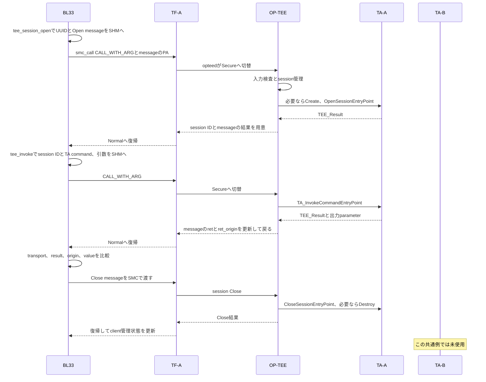

矢印の「返る」は制御と結果の伝達を模式化したもの。TAがTF-Aへ直接returnするわけではない。TAとCore間はuser mode entry/syscall、World間はSMCという別の境界。

|段階|コードを開く場所|見る処理|公式根拠|
|---|---|---|---|
|実行選択|[tests/validation/main.c：standalone_main](https://github.com/ririmon22/trustzone-validation/blob/a94646ea4130b448961c7921c57d1d317da8f36b/tests/validation/main.c#L284)、[tests/validation/functional.c：b2_run_functional_suite](https://github.com/ririmon22/trustzone-validation/blob/a94646ea4130b448961c7921c57d1d317da8f36b/tests/validation/functional.c#L268)|準備後、selectedの関数を呼ぶ|試験選択・PASS条件は自作仕様|
|message作成|[normal_world/client/client.c：tee_session_open](https://github.com/ririmon22/trustzone-validation/blob/a94646ea4130b448961c7921c57d1d317da8f36b/normal_world/client/client.c#L151)、[normal_world/client/client.c：tee_invoke](https://github.com/ririmon22/trustzone-validation/blob/a94646ea4130b448961c7921c57d1d317da8f36b/normal_world/client/client.c#L177)|command/session/function/count/attr/aを書込|O1・O2|
|SMC|[normal_world/client/client.c：transport_call](https://github.com/ririmon22/trustzone-validation/blob/a94646ea4130b448961c7921c57d1d317da8f36b/normal_world/client/client.c#L71)、[runtime/arch.c：smc_call](https://github.com/ririmon22/trustzone-validation/blob/a94646ea4130b448961c7921c57d1d317da8f36b/runtime/arch.c#L24)|DSB後、message PAをx1/x2に分けて渡す|O2・O3・O8|
|Coreへdispatch|O3 `opteed_smc_handler`|Normal/Secure context切替|O3|
|Core入力・session|O4 `entry_open_session` / `entry_invoke_command` / `entry_close_session`|memref・型・session検査、TAへdispatch、結果をmessageへ|O1・O4|
|TA処理|[secure_world/ta/ta.c：TA_InvokeCommandEntryPoint](https://github.com/ririmon22/trustzone-validation/blob/a94646ea4130b448961c7921c57d1d317da8f36b/secure_world/ta/ta.c#L142)、[secure_world/ta/security.c：security_invoke](https://github.com/ririmon22/trustzone-validation/blob/a94646ea4130b448961c7921c57d1d317da8f36b/secure_world/ta/security.c#L169)|独自command番号で分岐|O5はAPIの根拠。command番号・期待値は独自|
|復帰・比較|[normal_world/client/client.c：transport_call](https://github.com/ririmon22/trustzone-validation/blob/a94646ea4130b448961c7921c57d1d317da8f36b/normal_world/client/client.c#L71)、各試験関数|SMC完了とmessageの処理結果を別々に読む|O2・O4|
|結果保存|[tests/validation/functional.c：b2_check_value](https://github.com/ririmon22/trustzone-validation/blob/a94646ea4130b448961c7921c57d1d317da8f36b/tests/validation/functional.c#L116)、[tests/validation/review.c：inherit](https://github.com/ririmon22/trustzone-validation/blob/a94646ea4130b448961c7921c57d1d317da8f36b/tests/validation/review.c#L102)|expected/actual・子status・親status|自作判定規則|

`tee_invoke`はこのrepoの自作関数。GlobalPlatformの`TEEC_InvokeCommand`そのものではない。Linux driver/tee-supplicantを使う一般例と、本構成のbare-metal BL33＋限定RPCを区別する。

以後の図で、途中を`SMCで要求`とまとめた箇所もこの共通経路を通る。TA内からCore APIを呼ぶたびにTF-Aへ出るわけではない。

<a id="t-01"></a>

## T-01：NormalからのTAサービス実行と結果の照合（TZ-SYS-01-V01）

|対応項目|内容|
|---|---|
|reportの親test_id|`TZ-SYS-01-V01`|
|B2_REVIEW_PARENT|`1`。T番号とは別体系|
|従来の項目名|Secure／Normalの別々の実行|

### 今回の検証内容

Normal側BL33がTA-Aのサービスを実行し、返ってきた値をBL33自身で比較できることを確認する。BL33の起動時CurrentEL確認は実行前提として扱う。TA-Aの二つのsessionを使う試験であり、TA-AとTA-Bを一つずつ動かす試験ではない。

### 具体的な検証方法

1. BL33起動時にCurrentELを読み、EL1でなければ試験へ進まず停止する。
2. `b2_run_service()`でTA-Aへ二つのsessionをOpenする。いずれかのOpenが成立しなければ`TEE-01`はBLOCKEDとなる。
3. 一つ目のsessionでECHOへ`0x45a7`を渡す。
4. 二つ目でも同じECHOを実行する。
5. 一つ目に未定義command `UINT32_MAX`を送り、エラーとして戻ることを調べる。
6. BL33で応答を比較して子結果を記録し、開いているsessionをCloseする。
7. review親`TZ-SYS-01-V01`はこの子結果を引き継ぐ。

### 現行コードに合わせた合格条件

- 1回目・2回目のECHOはともに`transport=0`、`result=TEE_SUCCESS`、`value=0x45a7`。
- 未定義commandは`transport=0`、`result=TEE_ERROR_BAD_PARAMETERS`。この子の判定式ではoriginの数値一致まで要求していない。
- `first-echo`、`second-echo`、`unknown-command-rejected`がすべて1で、`TEE-01`がPASS。
- 親を実行した場合は`TZ-SYS-01-V01`がPASS。さらに共通の回収完了・後始末条件を満たす。

### この結果だけでは確認していないこと・追加確認

各処理地点のSecurity State、TF-A/Core/TAの実行ELを直接採取する試験はこの親に含まれない。5地点でのEL/World観測は追加のデバッガ確認として別記する。CurrentELだけではSecure/Non-secureを区別できない。

### レビューでの説明例

> Normalで要求を出し、TA-Aの二つのsessionから期待値を受け取り、Normalの比較処理と後始末まで進むことを確認しています。

### reportで見る場所

|検索する項目|OK条件|意味|
|---|---|---|
|`TEE-01 PASS`|`selected=True`、`phase=DONE`|子試験を実行した|
|`first-echo`、`second-echo`|各expected=actual=`1`、matched=True|各sessionで通信成功＋TEE_SUCCESS＋value=0x45a7|
|`unknown-command-rejected`|expected=actual=`1`|未知commandは通信正常でBAD_PARAMETERS|
|REVIEW `TZ-SYS-01-V01`|PASS、`functional-status`=0|同じTEE-01から引き継いだ|
|RAM `REPLY echo-first` / `echo-second`|transport0、result0、value0x45a7|boolの中身を確認|
|RAM `REPLY invalid-command`|transport0、result0xffff0006|意図した拒否|
|RAM `REPLY close`、全体cleanup|Close成功、cleanup_errors0|応答後の後始末も成立|

### 詳細シーケンス

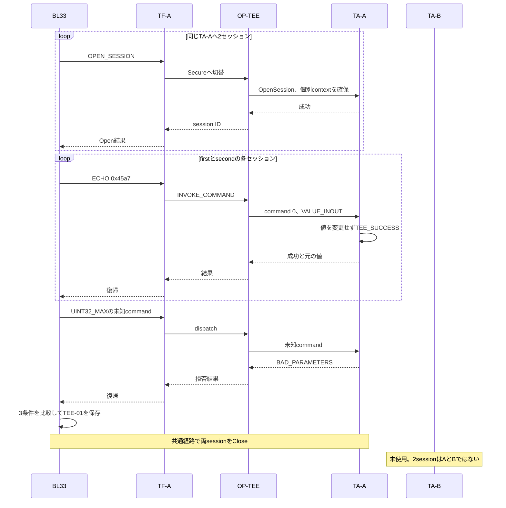

### コードで裏付ける

- 呼ぶ操作と3つの判定：[tests/validation/functional.c：b2_run_service](https://github.com/ririmon22/trustzone-validation/blob/a94646ea4130b448961c7921c57d1d317da8f36b/tests/validation/functional.c#L200)。
- 実際に値とcommandをmessageへ入れる：[normal_world/client/client.c：tee_invoke](https://github.com/ririmon22/trustzone-validation/blob/a94646ea4130b448961c7921c57d1d317da8f36b/normal_world/client/client.c#L177)。
- TAでECHOが成功し、未知commandがBAD_PARAMETERSになる：[secure_world/ta/ta.c：TA_InvokeCommandEntryPoint](https://github.com/ririmon22/trustzone-validation/blob/a94646ea4130b448961c7921c57d1d317da8f36b/secure_world/ta/ta.c#L142)。
- 親へ継承：[tests/validation/review.c：b2_run_review](https://github.com/ririmon22/trustzone-validation/blob/a94646ea4130b448961c7921c57d1d317da8f36b/tests/validation/review.c#L351)の`service[]={0U}`、`inherit`。

**注意：ECHO本体は値を計算し直さずそのままにする。** 値一致だけより、成功result、不正commandの拒否、session状態試験を合わせて説明する。「ECHOだけで全メモリ保護を証明した」とは言わない。公式の通信方式はO1〜O4、ECHO値・3条件は自作試験仕様。

<a id="t-02"></a>

## T-02：TA呼出しからNormal処理への復帰と継続（TZ-SYS-02-V01）

|対応項目|内容|
|---|---|
|reportの親test_id|`TZ-SYS-02-V01`|
|B2_REVIEW_PARENT|`2`。T番号とは別体系|
|従来の項目名|Secure呼出し・復帰|

### 今回の検証内容

T-01と共通の`TEE-01`を、要求の受渡しと復帰後の継続という観点で評価する。T-01とは別の往復試験を追加実行しているわけではない。

### 具体的な検証方法

1. BL33の`tee_invoke()`が共有メモリのmessageへcommand、session、値を設定する。
2. `transport_call()`から`smc_call()`を呼び、`CALL_WITH_ARG`とmessageの物理アドレスを渡す。
3. TF-AがSecure側へ処理を中継し、OP-TEEが対象sessionとcommandを解釈してTA-Aを実行する。
4. Secure側がmessageへ結果を書き、TF-Aを経てBL33のSMC後の処理へ戻る。
5. BL33が通信結果とmessage内の処理結果を読み、ECHO比較、次のInvoke、Closeへ進む。
6. `TZ-SYS-02-V01`は`TEE-01`の結果を引き継ぐ。

### 現行コードに合わせた合格条件

- 共通の`TEE-01`の3比較がすべて成立してPASSになる。
- 親`TZ-SYS-02-V01`の`functional-status`が期待値0と一致し、親がPASSになる。
- 全体の後始末で失敗がなく、回収記録が完了する。
- 復帰の根拠は、SMC後のBL33コードが実行され、応答比較と後続処理まで進んだことである。

### この結果だけでは確認していないこと・追加確認

SMC直後のPCを期待PCと比較するcheck、TF-A/Coreの全入口をtraceするcheckはない。それらは追加BP観測で補強できるが、この親の自動PASS条件へ混ぜない。

### レビューでの説明例

> TAから応答が返り、Normal側が結果を読み取って次の処理とCloseを実行できることを確認しています。

### reportで見る場所

|検索する項目|OK条件|説明|
|---|---|---|
|REVIEW `TZ-SYS-02-V01`|PASS、DONE、functional-status=0|TEE-01結果を継承|
|子`TEE-01`|PASS、selected=True、DONE|T-01と共通の実行|
|`first-echo` / `second-echo`|1 / 1|各sessionでtransport0/result0/value0x45a7|
|`unknown-command-rejected`|1|通信正常、BAD_PARAMETERS|
|RAM `REPLY echo-first`等|返値と比較行がある|SMC後のNormalコードが実行された|
|全体cleanup_errors、Close結果|0、Close成功|後続処理まで到達|

### 呼出しと復帰の詳細シーケンス

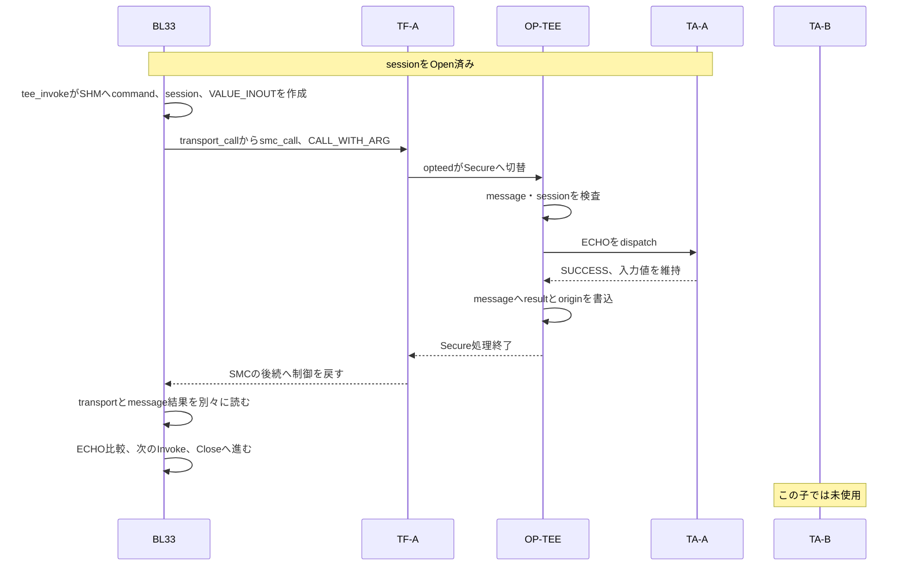

### コードと公式根拠

- messageを作る：[normal_world/client/client.c：struct tee_reply tee_invoke](https://github.com/ririmon22/trustzone-validation/blob/a94646ea4130b448961c7921c57d1d317da8f36b/normal_world/client/client.c#L177)
- SMCと戻ったmessageを読む：[normal_world/client/client.c：static struct tee_reply transport_call](https://github.com/ririmon22/trustzone-validation/blob/a94646ea4130b448961c7921c57d1d317da8f36b/normal_world/client/client.c#L71)
- CPUのSMC命令とCへのreturn：[runtime/arch.c：struct smc_result smc_call](https://github.com/ririmon22/trustzone-validation/blob/a94646ea4130b448961c7921c57d1d317da8f36b/runtime/arch.c#L24)
- Normalの後続比較とClose：[tests/validation/functional.c：void b2_run_service](https://github.com/ririmon22/trustzone-validation/blob/a94646ea4130b448961c7921c57d1d317da8f36b/tests/validation/functional.c#L200)
- 親への引継ぎ：[tests/validation/review.c：void b2_run_review](https://github.com/ririmon22/trustzone-validation/blob/a94646ea4130b448961c7921c57d1d317da8f36b/tests/validation/review.c#L351)

公式O2・O3・O4・O8。TA処理そのものの確認はT-14にも関連付け、T-02では通信の往復と復帰後のNormal継続を説明する。二つの観点に同じrunを使えるが、別実行を行ったように記録しない。

<a id="t-03"></a>

## T-03：256回のTA往復における指定状態の保持（TZ-SYS-02-V02）

|対応項目|内容|
|---|---|
|reportの親test_id|`TZ-SYS-02-V02`|
|B2_REVIEW_PARENT|`3`。T番号とは別体系|
|従来の項目名|繰返し切替と状態保持|

### 今回の検証内容

TA-A/Bを交互に呼び出し、毎回のECHOとsession counter、BL33の指定レジスタ状態とデータ、TA内の試験用状態を確認する。全CPUレジスタの保存試験ではない。

### 具体的な検証方法

1. TA-AとTA-BへsessionをOpenする。
2. BL33の`SCTLR_EL1`、`TTBR0_EL1`、`TCR_EL1`、`DAIF`を保存し、Normal側状態値を初期化する。
3. 256反復する。偶数回はA、奇数回はBへ、`seed ^ (i * 0x10201)`をECHO入力として送る。
4. 各ECHOの前にASM wrapperでx19〜x28へ既知値を設定し、x29へその時点のSPを設定する。復帰後、x19〜x28とx29/SPの整合を検査する。
5. 同じsessionのcounter commandを呼び、各sessionが128回ずつ増えることを確認する。256反復はECHO 256回にcounter呼出し256回を加えた構成である。
6. 各回、ECHO値、counter値、Normal側データ、レジスタ比較の結果を検査し、一致しなければループを終了する。
7. 最後にEL1設定を再取得し、A/Bの秘密tagを読み、16個の記録checkとCloseを評価する。

### 現行コードに合わせた合格条件

- `iterations=256`、`per-session-counter-steps=128`、`x19-x29-SP-errors=0`。
- 保存した4個のEL1設定と終了時の値が一致する。
- 各反復のECHO、counter、Normal側状態が期待値と一致し、最後の応答も記録checkと一致する。
- A-secret=`0x6d3a4719`、B-secret=`0xb5208c14`。
- 最後のECHO/counterは通信・処理成功、両originは4、Closeも成功し、親がPASSになる。

### この結果だけでは確認していないこと・追加確認

x0〜x18、NZCV、SIMD/浮動小数点などは対象外。ASMのSPに関する実装は「保存したx29と復帰後SPの一致」という検査であり、SP専用の独立した完全な破壊検出だと広げない。全反復の生レジスタ列はreportへ保存していない。

### レビューでの説明例

> 256反復の往復中に、決めたレジスタとNormalデータ、A/Bそれぞれの状態が保たれるかを確認しています。

### reportで見る場所：REVIEW → TZ-SYS-02-V02

|check名|OK値・条件|
|---|---|
|`iterations`|256（0x100）|
|`per-session-counter-steps`|128（0x80）|
|`input-seed`|0x59e1a273。ただしこれは入力値の記録で、それ単体は保持の証明にならない|
|`x19-x29-SP-errors`|0|
|`SCTLR_EL1` / `TTBR0_EL1` / `TCR_EL1` / `DAIF`|expectedとactualが一致|
|`A-secret` / `B-secret`|0x6d3a4719 / 0xb5208c14|
|`last-ECHO`|最終入力`seed ^ (255 * 0x10201)`と一致|
|`last-counter`|128|
|`last-Normal-state`|`seed ^ 255`と一致|
|`ECHO-transport-result` / `counter-transport-result`|0（通信0とresult0を連結）|
|`TA-origins`|0x0000000400000004（ECHO/counterともorigin4）|

この16checkの一致、親PASS、DONE、親cleanup_errors0を見る。各回の個別checkを256行保存するのではなく、ループ内で逐次比較して完了数・最終結果・集約値を残す。

### 詳細シーケンス

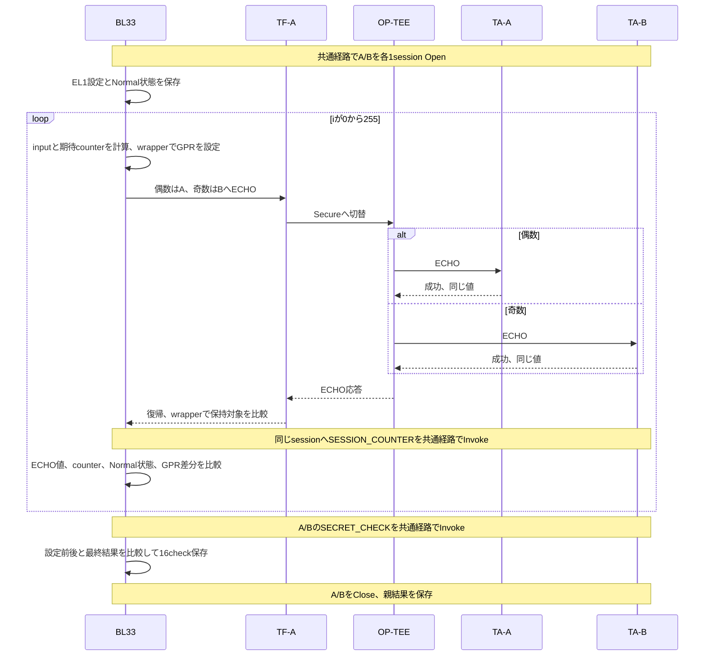

### コードと公式根拠

- 反復・入力・期待値・16check：[tests/validation/review.c：run_state_retention](https://github.com/ririmon22/trustzone-validation/blob/a94646ea4130b448961c7921c57d1d317da8f36b/tests/validation/review.c#L118)。
- GPRへ19〜28を入れ、x29にSPを保持し、`tee_invoke`後に比較：[tests/validation/state_call.S](https://github.com/ririmon22/trustzone-validation/blob/a94646ea4130b448961c7921c57d1d317da8f36b/tests/validation/state_call.S#L1)。
- session別counter：[secure_world/ta/ta.c：TA_InvokeCommandEntryPoint](https://github.com/ririmon22/trustzone-validation/blob/a94646ea4130b448961c7921c57d1d317da8f36b/secure_world/ta/ta.c#L142)の`TA_COMMAND_SESSION_COUNTER`。
- 秘密自体を返さず検査tagを返す：[secure_world/ta/security.c：security_invoke](https://github.com/ririmon22/trustzone-validation/blob/a94646ea4130b448961c7921c57d1d317da8f36b/secure_world/ta/security.c#L169)の`TA_COMMAND_SECRET_CHECK`。

O6（AAPCS64）にcallee-savedの根拠。**C関数呼出しを含む往復の指定GPR/SP整合性を検査するもので、SMC時点の全CPU contextの網羅検査ではない。** x0〜x18、NZCV、SIMDは保持対象に含めない。EL1設定の比較も指定4項目のみ。

<a id="t-04"></a>

## T-04：専用SecureページへのNormal read/write拒否・非改変・復帰（TZ-SYS-03-V01）

|対応項目|内容|
|---|---|
|reportの親test_id|`TZ-SYS-03-V01`|
|B2_REVIEW_PARENT|`4`。T番号とは別体系|
|従来の項目名|Secureメモリの読書き禁止|

### 今回の検証内容

Secure側で用意した専用4KiBページと同一PAへNormal側からアクセスし、stage1未写像による拒否と区別した上で、期待する例外・ページ非改変・正常処理継続を確認する。review一式では実アクセスを行わずBLOCKEDを記録し、専用physical実行を用いる。

### 具体的な検証方法

1. physical対応Core、BL33、予約領域、実機保護設定を一致させる。reviewの親4だけを選んでも物理probeは実行されない。
2. Secureの物理probe PTAが専用ページを準備し、既知patternを書き、PAとサイズを返す。
3. BL33が試験用VA aliasを作成し、アドレス変換結果が対象PAを指すことを確認する。EL1、EL2/Stage2情報、属性も記録する。
4. ページ先頭のread、先頭のwrite、末尾8B位置のread、末尾8B位置のwriteを順に行う。
5. 各アクセスで、限定したprobe命令からの期待する同期Data Abortを記録して復帰する。想定外例外の無条件読み飛ばしはしない。
6. 各回、Secure側PTAがページ全体を照合する。アクセス拒否のあとも内容が変わっていないことを確認する。
7. TA ECHOとNormal側制御処理で継続を確認し、alias除去、ページrelease、session Closeを行う。
8. PC側decoderが4試行の変換・例外・継続・後始末を照合する。XMPUの設定と違反記録は別途デバッガで採取する。

### 現行コードに合わせた合格条件

- 専用子`TZ-SYS-03`がPASSで、ページサイズ4096、4試行すべてが期待するPA変換とアクセス条件を満たす。
- 4試行すべて`completed=2`、`classification=PRECISE_EXTERNAL_ABORT`。FAR、ELR、read/write方向も各probeと一致する。
- 4回ともSecureページの検証tag=`0x50485953`で非改変を確認できる。
- `post-probe-TA-ECHO`と`Normal-control`が各`0xa35b`、後始末エラー0。
- `PHYSICAL EVIDENCE`の厳密検査を通過する。XMPU由来と説明するには、これに実機の対象bank設定・master/属性・該当違反記録の整合を加える。

### この結果だけでは確認していないこと・追加確認

SErrorやTF-A panicで止まり、4試行・非改変・継続を完了しなければ、この試験全体の合格にはしない。アクセス拒否を一部観測した事実は別途記録できる。ESR単独で拒否元をXMPUと確定しない。DMA・他master・全Secure領域の保護は対象外。

### レビューでの説明例

> Normalから同じ物理ページへのread/writeを拒否でき、ページが変わらず、その後の処理へ戻れるかまでを確認する試験です。

### まずreportを選ぶ

- review一式の親`TZ-SYS-03-V01`はBLOCKEDを記録するだけ。そこをPASSにする試験経路ではない。
- `PROFILE=physical B2_TEST_INDEX=15`で実probeを行った**別runのreport**を使う。子`TZ-SYS-03`を見る。
- 公開commitには手元で試したSError復帰変更がない。以下は**公開コードが厳密に要求する同期external abortのPASS条件**。SErrorでpanic・途中停止したrunはこの完全PASS条件を満たさない。

### reportで見る場所

|項目|OK値・条件|
|---|---|
|`TZ-SYS-03`|PASS、selected=True、phase=DONE|
|子`Secure-allocation-bytes`|4096が1件|
|子`precise-external-abort`|3が4件|
|子`Secure-page-check`|0x50485953が4件|
|子`post-probe-TA-ECHO` / `Normal-control`|各0xa35b|
|`PHYSICAL EVIDENCE` `state` / `entry_el`|2 / 1|
|`page_pa` / `page_bytes`|リンク済み許可予約内、4KiB整列 / 4096|
|`el2_known` / `hcr`|1 / Stage2 enable bit0が0|
|`sctlr` / `probe_mair`|MMUとD-cache有効、probe用MAIR slot2が0x44（Normal Non-cacheable）|
|`attempts`|4件すべて下表を満たす|
|`cleanup_errors`|0。alias除去・PTA release・Closeに失敗なし|
|`xmpu_attribution`|`NOT_ESTABLISHED_BY_ESR_ALONE`は正常な留保。設定・違反の別証拠で補う|

|attemptの順番|offset / write|completed|classification_name|追加条件|
|---|---|---|---|---|
|0|0 / 0（read）|2|PRECISE_EXTERNAL_ABORT|FAR=試行VA、ELR=read probe命令、WnR0|
|1|0 / 1（write）|2|PRECISE_EXTERNAL_ABORT|FAR=試行VA、ELR=write probe命令、WnR1|
|2|4088 / 0（read）|2|PRECISE_EXTERNAL_ABORT|末尾8B位置、readの条件|
|3|4088 / 1（write）|2|PRECISE_EXTERNAL_ABORT|末尾8B位置、writeの条件|

全attemptで`classification=3`、ESR.EC=0x25、DFSC=0x10、FnV/S1PTW=0。`par_read` / `par_write`はfault bit0が0で、変換PA＋offsetが記録した`pa`と一致する。PAR値を0と比較するのではない。

`read_value_valid=false`はabortで正常に読み終えていない場合に妥当。値0が読めたことを保護根拠にしない。分類1（translation）や2（permission）はMMU段階の拒否なので物理保護PASSにしない。

### 詳細シーケンス

TA-Bは使わない。5登場人物の範囲を保ち、この図だけ未使用TA-Bを外して外部保護経路を加える。

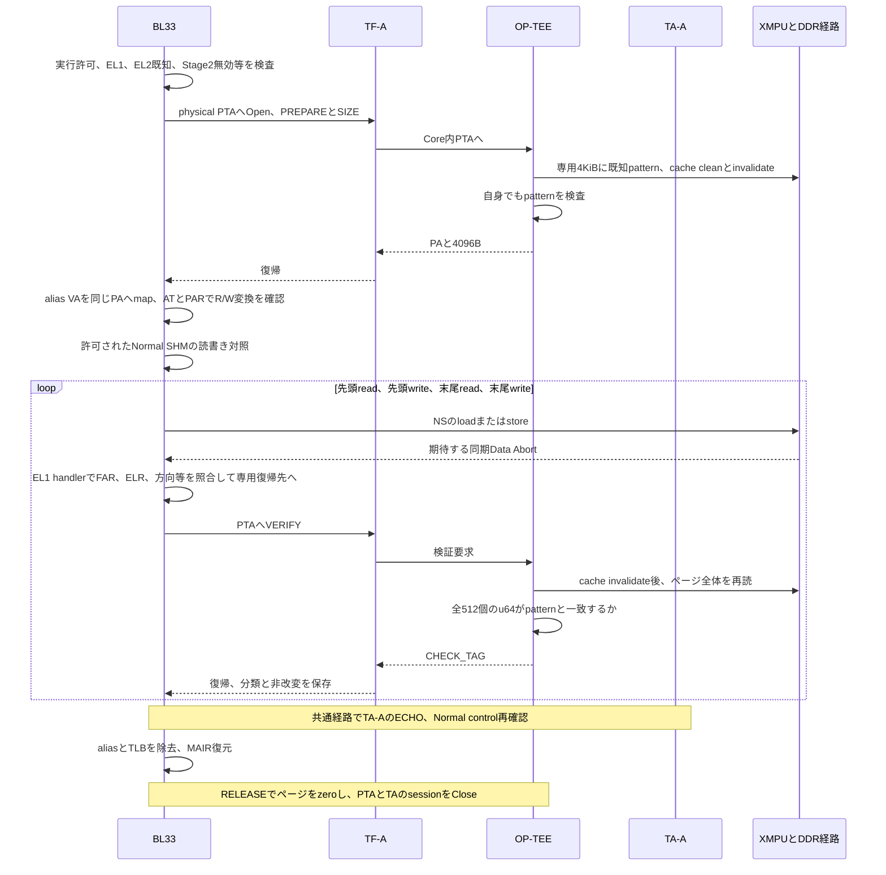

直接load/store部分にはSMCもTA-Aも介在しない。Secure側の準備と非改変確認にはSMCでPTAを呼ぶ。ハードウェア拒否→EL1復帰という図はこのコードが期待する経路であり、XMPU拒否が常にこの例外形になるという保証ではない。

### コードと公式根拠

|処理|コード|
|---|---|
|全体・同一PA検証・4回の試行・非改変・後始末|[tests/validation/physical_memory.c：b2_run_physical_memory](https://github.com/ririmon22/trustzone-validation/blob/a94646ea4130b448961c7921c57d1d317da8f36b/tests/validation/physical_memory.c#L118)|
|VA aliasとMAIR設定|同ファイル`install_alias` / `translation` / `translated_to`|
|実load/storeと復帰ラベル|[tests/validation/physical_probe.S](https://github.com/ririmon22/trustzone-validation/blob/a94646ea4130b448961c7921c57d1d317da8f36b/tests/validation/physical_probe.S#L1)|
|限定された例外だけ復帰|[runtime/el1_fault.c](https://github.com/ririmon22/trustzone-validation/blob/a94646ea4130b448961c7921c57d1d317da8f36b/runtime/el1_fault.c#L1)、[tests/validation/physical_memory.c：b2_handle_phys_fault](https://github.com/ririmon22/trustzone-validation/blob/a94646ea4130b448961c7921c57d1d317da8f36b/tests/validation/physical_memory.c#L42)|
|例外分類|[tests/validation/physical_policy.c：b2_classify_physical_abort](https://github.com/ririmon22/trustzone-validation/blob/a94646ea4130b448961c7921c57d1d317da8f36b/tests/validation/physical_policy.c#L3)|
|Secureページ準備・cache処理・全体照合・release|[secure_world/pta/physical_probe.c：prepare_page](https://github.com/ririmon22/trustzone-validation/blob/a94646ea4130b448961c7921c57d1d317da8f36b/secure_world/pta/physical_probe.c#L57) / `verify_page` / `release_page`|
|PC側の厳密条件|[scripts/decode_b2_physical.py：validate_physical_pass](https://github.com/ririmon22/trustzone-validation/blob/a94646ea4130b448961c7921c57d1d317da8f36b/scripts/decode_b2_physical.py#L26)、[scripts/decode_b2_results.py](https://github.com/ririmon22/trustzone-validation/blob/a94646ea4130b448961c7921c57d1d317da8f36b/scripts/decode_b2_results.py#L1)|

公式O11（Arm）でAT/PAR・ESR/FAR/ELR・page属性、O12（AMD）でXMPUの設定・master/route・応答・違反情報を確認する。Cの`register_phys_mem`はOP-TEEのmapping登録であって、XMPU設定そのものではない。

### reportに加えて残す別証拠

XMPU対象bank、region START/END/MASTER/CONFIG、CTRL/POISON/LOCK、アクセス経路、違反情報の読戻しと採取時点。実行物hash・run IDと同じrunに結び付ける。XMPU帰属をESRだけで断定しない。

**手元で確認した「拒否されてSError/TF-A panicで止まる」は、拒否の観測として説明できるが、4アクセス・非改変・後続処理・cleanupの完全合格とは分ける。** 全DDR・全master・DMA・全アクセス幅の保護を示すものではない。

<a id="t-05"></a>

## T-05：共有メモリの範囲・型・内容検査と拒否後の継続（TZ-SYS-03-V02）

|対応項目|内容|
|---|---|
|reportの親test_id|`TZ-SYS-03-V02`|
|B2_REVIEW_PARENT|`5`。T番号とは別体系|
|従来の項目名|秘密領域と共有領域の使い分け|

### 今回の検証内容

共有メモリを介した正常なbuffer操作と、範囲外・サイズ・型・内容の不正入力を比較する。拒否する場所をclient、OP-TEE Core、TAに分けて評価する。

### 具体的な検証方法

1. `TEE-SHM-01`では16Bへ0x50〜0x5fを書き、正常buffer要求を送る。
2. unchecked probeで15B、SHM越境、Secure予約領域、アドレス加算wrapを送る。通常clientによるSecure領域指定のlocal拒否も試す。
3. 正常な16Bを再試行し、元の16Bが変わっていないか確認する。
4. `TEE-BOUNDARY-01`ではSHM末尾に収まる16B、1Bはみ出す範囲、0B、messageとの重複を比較する。正常再試行と16B非改変も確認する。
5. `TEE-PARAM-01`ではTAが期待するVALUE_INOUTをVALUE_INPUTへ変え、TAでの型拒否を確認する。
6. bufferの先頭内容を不正にし、TAのSECURITY拒否とbuffer非改変、内容を戻した後の成功、BのECHO継続を確認する。
7. 各子の複合判定とClose、親の3子継承を評価する。

### 現行コードに合わせた合格条件

- 上記3子がすべてPASS、各複合predicateが1となる。
- SHM子の15BはBAD_PARAMETERS/origin4、越境・Secure領域・wrapはBAD_PARAMETERS/origin3。通信自体は正常に戻る。
- 通常clientのSecure領域指定は`TEE_CLIENT_SHM_UNAVAILABLE`でlocal拒否となる。
- 正常buffer操作・正常再試行が成功し、コードが照合する16Bが維持される。
- 型・内容の異常は、後述の各子の判定式どおりに拒否される。`TZ-SYS-03-V02`は3子PASSを継承し、共通後始末条件も満たす。

### この結果だけでは確認していないこと・追加確認

不正入力すべてについてoriginまで比較する実装ではない。buffer非改変もコードで指定した16Bと観測時点が対象である。Secure物理PAへの直接load/store拒否はT-04で確認する。

### レビューでの説明例

> 共有用bufferは利用でき、不正な範囲・型・内容は所定の層で拒否され、拒否後も通常通信が続くかを確認しています。

### reportで見る場所

親PASSに加え、次の3子すべてPASS、記載checkがexpected=actual=1。

|子試験ID|check名|含まれる操作と期待する拒否|
|---|---|---|
|`TEE-SHM-01`|`SHM-reject-and-nonmodification`|正常16B成功、15BはTAがBAD_PARAMETERS/origin4、SHM越境・Secure領域・uint64 wrapはCoreがBAD_PARAMETERS/origin3。通常clientのSecure領域指定もlocal拒否。正常再試行と非改変|
|`TEE-BOUNDARY-01`|`shared_boundaries-predicates`|SHM末尾の16B成功、1Bはみ出し・0B拒否、messageとの重複をclient拒否、正常再試行、16B非改変|
|`TEE-PARAM-01`|`parameter_validation-predicates`|Coreにとって有効なVALUE_INPUTをTA期待INOUTと違えてTA拒否、buffer先頭改変でSECURITY/origin4、拒否後非改変、内容を戻すと成功、Bへの正常呼出し継続|

RAMの検索文字：`SECURITY_REPLY valid` / `short` / `overflow` / `secure` / `wrap`、`REPLY last-valid` / `one-byte-outside` / `zero-size`、`REPLY wrong-TA-type` / `malformed-buffer`。

### 詳細シーケンス

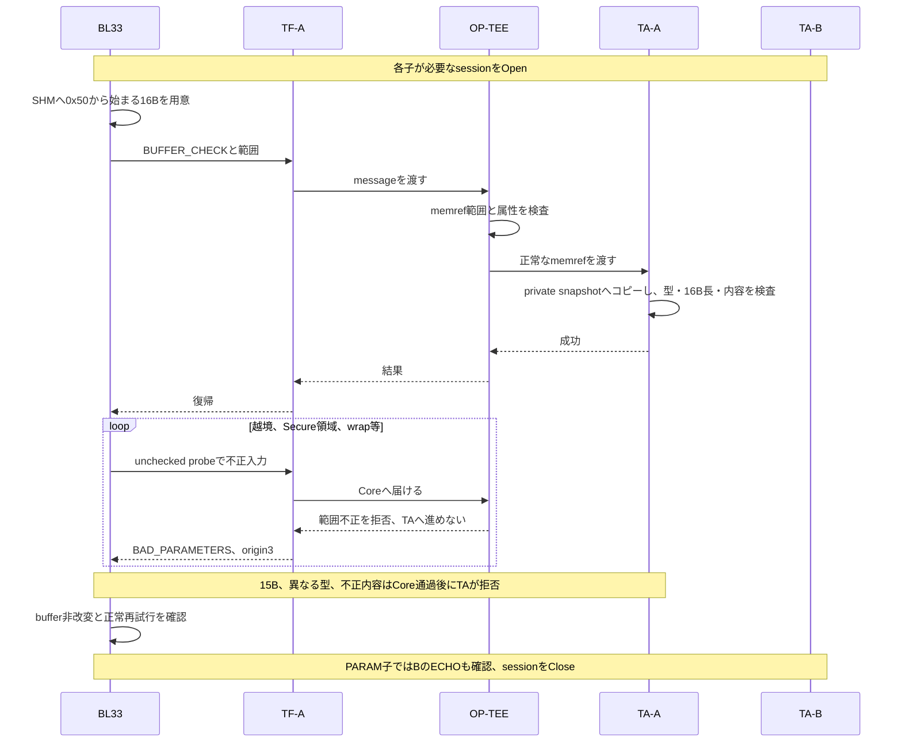

### コードと公式根拠

|知りたい処理|コード|
|---|---|
|5種類のbuffer入力|[tests/validation/security_tests.c：test_shared_memory](https://github.com/ririmon22/trustzone-validation/blob/a94646ea4130b448961c7921c57d1d317da8f36b/tests/validation/security_tests.c#L70)|
|末尾・1B越境・0B・message重複|[tests/validation/boundary_tests.c：b2_run_shared_boundaries](https://github.com/ririmon22/trustzone-validation/blob/a94646ea4130b448961c7921c57d1d317da8f36b/tests/validation/boundary_tests.c#L70)|
|型と内容の不正|[tests/validation/extended_tests.c：b2_run_parameter_validation](https://github.com/ririmon22/trustzone-validation/blob/a94646ea4130b448961c7921c57d1d317da8f36b/tests/validation/extended_tests.c#L67)|
|通常clientの範囲拒否と、敢えてCoreへ送るprobeの違い|[normal_world/client/client.c：tee_invoke_buffer](https://github.com/ririmon22/trustzone-validation/blob/a94646ea4130b448961c7921c57d1d317da8f36b/normal_world/client/client.c#L240)、[normal_world/client/client.c：tee_probe_buffer_unchecked](https://github.com/ririmon22/trustzone-validation/blob/a94646ea4130b448961c7921c57d1d317da8f36b/normal_world/client/client.c#L224)|
|TAがコピーして内容を検査|[secure_world/ta/security.c：security_invoke](https://github.com/ririmon22/trustzone-validation/blob/a94646ea4130b448961c7921c57d1d317da8f36b/secure_world/ta/security.c#L169)のBUFFER_CHECK分岐|

O1・O2・O4がSHM/message検査の根拠。16B・0x50+iという内容ルールは独自仕様。`unchecked`は攻撃試験のためclientの通常範囲検査を迂回する補助で、製品用APIの推奨ではない。境界子では全拒否のoriginを固定していないので、コードが要求していない条件まで「自動検査済み」としない。

<a id="t-06"></a>

## T-06：Secure周辺機器保護：未実施（TZ-SYS-04-V01）

|対応項目|内容|
|---|---|
|reportの親test_id|`TZ-SYS-04-V01`|
|B2_REVIEW_PARENT|`6`。T番号とは別体系|
|従来の項目名|Secure周辺機器の保護|

### 今回の検証内容

Secure/Normalで同じ周辺機器を操作するbackendがない。

### 具体的な検証方法

1. BL33のreviewが当該親IDの選択を確認する。
2. 対象外項目の分岐へ入る。
3. `SKIP`、理由、`phase=DONE`を保存する。この項目の実操作・測定は実行しない。
4. 未選択の場合はNOT_RUNであり、SKIPを記録した場合とも区別する。

### 現行コードに合わせた合格条件

**現行版に機能の合格判定基準はない。SKIPは合格ではなく、未実施理由の記録である。** 記録内容の整合を見るなら、対象の正式ID、status=SKIP、phase=DONE、構成に合うreasonを確認する。これは「検査に合格した」とは報告しない。

### この結果だけでは確認していないこと・追加確認

将来、対象機器の選定、Secure/Normalの許可・拒否対照、保護設定と機器状態の非改変確認を追加する場合は、期待値と合格基準を実装と合わせて別途定める。現行の合格基準欄へ先取りして書かない。

### レビューでの説明例

> 今回は実操作を行わず、未実施の理由を結果に残しています。

### 現行reportで見る場所と扱い

`REVIEW`内の`test_id: TZ-SYS-04-V01`を見る。review一式、または当該親を選択したrunでは**`status: SKIP`、`phase: DONE`**が現行コードの想定。これは試験に合格した意味ではない。未選択ならNOT_RUNのままなので、実施済みと数えない。

- 未実装の部分：対象周辺機器を操作するbackendがない。
- 現行の機能検証に対する判定：**未実施／保留。PASSの実行証拠は生成されない。**
- T-04のDDRページ保護は周辺機器保護の代替ではない。

reasonは`OUT-OF-SCOPE: peripheral-DMA-debug-authenticated-boot-persistent-storage`を固定長フィールドへ保存する。JSONの`reason`は長い文字列の末尾が切れる場合があるため、`OUT-OF-SCOPE:`と正式ID・statusで識別する。

### 現行コードが実際に行う流れ

実装のない機能を動かす図は描かない。実際には以下の**結果記録だけ**を行い、当初想定していた実操作は行わない。

|順序|担当|実際の処理|
|---|---|---|
|1|BL33|b2_run_reviewで対象親が選択されているか調べる|
|2|BL33|対象外親IDの分岐でfinishを呼ぶ|
|3|BL33|SKIP・reason・DONEを保存する|
|4|TF-A／OP-TEE／TA-A／TA-B|この項目の実操作は呼ばれない。他の選択試験で動くこととは区別|

### コードと必要な追加証拠

コード：[tests/validation/review.c：void b2_run_review](https://github.com/ririmon22/trustzone-validation/blob/a94646ea4130b448961c7921c57d1d317da8f36b/tests/validation/review.c#L351)、[tests/validation/review.c：static void finish](https://github.com/ririmon22/trustzone-validation/blob/a94646ea4130b448961c7921c57d1d317da8f36b/tests/validation/review.c#L79)。

実施するために確定する内容：周辺機器所有者、対象register/操作、XPPUと関連経路、Secure/Normal対照、状態非改変の観測点。

公式根拠：O12のAMD UG1085/UG1087でXPPU・対象周辺機器の保護設定を照合する。 ここで挙げる追加条件はレビューの不足事項で、現行の実行済みシーケンスではない。

<a id="t-07"></a>

## T-07：DMAからのSecureメモリ保護：未実施（TZ-SYS-05-V01）

|対応項目|内容|
|---|---|
|reportの親test_id|`TZ-SYS-05-V01`|
|B2_REVIEW_PARENT|`7`。T番号とは別体系|
|従来の項目名|DMAからのSecureメモリ保護|

### 今回の検証内容

DMA masterで許可・禁止転送を比較するbackendがない。

### 具体的な検証方法

1. BL33のreviewが当該親IDの選択を確認する。
2. 対象外項目の分岐へ入る。
3. `SKIP`、理由、`phase=DONE`を保存する。この項目の実操作・測定は実行しない。
4. 未選択の場合はNOT_RUNであり、SKIPを記録した場合とも区別する。

### 現行コードに合わせた合格条件

**現行版に機能の合格判定基準はない。SKIPは合格ではなく、未実施理由の記録である。** 記録内容の整合を見るなら、対象の正式ID、status=SKIP、phase=DONE、構成に合うreasonを確認する。これは「検査に合格した」とは報告しない。

### この結果だけでは確認していないこと・追加確認

将来、DMA master/属性/経路を確定した許可転送、禁止転送、保護領域の非改変確認を追加する場合は、期待値と合格基準を実装と合わせて別途定める。現行の合格基準欄へ先取りして書かない。

### レビューでの説明例

> 今回は実操作を行わず、未実施の理由を結果に残しています。

### 現行reportで見る場所と扱い

`REVIEW`内の`test_id: TZ-SYS-05-V01`を見る。review一式、または当該親を選択したrunでは**`status: SKIP`、`phase: DONE`**が現行コードの想定。これは試験に合格した意味ではない。未選択ならNOT_RUNのままなので、実施済みと数えない。

- 未実装の部分：DMA転送backendがない。
- 現行の機能検証に対する判定：**未実施／保留。PASSの実行証拠は生成されない。**
- A53のload/store拒否はDMA masterの拒否を証明しない。

reasonは`OUT-OF-SCOPE: peripheral-DMA-debug-authenticated-boot-persistent-storage`を固定長フィールドへ保存する。JSONの`reason`は長い文字列の末尾が切れる場合があるため、`OUT-OF-SCOPE:`と正式ID・statusで識別する。

### 現行コードが実際に行う流れ

実装のない機能を動かす図は描かない。実際には以下の**結果記録だけ**を行い、当初想定していた実操作は行わない。

|順序|担当|実際の処理|
|---|---|---|
|1|BL33|b2_run_reviewで対象親が選択されているか調べる|
|2|BL33|対象外親IDの分岐でfinishを呼ぶ|
|3|BL33|SKIP・reason・DONEを保存する|
|4|TF-A／OP-TEE／TA-A／TA-B|この項目の実操作は呼ばれない。他の選択試験で動くこととは区別|

### コードと必要な追加証拠

コード：[tests/validation/review.c：void b2_run_review](https://github.com/ririmon22/trustzone-validation/blob/a94646ea4130b448961c7921c57d1d317da8f36b/tests/validation/review.c#L351)、[tests/validation/review.c：static void finish](https://github.com/ririmon22/trustzone-validation/blob/a94646ea4130b448961c7921c57d1d317da8f36b/tests/validation/review.c#L79)。

実施するために確定する内容：DMA engine、master ID・Security属性、保護bank/route、許可・禁止buffer、転送完了/拒否/非改変の観測点。

公式根拠：O12のAMD UG1085/UG1087でDMA masterとメモリ保護経路を照合する。 ここで挙げる追加条件はレビューの不足事項で、現行の実行済みシーケンスではない。

<a id="t-08"></a>

## T-08：Secure割込み配送：選択ZCU構成では未実施（TZ-SYS-06-V01）

|対応項目|内容|
|---|---|
|reportの親test_id|`TZ-SYS-06-V01`|
|B2_REVIEW_PARENT|`8`。T番号とは別体系|
|従来の項目名|Secure割込みの配送|

### 今回の検証内容

現行ZCU構成はB2_SECURE_SGI=0で、対応PTAとGIC配送構成が用意されていない。

### 具体的な検証方法

1. BL33のreviewが当該親IDの選択を確認する。
2. run_secure_sgiの構成確認で停止する。
3. `BLOCKED`、理由、`phase=DONE`を保存する。この項目の実操作・測定は実行しない。
4. 未選択の場合はNOT_RUNであり、BLOCKEDを記録した場合とも区別する。

### 現行コードに合わせた合格条件

**現行版に機能の合格判定基準はない。BLOCKEDは合格ではなく、未実施理由の記録である。** 記録内容の整合を見るなら、対象の正式ID、status=BLOCKED、phase=DONE、構成に合うreasonを確認する。これは「検査に合格した」とは報告しない。

### この結果だけでは確認していないこと・追加確認

将来、実際の割込み発生、対象handler到達、受信EL/World、回数、復帰、誤配送の確認を追加する場合は、期待値と合格基準を実装と合わせて別途定める。現行の合格基準欄へ先取りして書かない。

### レビューでの説明例

> 今回は実操作を行わず、未実施の理由を結果に残しています。

### 現行reportで見る場所と扱い

`REVIEW`内の`test_id: TZ-SYS-06-V01`を見る。review一式、または当該親を選択したrunでは**`status: BLOCKED`、`phase: DONE`**が現行コードの想定。これは試験に合格した意味ではない。未選択ならNOT_RUNのままなので、実施済みと数えない。

- 未実装の部分：B2_SECURE_SGI=0でSGI PTAが選択Coreに含まれず、ZCU用配送構成もない。
- 現行の機能検証に対する判定：**未実施／保留。PASSの実行証拠は生成されない。**
- 実機の設定値を読むだけではhandler実行試験が追加されたことにはならない。

検索するreasonは`Secure-SGI-not-in-selected-Core; ZCU-SGI-group-route-review-required`または`Secure-SGI-profile-not-enabled`。T-08/T-19の選択の組合せでreasonが分かれるため、文字列が一種類だけだと思わない。

### 現行コードが実際に行う流れ

実装のない機能を動かす図は描かない。実際には以下の**結果記録だけ**を行い、当初想定していた実操作は行わない。

|順序|担当|実際の処理|
|---|---|---|
|1|BL33|b2_run_reviewで対象親が選択されているか調べる|
|2|BL33|run_secure_sgiのB2_SECURE_SGI != 1分岐へ入る|
|3|BL33|finishでBLOCKED・reason・DONEを保存し、PTA Openへ進まない|
|4|TF-A／OP-TEE／TA-A／TA-B|この項目の実操作は呼ばれない。他の選択試験で動くこととは区別|

### コードと必要な追加証拠

コード：[tests/validation/review.c：static void run_secure_sgi](https://github.com/ririmon22/trustzone-validation/blob/a94646ea4130b448961c7921c57d1d317da8f36b/tests/validation/review.c#L268)、[tests/validation/review.c：static void finish](https://github.com/ririmon22/trustzone-validation/blob/a94646ea4130b448961c7921c57d1d317da8f36b/tests/validation/review.c#L79)。

実施するために確定する内容：割込み発生源、GIC group・INTID・route、受信EL/World、handlerの回数と復帰、誤配送の観測。

公式根拠：O1のInterrupt handling、O12のGIC400レジスタ群。 ここで挙げる追加条件はレビューの不足事項で、現行の実行済みシーケンスではない。

<a id="t-09"></a>

## T-09：JTAGデバッグ制限：未実施（TZ-SYS-07-V01）

|対応項目|内容|
|---|---|
|reportの親test_id|`TZ-SYS-07-V01`|
|B2_REVIEW_PARENT|`9`。T番号とは別体系|
|従来の項目名|JTAGデバッグ制限|

### 今回の検証内容

デバッグ許可/禁止状態を作り分けて操作を比較する試験構成がない。

### 具体的な検証方法

1. BL33のreviewが当該親IDの選択を確認する。
2. 対象外項目の分岐へ入る。
3. `SKIP`、理由、`phase=DONE`を保存する。この項目の実操作・測定は実行しない。
4. 未選択の場合はNOT_RUNであり、SKIPを記録した場合とも区別する。

### 現行コードに合わせた合格条件

**現行版に機能の合格判定基準はない。SKIPは合格ではなく、未実施理由の記録である。** 記録内容の整合を見るなら、対象の正式ID、status=SKIP、phase=DONE、構成に合うreasonを確認する。これは「検査に合格した」とは報告しない。

### この結果だけでは確認していないこと・追加確認

将来、承認された可逆設定による接続・停止・register/memory操作の許可/禁止比較を追加する場合は、期待値と合格基準を実装と合わせて別途定める。現行の合格基準欄へ先取りして書かない。

### レビューでの説明例

> 今回は実操作を行わず、未実施の理由を結果に残しています。

### 現行reportで見る場所と扱い

`REVIEW`内の`test_id: TZ-SYS-07-V01`を見る。review一式、または当該親を選択したrunでは**`status: SKIP`、`phase: DONE`**が現行コードの想定。これは試験に合格した意味ではない。未選択ならNOT_RUNのままなので、実施済みと数えない。

- 未実装の部分：debug認証と許可/禁止状態を切り替える試験構成がない。
- 現行の機能検証に対する判定：**未実施／保留。PASSの実行証拠は生成されない。**
- 今JTAGで接続・RAM回収できることは、禁止状態の制御を検証した証拠ではない。

reasonは`OUT-OF-SCOPE: peripheral-DMA-debug-authenticated-boot-persistent-storage`を固定長フィールドへ保存する。JSONの`reason`は長い文字列の末尾が切れる場合があるため、`OUT-OF-SCOPE:`と正式ID・statusで識別する。

### 現行コードが実際に行う流れ

実装のない機能を動かす図は描かない。実際には以下の**結果記録だけ**を行い、当初想定していた実操作は行わない。

|順序|担当|実際の処理|
|---|---|---|
|1|BL33|b2_run_reviewで対象親が選択されているか調べる|
|2|BL33|対象外親IDの分岐でfinishを呼ぶ|
|3|BL33|SKIP・reason・DONEを保存する|
|4|TF-A／OP-TEE／TA-A／TA-B|この項目の実操作は呼ばれない。他の選択試験で動くこととは区別|

### コードと必要な追加証拠

コード：[tests/validation/review.c：void b2_run_review](https://github.com/ririmon22/trustzone-validation/blob/a94646ea4130b448961c7921c57d1d317da8f36b/tests/validation/review.c#L351)、[tests/validation/review.c：static void finish](https://github.com/ririmon22/trustzone-validation/blob/a94646ea4130b448961c7921c57d1d317da8f36b/tests/validation/review.c#L79)。

実施するために確定する内容：承認された可逆設定、許可/禁止する操作、APとCPU debug経路、Secure/Normal対象範囲、復旧手順。

公式根拠：O12のデバイスdebug/security設定を使用版で確認する。 ここで挙げる追加条件はレビューの不足事項で、現行の実行済みシーケンスではない。

<a id="t-10"></a>

## T-10：TA呼出元identityの認可と固定トークンのsession状態（EXT-AUTH-V01）

|対応項目|内容|
|---|---|
|reportの親test_id|`EXT-AUTH-V01`|
|B2_REVIEW_PARENT|`10`。T番号とは別体系|
|従来の項目名|サービスの認証・認可|

### 今回の検証内容

Coreが提供するTA identityによるA→Bの許可と、固定の試験トークンによるsessionごとの許可状態を確認する。本物のNormal利用者・アプリの本人認証は今回の検証項目に含めない。

### 具体的な検証方法

1. identity子で、NormalからTRUSTED_APPを装ったlogin Openを送り、Coreの拒否を確認する。
2. PUBLIC sessionでBへAらしいID値を引数として渡しても、Bが許可しないことを確認する。
3. Aから`TEE_OpenTASession`でBを呼び、Bが`gpd.client.identity`のloginとUUIDを使ってAを許可することを確認する。
4. Bの正常ECHOも実行し、拒否後の継続を確認する。
5. token親でTA-Aへfirst/otherの二つのsessionを作る。firstで許可前READ、誤トークン、正トークン、許可後READを実行する。
6. otherのREADは拒否されること、firstへ誤トークンを再送すると許可が取り消されREADが拒否されることを確認する。
7. firstをCloseし、閉handleのclient拒否、再Open後の未認可状態を確認する。全sessionをCloseする。

### 現行コードに合わせた合格条件

- `TEE-AUTH-TA`の`TA-identity-policy=1`でPASS。偽loginはBAD_PARAMETERS/origin3、PUBLICの偽IDはACCESS_DENIED/origin4、A→B自己試験はSUCCESS/value0、B継続は成功する。
- 正トークン操作が成功し、そのsessionのREADだけが試験秘密値`0x59436e`を返す。
- 許可前・誤トークン・別session・取消後・再Open後はACCESS_DENIED。コードが指定する拒否応答のtransport0/origin4を満たす。
- 閉handleはclient BAD_STATE=4、9個の親checkと子PASS継承が成立し、後始末成功で親がPASS。

### この結果だけでは確認していないこと・追加確認

固定トークンはコードに埋めた試験値である。端末利用者の本人確認、Normalプロセスの真正性、秘密credentialの配備や更新、リプレイ耐性を確認したとはしない。追加する場合は別の認証試験として扱う。

### レビューでの説明例

> 自己申告IDではなくCoreのTA identityで許可し、sessionの許可が別sessionや再Openへ漏れないことを確認しています。

### reportで見る場所

|場所・check名|OK値・条件|
|---|---|
|子`TEE-AUTH-TA` / `TA-identity-policy`|PASS、expected=actual=1|
|親`before-token` / `wrong-token`|各0xffff0001|
|親`authorized-read`|TA-Aの試験秘密値0x59436e|
|親`other-session-denied`|0xffff0001|
|親`revoke` / `after-revoke`|各0xffff0001。誤token認証操作が許可を取り消す|
|親`closed-client-state`|4（TEE_CLIENT_BAD_STATE）。これはCoreへ送る前のclient拒否|
|親`reopen-without-token`|0xffff0001|
|親`TA-identity-subtest`|0（子のPASS enum）|

親の9check一致、親PASS、cleanup_errors0。拒否resultだけでなく、`run_token_policy`は該当操作のtransport0・origin4も判定に含める。認証成功`allow`等は別check名にせずbool式に含まれる。

### シーケンスA：session token

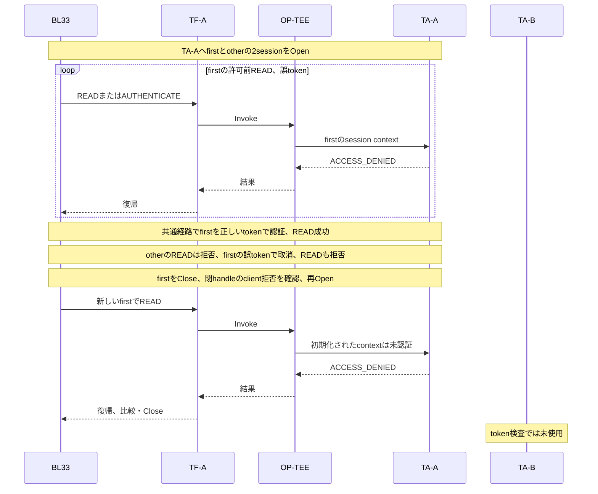

### シーケンスB：TA identity

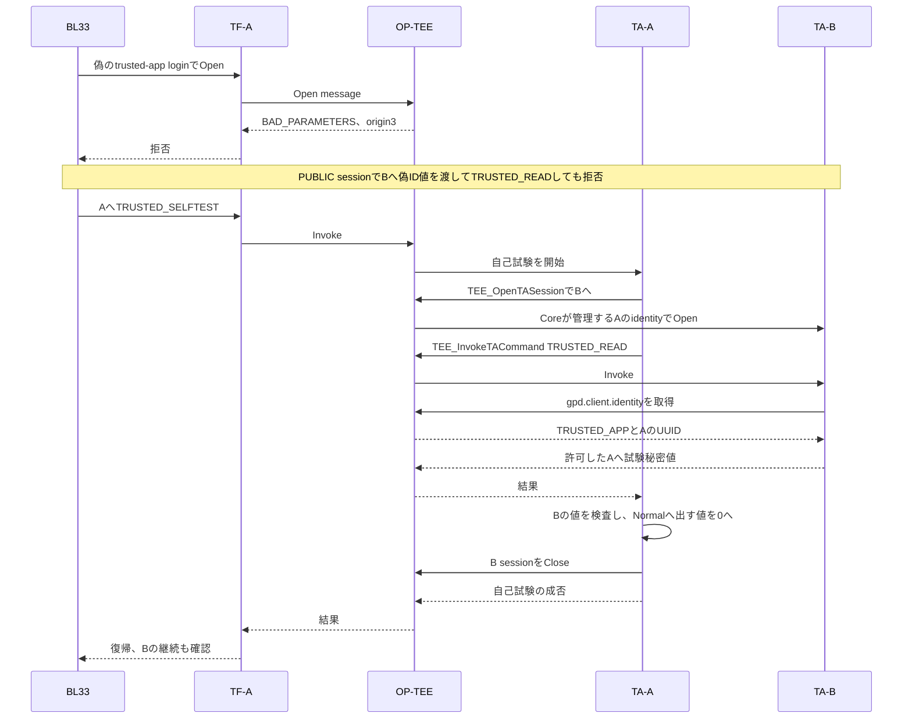

### コードと公式根拠

- token検査全体：[tests/validation/review.c：run_token_policy](https://github.com/ririmon22/trustzone-validation/blob/a94646ea4130b448961c7921c57d1d317da8f36b/tests/validation/review.c#L191)。
- `authenticated`をsession contextへ保存し、正しいtokenか判定：[secure_world/ta/ta.c：TA_OpenSessionEntryPoint](https://github.com/ririmon22/trustzone-validation/blob/a94646ea4130b448961c7921c57d1d317da8f36b/secure_world/ta/ta.c#L121)、[secure_world/ta/ta.c：TA_InvokeCommandEntryPoint](https://github.com/ririmon22/trustzone-validation/blob/a94646ea4130b448961c7921c57d1d317da8f36b/secure_world/ta/ta.c#L142)。
- identity子：[tests/validation/security_tests.c：test_identity](https://github.com/ririmon22/trustzone-validation/blob/a94646ea4130b448961c7921c57d1d317da8f36b/tests/validation/security_tests.c#L42)。
- A→BのOpen/Invoke/Closeと値の検査：[secure_world/ta/security.c：trusted_service_test](https://github.com/ririmon22/trustzone-validation/blob/a94646ea4130b448961c7921c57d1d317da8f36b/secure_world/ta/security.c#L69)。
- Bのallowlist：[secure_world/ta/security.c：trusted_read](https://github.com/ririmon22/trustzone-validation/blob/a94646ea4130b448961c7921c57d1d317da8f36b/secure_world/ta/security.c#L45)。**パラメータの自己申告IDを信用せず、Coreのsession propertyを読む。**

公式O5の`TEE_GetPropertyAsIdentity`、`TEE_OpenTASession`、`TEE_InvokeTACommand`。Core側login検査はO4。固定token0x7139a2とAのUUID許可は独自ポリシーで、本物の利用者・Normalプログラム本人の認証を実装したことにはならない。

<a id="t-11"></a>

## T-11：SoC認証bootによる起動署名検証：未実施（EXT-BOOT-V01）

|対応項目|内容|
|---|---|
|reportの親test_id|`EXT-BOOT-V01`|
|B2_REVIEW_PARENT|`15`。T番号とは別体系|
|従来の項目名|起動イメージ署名検証|

### 今回の検証内容

BootROMからの認証bootチェーンと正規/不正imageの起動対照を構成していない。

### 具体的な検証方法

1. BL33のreviewが当該親IDの選択を確認する。
2. 対象外項目の分岐へ入る。
3. `SKIP`、理由、`phase=DONE`を保存する。この項目の実操作・測定は実行しない。
4. 未選択の場合はNOT_RUNであり、SKIPを記録した場合とも区別する。

### 現行コードに合わせた合格条件

**現行版に機能の合格判定基準はない。SKIPは合格ではなく、未実施理由の記録である。** 記録内容の整合を見るなら、対象の正式ID、status=SKIP、phase=DONE、構成に合うreasonを確認する。これは「検査に合格した」とは報告しない。

### この結果だけでは確認していないこと・追加確認

将来、正規imageの起動成功、改変/未信頼imageの実行前拒否の実機記録を追加する場合は、期待値と合格基準を実装と合わせて別途定める。現行の合格基準欄へ先取りして書かない。

### レビューでの説明例

> 今回は実操作を行わず、未実施の理由を結果に残しています。

### 現行reportで見る場所と扱い

`REVIEW`内の`test_id: EXT-BOOT-V01`を見る。review一式、または当該親を選択したrunでは**`status: SKIP`、`phase: DONE`**が現行コードの想定。これは試験に合格した意味ではない。未選択ならNOT_RUNのままなので、実施済みと数えない。

- 未実装の部分：SoC認証bootチェーン・正規/改変/未信頼イメージによる起動比較を構成していない。
- 現行の機能検証に対する判定：**未実施／保留。PASSの実行証拠は生成されない。**
- T-16のTA runtime署名検査やhost署名比較、JTAG dow成功はSoC認証bootの代替ではない。

reasonは`OUT-OF-SCOPE: peripheral-DMA-debug-authenticated-boot-persistent-storage`を固定長フィールドへ保存する。JSONの`reason`は長い文字列の末尾が切れる場合があるため、`OUT-OF-SCOPE:`と正式ID・statusで識別する。

### 現行コードが実際に行う流れ

実装のない機能を動かす図は描かない。実際には以下の**結果記録だけ**を行い、当初想定していた実操作は行わない。

|順序|担当|実際の処理|
|---|---|---|
|1|BL33|b2_run_reviewで対象親が選択されているか調べる|
|2|BL33|対象外親IDの分岐でfinishを呼ぶ|
|3|BL33|SKIP・reason・DONEを保存する|
|4|TF-A／OP-TEE／TA-A／TA-B|この項目の実操作は呼ばれない。他の選択試験で動くこととは区別|

### コードと必要な追加証拠

コード：[tests/validation/review.c：void b2_run_review](https://github.com/ririmon22/trustzone-validation/blob/a94646ea4130b448961c7921c57d1d317da8f36b/tests/validation/review.c#L351)、[tests/validation/review.c：static void finish](https://github.com/ririmon22/trustzone-validation/blob/a94646ea4130b448961c7921c57d1d317da8f36b/tests/validation/review.c#L79)。

実施するために確定する内容：BootROMからの認証対象と信頼起点、対象image、鍵設定、正規起動記録、不正イメージが実行前拒否された記録。

公式根拠：O12のAMD UG1085にあるboot/securityの説明。TAローダ仕様O9とは区別する。 ここで挙げる追加条件はレビューの不足事項で、現行の実行済みシーケンスではない。

<a id="t-12"></a>

## T-12：非抽出鍵のAPI制約とAESの正常動作（EXT-KEY-V01）

|対応項目|内容|
|---|---|
|reportの親test_id|`EXT-KEY-V01`|
|B2_REVIEW_PARENT|`11`。T番号とは別体系|
|従来の項目名|鍵を外に出さない暗号サービス|

### 今回の検証内容

TA内の一時AES鍵を使用でき、許可しないexportとCoreのsecret属性取得が拒否されることを確認する。生成鍵の暗号往復と、既知鍵の既知解比較を分けて評価する。

### 具体的な検証方法

1. TAの初期化でAES鍵を生成し、usageを暗号化・復号へ制限してEXTRACTABLEを外す。
2. KEY_POLICYでusageと鍵利用を確認する。
3. 独自KEY_EXPORT commandを呼び、拒否と出力0を確認する。
4. CRYPTO自己試験で生成鍵による暗号化・復号の平文一致と、別の既知ゼロ鍵によるAES-ECB既知解一致を確認する。再度KEY_POLICYを呼ぶ。
5. 属性子では抽出可能な対照鍵を作り、そのsecret属性は取得できることを確認する。
6. 非抽出鍵のsecret属性はCore内部の属性取得経路へ直接要求し、BAD_PARAMETERSになること、0xa5で埋めた出力16Bが変わらないことを確認する。
7. 拒否後の鍵利用と資源解放を評価し、BL33が自己試験結果を判定する。

### 現行コードに合わせた合格条件

- `TEE-KEY-API`の3checkが1：鍵が前後で使える、独自exportがACCESS_DENIED/value0、AES往復・KATが成功する。
- `TEE-KEY-ATTR-01`の複合predicateが1：対照取得成功、非抽出属性取得のBAD_PARAMETERS、出力16B非改変、拒否後の鍵利用が成立する。
- 親`EXT-KEY-V01`は両子がPASSのときPASSを引き継ぐ。共通後始末条件も満たす。

### この結果だけでは確認していないこと・追加確認

生RAMからの鍵抽出、DMA、debug読み出し、side channel、乱数品質、永続鍵保存は対象外。「APIからsecret属性を取得できない」と「どの経路でも鍵が漏れない」は異なる。公開APIのpanic挙動と、試験で使用する内部syscallの返値を区別する。

### レビューでの説明例

> 鍵を暗号処理に使えることと、今回対象にした持出しAPIが拒否されることを、正常対照を付けて確認しています。

### reportで見る場所

|子・check名|OK条件|どこまで確認するか|
|---|---|---|
|`TEE-KEY-API` `key-usable-before-after`|1|禁止exportの前後で鍵が使える|
|同 `export-rejected-zero-output`|1|独自KEY_EXPORTがACCESS_DENIEDかつvalue0|
|同 `AES-roundtrip-and-KAT`|1|TA内で生成鍵の暗号・復号一致と、別の既知鍵の既知解一致|
|`TEE-KEY-ATTR-01` `key_attributes-predicates`|1|抽出可能な対照鍵で取得成功、非抽出鍵はCore属性取得拒否、出力buffer無傷、その後も鍵が使える|
|REVIEW `EXT-KEY-V01`|PASS、functional-statusが2件とも0|両子PASSを継承|

RAMで`REPLY key-before` / `export-denied` / `AES-KAT` / `key-after` / `nonextractable-attribute-test`を検索。KEY_ATTRIBUTEの戻りSUCCESSは「属性取得できた」という意味ではなく、**TA内部で拒否されるべき操作の拒否まで検査できた**という自己試験成功。

### 詳細シーケンス

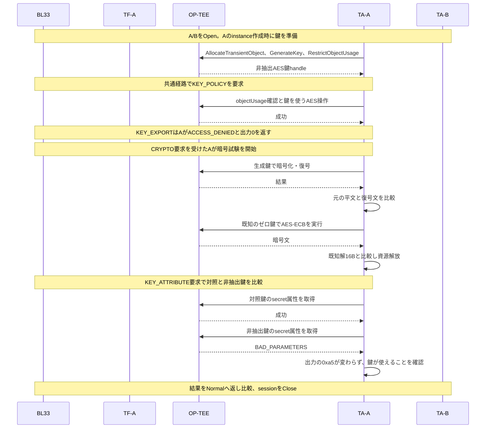

### コードと公式根拠

- 呼出しと複合判定：[tests/validation/security_tests.c：test_key_api](https://github.com/ririmon22/trustzone-validation/blob/a94646ea4130b448961c7921c57d1d317da8f36b/tests/validation/security_tests.c#L112)、[tests/validation/extended_tests.c：b2_run_key_attributes](https://github.com/ririmon22/trustzone-validation/blob/a94646ea4130b448961c7921c57d1d317da8f36b/tests/validation/extended_tests.c#L117)。
- 鍵生成と使用制限：[secure_world/ta/security.c：security_create](https://github.com/ririmon22/trustzone-validation/blob/a94646ea4130b448961c7921c57d1d317da8f36b/secure_world/ta/security.c#L22)。
- usage確認と使用：[secure_world/ta/security.c：key_policy_test](https://github.com/ririmon22/trustzone-validation/blob/a94646ea4130b448961c7921c57d1d317da8f36b/secure_world/ta/security.c#L97)。
- Core属性取得を直接検査：[secure_world/ta/security.c：key_attribute_test](https://github.com/ririmon22/trustzone-validation/blob/a94646ea4130b448961c7921c57d1d317da8f36b/secure_world/ta/security.c#L129)。
- 暗号・復号・既知解とcleanup：[secure_world/ta/ta.c：run_crypto_test](https://github.com/ririmon22/trustzone-validation/blob/a94646ea4130b448961c7921c57d1d317da8f36b/secure_world/ta/ta.c#L18)。

O5が鍵APIの規約、O7が実使用版の`TEE_USAGE_EXTRACTABLE`と`syscall_cryp_obj_get_attr`の実装根拠。非抽出属性取得の内部syscall `_utee_cryp_obj_get_attr`はOP-TEE固有で、公開APIと同じ戻り方を仮定しない。通常公開APIのpanic挙動との混同を避けてCoreの拒否を直接観測している。

自作KEY_EXPORTが拒否するだけではCore制約の証拠にならないため、属性子も見る。生RAM抽出・DMA・side channel・乱数品質の保証には広げない。AES既知解はコード内16B `66e94bd4ef8a2c3b884cfa59ca342b2e`との一致で、独立した暗号認証試験ではない。

<a id="t-13"></a>

## T-13：Secureデータ永続保存：未実施（EXT-STORE-V01）

|対応項目|内容|
|---|---|
|reportの親test_id|`EXT-STORE-V01`|
|B2_REVIEW_PARENT|`16`。T番号とは別体系|
|従来の項目名|Secureデータ永続保存|

### 今回の検証内容

永続Storage/RPC backendを構成していない。

### 具体的な検証方法

1. BL33のreviewが当該親IDの選択を確認する。
2. 対象外項目の分岐へ入る。
3. `SKIP`、理由、`phase=DONE`を保存する。この項目の実操作・測定は実行しない。
4. 未選択の場合はNOT_RUNであり、SKIPを記録した場合とも区別する。

### 現行コードに合わせた合格条件

**現行版に機能の合格判定基準はない。SKIPは合格ではなく、未実施理由の記録である。** 記録内容の整合を見るなら、対象の正式ID、status=SKIP、phase=DONE、構成に合うreasonを確認する。これは「検査に合格した」とは報告しない。

### この結果だけでは確認していないこと・追加確認

将来、保存・読出し・再起動・改変・破損・削除時の期待動作の確認を追加する場合は、期待値と合格基準を実装と合わせて別途定める。現行の合格基準欄へ先取りして書かない。

### レビューでの説明例

> 今回は実操作を行わず、未実施の理由を結果に残しています。

### 現行reportで見る場所と扱い

`REVIEW`内の`test_id: EXT-STORE-V01`を見る。review一式、または当該親を選択したrunでは**`status: SKIP`、`phase: DONE`**が現行コードの想定。これは試験に合格した意味ではない。未選択ならNOT_RUNのままなので、実施済みと数えない。

- 未実装の部分：永続Storage/RPC backendがない。
- 現行の機能検証に対する判定：**未実施／保留。PASSの実行証拠は生成されない。**
- TA内の一時鍵・session counter・RAMログ保存は、永続保存の耐改変・再起動保持の証拠ではない。

reasonは`OUT-OF-SCOPE: peripheral-DMA-debug-authenticated-boot-persistent-storage`を固定長フィールドへ保存する。JSONの`reason`は長い文字列の末尾が切れる場合があるため、`OUT-OF-SCOPE:`と正式ID・statusで識別する。

### 現行コードが実際に行う流れ

実装のない機能を動かす図は描かない。実際には以下の**結果記録だけ**を行い、当初想定していた実操作は行わない。

|順序|担当|実際の処理|
|---|---|---|
|1|BL33|b2_run_reviewで対象親が選択されているか調べる|
|2|BL33|対象外親IDの分岐でfinishを呼ぶ|
|3|BL33|SKIP・reason・DONEを保存する|
|4|TF-A／OP-TEE／TA-A／TA-B|この項目の実操作は呼ばれない。他の選択試験で動くこととは区別|

### コードと必要な追加証拠

コード：[tests/validation/review.c：void b2_run_review](https://github.com/ririmon22/trustzone-validation/blob/a94646ea4130b448961c7921c57d1d317da8f36b/tests/validation/review.c#L351)、[tests/validation/review.c：static void finish](https://github.com/ririmon22/trustzone-validation/blob/a94646ea4130b448961c7921c57d1d317da8f36b/tests/validation/review.c#L79)。

実施するために確定する内容：保存先、REE/RPMB方式、再起動、改変/破損/削除時の設計、復旧、rollbackを含めるかの範囲。

公式根拠：[OP-TEE 4.5 Secure storage](https://optee.readthedocs.io/en/4.5.0/architecture/secure_storage.html)は構成を追加する際の公式参照。今回はbackendを実装・検証したとはしない。 ここで挙げる追加条件はレビューの不足事項で、現行の実行済みシーケンスではない。

<a id="t-14"></a>

## T-14：User TAの正常呼出しと入力・sessionの拒否層（EXT-TA-V01）

|対応項目|内容|
|---|---|
|reportの親test_id|`EXT-TA-V01`|
|B2_REVIEW_PARENT|`12`。T番号とは別体系|
|従来の項目名|User TAの呼出し|

### 今回の検証内容

TAのOpen/Invoke/Closeが成立し、client・Core・TAそれぞれの不正入力と状態の扱いが期待どおりであることを確認する。

### 具体的な検証方法

1. `TEE-01`で二つのsessionのECHOと未知command拒否を確認する。
2. `TEE-SESSION-01`でclientの4枠を使用し、5個目のOpen、同じhandleの重複Open、Close済みhandleの再Close/Invokeをclientが拒否することを確認する。全枠を解放する。
3. `TEE-ABI-01`で不正attributeをCoreへ送り、未知commandをTAへ送る。ECHOの0とUINT32_MAXを正常対照とする。
4. `TEE-SESSION-CORE-01`でClose前のCore session IDを保存し、Close後にraw IDをCoreへ送って拒否を確認する。別sessionの正常通信、再Open、counter初期化も検査する。
5. `TEE-PARAM-01`で型・buffer内容の異常と正常再試行を確認する。
6. 各子でsessionを片付け、親が5子の結果を継承する。

### 現行コードに合わせた合格条件

- 上記5子がすべてPASSであり、それぞれの複合predicateが成立する。
- client容量超過・重複・閉handleはclient BAD_STATE。Coreへ送った不正attributeと閉Core IDはBAD_PARAMETERS/origin3。未知commandはBAD_PARAMETERS/origin4。
- ECHOの0とUINT32_MAXはその値で返り、型・内容検査後も正常呼出しが成立する。
- 全sessionの後始末と共通回収条件が成立し、親`EXT-TA-V01`がPASSになる。

### この結果だけでは確認していないこと・追加確認

4枠は自作BL33 clientの制約であり、OP-TEE全体のsession上限ではない。試した代表入力の結果であり、全入力空間の網羅ではない。SMCCC_VERSION等の標準問い合わせは別の補助子で、TA実行の代替ではない。

### レビューでの説明例

> 正常呼出しに加え、不正入力や閉じたsessionがclient・Core・TAのどこで拒否されるかを分けて確認しています。

### reportで見る場所

|子ID|check名とOK値|具体的な条件|
|---|---|---|
|`TEE-01`|T-01・T-02の3checkが1|正常往復と未知command拒否|
|`TEE-SESSION-01`|`client-limit-and-cleanup`=1|4枠Open、5件目と同じhandleへの二重Openをclient拒否。全Close、二重Close・閉handle Invoke拒否、active0|
|`TEE-ABI-01`|`message_abi-predicates`=1|attr0xffはCore BAD_PARAMETERS/origin3、未知commandはTA BAD_PARAMETERS/origin4、ECHO値0とUINT32_MAXが一致|
|`TEE-SESSION-CORE-01`|`closed_core_session-predicates`=1|閉じた生session IDをCoreへ送るとBAD_PARAMETERS/origin3、B継続、A再Openで未認証|
|`TEE-PARAM-01`|`parameter_validation-predicates`=1|T-05で説明した型・内容の拒否と継続|

親`EXT-TA-V01`のPASS、`functional-status`5件すべて0、子5件それぞれPASSを確認する。

### 詳細シーケンス

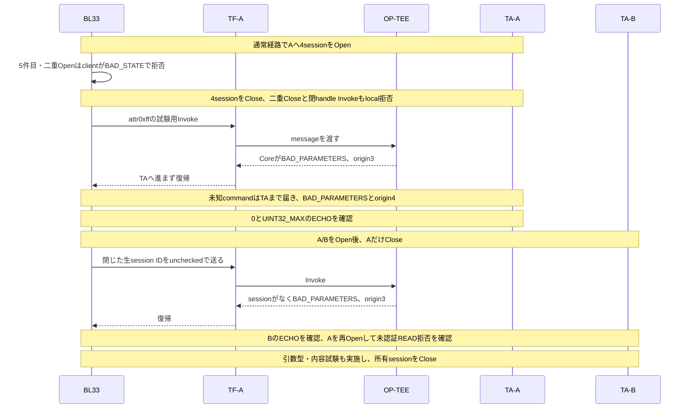

### コードと公式根拠

- client上限：[tests/validation/boundary_tests.c：b2_run_session_limits](https://github.com/ririmon22/trustzone-validation/blob/a94646ea4130b448961c7921c57d1d317da8f36b/tests/validation/boundary_tests.c#L12)。Core全体のsession上限試験ではない。
- attr・command・u32両端：[tests/validation/boundary_tests.c：b2_run_message_abi](https://github.com/ririmon22/trustzone-validation/blob/a94646ea4130b448961c7921c57d1d317da8f36b/tests/validation/boundary_tests.c#L41)。
- 生IDを敢えて送る：[normal_world/client/client.c：tee_probe_session_id](https://github.com/ririmon22/trustzone-validation/blob/a94646ea4130b448961c7921c57d1d317da8f36b/normal_world/client/client.c#L309)、[tests/validation/extended_tests.c：b2_run_closed_core_session](https://github.com/ririmon22/trustzone-validation/blob/a94646ea4130b448961c7921c57d1d317da8f36b/tests/validation/extended_tests.c#L37)。
- 引数：[tests/validation/extended_tests.c：b2_run_parameter_validation](https://github.com/ririmon22/trustzone-validation/blob/a94646ea4130b448961c7921c57d1d317da8f36b/tests/validation/extended_tests.c#L67)。
- 4枠の管理・通常API拒否：[normal_world/client/client.c：tee_session_open](https://github.com/ririmon22/trustzone-validation/blob/a94646ea4130b448961c7921c57d1d317da8f36b/normal_world/client/client.c#L151) / `tee_session_close` / `tee_invoke`。

公式O2のmessage ABI、O4の`entry_invoke_command`にあるsession検索・型検査。ローカルBAD_STATEは通信先が拒否した証拠ではないので、Coreの生ID試験を別に実施する。4枠・5件目等は独自client仕様。並列呼出しや全sessionライフサイクルを網羅したことにはしない。

<a id="t-15"></a>

## T-15：TAの異常終了・仮想空間分離・復旧とCore/資源の補足（EXT-TA-V02）

|対応項目|内容|
|---|---|
|reportの親test_id|`EXT-TA-V02`|
|B2_REVIEW_PARENT|`13`。T番号とは別体系|
|従来の項目名|2つのUser TAの分離|

### 今回の検証内容

Aだけを異常終了させてもBとNormalが継続し、Aを再生成できることを確認する。AからBの秘密VAと同じ数値のVAへのread/write probeを行う。Core canaryと512回の資源反復は追加の小試験として分ける。

### 具体的な検証方法

1. `TEE-07`でAへ意図的PANICを要求する。TARGET_DEAD、BのECHO継続、Aの再OpenとECHOを確認する。これはメモリアクセス違反を起こす試験とは別である。
2. `TEE-ISO-TA`でBから試験用秘密変数のVAを得て、A/Bの秘密tagを確認する。
3. AへそのVA数値でreadを要求する。Aの空間でも有効なVAならACCESS_CONFLICTとして実アクセスせず、A再生成で最大8回再試行する。
4. Aでアクセス不能なVAについて実loadを行い、AのTARGET_DEAD、B非改変、A再Openと状態復旧を確認する。write方向も同様に行う。
5. 補足Core probeでAから検証用Core canaryのread/writeを試み、TARGET_DEAD、canary非改変、A/B継続を検査する。
6. stats PTAを使い、32回warmup後に512資源cycleを実行する。各cycleのA/BへのOpen、ECHO、不正SHM拒否、鍵再生成、AES、Closeを行い、16回ごとにAをPANICさせB継続とA復旧を確認する。観測資源統計を前後で比較する。
7. 子2件と補足結果、後始末を別々に照合する。

### 現行コードに合わせた合格条件

- `TEE-07`がPASS。Aの期待する終了とB継続、A再Open/ECHOが成立する。
- `TEE-ISO-TA`がPASSでread/write両statusがPASS=0。両方向ともTARGET_DEAD/origin3、B tag維持、A再生成後tag復旧を満たす。
- 補足を採用するrunではCore-canary-status=0、resource-stress-status=0、stress-completed=512で、それぞれの内部比較が成立する。資源統計は終了時heap使用量・TA RAM使用量が開始時以下、allocation failure数が開始時と同じであることを比較し、clientの残sessionが0であることも確認する。
- 子と補足、後始末のすべてを確認する。現行コードでは補足関数が親statusを再設定するため、親PASSだけをこの項目全体の合格根拠にしない。

### この結果だけでは確認していないこと・追加確認

8回ともVA aliasなら該当probeはBLOCKED。TARGET_DEADだけでは例外種別を特定できないため、ESR/FAR/ELR/mappingは追加BP観測で取得する。Core/stats PTAがなければ補足はBLOCKED。物理PAのXMPU保護、無期限のリーク不存在は対象外。

### レビューでの説明例

> Aの異常をAに閉じ込め、BとNormalが続き、Aを作り直せることを確認します。VM probe、意図的PANIC、Core/資源補足は分けて説明します。

### reportで見る場所

|場所|OK条件|
|---|---|
|子`TEE-07`|PASS、`expected-target-dead` / `other-TA-continues` / `reopen` / `recovered-echo`が各1|
|子`TEE-ISO-TA`|PASS、`read-probe-status` / `write-probe-status`が各0（PASS enum）|
|子内`private-state-tag`|Aは0x6d3a4719、Bは0xb5208c14。繰返し現れる|
|RAM `REPLY TA-VM-probe`|想定したprobeでtransport0、TARGET_DEAD、origin3|
|RAM `PROBE_FAULT domain=ta`|read/write双方の試行記録|
|REVIEW `EXT-TA-V02`|PASSに加え`Core-canary-status`=0、`resource-stress-status`=0、`stress-completed`=512|
|RAM `PROBE_FAULT domain=core`|canary対象read/writeの想定fault。CoreのCHECK_TAGは0x16ac45e3|
|RAM `STRESS_RESOURCE`|completed512、heap_after≤heap_before、ta_after≤ta_before、alloc_fail_after=alloc_fail_before|
|全体・親cleanup|0|

**この版では親PASSだけを根拠にしない。** `b2_run_review`で子2件の`inherit`後に`supplement_isolation`が親statusを再設定し、元の子FAIL/BLOCKEDを直接保持しない経路がある。したがって子2件がPASSであることを別途必須とする。`TEE-STRESS-01`はRAMログのreportで、冒頭の15子固定表に独立行として出るIDではない。

### シーケンスA：panicとTA間VM分離

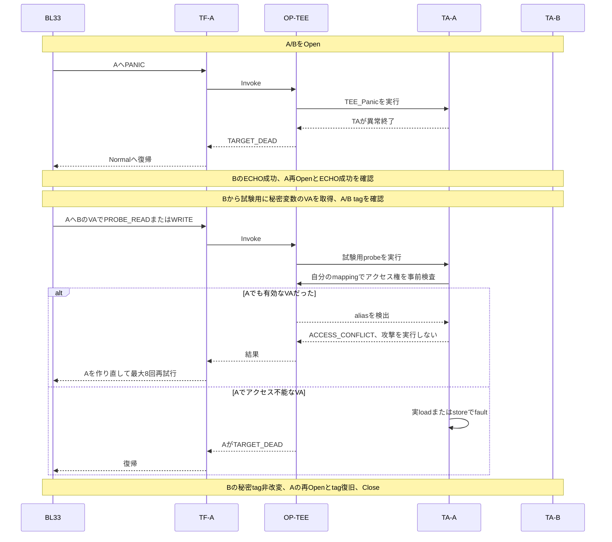

AへBのVA数値を渡している。AとBで同じVAが別物を指す可能性を排除してから実アクセスする。8回ともaliasならBLOCKEDで、拒否成功へ読み替えない。TA faultの内部ESRをこのreportが全て回収するわけではない。

### シーケンスB：Core canaryと512資源反復

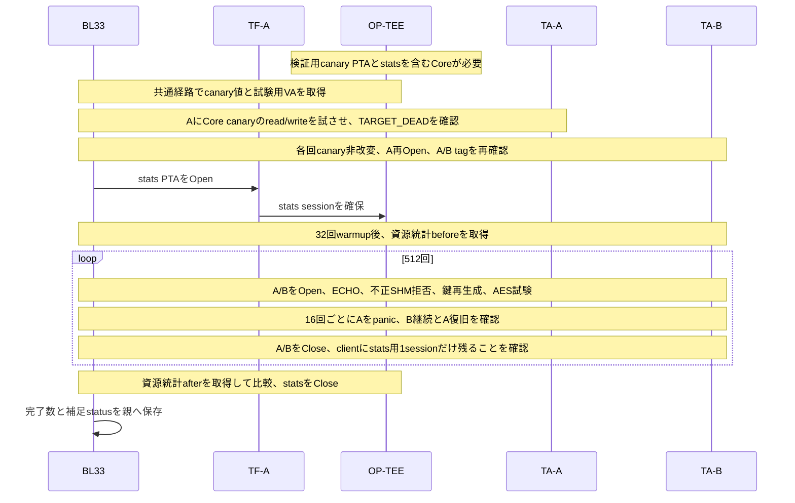

### コードと公式根拠

- panic復旧：[tests/validation/functional.c：b2_run_panic_recovery](https://github.com/ririmon22/trustzone-validation/blob/a94646ea4130b448961c7921c57d1d317da8f36b/tests/validation/functional.c#L233)。
- VM試験：[tests/validation/security_tests.c：probe_other_ta](https://github.com/ririmon22/trustzone-validation/blob/a94646ea4130b448961c7921c57d1d317da8f36b/tests/validation/security_tests.c#L140)、[tests/validation/security_tests.c：b2_run_ta_isolation](https://github.com/ririmon22/trustzone-validation/blob/a94646ea4130b448961c7921c57d1d317da8f36b/tests/validation/security_tests.c#L316)。
- TAで実際にload/storeする場所：[secure_world/ta/security.c：security_invoke](https://github.com/ririmon22/trustzone-validation/blob/a94646ea4130b448961c7921c57d1d317da8f36b/secure_world/ta/security.c#L169)のPROBE_READ/WRITE分岐。access rights検査を通ったという意味ではなく、**アクセス不能という事前条件を確認してから不正アクセスを試みる**。
- Core補足：[tests/validation/security_tests.c：probe_core_isolation](https://github.com/ririmon22/trustzone-validation/blob/a94646ea4130b448961c7921c57d1d317da8f36b/tests/validation/security_tests.c#L186)、[secure_world/pta/validation_canary.c：invoke_canary](https://github.com/ririmon22/trustzone-validation/blob/a94646ea4130b448961c7921c57d1d317da8f36b/secure_world/pta/validation_canary.c#L14)。
- 反復：[tests/validation/stress_tests.c：cycle](https://github.com/ririmon22/trustzone-validation/blob/a94646ea4130b448961c7921c57d1d317da8f36b/tests/validation/stress_tests.c#L14) / `run_stress_tests`。
- 親status再設定の注意：[tests/validation/review.c：supplement_isolation](https://github.com/ririmon22/trustzone-validation/blob/a94646ea4130b448961c7921c57d1d317da8f36b/tests/validation/review.c#L242)。

O4の`tee_ta_invoke_command`とTARGET_DEAD処理、O5の`TEE_Panic`、O1のTA/Coreメモリ分離が基礎。canary/stats PTAはこの試験のための追加コード。**TA間の仮想空間分離と、NormalからSecure PAへの物理保護は別。** 512回と観測統計の範囲であり、無期限・全資源のリーク不存在を示さない。

<a id="t-16"></a>

## T-16：外部署名TAの実ロード・不正image拒否とローダ監査（EXT-TA-V03）

|対応項目|内容|
|---|---|
|reportの親test_id|`EXT-TA-V03`|
|B2_REVIEW_PARENT|`14`。T番号とは別体系|
|従来の項目名|署名TAのロード・改ざん拒否|

### 今回の検証内容

Early TAとは別UUIDの外部署名TAを実runtime loaderでロードする。正常・改変・別鍵の拒否段階、供給側エラー、拒否後の再実行、RPC後始末を確認する。

### 具体的な検証方法

1. 正常・payload改変・別鍵署名などを含むbundleを用意し、BL33の限定RPCでTA bytesを供給する。
2. 0正常、1改変、2正常、3別鍵、4正常、5不在UUID、6過大サイズ、7正常の順で8ケースを実行する。
3. 正常ケースはOpen後、ECHOとinstance counterを各1回呼び、Closeする。不正ケースはOpen失敗を確認しInvokeしない。
4. 各ケースでRPC照会・コピー・確保/解放・live・非対応要求を記録する。
5. Core監査PTAから8件のsnapshotを取得する。
6. PC側でCore ELF/hashと監査を照合し、正常は署名/digest通過、payload改変はdigest拒否、別鍵は署名拒否という到達段階まで評価する。

### 現行コードに合わせた合格条件

- `TEE-04`がPASS、8個のsigned-loader-subcaseが1、Core-loader-audit-readが1。
- 正常4ケースはOpen SUCCESS/origin4、ECHO=`0x7e168ac1`、counter=1、Close SUCCESS/origin3。不正ケースのInvoke数は0。
- 改変・別鍵はSECURITY/origin3、不在はITEM_NOT_FOUND/origin3、過大はBAD_PARAMETERS/origin3。
- 正常系はcopies/queriesあり、不在・過大はlocal拒否でcopies0。live0、確保数=解放数、unsupported0、poisoned0。
- `SIGNED LOADER`の厳密監査照合がPASSし、fresh8件・overflow0・UUID順・署名/digest結果が後述正解表と一致する。review runなら親PASSも照合する。

### この結果だけでは確認していないこと・追加確認

Core監査未取得・hash照合不足なら署名拒否元の証明は未成立。SoC Secure Boot、rollback、製品鍵の配備は対象外。拒否後の正常ケースは対象署名TAの再利用確認であり、全既存サービスの網羅的継続試験ではない。

### レビューでの説明例

> 本物の実行時ローダでTAを読み込み、改変と別鍵をそれぞれの段階で拒否し、その後も正常TAを実行できるかを確認しています。

### reportで見る場所

1. 冒頭の`TEE-04 PASS`。`signed-loader-subcase`の8件がすべてexpected=actual=1、`Core-loader-audit-read`が1。
2. `SIGNED LOADER (EXT-TA-V03 / T-16)`内の`status: PASS`。`verification: UNVERIFIED`なら監査未成立。
3. REVIEW実行なら`EXT-TA-V03`もPASS。専用selection16ではREVIEW表自体を生成しないため、ないことを不具合としない。
4. `rpc.live=0`、`unsupported=0`、`poisoned=0`、allocations=frees。
5. `subcases`のscenario0〜7を次表で確認。Core snapshotはfresh8件・overflow0・UUID順までdecoderが照合する。

### 8ケースの正解表（番号はコードどおり0始まり）

|scenario / image_variant|Open result / origin|invokes|core_flags|core_signature|core_digest|意味|
|---|---|---|---|---|---|---|
|0 normal|0 / 4|2|127（0x7f）|0|0|正常ロード・ECHO・counter・Close|
|1 tampered|0xffff000f / 3|0|95（0x5f）|0|0xffff000f|署名段階を通り、payload digestで拒否|
|2 normal|0 / 4|2|127|0|0|改変拒否後も正常動作|
|3 wrong-key|0xffff000f / 3|0|71（0x47）|0xffff000f|0xffffffff|別鍵を署名段階で拒否、digest未実行|
|4 normal|0 / 4|2|127|0|0|別鍵拒否後も正常動作|
|5 absent|0xffff0008 / 3|0|1|0xffffffff|0xffffffff|UUID不在を供給側で拒否、署名検査ではない|
|6 oversized|0xffff0006 / 3|0|1|0xffffffff|0xffffffff|宣言サイズ0x40001を供給側で拒否|
|7 normal|0 / 4|2|127|0|0|最後も正常、後始末|

各Openのtransportは0。正常ケースのECHO値0x7e168ac1、counter=1、origin4、Closeはtransport0/result0/origin3。**これらのECHO/counter/Closeの詳細はdecoder内部で検査するが、SIGNED LOADERのsubcases行には全部を再出力しない。** 元記録`b2_signed_audit.bin`、RAM `runtime-TA-echo` / `fresh-instance-count`、decoderの条件を根拠に説明する。正常ケースのqueries≥1/copies≥1、不在・過大ケースはcopies0/local拒否あり。各ケースlive0、allocations=frees。

### 詳細シーケンス

この試験のTAは**TA-A/Bと別UUIDの署名TA**。不要なTA-A/Bを図に置く代わりに「署名TA」を追加する。Core監査PTAはOP-TEEの箱の中。

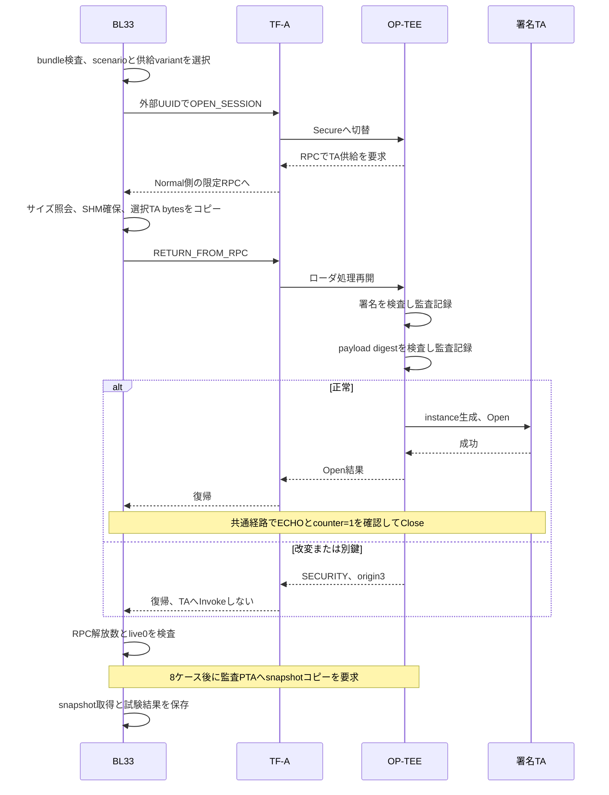

RPC要求は複数往復になる。図はサイズ照会・メモリ供給・復帰を代表化している。不在/過大は供給側拒否のため署名・digestまで進まない。

### コードと公式根拠

|処理|コード|
|---|---|
|8ケース・期待result・origin・Invoke0/2・cleanup|[tests/validation/signed_ta_tests.c：b2_run_signed_ta](https://github.com/ririmon22/trustzone-validation/blob/a94646ea4130b448961c7921c57d1d317da8f36b/tests/validation/signed_ta_tests.c#L25)|
|bundle選択とRPC loop、TA供給|[normal_world/client/signed_rpc.c：signed_rpc_call](https://github.com/ririmon22/trustzone-validation/blob/a94646ea4130b448961c7921c57d1d317da8f36b/normal_world/client/signed_rpc.c#L269)、同ファイル`load_ta`|
|外部TAのECHO/counter|[secure_world/ta_signed/ta.c：TA_InvokeCommandEntryPoint](https://github.com/ririmon22/trustzone-validation/blob/a94646ea4130b448961c7921c57d1d317da8f36b/secure_world/ta_signed/ta.c#L21)|
|Coreローダへの観測追加位置|[scripts/stage_signed_loader.py：apply](https://github.com/ririmon22/trustzone-validation/blob/a94646ea4130b448961c7921c57d1d317da8f36b/scripts/stage_signed_loader.py#L5)、[secure_world/loader/signed_loader_audit.h](https://github.com/ririmon22/trustzone-validation/blob/a94646ea4130b448961c7921c57d1d317da8f36b/secure_world/loader/signed_loader_audit.h#L1)|
|PC側の厳密照合と上記正解表|[scripts/decode_signed_results.py：decode_signed](https://github.com/ririmon22/trustzone-validation/blob/a94646ea4130b448961c7921c57d1d317da8f36b/scripts/decode_signed_results.py#L7)|
|Core ELF hash必須・監査不備の扱い|[scripts/decode_b2_results.py](https://github.com/ririmon22/trustzone-validation/blob/a94646ea4130b448961c7921c57d1d317da8f36b/scripts/decode_b2_results.py#L1)|

公式O9の`ree_fs_ta_open`で署名検証、`ree_fs_ta_read`/`check_digest`でpayload照合を読む。O10がEarly TAと外部署名TAの違いを説明する。

通常のTA-A/BはEarly TAとして組み込むため、この署名試験とは別。監査は外部OSSの**ビルド用コピーへコードを追加**する仕組みで、署名アルゴリズム自体を自作に置き換えてはいない。「OSSは完全に無変更」とは説明しない。O9原本と`stage_signed_loader.py`の差分が観測追加の根拠。

Core監査はどこで拒否したかを示し、Normal側のエラー表示だけでは足りない。Secure Boot、鍵の安全な製品配備、rollback防止、永続Storageの検査には広げない。

<a id="t-17"></a>

## T-17：GET_SHM_CONFIG fast SMCの往復時間測定（PERF-01）

|対応項目|内容|
|---|---|
|reportの親test_id|`PERF-01`|
|B2_REVIEW_PARENT|`17`。T番号とは別体系|
|従来の項目名|Secure呼出しの往復時間|

### 今回の検証内容

TAを呼ばず、OP-TEEのGET_SHM_CONFIG fast SMCの往復を測定する。呼出wrapperと返値照合も測定区間に含む。

### 具体的な検証方法

1. 初期化時のSHM base/size/cache属性を基準にする。
2. counter開始、GET_SHM_CONFIG呼出、TF-A/OP-TEE経由の復帰、statusと構成値の比較、counter終了というoperationを測る。
3. 16回warmupの後に128 sampleを取得し、空operationのoverheadも保存する。
4. 親17単独選択でも実装は8性能系列を実行する。本項目へ採用するのはseries_id PERF-01である。
5. 停止せずに測定を終え、回収後に平均・中央値・p95・p99等を確認する。

### 現行コードに合わせた合格条件

- 内部記録のseries-count=8、operation-errors=0、record-complete=2が一致する。
- `BENCHMARKS`のcollection_status=COMPLETE、errors=0で、対象系列のsampleとoverheadが各128件、warmup16、timer_hzが正値となる。
- 各operationの正常応答・データ検証・後始末が成立する。
- decoder表示はMEASUREDであり、速度合格を意味しない。コード内部のTEST_PASSを性能閾値への合格と読み替えない。

### この結果だけでは確認していないこと・追加確認

純粋なWorld切替命令だけの時間ではなく、TA Invoke時間でもない。CPU clock/IRQ/cache等の実施条件と測定中に停止していないことは実行記録で補う。速度の上限値は未設定である。

### レビューでの説明例

> TA処理を含めず、SHM構成問い合わせのSMCを往復するのにかかった時間を測っています。

### reportで見る共通条件

親は`status: MEASURED`・`phase: DONE`。`series-count=8`、`operation-errors=0`、`record-complete=2`が一致し、BENCHMARKSの`collection_status=COMPLETE`・`errors=0`。各対象系列のsampleとoverheadが各128件、warmup16、timer_hz>0を確認する。`MEASURED`は測定成立であり、速度閾値への合格ではない。

親単独を選んでも内部では8系列すべてを測るが、本項目の説明では下記の対象seriesだけを採用する。測定とlog出力の区間、IRQ/cache条件は後述「性能の共通説明」を参照する。

### 対象系列と返値検査

BENCHMARKSの`series`内で`parent_id: PERF-01`、`series_id: PERF-01`を検索する。Core応答のx0がOK、base/size/cache属性が初期化時と一致しなければ`benchmark_failed`を立てる。

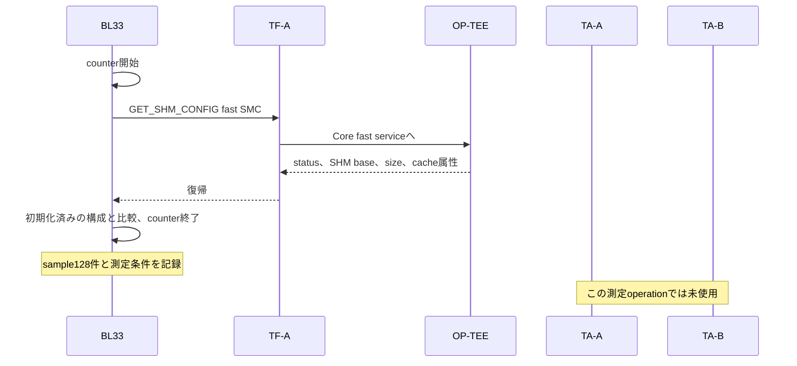

コード：[tests/validation/main.c：static void benchmark_transport](https://github.com/ririmon22/trustzone-validation/blob/a94646ea4130b448961c7921c57d1d317da8f36b/tests/validation/main.c#L26)、[normal_world/client/client.c：bool tee_client_probe_configuration](https://github.com/ririmon22/trustzone-validation/blob/a94646ea4130b448961c7921c57d1d317da8f36b/normal_world/client/client.c#L324)、[runtime/benchmark/benchmark.c：void benchmark_run_scoped](https://github.com/ririmon22/trustzone-validation/blob/a94646ea4130b448961c7921c57d1d317da8f36b/runtime/benchmark/benchmark.c#L82)。公式O2のGET_SHM_CONFIG、O3のSMC dispatch、O11のcounter。TA処理時間と表現しない。

<a id="t-18"></a>

## T-18：Normal cached SHMへの512B store区間の時間測定（PERF-02）

|対応項目|内容|
|---|---|
|reportの親test_id|`PERF-02`|
|B2_REVIEW_PARENT|`18`。T番号とは別体系|
|従来の項目名|メモリアクセス性能|

### 今回の検証内容

Normal側の共有メモリへ64個のu64を書き込む区間を測定する。範囲照会とDSBも含む。独立したread性能測定は行っていない。

### 具体的な検証方法

1. 交渉済みSHMの末尾512Bを試験bufferとし、必要なguardと領域サイズを確認する。
2. counter開始後、shared range照会、64個のu64への値0〜63のstore、DSBを行いcounterを止める。
3. 測定区間の外で64語をreadbackし、各語が対応するiと一致するか調べ、zeroする。
4. warmup16後、128 sampleとoverheadを取得する。対象はseries_id PERF-02。
5. 計測条件と統計値を回収する。

### 現行コードに合わせた合格条件

- 内部記録のseries-count=8、operation-errors=0、record-complete=2が一致する。
- `BENCHMARKS`のcollection_status=COMPLETE、errors=0で、対象系列のsampleとoverheadが各128件、warmup16、timer_hzが正値となる。
- 各operationの正常応答・データ検証・後始末が成立する。
- decoder表示はMEASUREDであり、速度合格を意味しない。コード内部のTEST_PASSを性能閾値への合格と読み替えない。

### この結果だけでは確認していないこと・追加確認

readbackはデータ正常性の確認で、read速度を測ったものではない。Secure DDR、非cacheアクセス、DMA帯域、DDRコントローラ単体性能には読み替えない。性能閾値は未設定。

### レビューでの説明例

> Normalのcache有効なSHMへ512Bを書く処理を測り、測定後にデータが正しく書けたことを確認しています。

### reportで見る共通条件

親は`status: MEASURED`・`phase: DONE`。`series-count=8`、`operation-errors=0`、`record-complete=2`が一致し、BENCHMARKSの`collection_status=COMPLETE`・`errors=0`。各対象系列のsampleとoverheadが各128件、warmup16、timer_hz>0を確認する。`MEASURED`は測定成立であり、速度閾値への合格ではない。

親単独を選んでも内部では8系列すべてを測るが、本項目の説明では下記の対象seriesだけを採用する。測定とlog出力の区間、IRQ/cache条件は後述「性能の共通説明」を参照する。

### 対象系列とデータ検証

BENCHMARKSの`series`内で`parent_id: PERF-02`、`series_id: PERF-02`を検索する。使用領域は交渉したSHM末尾の512B。i番目のu64にiを書き、測定外で全64語を照合してzeroする。失敗は`benchmark_failed`へ反映する。

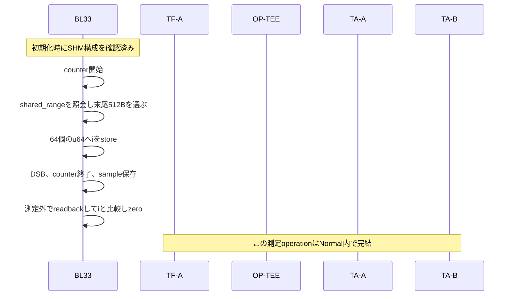

コード：[tests/validation/main.c：static void benchmark_shared_memory](https://github.com/ririmon22/trustzone-validation/blob/a94646ea4130b448961c7921c57d1d317da8f36b/tests/validation/main.c#L32)、[tests/validation/main.c：static void verify_shared_memory](https://github.com/ririmon22/trustzone-validation/blob/a94646ea4130b448961c7921c57d1d317da8f36b/tests/validation/main.c#L46)、[runtime/benchmark/benchmark.c：void benchmark_run_scoped](https://github.com/ririmon22/trustzone-validation/blob/a94646ea4130b448961c7921c57d1d317da8f36b/runtime/benchmark/benchmark.c#L82)。O11のmemory attributes・barrier・counterが基礎。範囲照会とstore loopは独自の測定仕様。

<a id="t-19"></a>

## T-19：Secure割込み応答時間：選択ZCU構成では未測定（PERF-03）

|対応項目|内容|
|---|---|
|reportの親test_id|`PERF-03`|
|B2_REVIEW_PARENT|`19`。T番号とは別体系|
|従来の項目名|Secure割込み応答時間|

### 今回の検証内容

Secure SGIのPTAと配送構成が現行ZCU構成に含まれない。

### 具体的な検証方法

1. BL33のreviewが当該親IDの選択を確認する。
2. run_secure_sgiの構成確認で停止する。
3. `BLOCKED`、理由、`phase=DONE`を保存する。この項目の実操作・測定は実行しない。
4. 未選択の場合はNOT_RUNであり、BLOCKEDを記録した場合とも区別する。

### 現行コードに合わせた合格条件

**現行版に機能の合格判定基準はない。BLOCKEDは合格ではなく、未実施理由の記録である。** 記録内容の整合を見るなら、対象の正式ID、status=BLOCKED、phase=DONE、構成に合うreasonを確認する。これは「検査に合格した」とは報告しない。

### この結果だけでは確認していないこと・追加確認

将来、割込み配送成立後の発生点からhandler時刻点までのsample取得と時刻条件の確定を追加する場合は、期待値と合格基準を実装と合わせて別途定める。現行の合格基準欄へ先取りして書かない。

### レビューでの説明例

> 今回は実操作を行わず、未実施の理由を結果に残しています。

### 現行reportで見る場所と扱い

`REVIEW`内の`test_id: PERF-03`を見る。review一式、または当該親を選択したrunでは**`status: BLOCKED`、`phase: DONE`**が現行コードの想定。これは試験に合格した意味ではない。未選択ならNOT_RUNのままなので、実施済みと数えない。

- 未実装の部分：Secure SGIのPTAと配送構成がなく、応答時間sampleを取得していない。
- 現行の機能検証に対する判定：**未実施／保留。PASSの実行証拠は生成されない。**
- PERF-05のTA Invoke時間や8系列のsample完備をSecure IRQ性能に流用しない。

検索するreasonは`Secure-SGI-not-in-selected-Core; ZCU-SGI-group-route-review-required`または`Secure-SGI-profile-not-enabled`。T-08/T-19の選択の組合せでreasonが分かれるため、文字列が一種類だけだと思わない。

### 現行コードが実際に行う流れ

実装のない機能を動かす図は描かない。実際には以下の**結果記録だけ**を行い、当初想定していた実操作は行わない。

|順序|担当|実際の処理|
|---|---|---|
|1|BL33|b2_run_reviewで対象親が選択されているか調べる|
|2|BL33|run_secure_sgiのB2_SECURE_SGI != 1分岐へ入る|
|3|BL33|finishでBLOCKED・reason・DONEを保存し、PTA Openへ進まない|
|4|TF-A／OP-TEE／TA-A／TA-B|この項目の実操作は呼ばれない。他の選択試験で動くこととは区別|

### コードと必要な追加証拠

コード：[tests/validation/review.c：static void run_secure_sgi](https://github.com/ririmon22/trustzone-validation/blob/a94646ea4130b448961c7921c57d1d317da8f36b/tests/validation/review.c#L268)、[tests/validation/review.c：static void finish](https://github.com/ririmon22/trustzone-validation/blob/a94646ea4130b448961c7921c57d1d317da8f36b/tests/validation/review.c#L79)。

実施するために確定する内容：T-08の配送成立、発生時刻点とhandler内時刻点、同一clock、warmup/sample、取得条件、応答閾値。

公式根拠：O1のInterrupt handling、O11のGeneric Timer、O12のGIC設定。 ここで挙げる追加条件はレビューの不足事項で、現行の実行済みシーケンスではない。

<a id="t-20"></a>

## T-20：許可領域間のDMA転送性能：未測定（PERF-04）

|対応項目|内容|
|---|---|
|reportの親test_id|`PERF-04`|
|B2_REVIEW_PARENT|`20`。T番号とは別体系|
|従来の項目名|許可領域のDMA転送性能|

### 今回の検証内容

DMA転送backendと測定sampleがない。

### 具体的な検証方法

1. BL33のreviewが当該親IDの選択を確認する。
2. 対象外項目の分岐へ入る。
3. `SKIP`、理由、`phase=DONE`を保存する。この項目の実操作・測定は実行しない。
4. 未選択の場合はNOT_RUNであり、SKIPを記録した場合とも区別する。

### 現行コードに合わせた合格条件

**現行版に機能の合格判定基準はない。SKIPは合格ではなく、未実施理由の記録である。** 記録内容の整合を見るなら、対象の正式ID、status=SKIP、phase=DONE、構成に合うreasonを確認する。これは「検査に合格した」とは報告しない。

### この結果だけでは確認していないこと・追加確認

将来、許可領域間での転送データ一致、size/cache/master条件、転送時間/量とsampleの取得を追加する場合は、期待値と合格基準を実装と合わせて別途定める。現行の合格基準欄へ先取りして書かない。

### レビューでの説明例

> 今回は実操作を行わず、未実施の理由を結果に残しています。

### 現行reportで見る場所と扱い

`REVIEW`内の`test_id: PERF-04`を見る。review一式、または当該親を選択したrunでは**`status: SKIP`、`phase: DONE`**が現行コードの想定。これは試験に合格した意味ではない。未選択ならNOT_RUNのままなので、実施済みと数えない。

- 未実装の部分：DMA転送backendがなく、転送時間/量を測っていない。
- 現行の機能検証に対する判定：**未実施／保留。PASSの実行証拠は生成されない。**
- PERF-02のCPUによるSHM store時間はDMA帯域ではない。

reasonは`OUT-OF-SCOPE: peripheral-DMA-debug-authenticated-boot-persistent-storage`を固定長フィールドへ保存する。JSONの`reason`は長い文字列の末尾が切れる場合があるため、`OUT-OF-SCOPE:`と正式ID・statusで識別する。

### 現行コードが実際に行う流れ

実装のない機能を動かす図は描かない。実際には以下の**結果記録だけ**を行い、当初想定していた実操作は行わない。

|順序|担当|実際の処理|
|---|---|---|
|1|BL33|b2_run_reviewで対象親が選択されているか調べる|
|2|BL33|対象外親IDの分岐でfinishを呼ぶ|
|3|BL33|SKIP・reason・DONEを保存する|
|4|TF-A／OP-TEE／TA-A／TA-B|この項目の実操作は呼ばれない。他の選択試験で動くこととは区別|

### コードと必要な追加証拠

コード：[tests/validation/review.c：void b2_run_review](https://github.com/ririmon22/trustzone-validation/blob/a94646ea4130b448961c7921c57d1d317da8f36b/tests/validation/review.c#L351)、[tests/validation/review.c：static void finish](https://github.com/ririmon22/trustzone-validation/blob/a94646ea4130b448961c7921c57d1d317da8f36b/tests/validation/review.c#L79)。

実施するために確定する内容：T-07とは別の許可領域間転送、size・cache・master条件、転送一致、clockとsample、速度閾値。

公式根拠：O12の対象DMA engineと保護経路、O11の測定counter。 ここで挙げる追加条件はレビューの不足事項で、現行の実行済みシーケンスではない。

<a id="t-21"></a>

## T-21：TA ECHO・暗号・Open/Close・復旧の6系列測定（PERF-05）

|対応項目|内容|
|---|---|
|reportの親test_id|`PERF-05`|
|B2_REVIEW_PARENT|`21`。T番号とは別体系|
|従来の項目名|TA呼出し・暗号処理時間|

### 今回の検証内容

TAを使う6種類の処理区間を別々に測定する。各系列の準備、測定内operation、測定外cleanupを区別する。Storageは含まない。

### 具体的な検証方法

1. ECHO Invokeと返値照合をPERF-05として測る。Open/Closeは区間外。
2. TA内での鍵生成、AES往復、既知解とtransportをPERF-06として測る。
3. 既存TA instanceへのsession OpenをPERF-08として測る。後続Closeは区間外。
4. 別sessionを残した状態のCloseをPERF-09として測る。直前Openは区間外。
5. PANIC診断、TARGET_DEAD確認、再Open、ECHOをPERF-10として測る。初期Openと最終Closeは区間外。
6. PANICとTARGET_DEAD観測を事前準備で済ませ、再OpenとECHOだけをPERF-11として測る。
7. 各系列でwarmup16とsample128、overhead128を取得し、処理結果と後始末を検査する。

### 現行コードに合わせた合格条件

- 内部記録のseries-count=8、operation-errors=0、record-complete=2が一致する。
- `BENCHMARKS`のcollection_status=COMPLETE、errors=0で、対象系列のsampleとoverheadが各128件、warmup16、timer_hzが正値となる。
- 各operationの正常応答・データ検証・後始末が成立する。
- decoder表示はMEASUREDであり、速度合格を意味しない。コード内部のTEST_PASSを性能閾値への合格と読み替えない。

### この結果だけでは確認していないこと・追加確認

6系列とも経路全体や複数操作を含み、暗号primitive単体や純粋な切替だけの時間ではない。Storage時間は未測定。復旧2系列は測定開始点が異なるため同じ指標として混ぜない。速度閾値は未設定。

### レビューでの説明例

> TA利用の時間をECHO・暗号・Open・Close・二種類の復旧に分け、処理が成立したsampleだけを解釈する構成です。

### reportで見る共通条件

親は`status: MEASURED`・`phase: DONE`。`series-count=8`、`operation-errors=0`、`record-complete=2`が一致し、BENCHMARKSの`collection_status=COMPLETE`・`errors=0`。各対象系列のsampleとoverheadが各128件、warmup16、timer_hz>0を確認する。`MEASURED`は測定成立であり、速度閾値への合格ではない。

親単独を選んでも内部では8系列すべてを測るが、本項目の説明では下記の対象seriesだけを採用する。測定とlog出力の区間、IRQ/cache条件は後述「性能の共通説明」を参照する。

### 6系列の対応

BENCHMARKSの`parent_id: PERF-05`に属する`series_id`は、`PERF-05`、`PERF-06`、`PERF-08`、`PERF-09`、`PERF-10`、`PERF-11`。この`PERF-11`は**T-11（起動署名）とは無関係な系列番号**である。

|系列|測定対象|測定外|
|---|---|---|
|PERF-05|TA ECHO Invokeと返値照合|session準備・終了|
|PERF-06|鍵生成・AES往復・既知解とtransport|測定枠外の準備|
|PERF-08|既存TA instanceへのsession Open|その後のClose|
|PERF-09|他sessionが残る状態のClose|直前のOpen|
|PERF-10|panic診断、TARGET_DEAD確認、再Open、ECHO|初期Open、最終Close|
|PERF-11|TARGET_DEAD観測後の再Open、ECHO|事前のpanicと観測、最終Close|

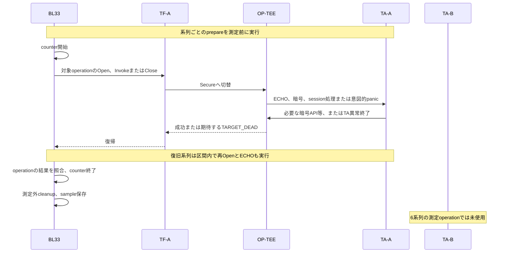

コード：[tests/validation/main.c：void b2_run_performance](https://github.com/ririmon22/trustzone-validation/blob/a94646ea4130b448961c7921c57d1d317da8f36b/tests/validation/main.c#L113)、[tests/validation/main.c：static void recover_session](https://github.com/ririmon22/trustzone-validation/blob/a94646ea4130b448961c7921c57d1d317da8f36b/tests/validation/main.c#L97)、[tests/validation/main.c：static void reopen_and_check](https://github.com/ririmon22/trustzone-validation/blob/a94646ea4130b448961c7921c57d1d317da8f36b/tests/validation/main.c#L81)、[secure_world/ta/ta.c：static TEE_Result run_crypto_test](https://github.com/ririmon22/trustzone-validation/blob/a94646ea4130b448961c7921c57d1d317da8f36b/secure_world/ta/ta.c#L18)。公式O4・O5がサービス/API、O11がtimerの根拠。各operationの包含区間はコードを根拠に説明する。

## 4. 補助子B2-SMCCC-01

これはT-02・T-14に関連する補助確認で、T番号ではない。BL33からTF-AへSMCCC_VERSION（0x80000000）、PSCI_VERSION（0x84000000）を問い合わせる。OP-TEEのTA messageやTA-A/Bは使わない。

|check名|OK値|実値の場所|
|---|---|---|
|SMCCC-version-in-range|1|RAM B2_STANDARD smccc=...|
|PSCI-version-in-range|1|RAM B2_STANDARD psci=...|

SMCCC=0x10000〜0x10007、PSCI=2〜0x10003の範囲を照合する。VERSION応答だけで電源制御・全SMCCC規約・全CPU contextを検証したとしない。

コード：[tests/validation/extended_tests.c：void b2_run_standard_versions](https://github.com/ririmon22/trustzone-validation/blob/a94646ea4130b448961c7921c57d1d317da8f36b/tests/validation/extended_tests.c#L20)。公式O8が背景。

## 5. reportの種類と子単独選択

reportの名前は解析時の`--output`で決まり、同名でも内容はrunごとに違う。

|B2_TEST_INDEX|reportの内容|
|---|---|
|0|基本機能13子。21項目一式ではなく署名・物理を含まない|
|17、親0|review一式。必要子＋親表＋署名監査＋8性能系列。物理実probeは別|
|17、親番号|選択した親と必要子。親番号は1章の対応表を使う|
|15|物理専用：子TZ-SYS-03とPHYSICAL EVIDENCE（T-04）|
|16|署名単独：子TEE-04とSIGNED LOADER（T-16）。親REVIEW表なし|
|18|性能8系列。SGIはBLOCKED、対象外SKIPも記録|
|14|旧legacy経路。通常の新結果表と区別|

### 子単独選択

|B2_TEST_INDEX|子ID|関連T項目|
|---|---|---|
|1|TEE-01|T-01、T-02、T-14|
|2|TEE-07|T-15|
|3|TEE-AUTH-TA|T-10|
|4|TEE-SHM-01|T-05|
|5|TEE-KEY-API|T-12|
|6|TEE-ISO-TA|T-15|
|7|TEE-SESSION-01|T-14|
|8|TEE-ABI-01|T-14|
|9|TEE-BOUNDARY-01|T-05|
|10|B2-SMCCC-01|T-02、T-14の補助|
|11|TEE-SESSION-CORE-01|T-14|
|12|TEE-PARAM-01|T-05、T-14|
|13|TEE-KEY-ATTR-01|T-12|
|15|TZ-SYS-03|T-04|
|16|TEE-04|T-16|

**T-11は起動署名、B2_REVIEW_PARENT=11は鍵API、B2_TEST_INDEX=11は閉Core sessionの子試験。** このように数値を直接対応させない。正式IDを検索してから選択・説明する。

## 性能の共通説明：T-17・T-18・T-21

### 親IDと系列IDは同じ番号体系ではない

|親ID|series_id|測っている区間|入口|
|---|---|---|---|
|PERF-01|PERF-01|GET_SHM_CONFIGのfast SMC往復＋wrapperと返値照合|`benchmark_transport` → `tee_client_probe_configuration`|
|PERF-02|PERF-02|Normal SHMに64×u64 store＋範囲照会＋DSB|`benchmark_shared_memory`。読戻し・zeroは測定外|
|PERF-05|PERF-05|TA ECHO Invoke。message作成・SMC・結果照合を含む|`benchmark_ta`|
|PERF-05|PERF-06|TA内の鍵生成・AES往復・KAT＋transport|`benchmark_crypto`|
|PERF-05|PERF-08|他sessionが開いているTAへのOpen|`prepare_session`を測定。後のCloseは外|
|PERF-05|PERF-09|他sessionを残したClose|Openは測定前、`close_session`を測定|
|PERF-05|PERF-10|PANIC要求・診断・TARGET_DEAD確認・再Open・ECHO|`recover_session`。最終Closeは外|
|PERF-05|PERF-11|TARGET_DEADを確認済みの状態から再Open・ECHO|panicは測定前、`reopen_and_check`を測定|

親17/18/21のどれかを単独選択しても内部では8系列全部を測る。`PERF-03`（Secure SGI）と`PERF-04`（DMA）は今回測定していない。

### 数値を説明する

- `statistics`の`minimum`、`maximum`、`mean`、`median`、`p95`、`p99`を見る。平均は`mean`。
- p95は小さい順に並べた128件の122番目、p99は127番目（1始まり）。統計検定のp値ではない。
- 時間[µs] = ticks × 1,000,000 ÷ timer_hz。平均・p95等にも同じ換算を適用できる。
- `overhead`は空operationの測定値。`overhead_subtracted=false`なので表示値から自動減算していない。
- 観測最大値は今回128件の最大であり、将来の最悪時間保証ではない。比較にはclock・cache・build・入力・デバッガ停止条件を揃える。

### コードと公式根拠

- 8系列の順とprepare/operation/cleanup：[tests/validation/main.c：b2_run_performance](https://github.com/ririmon22/trustzone-validation/blob/a94646ea4130b448961c7921c57d1d317da8f36b/tests/validation/main.c#L113)。
- 実測区間：[runtime/benchmark/benchmark.c：benchmark_run_scoped](https://github.com/ririmon22/trustzone-validation/blob/a94646ea4130b448961c7921c57d1d317da8f36b/runtime/benchmark/benchmark.c#L82)。counter開始・終了の間にある`operation()`を確認する。
- fast SMC照合：[normal_world/client/client.c：tee_client_probe_configuration](https://github.com/ririmon22/trustzone-validation/blob/a94646ea4130b448961c7921c57d1d317da8f36b/normal_world/client/client.c#L324)。
- カウンタ読み：[runtime/arch.c：counter_read](https://github.com/ririmon22/trustzone-validation/blob/a94646ea4130b448961c7921c57d1d317da8f36b/runtime/arch.c#L12) / `counter_frequency`。
- 平均とpercentileの定義：[scripts/analyze_benchmarks.py：summarize](https://github.com/ririmon22/trustzone-validation/blob/a94646ea4130b448961c7921c57d1d317da8f36b/scripts/analyze_benchmarks.py#L9)。
- reportの系列整合性とCSV：[scripts/decode_b2_review.py：benchmarks](https://github.com/ririmon22/trustzone-validation/blob/a94646ea4130b448961c7921c57d1d317da8f36b/scripts/decode_b2_review.py#L50)。

O11のGeneric Timerがカウンタの基礎。サンプル数・測定範囲・統計集計は独自仕様。測定中にbreakpointや手動停止を挟んだデータは性能値として採用しない。

## 6. 公式資料は何の根拠になるか

公式資料は仕組み・API・ハードウェアの意味の根拠。このrepoの独自T番号、0x45a7、16B、256回、512回、PASS論理を規定してはいない。**独自判定の根拠は試験コード、標準動作の根拠は公式仕様、実際に動いた根拠は同runの回収記録**という3種類を区別する。

外部コードの確認版：OP-TEE 4.5.0 `0919de0f7c79ad35ad3c8ace5f823ad1344b4716`、TF-A AMD版 `dd3512287a17eea866d5c82fa7b86ad58de59163`。手元で別版なら該当箇所を再照合する。GPの現行資料と使用版実装の挙動が同じとは自動的に仮定しない。

|参照ID|公式資料・探す見出し/関数|今回の説明で裏付けること|
|---|---|---|
|O1|[OP-TEE 4.5 Core](https://optee.readthedocs.io/en/4.5.0/architecture/core.html)：Shared Memory、world context switch、memory management|SHMはWorld間のデータ、SMC/monitorは制御の切替。Coreとuser TAの分離|
|O2|OP-TEEの`optee_smc.h`と`optee_msg.h`（後述リンク）|CALL_WITH_ARG、GET_SHM_CONFIG、RPC、message command・属性・ret/origin|
|O3|TF-Aの`opteed_main.c:opteed_smc_handler`|OP-TEE用SMCのdispatchとNormal/Secure contextの切替|
|O4|OP-TEEの`entry_std.c`、`tee_ta_manager.c`|Open/Invoke/Close、引数とsession検査、TA異常時のTARGET_DEAD|
|O5|[GlobalPlatform TEE Internal Core API](https://globalplatform.org/specs-library/tee-internal-core-api-specification/)：TEE_OpenTASession、TEE_InvokeTACommand、TEE_GetPropertyAsIdentity、TEE_Panic、Transient Object、Object Usage、Cipher API|TA側APIの契約。現行掲載版はv1.4であり、使用OP-TEEが全項目適合するという主張ではない|
|O6|[Arm AAPCS64](https://github.com/ARM-software/abi-aa/blob/main/aapcs64/aapcs64.rst)：General-purpose Registers、Stack|callee-saved GPRとSPの呼出し規約。全SMC状態保証との違い|
|O7|OP-TEEの`tee_api_defines.h`、`tee_svc_cryp.c:syscall_cryp_obj_get_attr`|実使用版のresult値・usage属性・非抽出鍵の属性拒否|
|O8|[Arm SMC Calling Convention DEN0028](https://developer.arm.com/documentation/den0028/latest/)|SMC function IDと引数・返値・呼出し規約|
|O9|OP-TEEの`ree_fs_ta.c`|REE TAを要求し、署名とpayload digestを検証する実装|
|O10|[OP-TEE 4.5 Trusted Applications](https://optee.readthedocs.io/en/4.5.0/architecture/trusted_applications.html)：Pseudo Trusted Applications、Early TA、REE filesystem TA|PTAはCore権限、Early TAは組込み、外部TAは署名ファイルとしてロード|
|O11|[Arm Architecture Reference Manual DDI0487](https://developer.arm.com/documentation/ddi0487/latest/)：ESR_EL1、FAR_EL1、ELR_EL1、PAR_EL1、AT S1E1R/W、MAIR_EL1、Generic Timer|物理試験の変換・例外・属性、性能counterの意味。公開入口は本文取得できなかったため、版別節番号は断定しない|
|O12|[AMD UG1085](https://docs.amd.com/v/u/en-US/ug1085-zynq-ultrascale-trm)のXMPU説明と[UG1087](https://docs.amd.com/r/en-US/ug1087-zynq-ultrascale-registers)のXMPU_DDRレジスタ群|bank・route/master・region設定・拒否応答・違反情報。任意の読取エラーだけでXMPU保護成立としない|

### 使用版の公式ソースへ直接飛ぶ

- O2 [core/arch/arm/include/sm/optee_smc.h：OPTEE_SMC_FUNCID_CALL_WITH_ARG](https://github.com/OP-TEE/optee_os/blob/0919de0f7c79ad35ad3c8ace5f823ad1344b4716/core/arch/arm/include/sm/optee_smc.h#L199)
- O2 [core/include/optee_msg.h：struct optee_msg_arg](https://github.com/OP-TEE/optee_os/blob/0919de0f7c79ad35ad3c8ace5f823ad1344b4716/core/include/optee_msg.h#L162)
- O3 [services/spd/opteed/opteed_main.c：static uintptr_t opteed_smc_handler](https://github.com/Xilinx/arm-trusted-firmware/blob/dd3512287a17eea866d5c82fa7b86ad58de59163/services/spd/opteed/opteed_main.c#L597)
- O4 [core/tee/entry_std.c：static void entry_open_session](https://github.com/OP-TEE/optee_os/blob/0919de0f7c79ad35ad3c8ace5f823ad1344b4716/core/tee/entry_std.c#L351)
- O4 [core/tee/entry_std.c：static void entry_invoke_command](https://github.com/OP-TEE/optee_os/blob/0919de0f7c79ad35ad3c8ace5f823ad1344b4716/core/tee/entry_std.c#L419)
- O4 [core/tee/entry_std.c：static void entry_close_session](https://github.com/OP-TEE/optee_os/blob/0919de0f7c79ad35ad3c8ace5f823ad1344b4716/core/tee/entry_std.c#L399)
- O4 [core/kernel/tee_ta_manager.c：TEE_Result tee_ta_invoke_command](https://github.com/OP-TEE/optee_os/blob/0919de0f7c79ad35ad3c8ace5f823ad1344b4716/core/kernel/tee_ta_manager.c#L750)
- O7 [lib/libutee/include/tee_api_defines.h：#define TEE_ERROR_TARGET_DEAD](https://github.com/OP-TEE/optee_os/blob/0919de0f7c79ad35ad3c8ace5f823ad1344b4716/lib/libutee/include/tee_api_defines.h#L127)
- O7 [core/tee/tee_svc_cryp.c：TEE_Result syscall_cryp_obj_get_attr](https://github.com/OP-TEE/optee_os/blob/0919de0f7c79ad35ad3c8ace5f823ad1344b4716/core/tee/tee_svc_cryp.c#L1282)
- O9 [core/kernel/ree_fs_ta.c：static TEE_Result ree_fs_ta_open](https://github.com/OP-TEE/optee_os/blob/0919de0f7c79ad35ad3c8ace5f823ad1344b4716/core/kernel/ree_fs_ta.c#L235)
- O9 [core/kernel/ree_fs_ta.c：static TEE_Result ree_fs_ta_read](https://github.com/OP-TEE/optee_os/blob/0919de0f7c79ad35ad3c8ace5f823ad1344b4716/core/kernel/ree_fs_ta.c#L546)

## 7. 試験を説明するときの順番と採用チェック

各T項目は次の5文で説明を組み立てると、ログとコードの対応が伝わりやすい。

1. 「この試験は○○を確認します」。対象World・TA・APIと範囲を指定する。
2. 「BL33のこの関数から、これを入力します」。関数を開き、実際の引数を指す。
3. 「CoreまたはTAのこの分岐が処理・拒否します」。TAまで届かない入力ならその検査層を示す。
4. 「Normalへ戻ったら、この条件を比較します」。boolを作る式とcheckを指す。
5. 「reportの正式IDとこのcheckが一致し、後始末と追加証跡も揃うので、この範囲をOKとします」。保証しない範囲も一文で添える。

### 各runの記録欄

|項目|記入する内容|
|---|---|
|本書T番号 / 実装上の親番号ID / 子ID|例：T-16 / EXT-TA-V03 / TEE-04|
|reportパス / run ID|実ファイルと先頭run。hex表記も併記|
|対象commitとローカル差分|公開コードとの差分、特に物理・TF-A修正|
|profile / selection / parent / compiler|実際に使った選択|
|BL33 / Core / BL31 / raw / bundle対応|実ロード物のhash、capture計画との一致|
|対象結果 / check|PASS/MEASURED等とexpected/actual|
|追加証跡|署名8監査、物理4attempt＋XMPU、性能sample条件等|
|後始末 / 回収|cleanup_errors0、Collection COMPLETE、ログ欠落なし|
|判定と限界|確認できた対象・範囲。未対応・未実施も記録|

実行物の対応を再確認する際は、ビルド済みELF・tee-raw.bin・bundle等を消してしまうとhashとコード位置を再照合しにくくなる。少なくとも実行物の保存先とhash、build設定、raw dump、capture計画、report、公開鍵の指紋を対応させる。秘密鍵をreportへ貼らない。

## 付録A. 子checkのコード上の検索先一覧

次表は取得したソースの`b2_check_value`呼出しから抽出した検索用索引。**expected列はCの式で、説明したPASS条件と併読する。** 全てのcheckが全runで出るわけではなく、選択・分岐・反復で出現数が変わる。判定条件にはcheck外のbool式もある。

|check名|expectedのC式|コード位置|
|---|---|---|
|`client-limit-and-cleanup`|`1UL`|[boundary_tests.c:36](https://github.com/ririmon22/trustzone-validation/blob/a94646ea4130b448961c7921c57d1d317da8f36b/tests/validation/boundary_tests.c#L36)|
|`message_abi-predicates`|`1UL`|[boundary_tests.c:62](https://github.com/ririmon22/trustzone-validation/blob/a94646ea4130b448961c7921c57d1d317da8f36b/tests/validation/boundary_tests.c#L62)|
|`shared_boundaries-predicates`|`1UL`|[boundary_tests.c:107](https://github.com/ririmon22/trustzone-validation/blob/a94646ea4130b448961c7921c57d1d317da8f36b/tests/validation/boundary_tests.c#L107)|
|`SMCCC-version-in-range`|`1UL`|[extended_tests.c:28](https://github.com/ririmon22/trustzone-validation/blob/a94646ea4130b448961c7921c57d1d317da8f36b/tests/validation/extended_tests.c#L28)|
|`PSCI-version-in-range`|`1UL`|[extended_tests.c:29](https://github.com/ririmon22/trustzone-validation/blob/a94646ea4130b448961c7921c57d1d317da8f36b/tests/validation/extended_tests.c#L29)|
|`closed_core_session-predicates`|`1UL`|[extended_tests.c:58](https://github.com/ririmon22/trustzone-validation/blob/a94646ea4130b448961c7921c57d1d317da8f36b/tests/validation/extended_tests.c#L58)|
|`parameter_validation-predicates`|`1UL`|[extended_tests.c:106](https://github.com/ririmon22/trustzone-validation/blob/a94646ea4130b448961c7921c57d1d317da8f36b/tests/validation/extended_tests.c#L106)|
|`key_attributes-predicates`|`1UL`|[extended_tests.c:129](https://github.com/ririmon22/trustzone-validation/blob/a94646ea4130b448961c7921c57d1d317da8f36b/tests/validation/extended_tests.c#L129)|
|`first-echo`|`1UL`|[functional.c:223](https://github.com/ririmon22/trustzone-validation/blob/a94646ea4130b448961c7921c57d1d317da8f36b/tests/validation/functional.c#L223)|
|`second-echo`|`1UL`|[functional.c:224](https://github.com/ririmon22/trustzone-validation/blob/a94646ea4130b448961c7921c57d1d317da8f36b/tests/validation/functional.c#L224)|
|`unknown-command-rejected`|`1UL`|[functional.c:225](https://github.com/ririmon22/trustzone-validation/blob/a94646ea4130b448961c7921c57d1d317da8f36b/tests/validation/functional.c#L225)|
|`expected-target-dead`|`1UL`|[functional.c:257](https://github.com/ririmon22/trustzone-validation/blob/a94646ea4130b448961c7921c57d1d317da8f36b/tests/validation/functional.c#L257)|
|`other-TA-continues`|`1UL`|[functional.c:258](https://github.com/ririmon22/trustzone-validation/blob/a94646ea4130b448961c7921c57d1d317da8f36b/tests/validation/functional.c#L258)|
|`reopen`|`1UL`|[functional.c:259](https://github.com/ririmon22/trustzone-validation/blob/a94646ea4130b448961c7921c57d1d317da8f36b/tests/validation/functional.c#L259)|
|`recovered-echo`|`1UL`|[functional.c:260](https://github.com/ririmon22/trustzone-validation/blob/a94646ea4130b448961c7921c57d1d317da8f36b/tests/validation/functional.c#L260)|
|`Secure-allocation-bytes`|`PHYSICAL_PAGE_BYTES`|[physical_memory.c:163](https://github.com/ririmon22/trustzone-validation/blob/a94646ea4130b448961c7921c57d1d317da8f36b/tests/validation/physical_memory.c#L163)|
|`precise-external-abort`|`3UL`|[physical_memory.c:232](https://github.com/ririmon22/trustzone-validation/blob/a94646ea4130b448961c7921c57d1d317da8f36b/tests/validation/physical_memory.c#L232)|
|`Secure-page-check`|`PHYSICAL_CHECK_TAG`|[physical_memory.c:233](https://github.com/ririmon22/trustzone-validation/blob/a94646ea4130b448961c7921c57d1d317da8f36b/tests/validation/physical_memory.c#L233)|
|`post-probe-TA-ECHO`|`PHYS_ECHO`|[physical_memory.c:245](https://github.com/ririmon22/trustzone-validation/blob/a94646ea4130b448961c7921c57d1d317da8f36b/tests/validation/physical_memory.c#L245)|
|`Normal-control`|`PHYS_ECHO`|[physical_memory.c:246](https://github.com/ririmon22/trustzone-validation/blob/a94646ea4130b448961c7921c57d1d317da8f36b/tests/validation/physical_memory.c#L246)|
|`private-state-tag`|`tag`|[security_tests.c:30](https://github.com/ririmon22/trustzone-validation/blob/a94646ea4130b448961c7921c57d1d317da8f36b/tests/validation/security_tests.c#L30)|
|`TA-identity-policy`|`1UL`|[security_tests.c:57](https://github.com/ririmon22/trustzone-validation/blob/a94646ea4130b448961c7921c57d1d317da8f36b/tests/validation/security_tests.c#L57)|
|`SHM-reject-and-nonmodification`|`1UL`|[security_tests.c:108](https://github.com/ririmon22/trustzone-validation/blob/a94646ea4130b448961c7921c57d1d317da8f36b/tests/validation/security_tests.c#L108)|
|`key-usable-before-after`|`1UL`|[security_tests.c:126](https://github.com/ririmon22/trustzone-validation/blob/a94646ea4130b448961c7921c57d1d317da8f36b/tests/validation/security_tests.c#L126)|
|`export-rejected-zero-output`|`1UL`|[security_tests.c:127](https://github.com/ririmon22/trustzone-validation/blob/a94646ea4130b448961c7921c57d1d317da8f36b/tests/validation/security_tests.c#L127)|
|`AES-roundtrip-and-KAT`|`1UL`|[security_tests.c:128](https://github.com/ririmon22/trustzone-validation/blob/a94646ea4130b448961c7921c57d1d317da8f36b/tests/validation/security_tests.c#L128)|
|`victim-and-recovery`|`TEST_PASS`|[security_tests.c:183](https://github.com/ririmon22/trustzone-validation/blob/a94646ea4130b448961c7921c57d1d317da8f36b/tests/validation/security_tests.c#L183)|
|`read-probe-status`|`TEST_PASS`|[security_tests.c:329](https://github.com/ririmon22/trustzone-validation/blob/a94646ea4130b448961c7921c57d1d317da8f36b/tests/validation/security_tests.c#L329)|
|`write-probe-status`|`TEST_PASS`|[security_tests.c:330](https://github.com/ririmon22/trustzone-validation/blob/a94646ea4130b448961c7921c57d1d317da8f36b/tests/validation/security_tests.c#L330)|
|`signed-loader-subcase`|`1UL`|[signed_ta_tests.c:108](https://github.com/ririmon22/trustzone-validation/blob/a94646ea4130b448961c7921c57d1d317da8f36b/tests/validation/signed_ta_tests.c#L108)|
|`Core-loader-audit-read`|`1UL`|[signed_ta_tests.c:136](https://github.com/ririmon22/trustzone-validation/blob/a94646ea4130b448961c7921c57d1d317da8f36b/tests/validation/signed_ta_tests.c#L136)|

## 付録B. 改訂時の照合範囲

- 提示された21項目表と同じT-01〜T-21・正式ID・項目名・順序に変更した。
- 実装の親番号はdecoderのPARENTS配列から対応付け、T-11〜T-16の並びの差を明示した。
- 実装済み小試験のcheck名・期待値・コードリンクを保持し、未実装の8項目には実際のSKIP/BLOCKED記録経路と不足証拠を記載した。
- T-01の両側EL/State、T-02の復帰PC、T-10の本物Normal認証、T-12の生メモリ抽出、T-18の独立read計測、T-21のStorageを、限定PASS/MEASUREDから推定しないようにした。
- T-17・T-18・T-21は対象区間の異なるシーケンスを用意した。Mermaidのブロック対応・参加者名・人数を機械点検するが、描画エンジンでのレンダリング確認は行っていない。
- 今回は説明資料のみを更新した。試験コード、reportの出力名やstatus、実機設定は変更していない。利用者の実reportと実機結果の最終照合は未実施。

