# 2. 試験仕様・構成図・実装シーケンス

[21項目と範囲](b2_scope_21.md) → 本書 → [初学者向け読み方](b2_reading_guide.md)。正式親IDは21個のまま。本書は実施対象13親（実行可能12＋条件待ち1）を説明する。対象外8親は末尾に不足構成だけを示す。

**図は111版sourceの条件付き実行経路であり、実機実行済みの記録ではない。** 新規実装の予定図は描かない。ハードウェア起動条件が未確認のため現配布設定はBL33初期化で停止する。

## 構成：処理の担当（物理配置とは別）

Central Processing Unit（CPU：命令を実行するプロセッサ）の同じCortex-A53でNormal/Secureの実行が順に切り替わる。図の箱を別CPUの並列タスクと解釈しない。PMUFWだけは電源管理用の別プロセッサのfirmwareである。

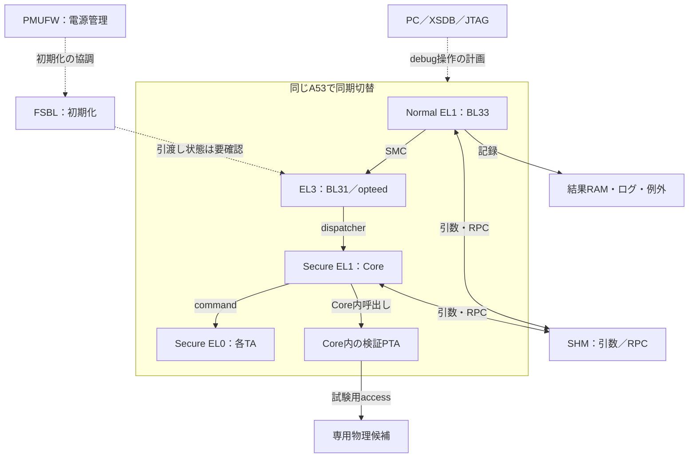

Joint Test Action Group（JTAG）はdebug接続方式。Xilinx Software Debugger（XSDB）はPC上の操作ツール。Power Management Unit Firmware（PMUFW）とFirst Stage Boot Loader（FSBL）の初期化は、試験本文の成否とは別に確認する。Trusted Firmware-A（TF-A）のBL31はEL3 monitor、OP-TEE CoreのBL32はSecure実行基盤、BL33はNormal側の試験開始点。

## 配置：ソフトウェア予約案

終端はexclusive（含まない）。map JSONとheader・linkerを照合した**案**であり、実機XMPU設定済みという意味ではない。

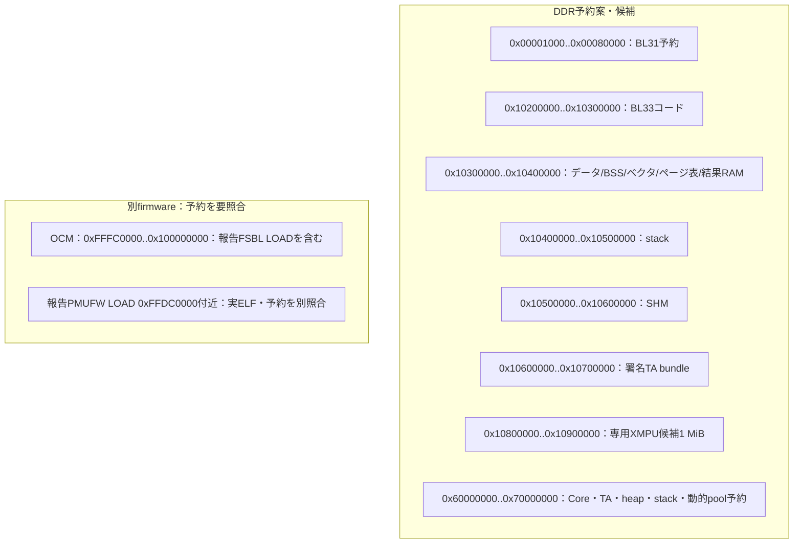

`platform/zcu106/b2/memory_map.json`、同`memory_map.h`、`linker_bl33.ld`が根拠。SHM内RPC arenaは0x10510000..0x105D0000、256 KiB×3slot。試験候補1 MiB、予約する検査buffer64 KiB、今回実accessするpage4 KiBは別の大きさ。結果RAMはシンボルで回収し、固定PAを手入力しない。BSS（Block Started by Symbol：初期値を持たない静的データ）・stack・page tablesもELFの実行時範囲へ含める。

### 起動と開始まで（実行計画、現ゲートでは未許可）

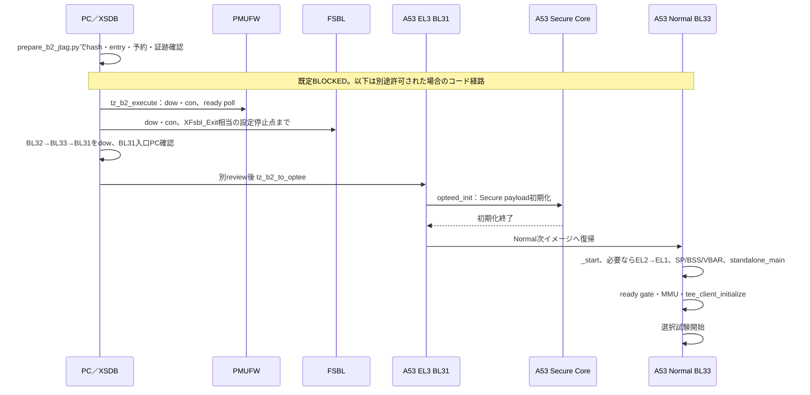

1. `scripts/build_zcu106.py`はSDK→TA-A/B→通常署名TAとbundle→Core→BL31→BL33を作る。ロードはしない。
2. `scripts/build_external.py:configured_plan`は`SPD=opteed`、BL31/32予約、`PRELOADED_BL33_BASE=0x10200000`を指定。Coreには`CFG_TZDRAM_*`と`CFG_SHMEM_*`を渡す。
3. `scripts/jtag/b2_boot.tcl:tz_b2_execute`は許可時にPMUFW ready待ち→FSBL停止→BL32/33/31配置で**BL31入口停止まで**。一度の関数で試験完了まで進めない。PMU readyのaddress/mask等は未確定入力である。
4. 外部sourceで照合したTF-A `bl31/bl31_main.c:bl31_main/bl31_prepare_next_image_entry`、`services/spd/opteed/opteed_main.c:opteed_setup/opteed_init/opteed_smc_handler`が担当する初期化とdispatcherへつながる。外部sourceはZIP_UNVERIFIED、移送物外。
5. `tfa_standalone/integration/start.S:_start`はEL2ならHCR_EL2を設定しEL1へERET、EL2状態を`debug_handoff`へ保存。EL1直接入口では`el2_known=0`のまま。その他ELは待機。入口がEL3という想定ではない。
6. `standalone_main`はEL1、`platform_prepare_tee_client`、transport初期化を確認して選択suiteを呼ぶ。ready=0は意図的な初期停止。FSBL Exit到達、BL31入口、Core初期化、BL33入口、試験開始は別の確認点。

## 共通仕様と読取り規約

本書の`tests/xxx.c`は`optee_standalone/tests/xxx.c`、`ta/xxx.c`は`optee_standalone/ta/xxx.c`、`client/xxx.c`は`optee_standalone/client/xxx.c`、`pta/xxx.c`は`optee_standalone/pta/xxx.c`。`review.c`の親statusと`functional.c`の子statusを分ける。

- `tee_reply`のtransportは自作通信の状態、resultはCore/TAの結果、originは発生層。通信成功0とTEE_SUCCESS=0は別field。origin=3はCore、4はTAサービス側の戻りであり、PTAもこの形で返る場合がある。
- エラー値：ACCESS_DENIED=0xFFFF0001、BAD_PARAMETERS=0xFFFF0006、ITEM_NOT_FOUND=0xFFFF0008、SECURITY=0xFFFF000F、TARGET_DEAD=0xFFFF3024。期待値だけでなくtransport/origin/非改変/継続を確認する箇所を各仕様へ記す。
- `functional.c:b2_run_functional_suite`は選択された子だけを実行。前後のactive session数を確認。保存は`test_report`→`common/test_runner/runner.c`→`b2_save_report`。重複report、ID不一致、記録overflow、後始末不備は正常完了にしない。
- 全試験共通の前提：対応Core・TA・BL33/profile、固有run ID、EL1/handoff、SHM/cache契約、安全gateの別review。実機は未実施。試験準備のOpenが使えなければ多くの子はBLOCKED、Open後の比較違いはFAIL。関数ごとの条件を以下で優先する。
- 通常の初期化/試験ではprintf互換の`log_printf`を使う。出力はBL33 RAMログで、外部TF-A/Core/TAの詳細traceを吸い上げるものではない。

## 1. TZ-SYS-01-V01：NormalとSecureの正常実行

**入力・準備**：同じTA-Aへ2 sessionをOpen。ECHO入力は0x45A7。親1は子TEE-01を選ぶ。

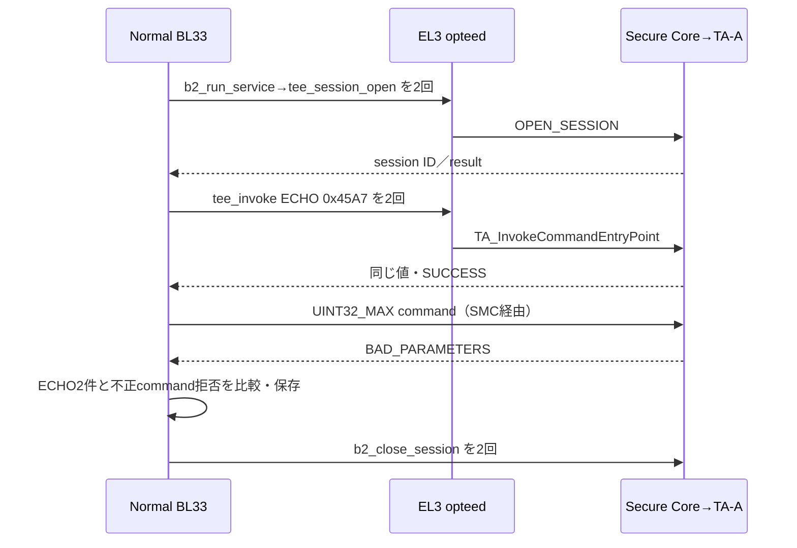

1. `functional.c:b2_run_service`で両Openのtransport/resultが成功か確認。失敗時はBLOCKED。
2. 各ECHOはtransport=OK、result=SUCCESS、value=入力が必要。未知commandはtransport=OK、result=BAD_PARAMETERSが必要（この子の判定はorigin固定を要求しない）。
3. 3個のboolを`b2_check_value`へ保存し、全部一致なら子PASS。`review.c:inherit`が選択済み・report1回・overflowなしの子statusを親へ引き継ぐ。
4. 両sessionをClose。子PASSの表示後でもClose不備は全体cleanup_errorsになる。両Worldの指定処理を確認するが、秘密物理領域は触らない。

観測：`b2_results.cases[0]`、親`b2_review_results.items[0]`、RAM `REPLY/CHECK`。出力例（模式、実測ではない）：`CHECK first-echo expected=0x1 actual=0x1`。1は「通信・結果・値の複合条件が成立」のboolで、ECHO値そのものではない。

## 2. TZ-SYS-02-V01：呼出しと復帰

入力・準備・後始末は前節のTEE-01と同じ。重複して別の物理試験を作ってはいない。

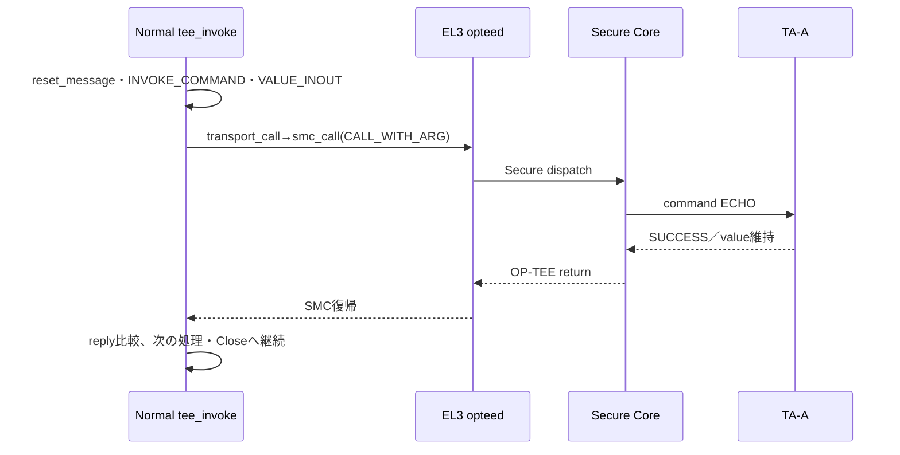

1. `client.c:transport_call`はSHMへ書いたmessageをDSB後にSMCで渡す。
2. `tee_session_open/tee_invoke/tee_session_close`はSMCのx0だけでなくmessage result/originを返す。通常のEarly TA呼出しではRPCを無条件に許可しない。
3. 親2はTEE-01が正常に報告・継続できたことを継承。`b2_review_results.items[1]`で確認する。未知のRPCが出ればtransport_poisonedとして再利用を避ける。
4. 出力の`transport=0 result=0x00000000`は「通信成功＋TEE処理成功」。SMC復帰だけで全状態保存の証明としない。

補助子`B2-SMCCC-01`（`extended_tests.c:b2_run_standard_versions`）は`all`/review全体で実行される。SMCCC（SMC Calling Convention：SMC引数・保存規約）とPSCI（Power State Coordination Interface：電源管理サービス）のVERSIONだけをSMCで問い合わせ、SMCCC=0x10000..0x10007、PSCI=2..0x10003の範囲を比較する。sessionやTAを使わず、物理保護・電源制御を試さない。親1/2の継承元はあくまでTEE-01で、この補助子を独立した22個目の親へ増やさない。

## 3. TZ-SYS-02-V02：256回の状態保持

**準備**：`review.c:run_state_retention`がTA-A/Bを各1 session開く。seed=0x59E1A273、input=seed xor(i×0x10201)、i=0..255。Normal volatile変数、x19..x29/SP、SCTLR_EL1/TTBR0_EL1/TCR_EL1/DAIFとTA secret tagを保持対象にする。

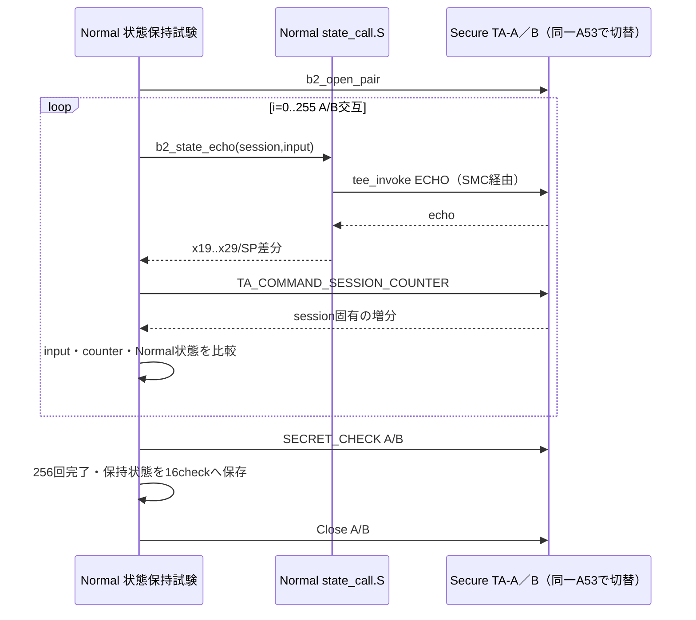

1. 毎回ECHO成功/一致、counter=i/2+1、Normal状態=seed xor i、callee-saved差分0を確認。途中違いで反復を止める。
2. 完了後は各session128増分、register errors=0、4個のEL1状態同値、A/B tag、最終input/counter/Normal値、transport/resultとTA origin=4も照合する。
3. Open不能はBLOCKED。比較又はClose失敗はFAIL。保存先は親items[2]。出力例`REVIEW TZ-SYS-02-V02 iterations expected=0x100 actual=0x100`（模式）。
4. x0..x18、NZCVはABI上保持前提にしない。SIMDを使わないbuildでありSIMD保存の試験ではない。256回を超える期間の保証にしない。

## 4. TZ-SYS-03-V01：Normal→Secure物理保護（条件待ち）

### 前提・準備

- selection15（`--test TZ-SYS-03`）のみ実probe。親reviewの本IDはBLOCKED記録のみ。
- `physical_dedicated=true`、Core physical PTA、`CFG_TZ_PHYSICAL_FIXED_BASE`とBL33許可範囲が一致。候補1 MiB=0x10800000..0x10900000、buffer64 KiB、その先頭4 KiBを使用。通常allocator版のcodeもあるが、XMPU変更対象を稼働Core/TA領域へ置き換えない。
- B2_PHYS_REVIEWEDは現状0。EL1、EL2状態が既知、HCR Stage2=0、111版と互換の39bit/4KiB page tables/MAIR、未使用root slotを要求。
- 公式仕様と実機で経路・master/mask・lock・priority/default・poison・全実行時予約・他master停止・復旧を確認する。これらが不足する間は設定しない。

### PC計画と限定設定：試験本文とは別の副作用

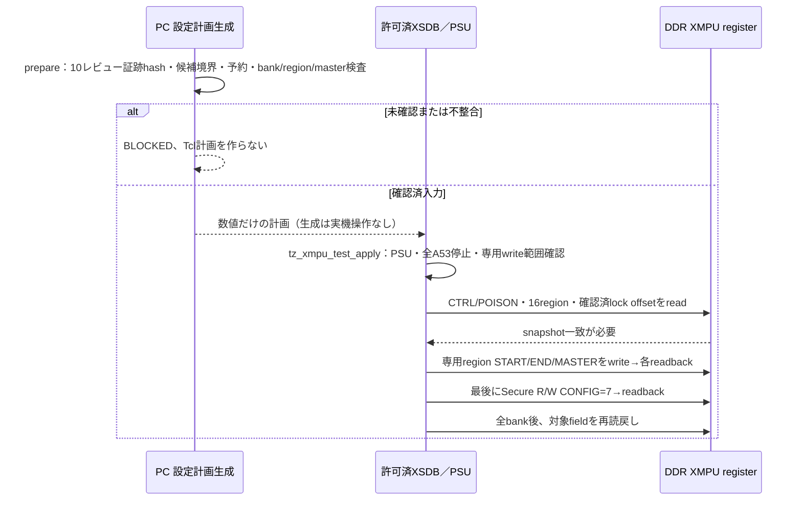

1. `config/xmpu_test.example.json`をlocal入力へコピー。reviewsのroute/master/lock/boundary/runtime_reservations/poison/priority/other_masters/secure_mmio/recoveryごとに確認内容のファイル、SHA-256、confirmedを記入。ファイル内容の真偽は人のレビューで、hashは内容を固定するだけ。
2. banksに経路全bankを指定。baseは既知6基のみ、region0..15、master ID/maskは10bit。各bankに実測CTRL/POISON、16個のregion配列 `[START,END,MASTER,CONFIG]` と`lock_checks`（offset/expected/official_reference）を記入。未知のlock offset/解除値を推定しない。
3. `prepare_xmpu_test.py:prepare`は1MiB/専用範囲/既定予約、disabled対象、他enabled regionとの重複を検査。CTRLのalignment/poison経路条件とPOISON属性も要求する。CTRL=0xB報告だけでは入力を完成させられない。
4. 実XSDB未検証。Tclは許可token、PSU、全4 A53のstate=Stoppedを要求。state属性がない版はBLOCKED。pre-readのどれかが変われば書込みゼロ。START/END/MASTER/CONFIGの4field×対象bankだけを書く。CTRL/POISON/lockを変更しない。
5. 書込み途中に失敗したら部分logを残して停止。複数bank変更はatomicでなく、自動rollback/無条件resumeなし。review済み復旧が必要。設定読戻し成功は**APPLIED_READBACK_ONLY**であり、物理保護PASSではない。

```bash
python3 scripts/prepare_xmpu_test.py --input config/xmpu.local.json --output results/xmpu-plan.tcl
```

```tcl
# sourceは定義だけ。以下のapplyは書込み副作用あり、現段階では実行しない。
source scripts/jtag/xmpu_test.tcl
source results/xmpu-plan.tcl
# tz_xmpu_test_apply $tz_xmpu_plan /path/to/new-apply.txt REVIEWED_DEDICATED_XMPU_WRITE
```

### probe本文と限定例外復帰

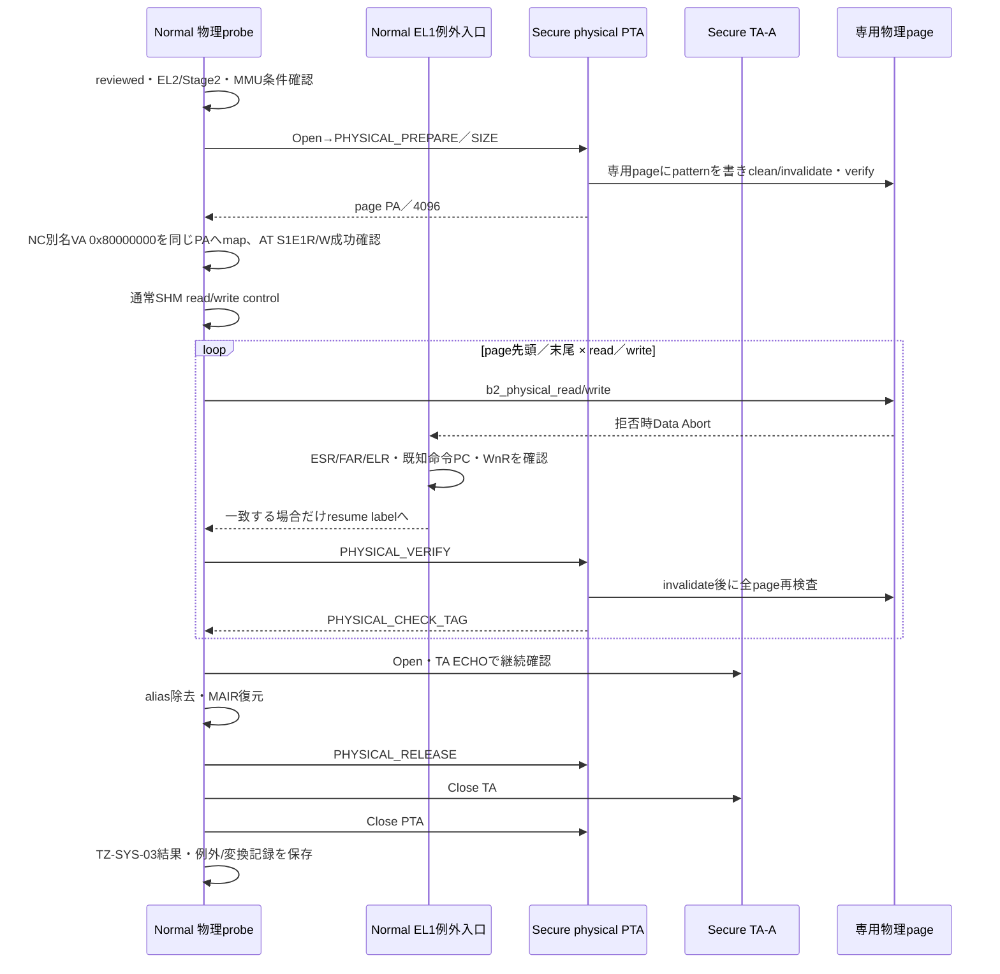

1. `physical_memory.c:b2_run_physical_memory`はCurrentEL/SCTLR/TCR/TTBR0/MAIR、handoffのHCR/VTTBR/VTCRを保存。ゲート又はEL2確認が不足ならBLOCKED。
2. PTAが返すPAを許可予約内・4KiB整列で検査。Normal仮想別名へNormal Non-cacheableのpage descriptorを作り、ATでread/writeとも同じPAになることを確認。単なる未mapをアクセス拒否の証拠にしない。
3. 4回（先頭read/write、末尾read/write）のみを試す。`b2_handle_phys_fault`はactive attempt、FAR、ELR既知命令、WnR、EC=0x25、SCTLR不変等に一致した場合だけ復帰先を返す。予期しない例外は致命的処理へ。
4. `physical_policy.c:b2_classify_physical_abort`はtranslation=1、permission=2、同期external abort（DFSC=0x10、S1PTW/FnVなし）=3、他=4。分類3以外は物理保護PASSにしない。readがpatternを返せばFAIL。faultなしでも原因不明のpoison値ならBLOCKED。
5. 毎回Secure側invalidate後全pageのpattern非改変を確認。最後にNormal controlとTA ECHO継続を確認。変更又は継続失敗はFAIL。
6. cleanupでalias/TLB/MAIRを戻し、pageをzero/release、sessionをClose。保存先`b2_physical_record`と子`b2_results.cases[13]`。このrecordのstate=COMPLETEだけではPASSでなく、子statusとdecoderの全証拠検査が必要。

出力例（模式）：`CHECK precise-external-abort expected=0x3 actual=0x1`なら**MMU由来translation fault**で物理保護はBLOCKED。分類3＋非改変でも、XMPU帰属は別途register/経路/違反情報と照合する。XMPU全境界のaccess試験は実装していない。

## 5. TZ-SYS-03-V02：SHM入力の許否と非改変

準備：A/B session、SHM内16byte（0x50+i）。子TEE-SHM-01／TEE-BOUNDARY-01／TEE-PARAM-01。

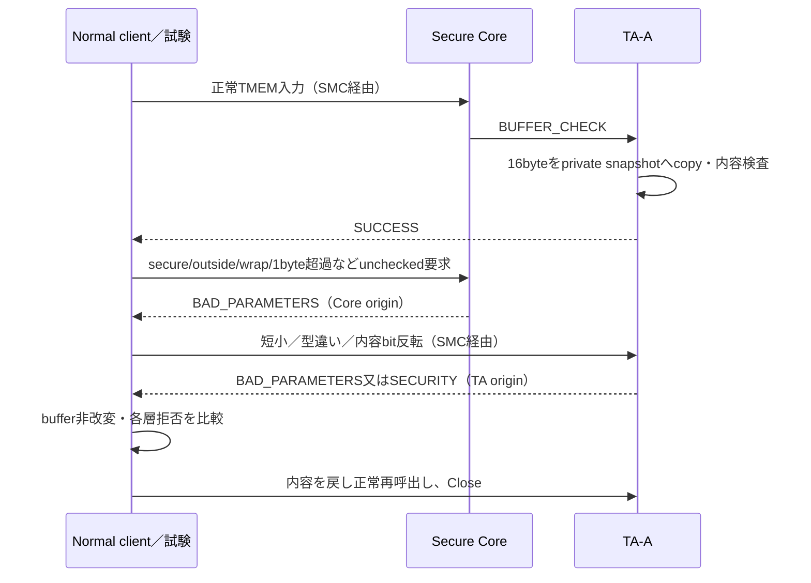

1. `test_shared_memory`は正規16byte成功、15byteはTA originのBAD_PARAMETERS、範囲外/secure指定/整数wrapはCore originのBAD_PARAMETERSを要求。安全wrapperのSecure範囲指定はローカルSHM_UNAVAILABLEも要求。最後の正常再呼出しとbuffer全byte不変を確認。
2. `b2_run_shared_boundaries`は末尾ぴったりの16byte成功、1byte超過と長さ0はBAD_PARAMETERS、message領域との重複はclient拒否、再呼出し成功・非改変を確認。この関数では全拒否のoriginを固定比較していない。
3. `b2_run_parameter_validation`はCoreが受ける属性でもTAが期待する型でなければTA originのBAD_PARAMETERS、内容bit反転ではSECURITY（TA origin）、拒否後の入力非改変、復元後成功、BのECHO継続を要求。
4. 比較不一致はFAIL。Open不可はBLOCKED。両sessionをClose。親items[4]は3子すべてのreportを継承。

出力例：`REPLY secure transport=0 result=0xffff0006 origin=3`（模式）は「メッセージ内の指定PAをCoreが拒否」。**Normal CPUがそのPAを直接loadして拒否された証拠ではない。** `parameter_validation-predicates=1`は上記複合条件の全一致。

## 6. EXT-AUTH-V01：固定tokenとTA identityの認可

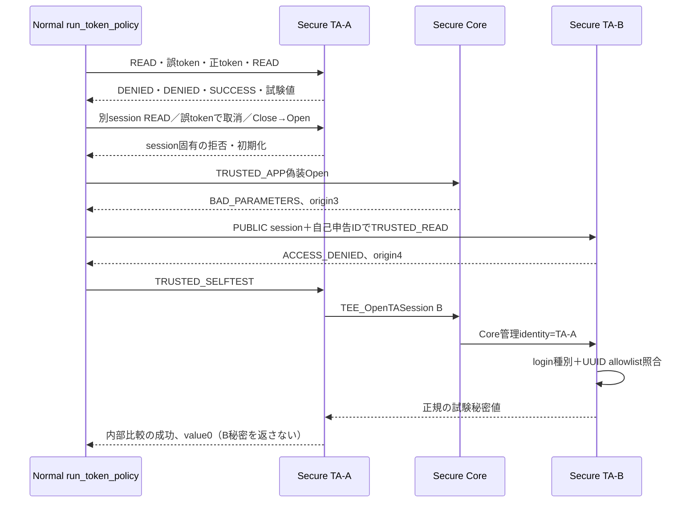

1. `run_token_policy`はTA-Aの2sessionを所有。許可前/誤token/別session/取消後/再Open後READのACCESS_DENIED、許可時READ=TA_PRIVATE_VALUEを検査する。拒否replyのtransport=OK/origin4も要求。Close後client BAD_STATEを確認。
2. `security_tests.c:test_identity`はCoreへのTRUSTED_APP偽装Open拒否、BのPUBLIC/自己申告ID拒否、AからBへの正規TA session成功、B継続を照合する。
3. `ta/security.c:trusted_read`は`gpd.client.identity`からCore管理identityを取得し、TRUSTED_APP＋AのUUIDだけ許可。要求parameterのIDを信用しない。
4. 親は上記token全比較と子TEE-AUTH-TA PASSを必要とし、Close不備も失敗。Open不足はBLOCKED。保存先親items[9]と子cases[2]。

出力例：`REVIEW EXT-AUTH-V01 other-session-denied expected=0xffff0001 actual=0xffff0001`（模式）。これは認可状態の隔離であり、固定tokenを知るNormalプログラムの本人認証ではない。

## 7. EXT-KEY-V01：鍵APIと暗号結果

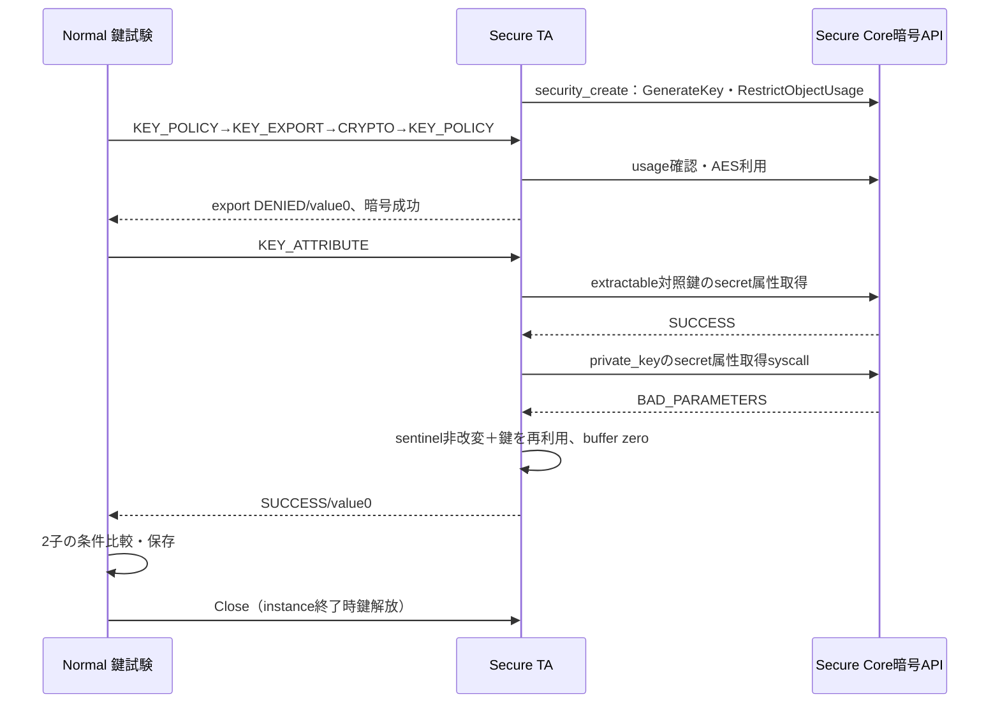

1. `security_create`はAES128を生成しENCRYPT/DECRYPTだけへusage制限。`key_policy_test`がEXTRACTABLE bitなしと暗号利用を確認。
2. 子TEE-KEY-APIのexportは**自作command**がACCESS_DENIED/value0を返す検査。その前後に鍵使用とCRYPTO成功を確認する。
3. 別子TEE-KEY-ATTR-01は`key_attribute_test`でCore syscall `_utee_cryp_obj_get_attr`を実際に通す。対照鍵は取得成功し、private_keyはBAD_PARAMETERS、0xA5 buffer全byte不変、鍵は使用可能でなければ失敗。Normalにはsecretを返さない。
4. `ta.c:run_crypto_test`は生成した別の鍵でAES暗号→復号の往復、別のゼロ既知鍵/ゼロ平文でAES-ECB既知結果`66e94bd4ef8a2c3b884cfa59ca342b2e`を比較。operation/objectを解放し一時bufferをzero。
5. 親はAPIと属性の両子PASS。準備Open不可はBLOCKED、各拒否/暗号/非改変の不一致はFAIL、session Closeを確認。鍵の削除/再生成反復はEXT-TA-V02のKEY_CYCLEにも含む。

観測：子cases[4]/[12]と親items[10]。例`key_attributes-predicates expected=0x1 actual=0x1`はCore対照成功・拒否・非改変・利用継続をまとめたbool。exportコマンド拒否だけをCore属性検証や生メモリ抽出耐性として説明しない。

## 8. EXT-TA-V01：呼出し・ABI・session状態

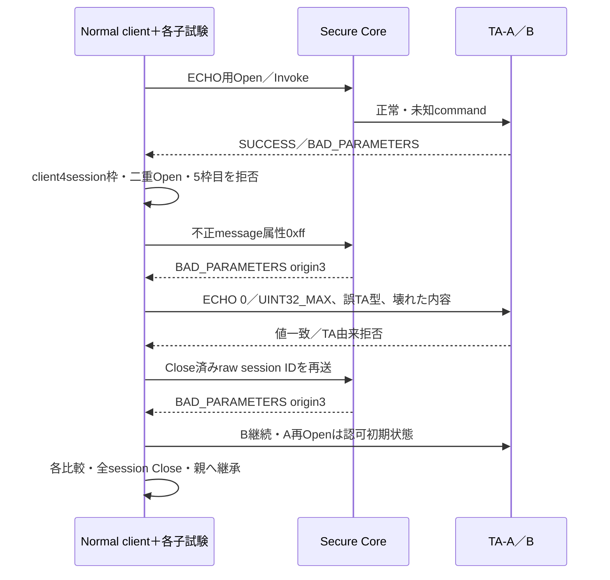

1. parent12の子はTEE-01、TEE-SESSION-01、TEE-ABI-01、TEE-SESSION-CORE-01、TEE-PARAM-01。共有境界子を全部ここへ自動追加するわけではない。
2. `b2_run_session_limits`はclient4枠の正常Open、5枠目/二重OpenはローカルBAD_STATE、全Close、再Close/閉handle Invoke拒否、active0を要求。Core全体の上限4とは言わない。
3. `b2_run_message_abi`は不正属性0xFFをCore origin3、未知commandをTA origin4のBAD_PARAMETERSとして区別し、u32両端ECHOの一致を確認。
4. `b2_run_closed_core_session`は一旦Closeした**生ID**をCoreへ送ってBAD_PARAMETERS/origin3を要求し、他TA継続・再Open後未認可READ拒否を確認。clientの閉handle拒否とは別。
5. 全子reportの継承、必要sessionのcleanup、親items[11]を確認。例`closed_core_session-predicates=1`はraw ID拒否だけでなくB継続と再Open初期化の複合一致。違えばFAIL、必要sessionが開けなければ該当子BLOCKED。

## 9. EXT-TA-V02：TA VM分離、panic復旧、Core補足、反復

### TA間のread/write fault

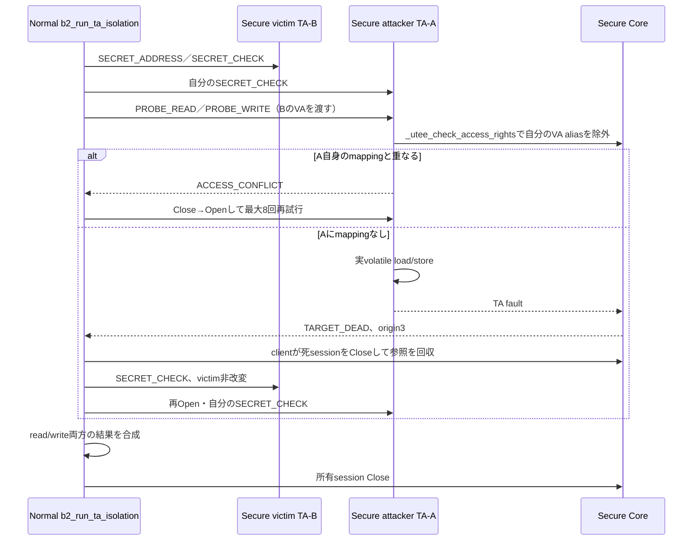

1. BのVAはBの仮想アドレスで、Normal/Secure物理PAではない。AのVA空間からその数値へ実accessする。前提としてA/Bのtagが正しいことを確認。
2. 自分のmappingに重なる場合をACCESS_CONFLICTとして避ける。8回残ればBLOCKED。Core origin3のTARGET_DEAD、attacker handle閉鎖、B tag不変、A再生成/tag正常が揃ってPASS。faultだけではPASSにしない。
3. 子TEE-ISO-TAはread/writeのどちらかFAILならFAIL、そうでなくBLOCKEDがあればBLOCKED。観測はcases[5]のread-probe-status/write-probe-statusとログ。TA-Aの意図したfaultとCore/BL33の予期しないfatalを区別する。

### panic、Core canary、資源の後始末

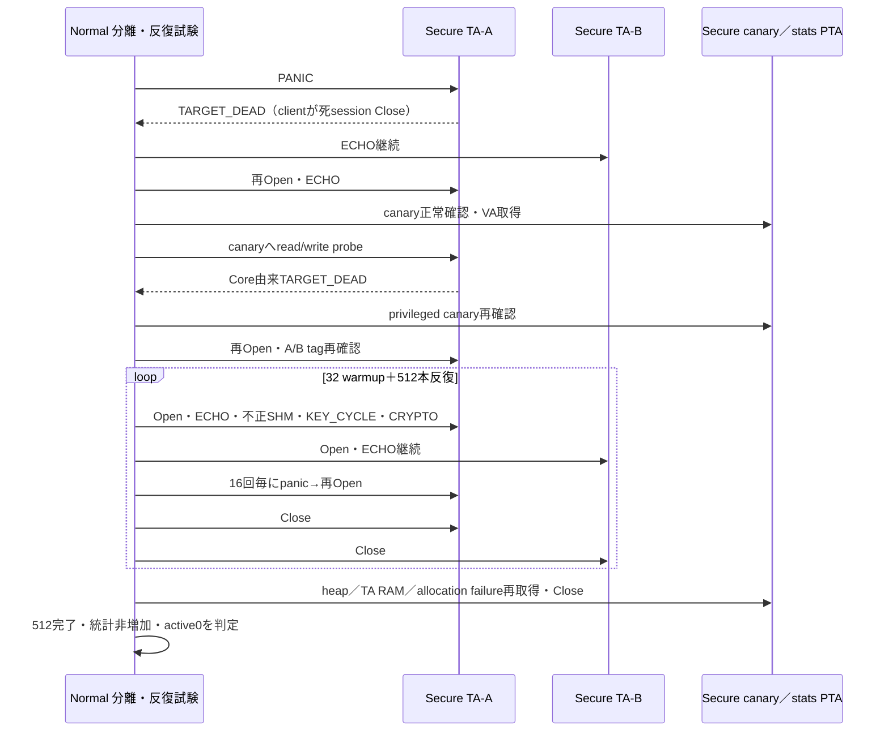

4. 子TEE-07はpanicのTARGET_DEAD、B ECHO、A再Open/ECHOを検査。TA panic時も`client.c:tee_invoke`がCoreのsessionをCloseする。
5. `review.c:supplement_isolation`はB2_VALIDATION_PTA=1を要求。`b2_probe_core_isolation`で専用Core canaryへのread/write fault、privileged側非改変、A再生成とA/B tagを確認。これは明示overlay入りCoreの補足で、製品Core通常構成の結果と混同しない。
6. `stress_tests.c:run_stress_tests`は32 warmup後のheap/TA RAM/失敗数を基準に512回を実施。各回はA/B Open、ECHO、不正SHM拒否後B継続、鍵削除/再生成・暗号、16回毎panic/復旧、両Close。統計session1個だけが残ることを毎回確認し、最後は0。
7. 本反復512回完了、heap/TA使用量が基準以下、allocation failure増加なし、stats Closeを要求。PTAを開けなければBLOCKED、反復/比較/cleanup失敗はFAIL。親items[12]と`b2_stress_results`を見る。報告数値の範囲での資源安定性であり、無期限リーク不存在とは言わない。

例（模式）：`REVIEW EXT-TA-V02 stress-completed expected=0x200 actual=0x200`に加え、Core-canary-status／resource-stress-status、cleanupを確認する。TA VM分離の子PASSだけではこの親の全補足PASSにならない。

## 10. EXT-TA-V03：通常署名TAの実行時ロード

### 準備・正常経路

専用UUID `6dc1341c-534f-4642-9138-215876304910`。Early TA-A/Bと異なりCoreへ埋め込まない。`ta_signed/user_ta_header_defines.h`でKEEP_ALIVE/SINGLE_INSTANCEなし、Close後にinstanceを保持しない。SDKとOP-TEE公式署名処理で正常/別鍵TAを作り、署名対象payloadの改変版を作る。秘密鍵/生成TA/bundleは資料・Git入力ではなくbuild出力として別保管する。

Core profileは`CFG_REE_FS_TA=y`、`CFG_REE_FS_TA_BUFFERED=n`、`CFG_PREALLOC_RPC_CACHE=n`、明示test公開鍵、監査PTA。REE/RPMB Storageは無効のまま。RAM受渡しがあるのでREE TAローダ使用にLinux/ファイルシステムは必須でないが、フルRPC backendの代用ではない。

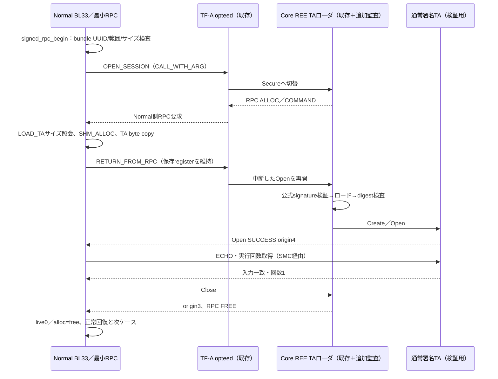

1. Normal bundle=0x10600000..0x10700000、RPC arena=SHM内0x10510000..0x105D0000。別用途。実行中にJTAG等からbundleを変更しない。署名profileではBL33 mappingはRO/XNだが、他masterからの不変性は別途管理。
2. `signed_rpc_begin`はheader/version/UUID、3imageの範囲・重複・各上限256KiBを検査。hash自体の比較はこのC関数ではなくPC decoderで行う。
3. `signed_rpc_call`はSMC RPC機能ALLOC(0)/FREE(2)/COMMAND(5)、command LOAD_TA(0)/SHM_ALLOC(6)/SHM_FREE(7)だけを扱う。RETURN_FROM_RPC=0x32000003で再開。LOAD_TAだけの実装ではない。
4. 3slotのcookie/種別/使用範囲を検査、解放時zero。1呼出し128step制限。不明RPCはunsupported/poisonedを記録し継続再利用しない。通常Early TA通信のRPC拒否を一括解除しない。

### 8ケースと拒否層

|子case|入力|Open期待result/origin|必要な実行・拒否証拠|
|---|---|---|---|
|0|正常署名TA|SUCCESS/4|実ロードquery/copy、ECHO、count1、Close、live0|
|1|同形式のpayload改変|SECURITY/3|signature成功、digest拒否。Invoke0|
|2|正常回復|SUCCESS/4|別fresh instance、ECHO/count1、Close|
|3|別鍵署名|SECURITY/3|signature拒否、digest未到達。Invoke0|
|4|正常回復|SUCCESS/4|fresh instance＋後始末|
|5|未登録UUID|ITEM_NOT_FOUND/3|Normal受渡しで拒否、copy0、Invoke0。署名試験ではない|
|6|申告size=0x40001|BAD_PARAMETERS/3|Normal受渡しで上限拒否、copy0、Invoke0。署名試験ではない|
|7|正常回復|SUCCESS/4|fresh instance＋後始末|

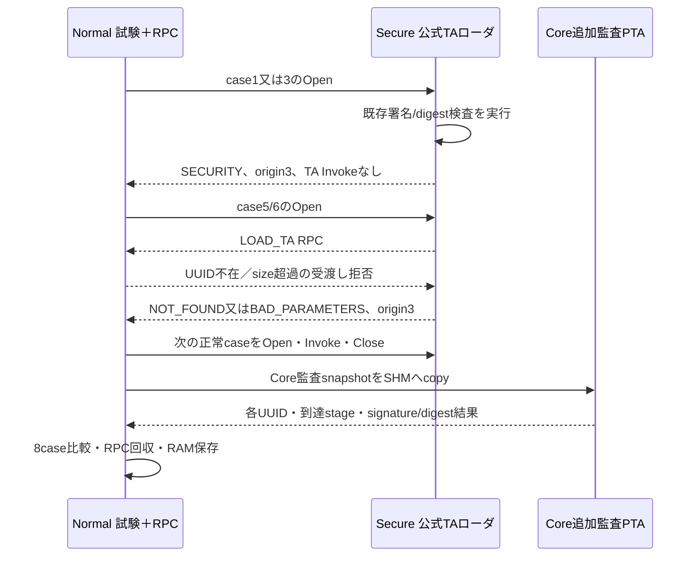

5. `signed_ta_tests.c:b2_run_signed_ta`は各caseのtransport/result/origin、正常時ECHO=0x7E168AC1・count1・Close、異常時Invoke0、query/copy又はlocal refusal、live0、allocations=frees、unsupported0を比較。
6. 監査snapshotが取得できない、unsupported、poisonedならBLOCKED。bundle/profile不足もBLOCKED。比較・cleanup不一致はFAIL。ただしC判定はCore stageの全flagを解釈せず、監査取得成功まで。**PC検証まで行って初めて拒否段階の証拠が揃う。**
7. `decode_signed_results.py:decode_signed`はbundleの各image SHA-256、run/8case、実ロードquery/copy、ECHO/fresh count、Close、RPC回収に加え、Core UUID順・stage flagを照合。正常flags127、改変95かつsignature0/digest SECURITY、別鍵71かつsignature SECURITY/digest未到達0xFFFFFFFF。不在/超過はflags1だけを要求し、署名拒否と区別。
8. 監査entriesはfresh runでちょうど8を要求。再実行時はCoreの古い監査を使い回さない。収録Core/BL33/bundle/hashの対応をPC回収計画で確認。ホストでの署名検査だけをこの実ロード成功の代替にしない。

出力例（模式）：`SIGNED_CASE 1 expected=0xffff000f actual=0xffff000f origin=3 invokes=0 ...`だけではdigest拒否の確定ではない。PC txt内`SIGNED LOADER`の`core_signature=0`と`core_digest=0xffff000f`、image hash、8case完了も確認する。

## 11. PERF-01：fast SMC往復

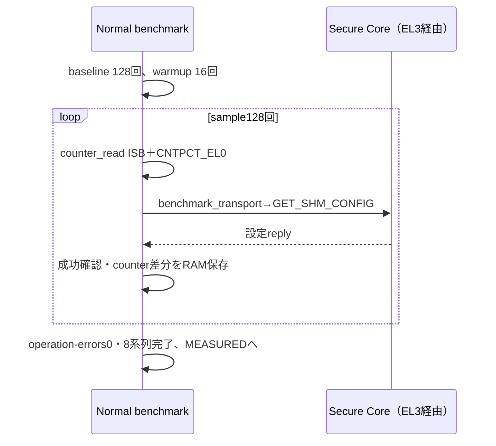

入力sessionは`b2_run_performance`がTA-AをOpenするが、この系列本文はTA Invokeでなく`tee_client_probe_configuration`のfast SMC。返却SHM/cacheが正しいことも確認する。その関数呼出し/比較を含む往復区間であり、純粋なWorld switch命令だけの時間ではない。終了時sessionをClose。親items[16]と`b2_bench_results.series[0]`へ保存。

出力例（模式）：`SAMPLE PERF-01 0 <ticks>`。0はsample番号、ticksは上記全往復区間。PC側親statusは`MEASURED`で、ticksが小さいことをPASSにしない。

## 12. PERF-02：Normal SHM store

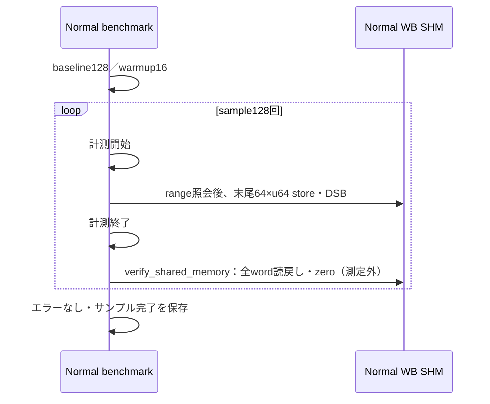

操作する512byteはmessage領域から4KiB以上離れていることを確認。期待値はword=i、比較不一致はbenchmark_failed。scopeはNormal WBで、Secure側やDDR帯域全体でない。親items[17]、series[1]。SHM非改変試験とは異なり、この測定は意図したstoreと後のzeroを行う。

出力例（模式）：`SAMPLE PERF-02 0 <ticks>`。測定外の読戻し失敗があれば、sampleがあってもoperation errorsで測定完了としない。

## 13. PERF-05：TA・暗号・session・復旧6系列

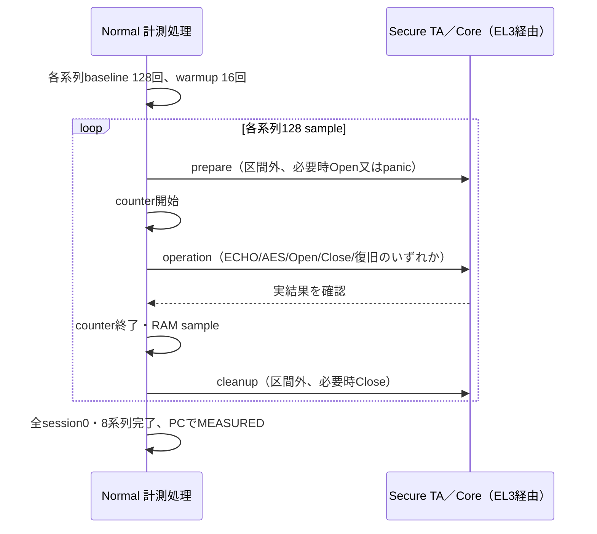

|詳細系列→親PERF-05|区間|除外/注意|
|---|---|---|
|PERF-05|ECHO Invoke、message/SMC/結果確認込み|TA本文だけではない|
|PERF-06|CRYPTO command：鍵生成往復＋別鍵AES既知解|AES一blockのprimitive時間だけではない|
|PERF-08|既存TA instanceがある状態のOpen|測定外Close|
|PERF-09|Open済sessionのClose|測定外Open、他sessionは残る|
|PERF-10|PANIC診断＋TA再Open＋ECHO|準備Open/最終Closeは外。Core/TA診断時間は内|
|PERF-11|TARGET_DEAD観測後の再Open＋ECHO|準備のpanicと最終Closeは外|

共通観測は`b2_bench_results`にcounter=CNTPCT_EL0、CNTFRQ、SCTLR_EL1、DAIF、interval、16 warmup、128 sample、128 baseline。`analyze_benchmarks.py:summarize`でmin/max/mean/median/nearest-rank p95/p99。単位ticks、秒はticks/timer_hz。CPU周波数UNKNOWN。baselineを勝手に引かない。

失敗はreply不一致、active session残り、8系列未完了、RAM record不備。親PERF-01/02/05は共通8系列count8/errors0/state2を判定し、速度閾値は持たない。PCは生PASSをMEASUREDへ表記する。本版のRAMログはrun開始時に保存したSCTLRのM（bit0）/C（bit2）/I（bit12）から`mmu/cache/icache`をon/off表示する。cacheはD-cacheを意味する。採取記録のmagic/version/state/runが有効でなければUNKNOWN。SCTLR生値と`state_source=run-start-SCTLR_EL1`も併記し、各sample時点で再採取した値と混同しない。sample後のprintfは直接測定区間外でもcache等への間接影響はある。breakpointを測定中に入れた値を性能証拠にしない。

出力例（模式）：`SAMPLE PERF-10 0 <ticks>`はpanic診断込みの復旧区間。`PERF-11`と同じ時間を測ったとは扱わない。txtのBENCHMARKS内のparent_id=PERF-05/series_id/interval、sampleとoverheadの統計、errors/stateを読む。

## 今回対象外8項目：実装図を作らない

|親ID|現版の実動作|移送にない/不足する構成|
|---|---|---|
|TZ-SYS-04-V01|reviewでSKIP|周辺機器保護/XPPU操作backend、対象所有権|
|TZ-SYS-05-V01|reviewでSKIP|DMA転送と保護経路backend|
|TZ-SYS-06-V01|run_secure_sgiでBLOCKED|SGI PTA、ZCU登録/配送経路。codeは発行前に戻る|
|TZ-SYS-07-V01|reviewでSKIP|debug認証/制限の実機構成|
|EXT-BOOT-V01|reviewでSKIP|認証付きbootチェーン|
|EXT-STORE-V01|reviewでSKIP|REE/RPMB Storageと必要RPC backend|
|PERF-03|run_secure_sgiでBLOCKED|割込み計測PTA。通常8系列とは別で未測定|
|PERF-04|reviewでSKIP|DMA転送性能backend|

どれも今回方針による除外で、実現不能という判定ではない。レビュー表の行やBLOCKED/SKIP保存があることを試験backend実装ありと解釈しない。

## 結果RAM・txt・CSVの共通仕様

|保存先symbol|用途・検査|
|---|---|
|b2_results|version3、run ID、selection、15子のselected/status/phase/reported/check/overflow、cleanup_errors|
|b2_review_results|version2、21親status/reason/最大16check。parent単独の未選択はNOT_RUN|
|debug_ram_log|version1、capacity/used/dropped、run ID、RUNNING/COMPLETE/FATAL。B2容量128KiB|
|debug_boot / debug_handoff|起動stage/stop_reason/run ID、EL2既知/HCR/VTTBR/VTCR|
|debug_exception / debug_sync_exception|Cより前に保存するEL・vector・ESR/FAR/ELR/SPSR/SP/GPR。fatalと想定probeを分ける|
|b2_physical_record|専用PA/VA、変換状態、4attemptのPAR/ESR/FAR/ELR/分類|
|b2_signed_audit / b2_signed_loader_snapshot / b2_signed_snapshot_status|Normal RPC記録とCoreからコピーした監査。Core trace全体ではない|
|b2_bench_results / b2_stress_results|測定8系列・baselineと反復資源記録|

状態：test enum PASS0/FAIL1/SKIP2/BLOCKED3/NOT_RUN4。phaseはIDLE0/PREPARE1/OPERATE2/EXPECTED_FAULT3/COMPARE4/SAVE5/CLEANUP6/DONE7。B2 stateはRUNNING1/COMPLETE2/ERROR3であり、数値0を全て成功と解釈しない。

回収の順番：

1. 実際に使用するBL33/Coreから`prepare_signed_capture.py --elf ... --core ... --output results/capture.tcl`をPCで生成する。通常symbol回収だけなら`prepare_jtag_capture.py`も使える。出力JSONを保存し、使用ELF/hashと手元実機ロードの対応を人が確認。
2. 許可された停止状態のXSDBで`capture.tcl`と生成Tclをsourceし`tz_dump`を実行する。これはRAM readで、`tz_stop_for_capture`は別の停止副作用。保存先は必ず新規directory。実XSDB操作はNOT_RUN。
3. `decode_b2_results.py`でb2_results.bin、debug_ram_log.bin、BL33/Core ELF、capture.json、run IDを対応付けてtxt/JSON/CSVへ変換する。署名profileはbundle/監査、review/performanceは追加RAMのbinも同directoryに必要。
4. 入力欠落、format/version、run/ELF/選択不一致、古いRAM、log dropped、未完了、cleanup不備を検出する。`COMPLETE`は全試験PASSではない。txt内status/expected/actual/拒否層を読む。
5. decoder終了codeは証拠に添えるがcode0だけで全親成功としない。実装ではreview内BLOCKEDだけはexit2集計に含まれない場合がある。SGI等BLOCKED/SKIP行を直接確認する。署名監査不備はcollection INCOMPLETEとなり、PASS表現を抑止する。

```bash
python3 scripts/decode_b2_results.py results/raw/b2_results.bin --ram-log results/raw/debug_ram_log.bin --elf /path/to/optee_bl33.elf --core-elf /path/to/tee.elf --capture-plan results/capture.json --run-id 0x20261040 --output results/run.txt
```

`log_printf`は整数u/x/d（l/ll含む）、s/c/p/%%、幅指定32まで。浮動小数点/%n/動的確保なし。排他lockや再入保証はなく、同期単一client前提。libc/semihostingを追加していない。RAM完了時PoC（Point of Coherency：共有観測点）へcache clean＋DSBするが、JTAG APのPA経路・coherencyは実機確認が必要。途中停止のlogは完了証拠として扱わない。

## 外部仕様と今回照合の限界

図中のCore REEローダは別配置の`core/kernel/ree_fs_ta.c:ree_fs_ta_open/ree_fs_ta_read`、Core message入口は`core/tee/entry_std.c:entry_open_session`を照合。追加監査の挿入位置は`stage_signed_loader.py:apply`が使用版source断片を検査して適用する。署名検証や暗号は既存OP-TEEを使い、自作方式へ置換していない。実機ZIPとの版同一性・本番鍵・Secure Bootは確認していない。

XMPU定義の根拠はAMD UG1085第16章XMPUとUG1087 XMPU_DDRレジスタ群。今回オンライン照合できなかった詳細bit/lockは推定せず、実機入力作成前に使用版の公式資料で再確認する。資料例：[UG1085](https://docs.amd.com/v/u/en-US/ug1085-zynq-ultrascale-trm)、[UG1087 R02_START](https://docs.amd.com/r/en-US/ug1087-zynq-ultrascale-registers/R02_START-XMPU_DDR-Register)。GUI/XSDBのコマンドが当該Vitisで動くことをこのsource照合でPASSにしない。

### 本版の性能metadata表示例（形式例、実測ではない）

```text
BENCH_META PERF-01 counter=CNTPCT_EL0 timer_hz=<timer_hz> cpu_hz=unknown cache=on mmu=on icache=on sctlr_el1=<captured_value> state_source=run-start-SCTLR_EL1 irq=masked interval=<interval> warmup=16
```

M/C/Iの判定は、run開始時の`b2_bench_begin`で既に採取したSCTLRだけを使用する。metadata出力はwarmup後・sample計測前。未採取/非B2/古いrunでは`cache=UNKNOWN mmu=UNKNOWN icache=UNKNOWN state_source=UNKNOWN`とし、offと決め付けない。測定区間・callback順・cache設定そのものは変更していない。

### Mermaidの描画確認

本版の3資料を走査し、含まれる19図をMermaid 11.4.1（既存ローカルアプリ同梱版）でSVGへ描画し、PNG化して確認した。構成図のラベル幅、共有/記録矢印、物理probeのTA-A宛先とcleanup順を調整した。確認環境は互換DOM＋Pangoによる文字寸法＋librsvgで、Firefoxは実行環境の制限により起動できなかった。GitHub/Vitis等の各viewerと同一レイアウトを保証するものではない。図の意味は併記した番号付き説明でも追える。
