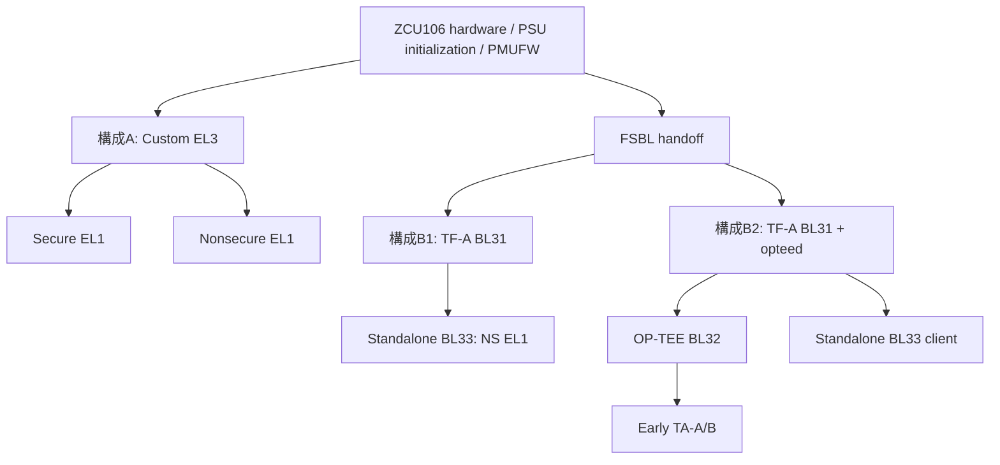

# ZCU106移植・起動準備（Phase 6）

全実機試験NOT_RUN。Vitis/実機/生成BSP/FSBL/PMUFWが未取得のため、準備資料と検査を整備した段階。`boot_plan.json` は未確定値をnull/falseに維持する。安全ゲートを無効化しない。

## 実機起動構成



A/B1/B2は別起動。AはTF-Aを含まない。JTAG直接loadでもPSU/DDR初期化が不要とは仮定しない。FSBLを使うAではFSBLのhandoff EL/securityと残留状態を確認する。B1/B2はBL31がEL3を所有し、自作EL3初期化を混ぜない。

|役割|配置・入口の確定方法|現在|
|---|---|---|
|FSBL|Vitis生成map、XSA PSU初期化、実ELF entry|未取得|
|PMUFW|PMU processorのmap、PMU viewからsystem addressへの変換|未取得|
|BL31|固定AMD TF-A ZynqMP ELFとOCM予約|生成済。entry0xfffea000。旧DDR予約案と不一致|
|BL32|ZCU106 portのCore ELF、effective CFG、TA RAM/heap/stack/SHM|未ビルド。QEMU用Coreを実機用としない|
|BL33|Standalone ELFとFSBL→TF-A handoffが指すentry/EL/security|暫定ELFのみ。handoff未照合|

詳細は [実ELF・配置表](zcu106_memory_phase6.md)。QEMU flash/FIPとZynqMP boot imageは別方式。未確認のBIFやdownload scriptを自動生成・実行しない。

## ロード前検査と証拠の収集

1. Vitisの内蔵ZCU106定義と生成物を [操作手順](vitis_2025_1_phase6.md) で取得する。
2. `platform/zcu106/boot_plan.json`を構成ごとに複製する。XSA、BSP map、live register snapshot、debug/boot reviewの実fileとSHA-256を記録する。
3. ELF path/hash/entryを記録し、FSBL/PMUFWを含むPT_LOADのruntime size（BSSを含む）を検査する。stack/heap/dynamicは別途reservedまたは根拠付きunusedとする。address translationも確認する。
4. MMIOは公式catalogの候補と現snapshotを照合する。master ID、NS属性、XMPU port、DMA channel、GIC経路はboardの実値を使う。
5. 次を実行し、全問題を解消する。現時点ではBLOCKEDが正しい結果でありREADYを得るためにフラグだけを変更しない。

```sh
python3 scripts/check_boot_plan.py --plan platform/zcu106/boot_plan.json --output results/phase6/boot-plan-check.json
make zcu106-prepare
python3 scripts/check_hardware_profile.py
```

新検査は既存map検査とprofileゲートを内包し、debug/boot証拠、MMIO候補、masterとruntime予約も検査する。profileゲートには未統合DMA/GICと例外帰属の停止条件が残る。したがって資料の空欄だけを埋めても実機起動可にはならない。

## 保護設定一覧

|対象|実装済み範囲|実機で必要な確認|
|---|---|---|
|DDR XMPU|1MiB窓/64KiB buffer分離、設定/readback/違反取得|全DDR port、master10bit ID/mask、default policy、優先順位、CTRL/POISON、lock、FSBL等との非重複|
|XPPU|20 profile照合、permission縮小、readback|対象周辺/aperture、parityを含む実profile、UART/JTAG/boot資源を巻き込まないこと|
|ZDMA|実simple-mode要求、完了/error/poll、内容照合adapter|ADMA/GDMAとchannel、NS属性、master→DDR XMPU経路、cache整合、排他利用、timeout後の回復|
|GIC-400|group0/1 SGI、priority、IAR/EOIR、任意EL1 vector|IIDR、SCR/DAIF/routing、Secure FIQのworld切替、2048-byte vector、状態保存、pending/activeなし|
|debug/boot|検査記録を要求|board boot mode、JTAG認可、FSBL停止点、初期EL/security、認証bootの有無|

register根拠とoffsetは [既存backend資料](zcu106_backends.md)、catalogは `platform/zcu106/mmio_catalog.json`。catalogへの包含は実際の保護経路やアクセス許可の証明ではない。eFUSE・不可逆な認証/デバッグ設定は変更しない。

## JTAGとUART

ゲート通過後に行う手順であり、今はdownload禁止。

1. board revisionの説明書でJTAG boot mode、電源・cable・USB UART接続を確認し、設定と写真/記録を保存する。switch番号やbaudを推測しない。
2. 2025.1 hw_server/XSDBまたはUnified IDEのtarget connectionを作り、targetsを一覧してPMUとA53#0を確認する。異なるCPUへloadしない。
3. UARTのdevice、baud、clock、stdin/stdout instanceをBSPとboard配線で確認してraw captureを開始する。例：`picocom -b <verified-baud> <verified-device> --logfile results/zcu106/<run>.log`。時刻、構成、全ELF hashを別metadataへ保存する。
4. 実boot手順に応じてPMUFWとFSBLを実行する。FSBLの完了は確認済みhandoff/exit breakpointで判定し、固定sleepで代用しない。[AMD 2025.1 XSDB例](https://docs.amd.com/r/2025.1-English/Vitis-Tutorials-Embedded-Software/Program-Hello-World-ELF-onto-Zynq-Ultrascale) はPMUFW→FSBL→appの流れを示すが、例のdebug可視化register書込みを無確認で転用しない。
5. AはSecure/NS payloadとcustom EL3を、B1/B2は各boot chainの配置とhandoffに従ってloadする。BL33を単独で開始してBL31/BL32初期化済みとしない。
6. 実PC/CurrentEL/SCR、VBAR、SP、ELF entry、MMU/cache、共有memory属性を確認してからrunする。UARTのRUN/RESULT/SUMMARY/ENDと例外情報を保存する。
7. 不正accessは通常の許可access確認後に行い、拒否の機構・新規違反・ESR/FAR・Secure側の非改変を同一runへ紐付ける。DMA errorや例外だけでPASSにしない。

[確認票](phase6_hardware_checklist.md)の未完了がなくなってから、実機結果をNOT_RUNから実測に基づいて更新する。
